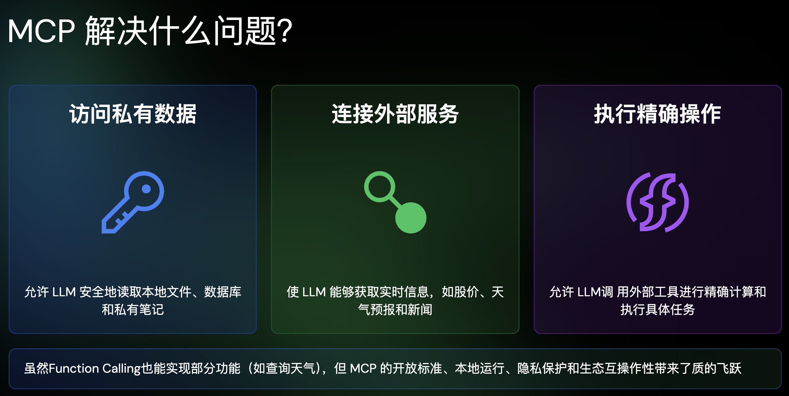

- https://github.com/ComposioHQ/composio
- 介绍 MCP 的 slide： https://talks.ayaka.io/nekoayaka/2025-04-13-what-is-mcp-and-how-it-helps/#/1
- 
	- 感觉这个私有性也不是很说的通，毕竟 FC 应该也能实现吧（也写死用 stdio 来通信就行了应该），我感觉最大的价值还是有了一个标准的协议
- 好用的 MCP 收集：
	- https://github.com/wrale/mcp-server-tree-sitter
- https://mp.weixin.qq.com/s?__biz=MzI1MzYzMjE0MQ==&mid=2247516461&idx=1&sn=ce4917a4ab56c2c136290e20c5ba79f5&poc_token=HEU_vWijo0oCrhmjt2qVAlM4teQ4khEUbS98qphk
	- [[OAuth]] 授权下带来的风险：
		- **恶意客户端通过授权码拦截窃取用户令牌**：由于任何应用都能动态注册为合法客户端，攻击者可以构建一个功能与正常应用类似的恶意 MCP 客户端，并通过各种渠道（如钓鱼邮件、非官方应用市场）诱导用户下载安装。
		- **恶意服务端利用“Confused Deputy”问题窃取令牌**：即便 MCP 客户端本身是可信的，如果用户在客户端中添加了一个恶意的 MCP 服务端地址，风险同样存在。这在安全领域被称为**“Confused Deputy Problem”**。
			- 可能是因为 MCP Client 是三方的，所以带来了可以授权任意页面，但是我们正常的一方页面就不会有这个问题，我们发起的授权应用都是可控的，不然感觉现在一方的也会有问题？
		- 解决方案：
			- **授权前二次确认**作为第一道防线，主动防范钓鱼攻击。
			- **令牌身份隔离**作为核心举措，极大限制了风险半径，防止危害横向扩散。
			- **API 级别权限管控**遵循最小权限原则，为潜在的未知风险提供了最终的安全保障。
-
## 2025-11-25 与 2026-07-28 规范对照核查记录（2026-10-20）

- 用途：支撑 `wiki/topics/ai/mcp-2026-07-28.md` 与 `wiki/topics/ai/mcp-authorization.md`。
- 访问日期：2026-10-20。资料版本：MCP 规范 `2026-07-28`（当前版）与 `2025-11-25`（上一版）。规范页面通过在路径后加 `.md` 取得 Markdown 正文，例如 `https://modelcontextprotocol.io/specification/2026-07-28/basic/index.md`；文档索引见 `https://modelcontextprotocol.io/llms.txt`。
- 读过的页面：
  - 2026-07-28：`changelog`、`basic/index`（`_meta`、Statelessness、错误码）、`basic/versioning`、`basic/patterns/mrtr`、`basic/patterns/subscriptions`、`basic/patterns/cancellation`、`basic/patterns/progress`、`basic/transports/streamable-http`、`basic/transports/stdio`、`basic/authorization/index`、`basic/authorization/authorization-server-discovery`、`basic/authorization/client-registration`、`basic/authorization/security-considerations`、`server/discover`、`server/tools`、`server/utilities/caching`、`server/utilities/logging`、`client/elicitation`、`client/roots`、`client/sampling`、`deprecated`，以及 `docs/2026-07-28/learn/versioning`。
  - 2025-11-25：`basic/lifecycle`、`basic/transports`、`basic/utilities/tasks`、`client/elicitation`、`basic/authorization`。
  - SEP：2575（无状态）、2567（去掉会话）、2322（MRTR）、2243（HTTP 头）、2549（列表 TTL）、2577（弃用 Roots / Sampling / Logging）、2663（Tasks 扩展）；扩展页 `extensions/overview`、`extensions/tasks/overview`。
  - 发布文章：<https://blog.modelcontextprotocol.io/posts/2026-07-28/>、<https://claude.com/resources/articles/bringing-mcp-2026-07-28-to-claude>、<https://devblogs.microsoft.com/dotnet/announcing-v20-of-the-official-mcp-csharp-sdk/>。
  - RFC：6749 §4.1.3 / §5.1 / §6、7636、8707、9207 §1–§2、9700 §4.4（含 §4.4.1 攻击步骤与 §4.4.2.2 不同回调地址的限制）。
- 没有单独打开原文的：SEP-837、SEP-2352、SEP-2468、SEP-2106、SEP-2596、PR #2858。页面中这几项的描述来自变更日志、授权规范页面和官方博客。
- 核查要点：
  - `basic/authorization/index`「Authorization Response Validation」：跳转前必须记下所选 AS 已校验元数据中的 `issuer`，并与存 PKCE `code_verifier`（及 `state`）的同一条按请求区分的记录关联；四行 `iss` 处理表；不做 RFC 3986 §6.2.2–6.2.3 规范化；`iss` 从 SHOULD 升级为 MUST 是计划中的后续修订。
  - `authorization-server-discovery`：元数据中的 `issuer` 必须与拼 well-known 地址用的 issuer 一致，示例是 `attacker.example` 返回 `"issuer": "https://honest.example"` 必须拒绝。在 2025-11-25 `basic/authorization` 中检索 `identical`，没有对应条文。
  - `client-registration`「Authorization Server Binding」：预注册与 DCR 凭据按 issuer 绑定；CIMD 的 `client_id` 可以跨 AS 使用，不需要重新注册。2025-11-25 已有「预注册 > CIMD > DCR」的选择顺序，2026-07-28 把 DCR 标为弃用。
  - `security-considerations`：PKCE 必须实现，元数据缺 `code_challenge_methods_supported` 时必须停止；回调地址必须是 `localhost` 或 HTTPS；客户端应使用并核对 `state`；Mix-Up Attacks 一节引用 RFC 9207 §1。
  - 官方博客授权段落：`iss` 校验关闭 mix-up 漏洞；DCR 时设置 `application_type` 让 AS 不再拒绝桌面和 CLI 的 `localhost` 回调；凭据绑定签发方；DCR 正式弃用，以后版本会移除。博客和规范都没有写弃用 DCR 的单独理由。
- 验证记录：只读规范、SEP、RFC 和发布文章，没有运行任何 MCP SDK、服务器或客户端，没有实际走过 OAuth 流程，也没有验证各 SDK 对这些条文的实现情况。页面里「并行登录时把记录放共享存储或签名后编进 `state`」「记录只用一次并设过期时间」是设计建议，规范没有对应条文。
- 配图：`raw/assets/mcp-2026-07-28-overview.png`（2400×1520）、`raw/assets/mcp-2026-07-28-lifecycle.png`（2000×1330）、`raw/assets/mcp-2026-07-28-mrtr.png`（2200×1420）、`raw/assets/mcp-2026-07-28-http-auth.png`（2200×1560）。用 roughjs 生成手绘线条、resvg 渲染为 PNG，字体为霞鹜文楷，带浅色填充块，不是 MCP 官方素材。逐张核对了标题、左右两栏的新旧版本归属、箭头方向（发出的请求为实线、返回的响应为虚线）、字段名与错误码（`-32020`、`-32022`、`resultType`、`requestState`、`Mcp-Method`、`Mcp-Name`、`Mcp-Param-*`）与本记录所列规范一致。
