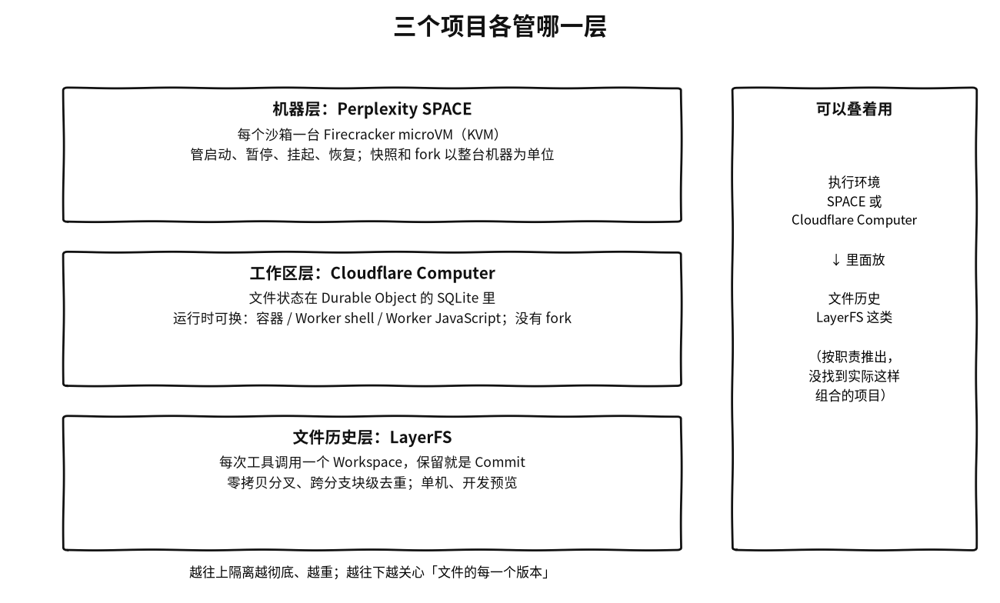

# Cloudflare Computer vs LayerFS vs Perplexity SPACE

## 先补点背景

这页比较三个「给 agent 跑代码、改文件」的项目。它们不是同一层的东西：一个管整台机器，一个管一个长期工作区，一个管文件历史。拿办公室打比方：SPACE 像整间带门锁的独立办公室，Cloudflare Computer 像一张一直在、工具可以换的桌子，LayerFS 像给桌上文件做的版本记录，随时能从任何一版分出一条新路。先把下面这些词弄明白，后面就不绕了。

- **沙箱 / 执行环境**：给 agent 跑代码的地方。它要有文件系统、能执行命令，还要把这段代码和别的用户、别的任务隔开。这页的三个项目都在做这件事，只是隔开的范围不一样。
- **microVM（Firecracker）**：一种精简的虚拟机，只保留跑代码需要的少数虚拟设备，但仍然是虚拟机。Firecracker 是其中一种实现，SPACE 每个沙箱起一台，隔离边界是虚拟机，不是进程。
- **KVM**：Linux 内核提供的硬件虚拟化接口。虚拟机靠它直接使用 CPU 的虚拟化指令。SPACE 要求宿主机有 `/dev/kvm`。
- **V8 isolate**：V8 引擎里一个独立的 JS 运行时实例，有自己的堆。isolate 之间拿不到对方的对象引用，只能拷贝数据或传句柄。Cloudflare Computer 的隔离 Worker 后端就是这种隔离。
- **容器**：用 Linux namespace 和 cgroup 隔出来的进程环境，共享宿主内核。比虚拟机轻，隔离边界还是内核。Cloudflare Computer 的容器后端能跑任意 Linux 程序、有网络；LayerFS 的容器模式是在容器里挂 FUSE 文件系统。
- **FUSE**：Filesystem in Userspace，用户态文件系统。内核把 open / read / write 转给一个用户态进程，由这个进程决定文件长什么样。好处是不用改内核就能造文件系统；代价是要 `/dev/fuse` 和 `SYS_ADMIN` 这类特权。LayerFS 的容器模式和 Cloudflare Computer 的容器后端都靠它把存储挂成普通目录。
- **内容寻址的分块（content-addressed chunks）**：把文件切成一块一块，用每块内容的哈希当名字。内容相同的块只存一份，这就是哈希去重。切法有两种。固定大小分块：Cloudflare Computer 每 512 KiB 切一刀，在文件中间插几个字节，插入点之后的块全变，后面的块没法复用。内容定义分块（CDC）：按内容特征找切点，LayerFS 用 FastCDC，块大小 8/16/32 KiB，中间插几个字节通常只影响附近一两块，其余块照样命中。
- **快照 / 分叉（fork）**：把当前状态存下来，之后从它再开一份。SPACE 按整台沙箱做：挂起时存内存差量和磁盘，fork 出来的是整台 VM。LayerFS 按 Commit 做，分叉只加一行 Branch 记录，不复制文件数据，所以叫零拷贝。
- **写时复制（CoW，btrfs 子卷）**：先共用同一份数据，谁写谁才复制被改的那部分。SPACE 在宿主上用 btrfs 的 CoW 从模板建每个沙箱的根盘，模板目录本身是 btrfs 子卷；上传快照时用 `btrfs send -p` 只发和父卷不同的部分。
- **Durable Object（DO，及其内置 SQLite）**：Cloudflare 的单实例有状态对象，自带 SQLite。一个工作区对应一个 DO，文件内容、目录、块索引都放在这个 SQLite 里。DO 是 Cloudflare 平台的东西，离开 Cloudflare 就用不了。
- **fsync / 断电安全**：`fsync` 是让进程把数据刷到持久存储、等它真正落盘再返回。不调用它，数据可能还在操作系统的页缓存里，断电就没了。断电安全说的是：机器突然断电，已经确认的写入还在不在。

## 一段话结论

要安全地跑不可信代码、要一台完整的 Linux 机器，选 SPACE；已经在 Cloudflare 上，想要一个跨会话一直在、运行时可以换的工作区，选 Cloudflare Computer；真正的痛点是文件状态要大量分叉、随时回退，LayerFS 的设计最对路，但它现在只适合研究和做原型；只是少量并行任务、只改源码，用 git worktree 就够了。三者还能叠：SPACE 或 Cloudflare Computer 提供执行环境，LayerFS 这类文件历史放在里面管文件。

## 三个项目各管什么

三个项目都和「给 agent 一个能跑代码、能改文件的环境」有关，但管的不是同一层，不能直接互相替换。

### [[wiki/topics/ai/perplexity-space|Perplexity SPACE]]：管整台机器

每个沙箱是一台 Firecracker microVM，用 KVM 做硬件虚拟化，隔离最彻底。它负责启动、暂停、挂起和恢复整台机器。快照和分叉都以整台沙箱为单位，没有文件级历史。这次看的是 `57c7c0c`（2026-10-18），自托管、Rust、Apache-2.0。

文件状态放在宿主上的 ext4 镜像里，宿主用 btrfs 子卷；快照上传到 S3。存储层是块设备，不做内容寻址。它支持多节点部署：Kubernetes 适配器，或者直接调工作节点服务的 direct 适配器，都行。成熟度上刚开源，工程量大。

### [[wiki/topics/ai/cloudflare-computer|Cloudflare Computer]]：管一个持久工作区

文件状态存在 Durable Object 的 SQLite 里，同一份文件可以给容器、Worker shell 或 Worker JavaScript 三种后端用。重点是「工作区一直在、运行时可以换」：工作区不跟着运行时消失。它没有分叉和快照接口，绑定 Cloudflare 平台。这次看的是 `7415a44`（2026-10-15，包版本 0.5.1；npm 最新 0.6.0），TypeScript 库、MIT，跑在 Cloudflare Workers。

SQLite 里主要的表是 `vfs_nodes`、`vfs_chunks`、`vfs_blobs`。分块用固定 512 KiB，哈希用 SHA-256。`rev` 是工作区里全局递增的版本号，同步时按它算增量。分布式靠 Cloudflare 全球网络，每个工作区一个 DO。核心包标为 Stable，容器后端和同步协议标为 Experimental。

### [[wiki/topics/ai/layerfs|LayerFS]]：管文件历史

每次工具调用开一个 Workspace，结果要保留就存成 Commit，任何状态都能零拷贝分叉，跨分支按块去重。它管的是文件历史（Layer / Branch / Commit），只能单机，也是三者里最不成熟的。版本是 `v0.1.6` 开发预览版；`main` 在重写。Rust 库和 CLI、MIT。

隔离靠容器内 FUSE（需要 `/dev/fuse`、`SYS_ADMIN`），或者把文件物化成普通目录。文件状态放在单个 SQLite 里，主要的表是 `objects`、`object_packs`、`commits`、`branches`。分块用 FastCDC 8/16/32 KiB，哈希用 BLAKE3。去重是跨分支的块级去重。

### 能不能叠起来用

可以。SPACE 或 Cloudflare Computer 提供执行环境，LayerFS 这类分叉历史放在环境里管文件。这是按三者职责推出的组合方式，没有找到实际这样组合的项目。

## 横向对比

先看几个关键维度。表格只放短结论，展开在表下面。

| 看什么 | LayerFS | Perplexity SPACE | Cloudflare Computer |
| --- | --- | --- | --- |
| 管理层次 | 文件历史（Layer / Branch / Commit） | 整台 microVM | 持久工作区（一个虚拟文件系统） |
| 隔离方式 | 容器内 FUSE（需 `/dev/fuse`、`SYS_ADMIN`），或物化成普通目录 | Firecracker + jailer，KVM 硬件虚拟化 | 隔离 Worker（V8 isolate）或容器内 FUSE |
| 文件状态存在哪 | 单个 SQLite：`objects`、`object_packs`、`commits`、`branches` | 宿主上的 ext4 镜像，btrfs 子卷；快照上传 S3 | Durable Object 的 SQLite：`vfs_nodes`、`vfs_chunks`、`vfs_blobs` |
| 分块与哈希 | FastCDC 8/16/32 KiB，BLAKE3 | 块设备，不做内容寻址 | 固定 512 KiB，SHA-256 |
| 分叉 / 快照粒度 | 每次工具调用一个 Commit，零拷贝分叉 | 整台沙箱挂起（内存差量 + 磁盘）、整机 fork | 没有分叉接口，按 `rev` 增量同步 |
| 去重 | 跨分支块级 | btrfs 写时复制、相对模板的 `btrfs send -p` | 同一工作区内按哈希共享块 |
| 分布式 | 否，单机单存储 | 是，多节点（Kubernetes 或 direct 适配器） | 是，Cloudflare 全球网络，每个工作区一个 DO |

### 写入什么时候才算稳

三个项目对「写完就算数」的承诺完全不同，这点最容易误判：

- **LayerFS**：提交时才持久。Workspace 的改动数据从不 `fsync`，整体不保证断电安全。
- **SPACE**：挂起、停止、快照时持久。客户机的 `fsync` 只写到宿主页缓存，不等于落盘。
- **Cloudflare Computer**：写进 DO 就持久。容器里的改动要等命令结束后拉回 DO，拉回之前只在容器里。

### 成熟度差在哪

- **LayerFS**：开发预览，`main` 重写中。
- **Perplexity SPACE**：刚开源，工程量大。
- **Cloudflare Computer**：核心包标为 Stable，容器后端和同步协议标为 Experimental。

## 按需求选

- **要安全地跑任意不可信代码，需要完整 Linux 和网络，还要自己部署**：选 SPACE。每个沙箱一台 Firecracker microVM，隔离边界是虚拟机。代价是 KVM、btrfs 和特权宿主，还要运维一套 PostgreSQL + 控制器 + 节点服务。
- **已经有 E2B 代码，想换成自托管**：选 SPACE。ECW 是 SPACE 的 E2B 兼容层，兼容 E2B 的 Python SDK。代价是生命周期名称不同（ECW 的 pause 是 SPACE 的 suspend），兼容范围以 ECW 文档的测试范围为准。
- **在 Cloudflare 上给每个用户或会话一个长期工作区**：选 Cloudflare Computer。文件存在 DO 的 SQLite 里，工作区不随运行时消失。代价是绑定 Cloudflare；容器后端还是实验性的。
- **大多数操作是读写文件和跑 JS，不想起容器**：选 Cloudflare Computer 的 Worker 后端。Worker shell 或 Worker JavaScript 直接经 Workers RPC 读写 DO，没有同步往返。代价是 just-bash 不是真 bash，跑不了任意二进制；Worker shell 后端是实验性的。
- **几十上百条路径并行试错（MCTS、RL rollout，也就是蒙特卡洛树搜索和强化学习批量试跑），每一步都要能回退和分叉**：选 LayerFS。每次工具调用一个 Commit，零拷贝分叉，跨分支块级去重。代价是只能单机，不保证断电安全，要自己改调度层接入。
- **只有少量并行任务，只改源码**：都不必，用 git worktree。它最简单，团队都会用。代价是依赖要重装，而且只管 Git 跟踪的文件。

## 推荐理由

先按要隔离的东西选层：要防恶意代码、要一台真机器，选 SPACE；要一个跨会话保留、可换运行时的工作区，并且已经在 Cloudflare 上，选 Cloudflare Computer；要的是「文件状态能大量分叉、随时回退」，LayerFS 的设计最对路，但它现在只适合研究和做原型。

三者的成熟度和测试条件都不同。本次只读了文档和关键路径源码，只实际运行过 LayerFS 的物化模式（见 [[wiki/topics/ai/layerfs#实际运行结果|LayerFS 运行结果]]），没有做性能对比，表里没有跑分。

## 来源指针

- [[wiki/topics/ai/cloudflare-computer|Cloudflare Computer]]、[[wiki/topics/ai/layerfs|LayerFS]]、[[wiki/topics/ai/perplexity-space|Perplexity SPACE]]：各自的实现细节和源码位置
- `raw/sources/cloudflare-computer.md`、`raw/sources/layerfs.md`、`raw/sources/perplexity-space.md`：阅读范围、核查位置与验证记录
- [cloudflare/computer](https://github.com/cloudflare/computer)、[Ephemeral-AI-Lab/layerfs](https://github.com/Ephemeral-AI-Lab/layerfs)、[perplexityai/SPACE](https://github.com/perplexityai/SPACE)
- `raw/assets/agent-workspace-layers.png`：脚本（matplotlib）按本页「三个项目各管什么」画的白底黑线分层示意，不是各项目的官方素材
- `raw/assets/agent-workspace-layer-comparison.png`：按三页内容画的手绘风格对比表。图中 SPACE 的「fork/快照粒度」一栏只写了挂起，没写整机 fork，以正文为准
