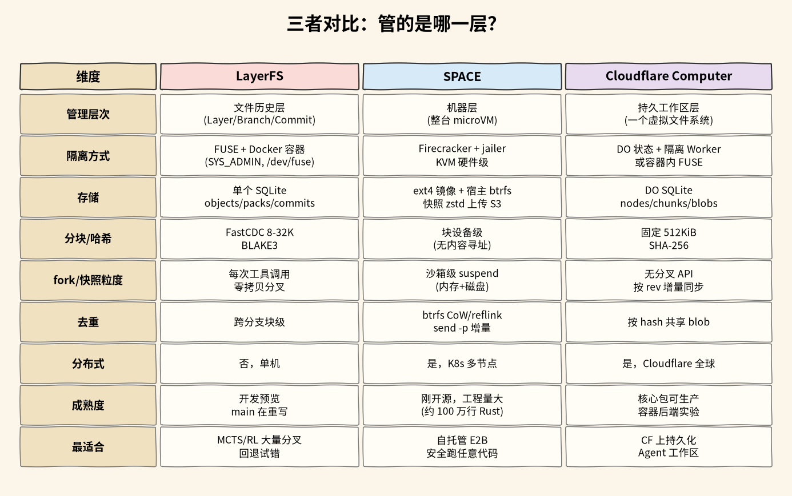

# Cloudflare Computer vs LayerFS vs Perplexity SPACE

## 当前结论

三个项目都和「给 agent 一个能跑代码、能改文件的环境」有关，但管的不是同一层，不能直接互相替换：

- **[[wiki/topics/ai/perplexity-space|Perplexity SPACE]] 管机器**：每个沙箱是一台 Firecracker microVM，隔离最彻底，负责启动、暂停、挂起和恢复整台机器。快照和分叉都以整台沙箱为单位，没有文件级历史。
- **[[wiki/topics/ai/cloudflare-computer|Cloudflare Computer]] 管一个持久工作区**：文件状态存在 Durable Object 的 SQLite 里，同一份文件可以给容器、Worker shell 或 Worker JavaScript 三种后端用。重点是「工作区一直在、运行时可以换」，没有分叉和快照接口，绑定 Cloudflare 平台。
- **[[wiki/topics/ai/layerfs|LayerFS]] 管文件历史**：每次工具调用一个 Workspace，保留就存成 Commit，任何状态都能零拷贝分叉，跨分支按块去重。只能单机，也最不成熟。

它们可以叠起来用：SPACE 或 Cloudflare 提供执行环境，LayerFS 这类分叉历史放在环境里管文件。这是按三者职责推出的组合方式，没有找到实际这样组合的项目。

## 备选项

- **Perplexity SPACE**（`57c7c0c`，2026-10-18）：自托管、Rust、Apache-2.0。
- **Cloudflare Computer**（`7415a44`，2026-10-15，包版本 0.5.1；npm 最新 0.6.0）：TypeScript 库、MIT，跑在 Cloudflare Workers 上。
- **LayerFS**（`v0.1.6` 开发预览版；`main` 在重写）：Rust 库和 CLI、MIT。

## 取舍分析

| 维度 | LayerFS | Perplexity SPACE | Cloudflare Computer |
| --- | --- | --- | --- |
| 管理层次 | 文件历史（Layer / Branch / Commit） | 整台 microVM | 持久工作区（一个虚拟文件系统） |
| 隔离方式 | 容器内 FUSE（需 `/dev/fuse`、`SYS_ADMIN`），或物化成普通目录 | Firecracker + jailer，KVM 硬件虚拟化 | 隔离 Worker（V8 isolate）或容器内 FUSE |
| 文件状态存在哪 | 单个 SQLite：`objects`、`object_packs`、`commits`、`branches` | 宿主上的 ext4 镜像，btrfs 子卷；快照上传 S3 | Durable Object 的 SQLite：`vfs_nodes`、`vfs_chunks`、`vfs_blobs` |
| 分块与哈希 | FastCDC 8/16/32 KiB，BLAKE3 | 块设备，不做内容寻址 | 固定 512 KiB，SHA-256 |
| 分叉 / 快照粒度 | 每次工具调用一个 Commit，零拷贝分叉 | 整台沙箱挂起（内存差量 + 磁盘）、整机 fork | 没有分叉接口，按 `rev` 增量同步 |
| 去重 | 跨分支块级 | btrfs 写时复制、相对模板的 `btrfs send -p` | 同一工作区内按哈希共享块 |
| 写入何时持久 | 提交时；Workspace 改动数据从不 `fsync`，整体不保证断电安全 | 挂起、停止、快照时；客户机 `fsync` 只到宿主页缓存 | 写进 DO 即持久；容器里的改动要等命令结束后拉回 |
| 分布式 | 否，单机单存储 | 是，多节点（Kubernetes 或 direct 适配器） | 是，Cloudflare 全球网络，每个工作区一个 DO |
| 成熟度 | 开发预览，`main` 重写中 | 刚开源，工程量大 | 核心包标为 Stable，容器后端和同步协议标为 Experimental |

选择表：

| 如果需要 | 优先选 | 因为 | 需要承担的代价 |
| --- | --- | --- | --- |
| 安全地跑任意不可信代码，要完整 Linux 和网络，自己部署 | SPACE | 每个沙箱一台 Firecracker microVM，隔离边界是虚拟机 | 需要 KVM、btrfs 和特权宿主，运维一套 PostgreSQL + 控制器 + 节点服务 |
| 已有 E2B 代码，想换成自托管 | SPACE | ECW 兼容 E2B 的 Python SDK | 生命周期名称不同（ECW 的 pause 是 SPACE 的 suspend），兼容范围以 ECW 文档的测试范围为准 |
| 在 Cloudflare 上给每个用户或会话一个长期工作区 | Cloudflare Computer | 文件存在 DO 的 SQLite 里，工作区不随运行时消失 | 绑定 Cloudflare；容器后端仍是实验性的 |
| 大多数操作是读写文件和跑 JS，不想起容器 | Cloudflare Computer 的 Worker 后端 | Worker shell 或 Worker JavaScript 直接经 Workers RPC 读写 DO，没有同步往返 | just-bash 不是真 bash，跑不了任意二进制；Worker shell 后端是实验性的 |
| 几十上百条路径并行试错（MCTS、RL rollout），每步都要能回退和分叉 | LayerFS | 每次工具调用一个 Commit，零拷贝分叉，跨分支块级去重 | 只能单机，不保证断电安全，要自己改调度层接入 |
| 少量并行任务，只改源码 | 都不必，用 git worktree | 最简单，团队都会用 | 依赖要重装，只管 Git 跟踪的文件 |

## 推荐理由

先按要隔离的东西选层：要防恶意代码、要一台真机器，选 SPACE；要一个跨会话保留、可换运行时的工作区并且已经在 Cloudflare 上，选 Cloudflare Computer；要的是「文件状态能大量分叉、随时回退」，LayerFS 的设计最对路，但它现在只适合研究和做原型。

三者的成熟度和测试条件都不同，本次只读了文档和关键路径源码，只实际运行过 LayerFS 的物化模式（见 [[wiki/topics/ai/layerfs#实际运行结果|LayerFS 运行结果]]），没有做性能对比，表里没有跑分。

## 来源指针

- [[wiki/topics/ai/cloudflare-computer|Cloudflare Computer]]、[[wiki/topics/ai/layerfs|LayerFS]]、[[wiki/topics/ai/perplexity-space|Perplexity SPACE]]：各自的实现细节和源码位置
- `raw/sources/cloudflare-computer.md`、`raw/sources/layerfs.md`、`raw/sources/perplexity-space.md`：阅读范围、核查位置与验证记录
- [cloudflare/computer](https://github.com/cloudflare/computer)、[Ephemeral-AI-Lab/layerfs](https://github.com/Ephemeral-AI-Lab/layerfs)、[perplexityai/SPACE](https://github.com/perplexityai/SPACE)
- `raw/assets/agent-workspace-layer-comparison.png`：按三页内容画的手绘风格对比表。图中 SPACE 的「fork/快照粒度」一栏只写了挂起，没写整机 fork，以正文为准
