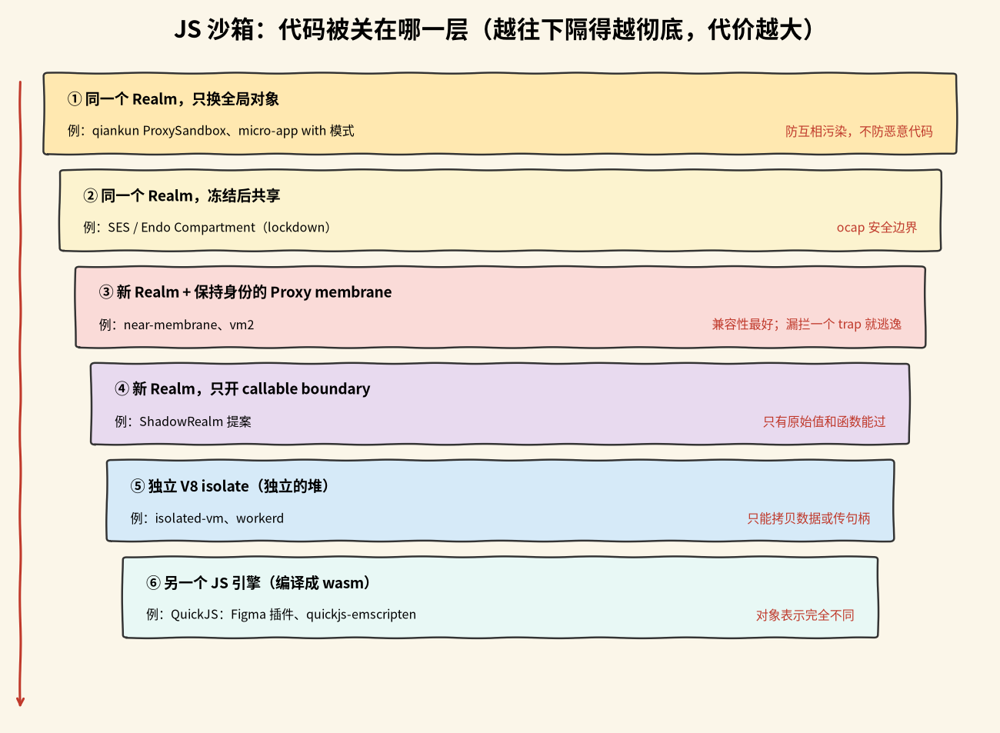

# JavaScript 沙箱方案对比

## 先补点背景

这页比较「怎么把一段 JS 关起来跑」。方案之间的差别，主要不在 API 好不好用，而在代码被关在哪一层、跨边界时对象怎么传。很像合租：有人只拉个帘子，有人各住一间，有人干脆住到另一栋楼。先把下面这些词弄明白，后面就不绕了。

- **Realm**：一套独立的全局对象和内置对象，比如它有自己的 `Object`、`Array`，浏览器里还有自己的 `window`。注意它和线程、内存不是一回事：两个 Realm 可以跑在同一个线程、同一块内存上。
- **intrinsics（内置对象）**：语言规范自带的那些对象和函数，比如 `Object`、`Array`、`Promise`、`JSON`。每个 Realm 都有一套自己的 intrinsics。
- **全局对象 / window**：脚本最外层能直接摸到的那个对象。浏览器里是 `window`，Node 里是 `globalThis`。同一个页面里的 iframe 有自己的一份。
- **Proxy 和 membrane（膜）**：`Proxy` 是 ES 提供的包装对象，可以拦下 get、set、函数调用这些操作。membrane 是一层代理：对象每次穿过沙箱边界，都先包一层 Proxy，调用方拿到的是代理，不是原对象。
- **身份保持（identity）**：同一个对象从 A 侧穿到 B 侧、再穿回来，还是 `===` 原来那个对象。做不到的话，同一个对象传过去两次会变成两个互不相等的代理，依赖 `===`、`WeakMap` 做判断的库就乱了。
- **distortion**：跨界时把值换掉。near-membrane 的 `distortionCallback(target) => target'` 在 blue 值第一次跨界时调用，可以把一个 getter 或 API 换成受限版本。
- **blue / red**：near-membrane 的叫法。宿主一侧叫 blue，沙箱一侧叫 red。blue 值就是宿主对象，red 值就是沙箱里的对象。
- **lockdown / harden（冻结）**：SES 的两个操作。`lockdown()` 冻结所有内置对象，让代码改不了 `Object.prototype` 这类共享东西；`harden()` 把单个对象冻到不能再改。冻结之后大家共享同一份引用也安全，因为没有谁能改它。
- **ocap（对象能力）**：object capability，对象能力。核心想法是：拿到一个对象引用，就有了对它做事的权限；没有引用就没有权限。所以不用维护一张全局权限表，只要控制好交给沙箱哪些对象。
- **callable boundary**：一条只能过函数和原始值的边界。函数过去会被包一层，普通对象直接过不去。想传对象，只能像 near-membrane 那样自己把它编码成函数（指针）再传。ShadowRealm 只开这条缝。
- **V8 isolate**：V8 引擎里一个独立的运行时实例，有自己的堆。isolate 之间拿不到对方的对象引用，只能拷贝数据或传句柄。
- **wasm 里的 JS 引擎**：把 QuickJS 这类完整的 JS 引擎编译成 WebAssembly，跑在宿主里。沙箱代码由这个引擎解释执行，和宿主的 V8 是两套完全不同的对象表示。
- **iframe**：HTML 里的内嵌文档。同源的 iframe 有自己的 `window` 和 Realm，浏览器会给你一个独立的全局环境；near-membrane 在浏览器里就借它造新 Realm。跨域 iframe 访问不了对方 DOM，同源 iframe 可以。
- **shadow DOM**：浏览器提供的一种能力，把一棵 DOM 子树挂到某个元素上，样式和外界隔开。wujie 用 iframe 跑 JS，用 shadow DOM 放 DOM。
- **逃逸（sandbox escape）**：沙箱里的代码绕过边界，拿到了宿主对象，或者执行了本该被拦住的操作。同堆的 Proxy membrane 一旦漏拦一个 trap（Proxy 的拦截钩子），就可能直接漏到宿主。

## 一段话结论

只防多个前端应用互相污染，用 qiankun、micro-app、wujie 这类微前端框架；要跑不可信代码，优先独立 isolate、wasm 或进程 / 虚拟机隔离，别只靠同堆的 Proxy membrane；要第三方组件像原生一样直接操作宿主 DOM、又由平台控制它能碰什么，看 near-membrane 这条路线（LWS）；在 Node 里跑不可信代码，用 isolated-vm 再加单独进程或容器 / VM；浏览器里安全优先于性能，选 QuickJS-wasm；想等标准化的隔离原语，关注 ShadowRealm，但它现在停在 Stage 2.7，还不能依赖。

## 先看隔离单位：关得越深，代价越大

各方案最大的区别是**隔离单位**，也就是被隔离的代码关在哪一层里跑。层级越往下隔得越彻底，代价也越大：

1. **同一个 Realm，只换全局对象**：qiankun 的 `ProxySandbox`、micro-app 的 with 模式（用 `with` 把全局变量的查找转到代理对象上）。内置对象共享，主要防全局变量和样式互相污染，不防恶意代码。
2. **同一个 Realm，冻结后共享**：SES / Endo 的 Compartment。不包装对象，靠 `lockdown()` 冻结所有内置对象，是 ocap（object capability，对象能力）意义上的安全边界。
3. **新 Realm 加同步、保持身份的对象 membrane**：[[wiki/topics/frontend/near-membrane|near-membrane]]、vm2。Realm 是一套独立的全局对象和内置对象（有自己的 `Object`、`Array`、`window`），但仍在同一个线程、同一块内存里，靠 Proxy 拦截。好处是能同步互相调用、兼容性最好、能直接操作宿主 DOM；坏处是一旦拦漏，沙箱就直接拿到宿主对象。
4. **新 Realm，只开 callable boundary**：ShadowRealm 提案。只有原始值和函数能跨界，普通对象过不去。
5. **独立的 V8 isolate**：isolated-vm、workerd。独立的堆，对象拿不到对面的引用，只能拷贝数据或传句柄。
6. **另一个 JS 引擎**：QuickJS 编译成 wasm，例如 Figma 插件和 quickjs-emscripten。对象表示完全不同，不存在「同一个对象」。

要跑不可信代码，近几年的趋势是独立 isolate 或 wasm，再加进程或虚拟机级别的隔离：同进程、同堆的 Proxy membrane 一直是逃逸漏洞的高发区，realms-shim 在 2019 年被攻破，vm2 至今在修 GHSA，near-membrane 最后几次提交也在补 trap 的边界情况。

## 每个方案几句话

资料核对日期 2026-10-21。状态里只写到日期的按 UTC 记。

下面按隔离单位分组。每段保留原来的几个判断：怎么跨界、身份保不保持、算不算安全边界、现在什么状态。

### 微前端框架：qiankun、micro-app、wujie

**qiankun**：同一个 Realm，造一个假 window（Proxy 或快照）。内置对象共享，只代理 window，所以身份保持这件事「不涉及」。它的定位是应用共存隔离，不是安全边界（归纳）。npm 2.10.16（2023-11）；3.0 处于 rc。

**micro-app**：同一个 Realm（with + Proxy），也可以走 iframe Realm。它代理 window；iframe 模式给 DOM 打补丁转发。身份不保证（待确认）。定位是应用共存隔离。1.0.0-rc.32（2026-06-25）。

**wujie**：用 iframe Realm 跑 JS，用 shadow DOM 放 DOM。DOM 访问靠框架代理或转发（待确认）。身份不保证（待确认）。定位是应用共存隔离。2.1.0（2026-06-15）。

### 同 Realm 的对象图 membrane：Miller / tvcutsem、es-membrane

**Miller / tvcutsem membrane**：同一个 Realm 的两张对象图。用 Proxy 递归包装，可以撤销。身份保持成立，靠 WeakMap 一一映射。它的定位是语言模式和示例。harmony-reflect 最后 push 2024-01-15。

**es-membrane**：同一个 Realm 的多张对象图，分 wet / dry / damp。用 Proxy + ProxyMapping，distortion 可配置。身份保持成立。定位是构建工具，没有声明自己是安全边界（归纳）。v2 重写中；npm 停在 0.9.0（2018）。

### 冻结、改写和包装：SES / Endo、Caja、Lightning Locker、LWS

**SES / Endo**：用 Compartment 做隔离单元。它和宿主在同一个 Realm，共享已经冻结的内置对象。跨界直接共享引用（先 `lockdown` / `harden`），能力靠 `globals` 交进来。因为不包装对象，身份天然成立。它是 ocap 安全边界，但不防 DoS 和内存耗尽。状态：活跃；`ses` 2.3.0（2026-08-13）；Compartments 提案 Stage 1。

**Google Caja**：把代码改写、驯化后放在同一个页面里执行（ES5 SES + Domado）。跨界走 taming membrane。身份保持待确认。定位是 ocap 安全边界。2021-01-31 归档，不再出安全补丁。

**Lightning Locker**：同一个 Realm 加 secure wrapper。用 `SecureWindow` 这类包装对象。沙箱拿到的是包装对象，身份保持不了。定位是 Salesforce 平台安全。被 LWS 取代（时间表待确认）。

**LWS**：每个 namespace 一个沙箱。跨界靠 distortion（推断建立在 near-membrane 之上）。身份保持成立（官方文档：iframe 身份两侧一致）。定位是 Salesforce 平台安全。现行方案。

### 新 Realm 加同步 membrane：near-membrane、vm2

**near-membrane**：新 Realm（浏览器同源 iframe，Node 用 `vm`），同一个线程。跨界是双向 Proxy membrane：用 shadow target（本地占位对象）和懒投影，有 live / static 两种状态（static 是第一次写时把属性复制到本地，live 是写直接落到宿主），blue 侧第一次跨界时做 distortion。身份保持成立：双向指针缓存，回程解包，不会 proxy 套 proxy。它只保证完整性，安全要靠上层的 distortion。状态：2026-09-18 归档，最终 0.19.1。

**vm2**：Node `vm` context，也就是新 Realm，但同进程。跨界是双向 Proxy bridge（常识背景，未逐行核对）。身份保持成立（常识背景）。README 说不能把它当作唯一防线。状态：2023 停更，2025-10 恢复维护；3.12.2（2026-09-08）。

### 新 Realm：realms-shim、ShadowRealm

**Agoric realms-shim**：新 Realm（同源 iframe）加 `with(scopeProxy)`。跨界是直接引用加作用域 Proxy。身份保持只做到一部分。它想做安全边界，但已经被攻破。README 标为 OBSOLETE / INSECURE。

**ShadowRealm**：引擎原生的新 Realm。只开 callable boundary。对象不跨界；函数每次跨界都包一层新 wrapper（按规范语义推断，未逐行核对）。它是隔离原语，不是现成沙箱。状态：Stage 2.7；Firefox 2026-02 移除实现，Chrome 原型阶段要开关，WebKit 要开关（待确认）。

### 独立 V8 isolate：isolated-vm、workerd

**isolated-vm**：独立的 V8 isolate。跨界用 transferable：拷贝、`Reference`、`ExternalCopy`。没有身份保持，只有句柄。比同堆方案强，但 README 说它不会自动安全。状态：维护模式；7.0.1（2026-08-05）。

**Cloudflare workerd**：每个 Worker 一个 V8 isolate。跨界靠 capability binding / RPC（细节待确认）。没有身份保持。README 称「not a hardened sandbox」，需要外层 VM。活跃。

### wasm 里的 JS 引擎：Figma 插件、quickjs-emscripten

**Figma 插件**：wasm 里的 QuickJS。跨界是句柄加拷贝，宿主 API 显式注入。没有跨堆身份。它是安全边界。2019-09-25 起采用；现状待确认。

**quickjs-emscripten**：wasm 里的 QuickJS VM。跨界用 `QuickJSHandle`，要手动 `dispose()`。没有跨堆身份。README 称可以安全执行不可信 JS。活跃；0.32.0（2026-02-16）。

## 精简总表

| 方案 | 隔离单位 | 安全定位 | 状态 |
| --- | --- | --- | --- |
| near-membrane | 新 Realm（iframe / Node `vm`），同线程 | 只保证完整性 | 2026-09-18 归档，0.19.1 |
| Miller / tvcutsem | 同 Realm 的两张对象图 | 语言模式和示例 | harmony-reflect 最后 push 2024-01-15 |
| es-membrane | 同 Realm 的多张对象图 | 构建工具，未声明安全边界 | v2 重写中；npm 0.9.0（2018） |
| SES / Endo | 同 Realm 的 Compartment | ocap 安全边界 | 活跃；`ses` 2.3.0 |
| realms-shim | 新 Realm + 作用域 Proxy | 已被攻破 | OBSOLETE / INSECURE |
| ShadowRealm | 引擎原生的新 Realm | 隔离原语 | Stage 2.7 |
| Figma 插件 | wasm 里的 QuickJS | 安全边界 | 2019-09-25 起采用 |
| quickjs-emscripten | wasm 里的 QuickJS VM | README 称可安全执行不可信 JS | 活跃；0.32.0 |
| qiankun | 同 Realm，假 window | 应用共存隔离 | npm 2.10.16；3.0 rc |
| micro-app | 同 Realm 或 iframe Realm | 应用共存隔离 | 1.0.0-rc.32 |
| wujie | iframe Realm + shadow DOM | 应用共存隔离 | 2.1.0 |
| Google Caja | 改写后同页执行 | ocap 安全边界 | 2021-01-31 归档 |
| Lightning Locker | 同 Realm + secure wrapper | Salesforce 平台安全 | 被 LWS 取代 |
| LWS | 每个 namespace 一个沙箱 | Salesforce 平台安全 | 现行方案 |
| vm2 | Node `vm` context | 不能作为唯一防线 | 3.12.2（2026-09-08） |
| isolated-vm | 独立 V8 isolate | 比同堆强，不会自动安全 | 维护模式；7.0.1 |
| Cloudflare workerd | 每个 Worker 一个 V8 isolate | 需外层 VM | 活跃 |

## 按需求选

- **多个前端应用在同一页面共存，互不污染全局变量和样式**：选 qiankun、micro-app、wujie。它们只换全局对象，或者借 iframe 跑 JS，接入成本低。代价是不防恶意代码；iframe 模式有跨 Realm 的 `instanceof` 问题。
- **第三方组件要像原生一样直接操作宿主 DOM，同时由平台控制它能碰什么**：走 near-membrane 路线（LWS）。同步、保持身份的 membrane 兼容性最好，distortion 可以按值替换 API。代价是安全全押在 Proxy 语义正确上；near-membrane 已归档，要自己维护。
- **跑互不信任的插件或第三方代码，接受冻结整个运行环境**：选 SES / Endo。不包装对象就没有身份断裂，冻结后共享引用是安全的。代价是整个应用要先 `lockdown()`；依赖修改内置原型的库可能跑不起来（常识背景，本次没有逐个验证）。
- **在 Node 里跑不可信代码**：isolated-vm 放在单独进程里，或者容器 / VM。独立的堆，对象引用过不去。代价是只能拷贝或传句柄，异步调用多；`Reference` 泄露给不可信代码仍然可以逃逸。
- **浏览器里跑不可信插件，安全优先于性能**：选 QuickJS-wasm（quickjs-emscripten）。对象表示完全不同，不可能发生对象混淆。代价是解释执行比 V8 慢（常识背景，未测）；宿主 API 都要手动注册，句柄要手动释放。
- **想要标准化、不用库的隔离原语**：关注 ShadowRealm。callable boundary 从根上消除对象混淆。代价是它停在 Stage 2.7，Firefox 已移除实现，目前不能依赖。

## 推荐理由

先按威胁模型选层：只防应用之间互相干扰，用微前端框架；要防恶意代码，优先独立 isolate、wasm 或进程 / 虚拟机隔离，不要只靠同堆的 Proxy membrane。near-membrane 的价值是让 LWS 这类平台以接近原生的兼容性，给每个 namespace 一个可以被 distortion 改写的虚拟 `window`；它和 SES 走相反的路：SES 共享但冻结，near-membrane 每个沙箱一套内置对象再用 membrane 连起来。

near-membrane 两侧只交换 37 个函数、对象用指针闭包表示，结构上已经接近「在 callable boundary 之上重建完整 membrane」。这是本页对它与 ShadowRealm 关系的解读，不是项目官方说法。

## 来源指针

- [[wiki/topics/frontend/near-membrane|near-membrane]]：near-membrane 的实现细节、修复历史和归档
- `raw/assets/js-sandbox-isolation-layers.png`：脚本（matplotlib）按本页「先看隔离单位」一节画的米色底手绘风格示意，不是任何项目的官方素材
- `raw/sources/near-membrane.md`：各方案的核对记录、日期和待确认项
- [SES](https://github.com/endojs/endo/tree/master/packages/ses)、[Compartments 提案](https://github.com/tc39/proposal-compartments)
- [ShadowRealm 提案](https://github.com/tc39/proposal-shadowrealm)、[chromestatus](https://chromestatus.com/feature/5638053476433920)
- [qiankun](https://github.com/umijs/qiankun)、[micro-app](https://github.com/jd-opensource/micro-app)、[wujie](https://github.com/Tencent/wujie)
- [vm2](https://github.com/patriksimek/vm2)、[isolated-vm](https://github.com/laverdet/isolated-vm)、[workerd](https://github.com/cloudflare/workerd)
- [quickjs-emscripten](https://github.com/justjake/quickjs-emscripten)、Figma：[How we built the Figma plugin system](https://www.figma.com/blog/how-we-built-the-figma-plugin-system/)、[An update on plugin security](https://www.figma.com/blog/an-update-on-plugin-security/)
- [Caja](https://github.com/googlearchive/caja)、[realms-shim](https://github.com/Agoric/realms-shim)、[es-membrane](https://github.com/ajvincent/es-membrane)、[harmony-reflect membrane 示例](https://github.com/tvcutsem/harmony-reflect/blob/master/examples/membrane.js)
- LWS：[How LWS Compares to Lightning Locker](https://developer.salesforce.com/docs/platform/lightning-components-security/guide/get-started-compare-lws-locker.html)、[LWS 架构](https://developer.salesforce.com/docs/platform/lightning-components-security/guide/lws-architecture.html)
