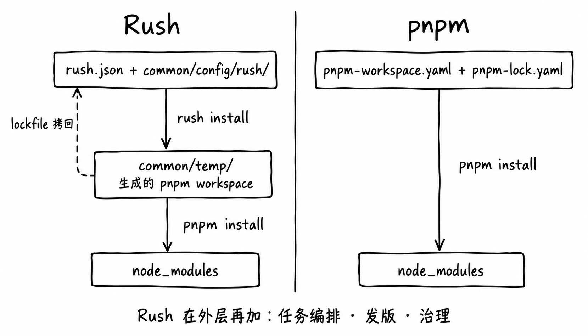

# Rush vs pnpm workspace

## 当前结论

几十个包以内、一个小团队维护的 TypeScript monorepo，直接用 pnpm workspace，发版用 [[wiki/topics/tooling/pnpm-versioning|pnpm 原生发版]] 或 changesets。Rush 比 pnpm 多出来的能力集中在构建缓存、cobuild、subspaces、依赖审批和治理，这些是为几百个项目、多个团队设计的。依据有三条：Rush 维护者自己说十几个包以内 pnpm workspace 更合适；几个大项目迁出 Rush 时给出的理由；pnpm 在 2026 年把发版、任务编排和缓存做进了自身。

## 两条路线

- **Rush** 不自己解析依赖，也不建 `node_modules`。它按 `rush.json` 在 `common/temp/` 生成一个 pnpm workspace，把 `common/config/rush/pnpm-lock.yaml` 拷进去，在那里运行固定版本的 pnpm；`rush update` 结束后再把 lockfile 拷回 `common/config/rush/`。在这层安装之外，Rush 再加任务编排、发版和治理。
- **pnpm workspace** 只有根目录的 `pnpm-workspace.yaml` 和 `pnpm-lock.yaml`，安装、过滤、按依赖顺序执行都由 pnpm 自己完成。

`common/temp/` 这层带来三个实际影响：

1. lockfile 不在仓库根目录，Dependabot（[dependabot-core#2270](https://github.com/dependabot/dependabot-core/issues/2270)，2020 年起 open）和 Renovate（[renovate#3681](https://github.com/renovatebot/renovate/issues/3681)，2019 年起 open）都不支持。公开仓库 PerfectPan/agent-kit 的 35 个 Dependabot npm PR 一个都没有合入：PR 只改 `package.json`，CI 在 `rush install` 报 "The shrinkwrap file (pnpm-lock.yaml) is out of date"。
2. lockfile 里的项目路径相对 `common/temp/` 书写（如 `../../packages/x`），迁到 pnpm workspace 时不能直接复用，要重新解析。
3. pnpm 11 起在 `pnpm run` 前默认检查依赖是否已安装（`verifyDepsBeforeRun`），在 Rush 仓库根目录会和这层布局冲突，需要在根目录 `pnpm-workspace.yaml` 里关掉。

## Rush 在 pnpm 外加的层

| 层 | Rush 做什么 | pnpm 现在的对应 |
| --- | --- | --- |
| 工具引导 | `install-run-rush.js` 免全局安装，`rush.json` 固定 Rush 和 pnpm 版本 | `packageManager` / `devEngines.packageManager`，pnpm 自动切换版本 |
| 安装管控 | 上面的 `common/temp/` 布局；`ensureConsistentVersions` 要求同一依赖全仓库一个版本；preferredVersions；subspaces；依赖审批 | catalog 和 `overrides` 覆盖大部分；全量一致性检查要加 syncpack；subspaces 和依赖审批没有 |
| 任务执行 | 按依赖图并行跑命令；增量构建；构建缓存；cobuild；phased commands；`--to`、`--impacted-by` 等项目选择 | `pnpm -r run` 和 `--filter`；11.25 起 `tasks.dependsOn`；12.4 起 `pnpm pipeline` 本地缓存、12.12 起远程缓存（实验）；cobuild 没有 |
| 发版 | change files、版本策略（lockstep / individual）、`rush version`、`rush publish`、生成 changelog | 11.13 起原生发版；或 changesets |
| 治理 | git 提交邮箱检查、git hooks、事件钩子、alerts、project tags | 没有，要另加 husky / lefthook 等工具 |
| 扩展与部署 | Rush 插件、autoinstallers、`rush deploy` | `configDependencies`、`pnpm dlx`、`pnpm deploy` |

几个 Rush 专有名词：

- **cobuild**：CI 上多台机器同时跑同一次 `rush build`，通过 Redis 锁分配任务，产出放进云端构建缓存互相复用。前提是开了云端构建缓存，官方仍标为实验。
- **subspaces**：把项目分成几组，每组一份 lockfile（`common/config/subspaces/<组名>/`），让一个团队升级依赖不必拉着所有团队一起升。
- **依赖审批**：`browser-approved-packages.json` 和 `nonbrowser-approved-packages.json` 记录允许使用的第三方包；引入新依赖时 `rush update` 把它加进清单，配合 CODEOWNERS 让指定的人审。
- **rushd**：[RFC #5863](https://github.com/microsoft/rushstack/issues/5863) 提出的常驻进程，把项目图和文件哈希留在内存里，命令行只负责转发请求；5.180、5.181 已加入默认关闭的实验配置，计划从 Rush 6 起默认开启。

## 怎么选

| 如果需要 | 优先选 | 因为 | 需要承担的代价 |
| --- | --- | --- | --- |
| 几十个包以内，装依赖、按依赖顺序跑脚本、发 npm | pnpm workspace + pnpm 原生发版或 changesets | 这些 pnpm 都原生支持，发版有原生功能或 changesets | 版本一致性检查要靠 catalog 或 syncpack；没有 Rush 的增量构建 |
| 依赖升级机器人自动改 lockfile | pnpm workspace | Dependabot 和 Renovate 都读根目录的 `pnpm-lock.yaml` | Dependabot 文档只写支持 pnpm v7–v10，维护者 2026-09-28 说"目前不正式支持 pnpm 11 或 12"（[#16397](https://github.com/dependabot/dependabot-core/issues/16397)），用新版 pnpm 要先验证 |
| 版本 PR 自动附上 changelog | changesets/action，配 changesets 或 pnpm 原生发版 | Rush 没有官方 Action，要自己写脚本 | pnpm 原生发版必须设 `versioning.changelog.storage: repository`，原因见 [[wiki/topics/tooling/pnpm-versioning\|pnpm 原生发版]] |
| 几百个项目，单机 CI 要跑几十分钟 | Rush（构建缓存 + cobuild）或 Nx | 能跨机器复用构建结果，把一次构建分给多台机器 | 要维护云端缓存和 Redis；Turborepo 和 pnpm 都没有 cobuild 对应 |
| 多个团队各自升级依赖 | Rush subspaces | pnpm 一个 workspace 只有一份 lockfile | 只有 Rush 有 |
| 新依赖必须由指定的人审批 | Rush 依赖审批 | pnpm 没有这项功能 | 只有 Rush 有；pnpm 仓库只能用 CODEOWNERS 加 CI 脚本近似 |

## 社区怎么看

官方定位：

- Rush 首页的定位是 "a scalable monorepo manager for the web"，Welcome 页写团队 "build hundreds of production NPM packages every day"。官网没有"适不适合你"这类页面。
- Rush 维护者在 [rushstack#4011](https://github.com/microsoft/rushstack/issues/4011)（2023-04）中说："a small, single-focus repo, with a dozen or less packages, PNPM Workspaces is probably a better way"，并认为 "pnpm workspaces + changesets is a very reasonable alternative to Rush's publishing solution"。另一位维护者说判断标准主要看参与的人数，Rush 面向多团队仓库。
- pnpm 的 [workspaces 文档](https://pnpm.io/workspaces)推荐 changesets 和 Rush 作为发版工具；[using-changesets](https://pnpm.io/using-changesets) 页已注明 11.13.0 起 pnpm 能原生发版。

迁出 Rush 的公开案例：

| 时间 | 项目 | 方向 | 原因（原文） |
| --- | --- | --- | --- |
| 2024-01 | [microsoft/typespec](https://github.com/microsoft/typespec/pull/2775) | → pnpm + changesets | "Remove the opinionated (wrongly so most of the time) middleman that brings more config pain than value" |
| 2025-08 | [Azure/azure-sdk-for-js](https://github.com/Azure/azure-sdk-for-js/pull/34941)，439 个项目 | → pnpm + Turborepo | "take better advantage of pnpm features and workspaces"（2024-08 首次尝试时） |
| 2026-06 | [Azure/autorest](https://github.com/Azure/autorest/pull/5190) | → pnpm + Chronus | 未写 |
| 2026-09 | [wso2/agent-manager](https://github.com/wso2/agent-manager/pull/1555) | → pnpm | "We're not working at the scale that Rush is beneficial"；冷构建从 15–20 分钟降到约 1 分 20 秒 |

2024-10 以后没找到大项目迁入 Rush 的公开 PR；仍在用 Rush 的大多是上百个项目的仓库，例如 hcengineering/platform（约 480 个项目）、coze-dev/coze-studio（前端约 259 个项目）。

趋势：

- npm 周下载量中，Rush 相当于 pnpm 的 4.1%（2024-09）、2.1%（2025-09）、0.38%（2026-09）。2026 年各包下载量都大涨，原因未核实，所以看比例。
- State of JS 2024 的 monorepo 工具 "Used at Work" 人数：pnpm 3508，Rush 147，排最后；2025 年 pnpm 3940，Rush 74，仍排最后。
- Rush 仍在活跃开发：2026 年大约 2–4 周发一版。但它跟进 pnpm 大版本要晚几个月：pnpm 12 于 2026-08-26 发布，Rush 的兼容修复 2026-10-14 才合并，还没进正式版。

## pnpm 的走向和风险

pnpm 正在从包管理器扩展成覆盖整个 workspace 的工具链（以 pnpm/rfcs 为准，2026-10）：

- 已发布：原生发版（11.13）、任务编排（11.25）、`pnpm pipeline` 和远程缓存（12.4、12.12，实验）、`tool:` 协议。
- 设计中：把冻结安装、受影响项目选择、任务图和缓存合成一条 CI 命令（[rfcs#25](https://github.com/pnpm/rfcs/pull/25)）；按包授权的 `permissions` 字段；在 `pnpm install` 时发现依赖包自带的 agent skill，人工批准后再链接；锁文件记录未压缩 tar 的哈希。
- 自家 registry：pnpr，Rust 实现，`0.1.0-alpha.15`，同时支持 npm、Cargo、Python 和 OCI 镜像，许可证是 PolyForm Shield（不是 OSI 开源协议）。

要考虑的风险：2026-07 以来 pnpm 主仓库的提交和 RFC 高度集中在一位维护者身上；新功能多数标为实验，行为还在变；周边工具（例如 Dependabot 对 pnpm 11/12 的支持）跟不上 pnpm 的发布速度。

## 相关页面

- [[wiki/topics/tooling/pnpm-versioning|pnpm 原生发版]]
- [[wiki/topics/tooling/monorepo|Monorepo]]
- [[wiki/topics/tooling/dependency-resolution|Dependency Resolution]]
- [[wiki/topics/tooling/npm-trusted-publishers|npm Trusted Publishers]]

## 来源指针

- 版本快照、逐项证据、迁移案例、下载量和本地实测记录：[[raw/sources/rush-vs-pnpm-workspace]]
- [Rush 首页](https://rushjs.io/)、[rushstack#4011](https://github.com/microsoft/rushstack/issues/4011)、[RFC #5863](https://github.com/microsoft/rushstack/issues/5863)
- [pnpm workspaces](https://pnpm.io/workspaces)、[pnpm versioning](https://pnpm.io/versioning)、pnpm v11.13.0 / v11.25.0 / v12.4.0 / v12.12.0 release notes
- [dependabot-core#2270](https://github.com/dependabot/dependabot-core/issues/2270)、[dependabot-core#16397](https://github.com/dependabot/dependabot-core/issues/16397)、[renovate#3681](https://github.com/renovatebot/renovate/issues/3681)
- [State of JS 2024 monorepo tools](https://2024.stateofjs.com/en-US/libraries/monorepo_tools/)、[State of JS 2025 other tools](https://2025.stateofjs.com/en-US/other-tools/)
- 安装布局图由生图工具绘制，内容依据 rushjs.io 的 `useWorkspaces` 说明和上述 raw 记录，不是官方图。
