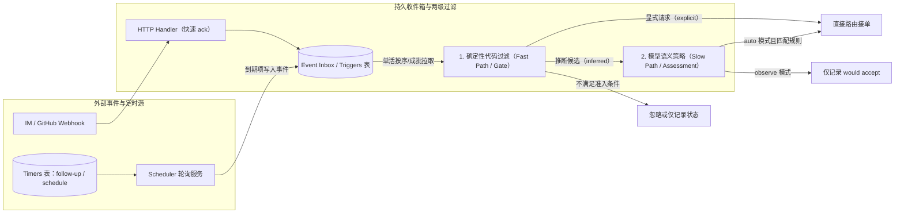
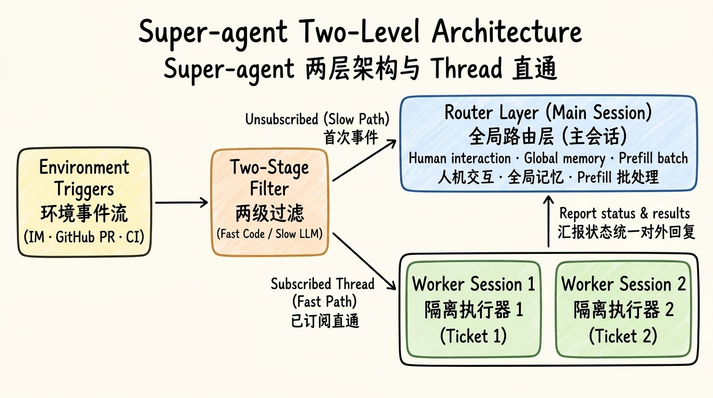
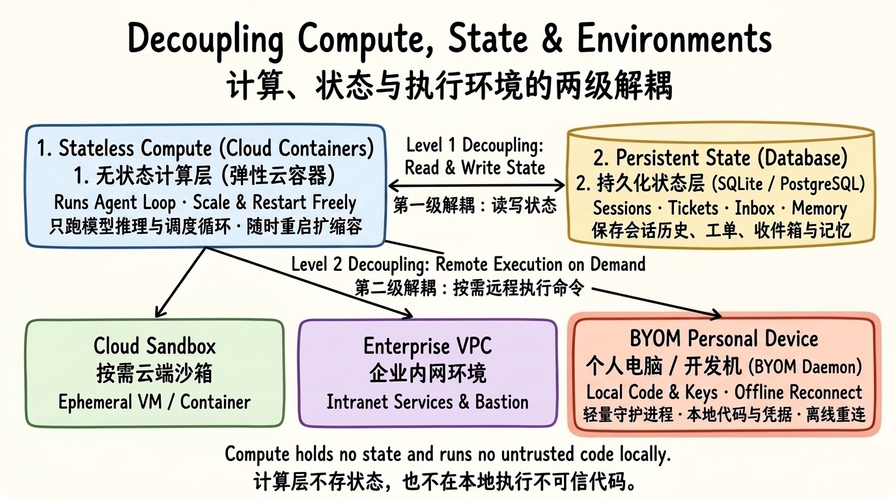

# 常驻型 Agent（Always-on / Super-agent）的系统架构

## 问题

当 [[wiki/topics/ai/personal-agent|Personal Agent 与 Super-agent]] 从“人盯着终端一问一答”演进为“7×24 监听 IM、邮件、代码仓库与定时任务，跨渠道保持上下文连续，并在后台并行推进多项任务”时，单纯靠底层的 ReAct 工具循环会遇到哪些阻塞？外围运行时需要哪些核心模块来同时保证**跨渠道上下文连续性**、**多任务并发吞吐**、**低噪音人机协作**与**长程运行自愈**？

## 简答

常驻型 Agent 并不是让单个模型会话永不停机地空转，而是“平时休眠、由事件或定时器唤醒执行一次 Run、落盘状态后再次休眠”的状态机循环。构建这套系统可分为两层演进台阶：

1. **单实例常驻基线（Anthropic 五组件）**：用 **Event Inbox**（持久化事件收件箱与单活 Worker 批处理）、**Timers**（跟进截止时间与周期调度表）、**Memory**（四类持久化文件目录）、**Permissions**（外部代理注入凭据、Auto mode 分类器与延后工具调用挂起会话）和 **Outbox**（后台控频发件箱）把普通 Agent Loop 包装成无人值守后台服务。[Anthropic 指南][always-on]
2. **跨渠道高并发架构（DeepSeek Super-agent 五模块）**：当事件流信噪比极低且多任务并发执行时，进一步拆分为 **Router + Worker 两层架构**（Router 管全局交互与记忆并利用 Prefill 自动合并突发事件，Worker 隔离上下文并发执行）、**Fast/Slow Path 二级过滤与 Thread 订阅直通**、**Inline & Spill 缓存注入与 Chain of Recall 引用图多跳召回**、**全双工异步工具调用与分渠道输出限制**，以及**计算/状态/BYOM 本地环境两级解耦 + 独立 Watchdog 巡检会话**。[DeepSeek Super-agent §1–§6][dsh-article]

## 来源事实：三份一手材料的定位对照

本文综合以下三份材料（核查细节见 [[raw/sources/building-always-on-agents|Anthropic 来源记录]] 与 [[raw/sources/deepseek-superagent|DeepSeek 来源记录]]）：

| 架构环节 | Anthropic《Building always-on agents》（2026-11-13） | DeepSeek《Exploring Super-agent Design》（2026-11-01） | `dsh-superagent-prototype`（`8c32a9dc`）开源实现 |
| --- | --- | --- | --- |
| **1. 触发与过滤** | **Event Inbox + Timers**：HTTP Handler 快速写库 ack；Scheduler 轮询 `follow-up` 与 `schedule` 定时器表推入 Inbox | **Triggers + 二级过滤 + 投机执行**：确定性代码（Fast Path）筛除群聊噪音，模型语义策略（Slow Path）研判候选；后台静默预执行 | `Source` 记录读取游标产生不可变 `Trigger`；`Eval` 分确定性 `Gate`（白名单、准入表、强度分级）与模型 `Assessment`；支持 `off / observe / auto` 模式 |
| **2. 会话与路由** | 单 Inbox 绑定单活 Worker，按事件决定恢复已有 Session 或新建 Session，支持合并连续事件 | **Router + Worker 两层架构 + Thread 直通**：单长生命周期 Router Session 负责全局交互与派单（Prefill 批处理）；Worker Session 隔离执行并订阅 `Thread` 直通接收后续事件 | 主会话（`orchestrator`）运行 `dsh-superagent-router`；每个获批 `Ticket` 绑定独立 `worker-<ticket id>` 会话与 `git worktree` 目录；`Subscription` 实现多对多扇出（Fan-out）与超范围 `handback` |
| **3. 记忆与上下文** | **四类持久文件 + Dreaming**：`User instructions`、`User notes`（索引+分文件）、`Past messages`、`Task progress`，配合离线 `dreaming` 与 `compaction` | **Inline & Spill + Chain of Recall**：上下文作缓存，按局部性内联摘要与相邻消息、超长截断留指针；对象内联关联 ID 构成引用图支持多跳召回 | 单一 SQLite `Store` 持久化 `Triggers`、`Threads`、`Tickets`、`Decisions` 与带版本号的提示词/策略；通过 `Correlation` 关联跨 Thread 上下文 |
| **4. 环境解耦与自愈** | Worker 无状态化，Inbox、Timers、Memory、Session 均存于外部数据库或对象存储 | **计算/状态/环境两级解耦 + Watchdog**：云端无状态容器跑 Agent Loop，通过轻量 daemon 连接用户个人电脑（**BYOM**）；外部独立 Watchdog Session 巡检死循环与故障 | 单机进程持目录锁访问 SQLite；所有外部动作先在事务内写入 `Effects` 持久队列，提交后按指数退避重试；前台命令满 5 秒自动转后台作业 |
| **5. 权限与投递** | **Proxy + Auto mode + Deferred Calls + Outbox**：外部代理填凭据；高危动作挂起 Session 等用户卡片确认；Outbox + Dispatcher 控制通知节奏 | **多渠道规范**：Worker 绝不直接对人说话；Router 按渠道定制密度（IM ≤100 词轻打扰，GitHub/邮件高密度结构化输出） | 不可变 `Mandate` 记录策略版本、强度与范围，恢复前执行 `revalidate`；`Outbox` 按同一 Ticket 同一会话严格保序重试；Web Panel 仅展示需人工处理的阻塞项 |

> **证据边界说明**：DeepSeek 长文明确说明其探讨的是通用架构设计，开源仓库 `dsh-superagent-prototype` 是针对单 GitHub 仓库与飞书接入整理的参考原型；长文中的**跨设备 BYOM 守护进程、独立 Watchdog Session 与投机执行**属于架构演进方向或内部实践，并未包含在 `8c32a9dc` 原型包代码中。[dsh-superagent README][dsh-readme]

---

## 综合结论：按请求生命周期的五层架构设计

下面围绕一个具体场景贯穿全文：**用户在飞书群里反馈某个功能存在边界 bug，随后又在对应的 GitHub Pull Request 评论区补充要求“顺便把配置项默认值改掉”**，拆解常驻型 Agent 从接收事件到交付结果的五个核心环节。

### 环节一：事件接入、定时唤醒与两级降噪

常驻型 Agent 的输入不再是人工在终端里敲入的单条指令，而是来自 IM、Webhook、CI 和定时器的连续事件流。如果让各个事件源直接调用 Agent 循环，两个同时到达的事件会启动相互覆盖的竞争运行，进程重启也会直接丢失在途事件。[Anthropic 指南][always-on]

1. **持久化收件箱（Event Inbox）与快速确认**：
   - 接收端（HTTP Handler）只做签名校验与基于源端事件 ID 的幂等去重，将事件追加到数据库表后立即返回 HTTP 200，避免 Webhook 因超时重发；耗时检查（如提示词注入检测）留到运行阶段执行。[Anthropic 指南][always-on]
   - 每个状态作用域（如单个用户或单个 `Thread`）在同一时刻只允许一个活跃 Worker / Eval 处理，以数据库中的收件箱作为唯一真实底稿；运行崩溃后新实例直接从收件箱未完成记录恢复。[Anthropic 指南][always-on]、[dsh-superagent Domain][dsh-domain]
2. **定时器（Timers）通过收件箱统一触发**：
   - 定时任务分为两类：Agent 在运行中为自己设定的单次跟进截止时间（**follow-up**，例如“2 小时后检查 PR CI 是否通过”），以及固定周期的例行任务（**schedule**，例如“每天早上 9 点汇总未处理 Issue”）。[Anthropic 指南][always-on]
   - 定时器存放在独立于 Inbox 的数据库表中，由后台 Scheduler 定期扫描：将到期的 follow-up 标为完成，将 schedule 的到期时间推进到下一周期，然后向 Inbox 插入一条普通事件唤醒 Worker，从而复用同一套单活消费与重试链路。[Anthropic 指南][always-on]
3. **两级事件过滤（Fast Path 代码准入 + Slow Path 模型研判）**：
   - 接入真实群聊和代码仓后，绝大多数消息无需 Agent 介入。如果每条消息都调大模型判断，延迟和 Token 成本都会失控。[DeepSeek Super-agent §3.1][dsh-article]
   - **第一级（Fast Path / Gate）**：用确定性代码检查事件源、群组、发送者白名单与机器人列表，把事件划分为**显式请求（explicit，如白名单成员直接 `@agent`）**、**推断候选（inferred，如群内普通讨论或白名单 bot 告警）**与**忽略（not admitted）**，在调用模型前筛除绝大多数无关噪音。[DeepSeek Super-agent §3.1][dsh-article]、[dsh-superagent Authorization][dsh-auth]
   - **第二级（Slow Path / Assessment）**：仅将候选事件交给模型，对照用自然语言编写的团队规则（Policy rules）判断是否需要主动介入。为防止新规则上线后产生大量噪音扰民，工程上应默认开启 **观察模式（`observe`）**——模型正常评估并记录“本来会接单（would accept）”，但不实际创建任务；待团队审阅记录确认准确率后，再切到自动接单（`auto`）。[dsh-superagent Philosophy][dsh-phil]、[dsh-superagent Authorization][dsh-auth]
4. **投机执行（Speculative Execution / Acting Ahead）**：
   - 在算力允许时，Agent 可根据早期环境信号在后台静默启动准备工作：例如收到会议邀请邮件时先查日历冲突并备好回复草稿；或在研发群看到有人讨论疑似 bug 时，后台静默尝试复现与修复，只有确认问题真实存在且修法简单时才发出 PR，否则全程保持沉默并将中间结果丢弃。[DeepSeek Super-agent §3.4][dsh-article]

---

### 环节二：两层会话路由、Thread 订阅直通与全双工交互

当用户在飞书群报了 bug、同时又有另外三个开发任务在进行时，系统面临**全局上下文连续性**与**多任务并发吞吐**的直接取舍：若把所有事件都塞进同一个 Session，单步 ReAct 循环会串行阻塞且不同任务的中间输出互相干扰；若每个事件都新建独立 Session，当用户在 GitHub PR 里修改飞书群提过的需求时，新 Session 又拿不到此前的全局背景。[DeepSeek Super-agent §2][dsh-article]

1. **Router + Worker 两层架构解耦连续性与吞吐量**：
   - **Router 层（主会话）**：维护全局长生命周期上下文，承接所有入口的人类交互，充当系统的全局顺序点与协调点。为避免成为性能瓶颈，Router **不直接执行具体编码或耗时命令**（甚至可以不挂载 Bash 工具），只做轻量对话与任务派发。[DeepSeek Super-agent §2.1][dsh-article]
   - **Router 层的自动批处理（Batching）**：当外部事件突发到达时，在 Router 当前推理轮次期间积压的多个 Triggers 会自动合并，在下一轮一次性注入模型。由于 Router 主要是长输入、短输出，合并后的多个事件在模型 Prefill 阶段并行计算，单次请求耗时随批量增长极慢。DeepSeek 的压测显示，当需要决策的 Trigger 到达率从 1 个/分钟升至 40 个/分钟时，平均批大小从 1.0 升至 2.8，单次请求耗时仅从 2.5 秒增至 3.9 秒，**每次决策的分摊推理耗时反而从 6.4 秒降至 1.6 秒**。[DeepSeek Super-agent §2.1, §7.2][dsh-article]
   - **Worker 层（执行器会话）**：每个获批任务（Ticket）分配独立的 Worker Session 与专属工作目录（如通过 `git worktree` 检出独立分支），使用最强模型执行复杂工具调用。Worker 绝不直接向外部渠道发消息，其冗长的推理与工具日志留在内部，仅将关键状态通过结构化 `Report` 汇报给 Router。[DeepSeek Super-agent §2.2][dsh-article]、[dsh-superagent Execution][dsh-exec]
2. **Thread 订阅与直通（Subscription & Pass-through）**：
   - 如果已指派任务的每一条后续跟进（如 PR 上的连续 review 评论或 CI 报错）都要再经过 Router 转发，Router 仍会承担大量重复开销。因此系统将同一 GitHub PR、同一飞书话题或同一邮件串上的连续事件定义为一条 **Thread**。[DeepSeek Super-agent §3.2][dsh-article]
   - Router 为某条 Thread 的首个事件创建 Worker 后，该 Worker 直接**订阅（Subscribe）**这条 Thread（以及它自己新开的 PR Thread）。此后该 Thread 上的跟进消息由确定性代码**直通（Pass-through / Fan-out）**送达订阅它的 Worker，无需 Router 再次调用工具转发；若 Worker 发现某条跟进超出了当前工单的授权范围（Mandate scope），再调用 `handback` 退回给 Router 重新评估派单。[DeepSeek Super-agent §3.2][dsh-article]、[dsh-superagent Authorization][dsh-auth]
   - **消融实验效果**：在 DeepSeek 的 300 条消息（含约 20 个工作请求）合成负载实验中（跑 5 次取均值），`Super-agent` 的任务完成时间 p50 / p95 为 **12.4 / 15.7 分钟**，显著快于依赖提示词让单 Session 自行决定是否调 Subagent 的方案（中性提示词下 5 次均未调子代理，p50 / p95 达 **20.4 / 29.5 分钟**；委派优先提示词下仍有 1 次自行执行产生长尾，p50 / p95 为 **13.8 / 29.0 分钟**）。而在 `Super-agent` 内部，开启 Thread 直通与关闭直通相比，完成时间相当（12.4/15.7 vs 12.6/15.5 分钟），但**关闭直通会使 Router 决策次数增加约 30%，全系统每次运行的 cache-read tokens 从 23.2M 升至 31.8M（增加约 37%）**。[DeepSeek Super-agent §7.1][dsh-article]
3. **全双工异步工具调用（Full-Duplex Interaction）**：
   - 在会话内部，为避免长耗时命令阻塞前台对话，需要将半双工同步工具调用改为全双工异步调用：模型调用 `start()` 立即收到 `"Started"` 返回并结束当前步骤，从而能立刻响应人类发来的新消息或 `stop()` 取消指令；后台工具执行完毕后再作为一条新事件注入会话。[DeepSeek Super-agent §4.1][dsh-article]
   - 在 `dsh-superagent-prototype` 的工程实现中，这一机制被进一步具体化为 **5 秒自动转后台规则**：Router 与 Worker 预设对运行超过 5 秒的前台 shell 命令自动转为后台 job，使 Worker 在下一步即可接收新消息；同时并发槽位（`WorkerSlots`）专门为“人类发来的跟进消息或状态查询”预留 1 个额外槽位，防止后台新任务占满并发上限导致人类无法插话。[dsh-superagent Execution][dsh-exec]

---

### 环节三：跨运行记忆、Inline & Spill 与引用图多跳召回

常驻型 Agent 跨越成百上千次短运行（Runs）与多个隔离会话，记忆设计必须同时解决**跨运行状态延续**和**上下文窗口容量限制**两个问题：

1. **Anthropic 的四类持久文件记忆（按读写频率分层加载）**：
   - 经验原则是**只保存无法从外部系统再次查到的信息**；如果状态已经在 Issue 追踪器或代码库里，记忆中只存指针。[Anthropic 指南][always-on]
   - 将持久存储（数据库或对象存储）映射为四类文件目录：
     - **User instructions（用户指令）**：用户对 Agent 行为习惯的长期要求，每次 Run 启动时全量加载（配合 Prompt Caching 降低固定前缀成本）。
     - **User notes（用户笔记）**：了解到的用户角色、偏好与历史纠正；初期单文件全载，随规模增长拆为多个小文件，每次 Run 启动**只加载索引**，需要时按需拉取明细文件。
     - **Past messages（已发消息记录）**：记录已经告诉过用户的内容，防止跨 Run 重复汇报同一结论。
     - **Task progress（任务进度）**：每个长程任务维护一份已完成项与剩余项清单，同样在 Run 启动时**只加载索引**，按需读取具体文件续接工作。
   - 此外，可在后台运行离线整理任务（**Dreaming**），定期审阅历史会话以替换过期条目、提炼跨多轮运行才显现的模式；当单个会话过长时，通过上下文压缩（Compaction）或转存关键结论后开启新会话。[Anthropic 指南][always-on]
2. **DeepSeek 的缓存式上下文注入（Inline & Spill）与引用图多跳召回（Chain of Recall）**：
   - 当环境事件持续涌入时，把完整事件内容全部塞进上下文会迅速稀释模型注意力，而塞得太少又会导致模型反复调工具查询。DeepSeek 将上下文窗口视为缓存，拆解为两个基本操作：[DeepSeek Super-agent §3.3][dsh-article]
     - **Inline（按时空局部性内联）**：初始只给当前对象的唯一 ID 与简短摘要（如前 50 个字符），并利用局部性直接内联最可能立刻用到的相邻信息（如一条 IM 消息前后的几条群聊、它所回复的原消息、同一代码评审线程中的相邻评论，以及直接关联对象的 ID）。
     - **Spill（超长溢出留指针）**：对超过长度上限的正文直接截断，在上下文中只留读取指针，由模型按需调用读取工具拉取全文。
   - **Chain of Recall（引用图多跳召回）**：由于大量后续事件通过 Thread 直通绕过了 Router，且历史任务不断累积，Router 无法在窗口里保留所有旧任务的完整历史。系统为 `Trigger`、`Thread`、`Worker Session` 统一分配唯一 ID，并在每次注入或工具返回时内联下一跳关联对象的 ID 与摘要，从而将这些对象连接成一张**引用图（Reference Graph）**。当用户在另一个渠道突然提起旧任务时，Router 可以从当前消息的 Thread 出发，顺着内联 ID 逐跳检索关联的 Worker Session 及另一条 PR Thread，按需恢复任意深度的历史上下文。[DeepSeek Super-agent §3.3][dsh-article]

---

### 环节四：计算、状态与执行环境两级解耦及外部自愈

要让 Agent 真正做到常驻在线并操作真实工作环境，必须解除本地单机 Agent 将**计算（Agent Loop）**、**持久状态（Session State）**和**执行环境（代码仓、工具链、内网服务）**绑死在同一台机器上的限制：[DeepSeek Super-agent §5][dsh-article]

1. **第一级解耦（计算与状态分离）**：运行 Agent Loop 的进程保持无状态，随时可扩缩容、重启或替换；所有会话历史、事件收件箱、工单状态与待执行副作用全部持久化到数据库（这与 [[wiki/syntheses/ai/agent-harness-runtime-architecture|Agent Harness 运行时架构与演进]] 中 [[wiki/topics/ai/tetral|Tetral]]、[[wiki/topics/ai/pi-durable|Pi Durable]] 的路线一致）。[Anthropic 指南][always-on]、[DeepSeek Super-agent §5.1][dsh-article]
2. **第二级解耦（云端 Agent Loop 与重状态执行环境分离，支持 BYOM）**：
   - 真实工作环境往往包含未提交的本地代码改动、私有凭据、内网服务依赖或特定硬件工具链，强行同步到云端沙箱成本极高且容易遗漏。[DeepSeek Super-agent §5.2][dsh-article]
   - 因此可以让 Agent Loop 留在云端，而把重状态执行环境留在原地：无论是云端按需沙箱、企业 VPC，还是用户日常使用的个人电脑/开发机（**BYOM，Bring Your Own Machine**），都只需运行一个**不保存任何会话状态的轻量守护进程（daemon）**，仅负责接收命令、执行并返回结果。当用户的个人电脑睡眠离线再重连时，云端 Agent 会自动唤醒并继续执行挂在该设备上的待办任务（节点接入与隧道机制可对照 [[wiki/syntheses/architecture/machine-identity-and-agent-provisioning|机器身份与 Agent 节点自举授权范式]]）。[DeepSeek Super-agent §5.2][dsh-article]
3. **两层可靠性保障：事务内持久化副作用队列 + 外部独立 Watchdog**：
   - **进程内状态与外部动作对齐**：在 `dsh-superagent-prototype` 中，所有领域状态变更在单个 SQLite 事务中完成，而需要发往外部的动作（如唤醒主会话评估 `assessment`、启动执行器 `launch`、投递输入 `delivery`、外发渠道回复 `reply`）在事务内写入持久化队列 `Effects`，等事务 `afterCommit` 成功后才由后台处理器按指数退避重试执行，重启后未完成项自动续跑并向 Worker 注入恢复提示（提醒先检查工作目录、`git` 历史与 GitHub 状态再重做外部写操作）。[dsh-superagent Execution][dsh-exec]、[dsh-superagent Architecture][dsh-arch]
   - **外部独立控制循环（Watchdog Session）**：传统进程存活探针只能发现崩溃，无法发现“进程还活着，但模型在原地死循环或偏离任务目标”。DeepSeek 在主系统之外独立运行一个由定时消息驱动的 **Watchdog Session**（自身也是带完整工具的 Agent），既处理 API 报错和状态恢复失败，也用模型判断各 Worker 是否有实质进展；维护者还可以直接用自然语言向 Watchdog 询问故障原因，或让它在系统运行期间在线增删提示词、调整触发规则。[DeepSeek Super-agent §6][dsh-article]

---

### 环节五：无人值守权限控制与少打扰发件箱（Outbox）

常驻型 Agent 持有用户权限并在后台无人值守运行，权限失控与消息轰炸是落地时最直接的两个风险：[Anthropic 指南][always-on]、[DeepSeek Super-agent §4.2, §8.4][dsh-article]

1. **凭据代理隔离（Credential Proxy）**：
   - Agent 运行环境内不存放明文密码或长效访问令牌；Agent 发起不带凭据的请求，由运行环境之外的代理（Proxy）在转发前注入真实凭据，或者通过受控包装命令（如绑定专用 bot 账号的 CLI）访问服务，防止模型上下文泄露密钥。[Anthropic 指南][always-on]、[DeepSeek Super-agent §8.4][dsh-article]、[dsh-superagent Execution][dsh-exec]
2. **风险分级、不可变授权凭据（Mandate）与延后工具调用（Deferred Tool Calls）**：
   - **Auto mode 分类器拦截**：对中高风险动作先过安全分类器，拦截危险操作并让模型寻找替代做法。[Anthropic 指南][always-on]
   - **Deferred tool calls（挂起会话等人工确认）**：当遇到必须由人类拍板或补充信息的工具调用时，Agent 保存当前处于调用中途的 Session 状态并**立即结束本次 Run**；向用户推送一张交互式审批卡片（如基于 MCP Apps 或外部企业 [[wiki/topics/ai/personal-agent-protocol|Poppy `operations` 扩展]] 的条款确认单）。在等待用户回复期间，Worker 槽位立即释放去处理其他事件，不会空转阻塞；等用户点击批准或回复后，该回复作为新事件进入 Inbox，启动一次新 Run 并恢复此前保存的 Session 继续执行。[Anthropic 指南][always-on]、[dsh-superagent Execution][dsh-exec]
   - **Mandate（授权范围与版本重校验）**：在团队协作场景下，`dsh-superagent` 为每个获批工单生成不可变的 `Mandate`，记录批准时的策略版本（Policy version）、触发强度（`explicit` 或 `inferred`）及允许的操作范围。当已结束的工单因后续消息准备恢复时，必须先对照当前最新策略重新校验（`revalidate`）——若发起人已被移出白名单或主动接单模式已关闭，则撤销恢复。[dsh-superagent Authorization][dsh-auth]
3. **发件箱（Outbox）与分渠道注意力保护**：
   - 每次后台运行结束只有三种出口：向 Outbox 写入结果消息、判断无需通知而静默结束、或发起 Deferred tool call 请求人工介入。[Anthropic 指南][always-on]
   - **保序与控频派发**：Outbox 表与后台 Dispatcher 负责消息重试与节奏控制。在 `dsh-superagent-prototype` 中，同一工单发往同一会话的消息严格按入队顺序发送（确保“已接单确认”一定先于“最终结果”送达），单条连续失败 3 次才上报系统告警，且不同工单之间的消息互不阻塞。[Anthropic 指南][always-on]、[dsh-superagent Execution][dsh-exec]
   - **分渠道定制信息密度**：
     - **IM 群聊等即时通道**：只在需要人做决定、签字批准或交付可用结果时说话，中间过程保持安静；DeepSeek 验证过的一条简单有效的规则是**限制 IM 单条回复不超过 100 词**，且每次只问一个具体问题。[DeepSeek Super-agent §4.2][dsh-article]、[dsh-superagent Philosophy][dsh-phil]
     - **GitHub PR / 邮件 / 文档等异步通道**：输出结构化、高信息密度的完整背景、变更说明与验证结果。[DeepSeek Super-agent §4.2][dsh-article]
   - **注意力面板（Attention-first Panel）**：管理界面只置顶展示正在等待人工回答（`Awaiting answer`）、等待审阅（`Awaiting review`）或投递/执行失败（`Blocked · Failed`）的工单，正常运转的状态不占用视觉空间。[dsh-superagent Philosophy][dsh-phil]、[dsh-superagent Execution][dsh-exec]

---

## 使用限制与还需要确认什么

1. **单 Router Session 的吞吐上限与分片代价**：在团队规模适中时，依靠 Prefill 自动批处理与 Thread 订阅直通，单个长生命周期 Router Session 即可应对（压测至 40 Triggers/分钟未见瓶颈）。但当并发任务规模继续扩大且跨任务强耦合时，何时需要对 Router 做多级过滤或水平分片（Sharding）、以及分片后如何弥补全局共享记忆的割裂，目前尚无定论。[DeepSeek Super-agent §2.1, §8.1][dsh-article]
2. **无 Session 界面下的半途人工接管交互**：隐藏底层多 Session 后，用户在任务启动和最终验收时体验自然，但在复杂任务执行中途如何优雅地实时介入、接管或与后台 Worker 协同修改细节，仍需按具体业务领域定制交互形态。[DeepSeek Super-agent §8.2][dsh-article]
3. **跨实例与跨组织的 Agent-to-Agent（A2A）权限边界**：单个 Super-agent 实例内部共享全局上下文；当每个成员拥有自己的 Personal Agent、各团队拥有独立 Super-agent，甚至需要与外部商业公司的 Company Agent 协同（参见 [[wiki/topics/ai/personal-agent-protocol|Personal Agent Protocol（Poppy）]]）时，如何在不共享底层上下文且代表不同权限主体的前提下安全协作，是下一阶段的核心工程问题。[DeepSeek Super-agent §8.3][dsh-article]
4. **实验数据的适用前提**：文中所引 DeepSeek 消融实验（p50 12.4 分钟、37% cache-read token 差异）与 Router 批处理数据均基于合成消息流与模拟耗时工具测得（运行 5 次取均值），尚未在真实复杂代码生成任务上公布大规模对照基准，实际节省比例取决于单个 Thread 的平均跟进轮数与上下文体积。[DeepSeek Super-agent §7][dsh-article]

## 相关页面

- [[wiki/topics/ai/personal-agent|Personal Agent 与 Super-agent]]
- [[wiki/topics/ai/personal-agent-protocol|Personal Agent Protocol（Poppy）]]
- [[wiki/syntheses/ai/agent-loop-control-boundaries|Agent 循环工作流的控制边界]]
- [[wiki/syntheses/ai/agent-harness-runtime-architecture|Agent Harness 运行时架构与演进]]
- [[wiki/topics/ai/pi-durable|Pi Durable：可恢复的 Agent 执行库]]
- [[wiki/topics/ai/tetral|Tetral]]
- [[wiki/topics/ai/rivet-agentos|Rivet agentOS：执行环境与持久会话]]
- [[wiki/topics/ai/botmux|Botmux：在飞书中使用本地 Coding CLI]]
- [[wiki/syntheses/architecture/machine-identity-and-agent-provisioning|机器身份与 Agent 节点自举授权范式]]

## 来源指针

- [[raw/sources/building-always-on-agents|Anthropic《Building always-on agents》核查记录]]
- [[raw/sources/deepseek-superagent|DeepSeek《Exploring Super-agent Design》与 dsh-superagent-prototype 核查记录]]
- [Anthropic: Building always-on agents][always-on]（William Hu，2026-11-13）
- [DeepSeek Harness: Exploring Super-agent Design: Towards a More Autonomous Agent System][dsh-article]（Yujia Qiao 等，2026-11-01）
- [deepseek-ai/dsh-superagent-prototype][dsh-readme]（固定提交 `8c32a9dc5d72c033816c6a8110b37f40cf94fba4`）：[000 Philosophy][dsh-phil]、[001 Domain model][dsh-domain]、[002 Authorization][dsh-auth]、[003 Execution][dsh-exec]、[007 Architecture][dsh-arch]

[always-on]: https://claude.com/resources/articles/building-always-on-agents
[dsh-article]: https://x.com/DeepSeekHarness/status/2116857257245987236
[dsh-readme]: https://github.com/deepseek-ai/dsh-superagent-prototype/blob/8c32a9dc5d72c033816c6a8110b37f40cf94fba4/README.md
[dsh-phil]: https://github.com/deepseek-ai/dsh-superagent-prototype/blob/8c32a9dc5d72c033816c6a8110b37f40cf94fba4/docs/000-philosophy.md
[dsh-domain]: https://github.com/deepseek-ai/dsh-superagent-prototype/blob/8c32a9dc5d72c033816c6a8110b37f40cf94fba4/docs/001-domain.md
[dsh-auth]: https://github.com/deepseek-ai/dsh-superagent-prototype/blob/8c32a9dc5d72c033816c6a8110b37f40cf94fba4/docs/002-authorization.md
[dsh-exec]: https://github.com/deepseek-ai/dsh-superagent-prototype/blob/8c32a9dc5d72c033816c6a8110b37f40cf94fba4/docs/003-execution.md
[dsh-arch]: https://github.com/deepseek-ai/dsh-superagent-prototype/blob/8c32a9dc5d72c033816c6a8110b37f40cf94fba4/docs/007-architecture.md
