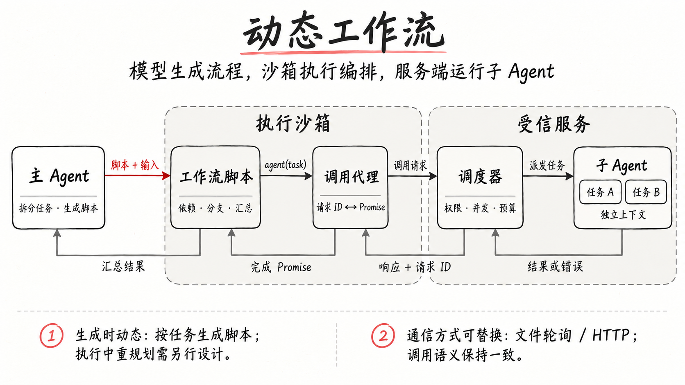

# 动态工作流：用沙箱脚本编排多 Agent

动态工作流由模型根据当前任务组织子任务、依赖和并发。用代码编排时，模型生成脚本，脚本在沙箱中调用工具或子 Agent，处理分支并汇总结果；权限检查和资源限制由运行时负责。

## 已有实践

- **程序化工具调用**：Claude 的 Programmatic Tool Calling（PTC）允许模型编写 Python 代码，在沙箱内调用工具、处理数据，并用 `asyncio.gather` 并发调用。需要外部工具结果时，代码执行暂停，API 返回 `tool_use`；调用方回传 `tool_result` 后，代码继续执行，最终输出再进入模型上下文。[Claude PTC 文档](https://platform.claude.com/docs/en/agents-and-tools/tool-use/programmatic-tool-calling#how-programmatic-tool-calling-works)
- **动态任务分解**：Anthropic 的 orchestrator-workers 模式由主模型根据具体输入拆分任务、委派给工作模型并汇总结果，子任务无需提前固定。[Building effective agents](https://www.anthropic.com/engineering/building-effective-agents)
- **子 Agent 上下文隔离**：Claude Code 的 subagents 使用各自的上下文、系统提示词、工具访问范围和权限，完成后把结果交回主对话。[Claude Code subagents](https://code.claude.com/docs/en/sub-agents)

这些机制可以组合：把子 Agent 包装成异步工具函数，就能用脚本表达它们之间的调用顺序和结果依赖。具体的代理接口、调度策略和通信方式仍由应用实现决定。

## 动态发生在哪里

每次收到任务后，主 Agent 决定怎样拆分、哪些任务并发、结果如何汇总，并生成相应脚本。流程结构随任务变化，执行时的依赖关系由脚本表达。

动态也可以发生在执行过程中：脚本根据中间结果选择分支、展开更多任务。条件和循环控制这些变化；需要重新判断整体计划时，再由模型介入。生成代码、执行代码分支和让模型重新规划，是不同的操作。

工作流规定子任务之间的控制顺序，每个子 Agent 内部仍可根据结果决定下一次工具调用。这两层可以组合，动态生成的流程也仍然需要权限、预算和终止条件。

## 从一个任务出发

假设要写一份技术评估：先并行分析几个模块，再逐份校验分析结果，最后汇总成报告。主 Agent 负责拆分任务、提供必要上下文并验收结果；脚本负责执行已经明确的依赖关系。

脚本编排中的职责分工：

| 运行位置 | 负责什么 |
| --- | --- |
| 主 Agent | 决定任务目标、拆分方式和验收要求，读取最终结果 |
| 执行沙箱 | 运行生成的编排脚本，保存中间变量，处理条件、循环和聚合 |
| 受信服务 | 校验调用权限，分配资源，运行子 Agent 的模型与工具循环，记录状态 |

子 Agent 可以是一个独立的对话上下文和异步运行循环，是否另启进程是实现选择。脚本运行在独立环境里，并不意味着每次调用子 Agent 都要创建一个操作系统进程。

## 脚本只需要少量能力

用 `agent`、`parallel`、`pipeline` 这组伪代码接口表达子任务调用、并发和阶段依赖：

| 能力 | 作用与调用约定 |
| --- | --- |
| `agent(task)` | 提交一个子任务，异步返回结果；角色、工具与预算由服务校验 |
| `parallel(tasks)` | 接收尚未启动的任务函数，在并发额度内调度，按输入顺序汇总结果 |
| `pipeline(items, ...stages)` | 每个输入依次经过各阶段；不同输入可以重叠执行，无需每阶段全局等待 |
| 进度与日志 | 上报阶段变化和诊断信息，与最终结果分开 |
| 输入参数 | 提供结构化输入，避免把全部内容拼进生成代码 |

分支、循环和结果转换可以直接用编程语言表达。例如，先分析并校验各模块，再汇总结果：

```js
const analyses = await parallel(input.modules.map(module => async () => {
  const analysis = await agent({ task: "分析模块", input: module });
  return agent({ task: "校验分析", input: { module, analysis } });
}));

return agent({ task: "汇总技术评估", input: analyses });
```

每个模块完成分析后即可开始校验，汇总则等待所有模块完成。`parallel` 和 `pipeline` 还要明确失败语义：遇到错误是终止整个任务，还是返回带状态的部分结果。拒绝一个 Promise 不等于取消已经启动的其他任务，取消需要单独实现。

## `agent()` 如何跨过沙箱边界

沙箱中的 `agent()` 可以是一个调用代理：它发送结构化请求，保存等待结果的 Promise，收到对应响应后再恢复脚本执行。



图中节点表示职责，不表示每个节点对应一个独立进程。[配图提示词](../../../raw/assets/sandboxed-agent-workflows-field-notes-prompt.txt)

可以借鉴 JSON-RPC（远程过程调用协议）的做法：请求与响应通过 `id` 关联，结果和错误有明确字段，消息语义独立于传输方式。[JSON-RPC 的请求与响应定义](https://www.jsonrpc.org/specification#request_object)支持这些基础机制；任务取消、预算和恢复则需要另外定义。

每次调用还需要绑定到工作流实例。服务应从可信连接或授权信息确定归属，不能只信任脚本提交的实例 ID。超时、取消和沙箱退出时，需要释放等待项、停止后续派发，并处理仍在运行的子任务与迟到响应。

## 文件轮询与 HTTP 怎么选

如果现有沙箱平台只提供“服务端执行命令、读文件、写文件”，可以用文件作为请求和响应通道：脚本写请求，服务端轮询读取并执行，再写回结果，脚本读取后继续运行。这是复用已有能力的一种选择。

如果沙箱能访问受控网关，也可以直接使用 HTTP（超文本传输协议）。长任务可以先返回任务标识，再查询或订阅结果。JSON-RPC 本身也明确不绑定某种传输方式。[协议概述](https://www.jsonrpc.org/specification#overview)

| 方案 | 适用前提 | 需要承担的工作 |
| --- | --- | --- |
| 文件通道与轮询 | 已有可靠的文件读写或命令通道，暂时没有反向调用入口 | 处理轮询开销、写入未完成的记录、重复读取、清理与存活检测 |
| HTTP 请求与结果查询或订阅 | 有可达的服务入口，能管理工作流级授权 | 处理身份绑定、连接中断、重复提交、超时、取消与结果查询 |

先确定请求 ID、结果格式和失败语义，再选择通信方式；以后更换传输层时，脚本里的 `agent()` 可以保持不变。仅把消息写进文件不会自动得到断点恢复：还需要保存任务状态，并处理外部动作重复执行的问题。

## 并发与隔离要分别设计

如果子 Agent 的主要时间花在等待模型或工具响应，异步服务可以让多个任务重叠等待。但同步计算、大对象序列化和结果缓存仍会消耗处理器时间与内存。Node.js 官方指南说明了非阻塞 I/O（输入输出）的工作方式，也特别提醒大对象的 `JSON.parse` / `JSON.stringify` 会阻塞事件循环。[事件循环与阻塞操作](https://nodejs.org/en/learn/asynchronous-work/dont-block-the-event-loop)

因此，单个工作流的并发额度之外，还应有服务总量限制、排队策略、调用预算和结果大小上限。多个子 Agent 即使使用独立上下文，仍可能共享同一进程的资源与故障影响范围。

另有三条边界需要明确：

- **代码执行边界**：生成的脚本应在可以单独终止、限制资源与访问范围的环境中执行。单独一个进程也不自动具有完整的沙箱权限隔离。Node.js 官方明确说明 `node:vm` 不是安全机制，不能把它当作运行不可信代码的安全边界。[VM 文档](https://nodejs.org/api/vm.html#vm-executing-javascript)
- **工作区边界**：上下文独立不等于文件独立。子 Agent 共享文件时，要约定修改归属、串行写入或使用独立工作区，再由明确的步骤整合结果。
- **权限边界**：服务保留凭据并校验每次调用，脚本只获得本任务需要的能力。子 Agent 的输出仍需校验；拥有调用入口不代表可以任意选择工具或扩大权限。

## 如何做一个最小验证

可以先用模拟子任务验证调用链，不急着接真实模型：让任务乱序完成，确认结果仍能匹配正确请求；注入单任务失败与超时，确认其他任务按约定继续或取消；终止脚本，确认后台任务和等待项得到处理。

再接入少量真实任务，检查并行是否缩短总耗时、排队和内存是否可控，以及部分失败能否被主 Agent 明确识别。只有需要跨重启继续执行时，再设计持久状态、幂等调用与恢复规则。

## 相关页面

- [[wiki/topics/ai/agent-harness|Agent Harness]]
- [[wiki/syntheses/ai/agent-harness-runtime-architecture|Agent Harness 运行时架构与演进]]
- [[wiki/syntheses/ai/agent-team-roles-and-collaboration|Agent 团队的角色分工与协作模式]]

## 来源指针

- [Claude — Programmatic tool calling](https://platform.claude.com/docs/en/agents-and-tools/tool-use/programmatic-tool-calling)：生成编排代码、沙箱执行、外部工具调用与结果回传。
- [Anthropic — Building effective agents](https://www.anthropic.com/engineering/building-effective-agents)：orchestrator-workers 的动态任务分解与委派。
- [Claude Code — Create custom subagents](https://code.claude.com/docs/en/sub-agents)：子 Agent 的独立上下文、提示词、工具与权限。
- [JSON-RPC 2.0 Specification](https://www.jsonrpc.org/specification)：传输无关的消息语义、请求 ID、结果与错误。
- [Node.js VM](https://nodejs.org/api/vm.html)：JavaScript 上下文与安全边界的区别。
- [Node.js — Don't Block the Event Loop](https://nodejs.org/en/learn/asynchronous-work/dont-block-the-event-loop)：异步等待、同步计算与序列化开销。
