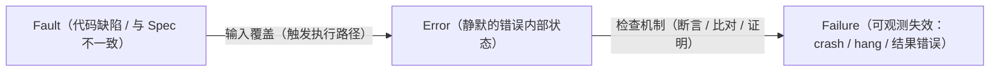

# 生成式软件工程的质量保障：从测试、架构到形式化验证

## 核心问题

在 AI Agent 批量生成代码的环境下，一次任务可能产出数百个 commit 和上万行改动。代码生产变快之后，人类不再逐行阅读和掌控实现；同时，受限于强化学习奖励倾向（优先快速完成任务），模型常跳过单元测试，直接靠运行一次端到端检查交差。一旦后续追加需求，缺乏结构约束的代码就会快速失控。

综合南京大学《26 生成式软件工程》第 11、12 讲，解决这一问题的核心思路是：**工程师的精力应从手写实现转移到“定义正确性（Spec）”与“搭建确定性的验证闭环”，用好架构把隐蔽错误低成本暴露出来，并把 AI 放进严格工具链的约束中工作。**

## 调试理论基础：`Fault → Error → Failure`

软件质量保障的底层逻辑来自调试理论的三段传播链条（见 [nju-se-software-quality-1.md](raw/sources/nju-se-software-quality-1.md)）：

- **Fault**：静态存在于代码中的缺陷（如手滑把内层循环 `j++` 写成 `i++`、边界条件遗漏）。
- **Error**：程序运行后，内部状态已经违反了规约（Specification），但 CPU 不会主动报错，多数 Error 是静默（silent）的。例如未使用的栈内存被覆盖时，当次运行结果可能看似完全正常。
- **Failure**：Error 最终传播到外部可观测行为（崩溃、超时、输出错误；如 Ariane 5 火箭因浮点转 16 位整数溢出触发异常导致坠毁）。

由此推导出两个第一性原理：
1. **有 Fault 不一定会触发 Error**，必须依赖足够完备的测试输入去覆盖对应的执行路径和运行环境（跨平台大小端、依赖库版本、并发调度时序）。
2. **触发了 Error 不一定会看到 Failure**，必须配合有效检查（断言、参考实现比对等）；而一旦捕获到 Failure，就能顺着运行轨迹用二分法定位状态从正确变为错误的第一条语句。

## 架构决定验证成本

讲任何测试或形式化工具之前，决定系统质量上限的第一因素是**语言选择与软件架构**（见 [nju-se-software-quality-1.md](raw/sources/nju-se-software-quality-1.md) 与 [nju-se-software-quality-2.md](raw/sources/nju-se-software-quality-2.md)）：

- **用语言消除整类未定义行为**：Java 通过托管运行时消除了 C/C++ 的 `use-after-free` 等指针未定义行为；Safe Rust 通过编译期借用检查进一步消灭内存安全问题，无需等到运行时靠测试碰运气。
- **把逻辑引擎与渲染/外部 I/O 拆开**：课程中复盘了让 DeepSeek 一句话写 CS:GO 的失败轨迹——模型把 3D 渲染和硬编码物理混在一起，导致后期只能靠“改代码 → 多机位截图 → 肉眼/多模态看图 → 再小修”循环，最终单次响应飙升到 50MB 触发 HTTP 413 崩溃。正确做法是先实现无图形的确定性状态引擎（deterministic state transition，可直接跑单元测试与 replay），再做渲染投影层。
- **优先使用纯函数（Functional Design）**：减少对全局可变状态的隐式读写，使函数的正确性只依赖输入参数，避免每次测试都要构造复杂的全局前置状态。
- **为差分比对预留接口边界**：以南大课程实验 NEMU 为例，将 CPU 核与内存、外设按总线接口解耦后，即可把自研 CPU 与参考实现 QEMU 并行挂载，每执行一条指令就比对寄存器和 `EFLAGS`，让静默的 Error 当场变成 Failure。
- **用单一表格统一管理测试策略**：当项目膨胀到十万行以上时，测试脚本、`Justfile` 与 `.github` CI 配置容易出现双向同步漂移。第 12 讲给出的工程做法是在 `docs/testing.md` 中用一张 Markdown 表格作为唯一事实来源，集中声明测试范围、层级、执行命令与标签，再由工具编译生成 pre-commit 和 CI 检查流程。

> [!NOTE]
> 相比传统软工把“高内聚、低耦合”当成抽象原则，这两讲给出了更具体的判断标准：**能不靠截图、只靠确定性输入和廉价检查就把 Error 暴露出来的架构，才是好架构。**

## 软件质量保障的方法光谱

围绕 `Fault → Error → Failure` 与状态空间验证，课程梳理了从低成本测试到全量数学证明的技术光谱（事实层见 [nju-se-software-quality-1.md](raw/sources/nju-se-software-quality-1.md)、[nju-se-software-quality-2.md](raw/sources/nju-se-software-quality-2.md) 及幻灯片 [slides-2](raw/assets/nju-se-software-quality-2-slides-2.png)）：

| 方法 | 核心机制 | 解决的问题 | 主要局限与代价 |
| --- | --- | --- | --- |
| **分层测试（Unit / Module / System）** | 按模块粒度编写确定性用例；用 Mock/Stub 隔离外部设备（如 Android AVD 虚拟摄像头） | 以低成本快速发现局部 Bug，用回归测试防止改动破坏旧功能 | Dijkstra：“只能证明 Bug 存在，不能证明没有 Bug” |
| **Differential Testing（差分测试）** | 同一输入/状态同时喂给被测实现与参考实现（Golden Version，如 NEMU 对比 QEMU） | 把难以察觉的静默内部状态错误直接暴露为差异 | 需要可靠的参考实现；C/C++ 存在未定义行为时需构造无 UB 输入 |
| **Fuzzing（模糊测试）** | 将输入编码为字节序列，基于代码覆盖率反馈做变异与交叉（如 Syzkaller、OSS-Fuzz） | 自动探索人工想不到的边界和异常输入空间 | 需要集群算力长期跑；难以直接发现无 crash 的业务逻辑错误 |
| **Model-Based（TLA+）** | 对核心并发/协议逻辑抽象出几十到数百状态的极简模型并穷举路径（如 2PC 共识） | 躲开真实代码的状态爆炸，提前验证协议无死锁或一致性错误 | 模型正确不代表代码正确，需靠 **Refinement Mapping**（如运行日志对齐模型、模型采样生成用例）衔接实现 |
| **Path-Based（KLEE）** | 将程序指令与分支条件编码为数学方程，交给 SMT 求解器求解可行路径 | 自动解出能触发 `assert` 失败或异常分支的具体输入 | 依赖底层 IR（如 LLVM IR）建模，工程实现重，易受路径爆炸限制 |
| **Proof-Based（Hoare 逻辑 / Coq / Lean）** | 用公理化系统与循环不变式直接证明代码满足数学规约（如 CompCert、seL4） | 从逻辑意义上彻底证明不存在特定错误（如永不 crash、编译语义等价） | 传统模式需消耗数倍于开发的顶尖人年成本（如 seL4 耗费 25 人年、20 万行证明脚本） |

## AI 与 Proof Assistant 带来的拐点与边界

第 12 讲重点分析了形式化方法在 AI 时代成本骤降的原因与依然存在的工程边界（见 [nju-se-software-quality-2.md](raw/sources/nju-se-software-quality-2.md) 与 [slides-3](raw/assets/nju-se-software-quality-2-slides-3.png)、[slides-4](raw/assets/nju-se-software-quality-2-slides-4.png)）：

1. **Proof Assistant 提供了无容错的确定性反馈**：
   - 在 Lean / Coq 等 Proof Assistant 中，每一步推导都必须显式声明所用的公理或规则，由内核逐字核对，杜绝中学数学式的跳步与蒙混过关。这种“非对即错”的裁判机制非常适合用于强化学习训练大模型。
   - 基于 **Curry-Howard 同构**（命题即类型，证明即程序），在 Lean 4 中既可以用 `def` 编写可执行算法并直接编译为 C 代码，也可以在旁边用 `theorem` 证明其性质；编译时证明项会被擦除（Proof Erasure），只留下经过校验的计算逻辑。
   - 讲者在课上分享了亲身案例：用 GPT 生成非形式化证明、Claude 交叉核对并写出约 2 万行 Lean 代码，把当年因“需对任意程序及修改做证明”而烂尾的博士论文猜想跑通。结合 Anthropic 在固件形式化验证上的实践，原本需要数十人年的形式化工作正在转化为可购买的算力成本。

2. **未来趋势与依然存在的瓶颈（No Silver Bullet）**：
   - **Proof-Carrying Code（OSDI '96）的重新激活**：过去开发者盲信编译器与人工 `assert`，未来可能要求大模型把代码中的 `assert` 翻译成 Proof Assistant 证明，未通过验证的代码直接无法通过编译。
   - **真正的瓶颈在于 `Intent → Spec`（Autoformalization）**：AI 能把 `Impl ↔ Spec`（不崩溃、不越界、满足给定数学性质）证得越来越便宜，但把人类的模糊意图翻译成精确的形式化规约仍然困难：
     - 依赖主观体验的需求（如“自然舒适的折叠屏关闭动效”“领导满意的教务系统”）难以写成无歧义的数学公式；
     - 模型在 Autoformalization 时可能出现“改弱定理定义再把它证出来”的对齐偏差，因此**依然需要可执行的测试来反向检验形式化定义是否符合原意**。

## 相关页面与来源

- [[wiki/topics/architecture/software-design|Software Design]]
- [nju-se-software-quality-1.md](raw/sources/nju-se-software-quality-1.md)（NJU《26 生成式软件工程》第 11 讲转录稿）
- [nju-se-software-quality-2.md](raw/sources/nju-se-software-quality-2.md)（NJU《26 生成式软件工程》第 12 讲转录稿，含幻灯片缩略图 [slides-1](raw/assets/nju-se-software-quality-2-slides-1.png) 至 [slides-4](raw/assets/nju-se-software-quality-2-slides-4.png)）
