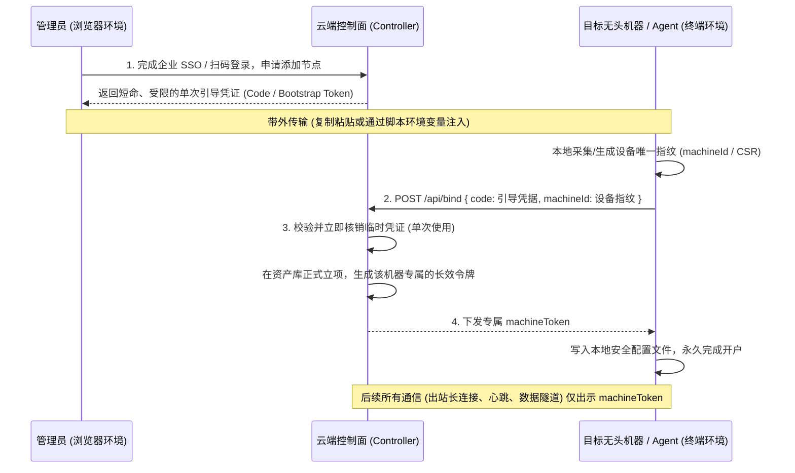

# 机器身份与 Agent 节点自举授权范式

## 摘要

在现代云计算、分布式系统与 AI Agent 架构中，计算节点、无头服务器（Headless Server）与常驻后台 Daemon 往往需要在无人类直接干预的环境下接入中心控制面并接受调度。这类系统普遍抛弃了在命令行交互式输入账号密码的旧做法，收敛为**“人类在控制台授权 ➔ 生成临时引导凭证 ➔ 机器携带指纹自举开户（Bootstrap Provisioning）➔ 颁发长效专用机器身份”**的通用架构范式。

这一模式解决了人类生命周期与机器资产强耦合的隐患，规避了长期主密码流经终端剪贴板的安全风险，并通过单向出站长连接（WebSocket / gRPC / 双向隧道）天然瓦解了复杂的企业内网 NAT 与防火墙壁垒。本文提炼该模式的核心原理、四步开户流水线与工业界经典实践。

## 为什么现代系统消灭了终端账号密码

在早期命令行工具中，程序常通过 `Username: ___` 与 `Password: ___` 提示符直接收集主账号凭据（如旧版 `git`、旧版 `docker login`）。在现代工程与企业安全要求下，该做法已成为典型反模式：

1. **企业 SSO 与现代认证阻断**：现代企业全面普及了单点登录（SSO/SAML/OIDC）、多因素认证（2FA/MFA）以及飞书/企微扫码登录。纯黑框终端（TTY）缺乏富客户端环境，无法承载多步重定向与扫码确认；
2. **凭据暴露面失控**：终端交互输入或启动参数传递的密码，极易残留在进程环境表（`ps aux`）、Shell 历史记录（`~/.bash_history`）或调试日志中；
3. **主账号权限过载**：人类账号通常具备该实体在平台上的全局最高管理权限。将主密码直接赋予某台开发机或构建节点，一旦机器遭受恶意依赖包投毒或提权渗透，黑客将顺藤摸瓜接管人类的全部数字资产；
4. **自动化流水线阻塞**：在 Docker 构建、Terraform 置备或云主机开机脚本中，交互式密码输入会直接打断全自动流水线。

2021 年 GitHub 永久移除 Git 操作的密码认证支持，正是该安全演进的标志性事件。

## 机器身份（Machine Identity）与人类身份（User Identity）的解耦

直接在控制台为用户签发个人长效令牌（如 Personal Access Token, PAT）并拷贝到机器使用，虽然免去了输入密码，但依然未能解决身份归属的根本矛盾：

| 维度 | 人类代持令牌 (Personal Access Token) | 独立的机器身份 (Machine / Workload Identity) |
| :--- | :--- | :--- |
| **主体归属** | 绑定在具体自然人账号下 | 独立于自然人，作为团队/组织的受控机器资产立项 |
| **生命周期影响** | **强耦合**：人类员工离职、转岗或定期重置 SSO 密码，代持机器集体断网瘫痪 | **解耦**：人类仅作为引入该资产的“担保人”，机器持有自身令牌长驻运行，人员变动不波及业务 |
| **权限范围** | 往往默认继承人类用户的全局个人数据与管理权限，违背最小权限原则 | **沙盒受限**：仅具备维持网络隧道、上报机器心跳、拉取本团队任务的最小工作负载权限 |
| **设备指纹审计** | 平台无法识别 Token 实际运行在几台机器、哪台硬件上 | 开户时绑定机器指纹（`machineId`），支持单机维度的精确准入、监控与一键吊销 |

## 节点自举开户的标准四步流水线

为了在“无初始机器身份”的前提下安全建立机器身份，业界普遍采用临时引导凭据驱动的开户自举（Bootstrap & Enrollment）机制：

### 核心设计细节

1. **凭证分层（Ephemeral to Durable）**：人类剪贴板或安装脚本中只流转生存时间极短（分钟级）、单次消费即作废的临时引信；真正的长效凭据直接在服务端与客户端之间的加密信道中落地，杜绝长效密钥被误贴入即时通讯工具；
2. **设备指纹锁死**：控制面在核验通过后，将新签发的凭证与该机器的物理/逻辑指纹严格绑定，阻断令牌被复制到其他未知硬件冒名顶替；
3. **单向出站打通双向通道**：节点凭借新领取的机器令牌，主动向控制面建立单向出站长连接（如 WebSocket 或双向 gRPC）。由于是内网机器主动向公网发起连接，天然穿透 NAT 与防火墙，无需配置公网 IP、动态域名（DDNS）或路由器端口映射。

## 工业界同类实践对照表

该范式已成为跨云资产接入、CI/CD 构建节点、虚拟局域网组网与 AI 编程代理的标准底座：

| 产品 / 场景 | 控制台派发的临时引导凭证 | 机器端执行的开户动作 | 最终落地的长效凭证形态 | 建立的底层长连接通道 |
| :--- | :--- | :--- | :--- | :--- |
| **Botmux 平台接入** | Base64 编码的绑定串（含一次性 `code`） | `botmux bind <blob>`（上报 `machineId`） | 本地保存 `machineToken` | 双向 WebSocket（`/tunnel/control` + `/tunnel/data`） |
| **Cloudflare Tunnel** | 网页生成的 `Tunnel Token` | `cloudflared service install <token>` | 本地 credentials JSON 文件 | 4 条持久出站 QUIC / HTTP/2 隧道，将公网流量反向倒灌本地端口 |
| **GitHub Actions Runner** | 网页生成的 1 小时有效 `Registration Token` | `./config.sh --token <token>` | 本地 `.runner` 持久化凭据文件 | 长轮询拉取专属作业，原注册码立即失效 |
| **Kubernetes Worker 节点** | Master 节点生成的 24 小时 `Bootstrap Token` | `kubeadm join --token <token>` | 签署正式节点客户端证书并保存于 `kubelet.conf` | 与 API Server 维持持久管理流 |
| **AWS Systems Manager** | AWS 控制台生成的 `Activation Code + ID` | `amazon-ssm-agent -register` | 写入本地持久化的 IAM 实例凭证 | 与 AWS 消息通道维持控制长连接，支持网页终端直连 |
| **Tailscale 节点组网** | 网页控制台生成的 `Pre-Auth Key` | `tailscale up --authkey <key>` | 本地安全状态存储专有 `Node Key` | 建立虚拟私网 WireGuard 隧道与 DERP 中继连接 |

## 远程控制与流量倒灌的实现机制

节点开户并建立常驻出站连接后，外部用户若需要从公网操作内网机器的 Web Terminal、调试面板或本地 API，通常采用**双隧道/流多路复用**机制避免直接向公网开放监听端口：

1. **控制隧道（常驻长电线）**：机器持续向云端保活（如每 30 秒心跳），接收调度指令与团队元数据全量同步（如 Botmux 的 `team-sync`）；
2. **数据隧道（按需临时水管）**：当公网浏览器访问分配给该机器的专属子域名时，控制面沿控制隧道发出开流指令（`open-stream`），机器随即主动拨号第二条数据连接，控制面将浏览器端流量倒灌至该连接，再由机器本地桥接至内部回环服务（如 `127.0.0.1:3000`）。

在该模式下，外部用户的身份认证由云端控制面统一承担（支持复杂的企业级 SSO / 2FA），机器本地完全无需运行复杂的账号密码系统，仅需消费云端反向代理注入的受信身份断言头（如角色、操作者与能力范围），实现系统复杂度的分层收敛。

## 相关页面

- [[wiki/topics/architecture/oauth|OAuth]]：授权码与设备码流程标准规范。
- [[wiki/topics/ai/botmux-team-federation|Botmux 团队联邦与平台鉴权]]：单机本地密钥、内网联邦预共享密钥与中心平台模式的具体工程实现。
- [[wiki/syntheses/architecture/authentication-api-design|登录态的服务端接口设计]]：浏览器会话、JWT 与双 Token 的设计对照。

## 来源指针

- RFC 8628 OAuth 2.0 Device Authorization Grant：https://www.rfc-editor.org/rfc/rfc8628
- GitHub Self-hosted Runners Architecture：https://docs.github.com/en/actions/hosting-your-own-runners/managing-self-hosted-runners/about-self-hosted-runners
- Kubernetes kubeadm Bootstrap Tokens：https://kubernetes.io/docs/reference/setup-tools/kubeadm/kubeadm-token/
- Cloudflare Tunnel Architecture：https://developers.cloudflare.com/cloudflare-one/connections/connect-networks/
- AWS SSM Hybrid Activations：https://docs.aws.amazon.com/systems-manager/latest/userguide/systems-manager-managedinstances.html
