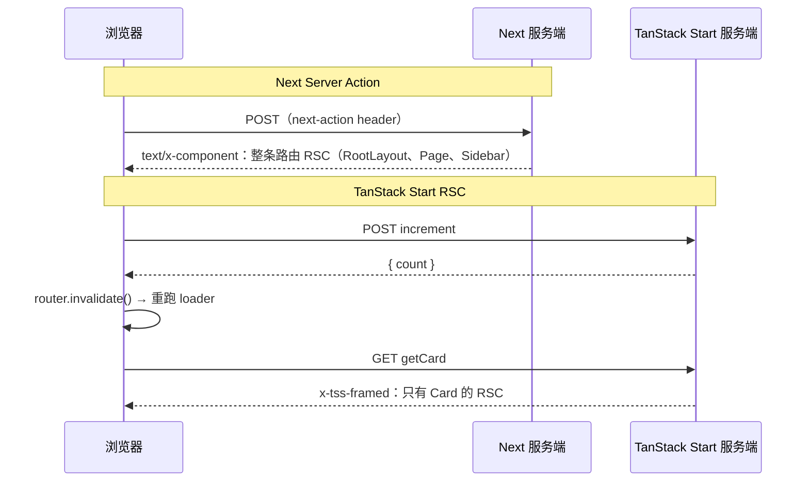
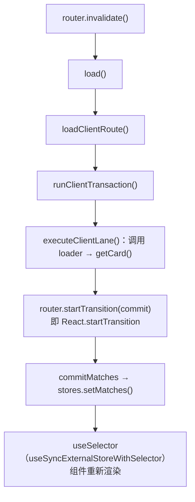
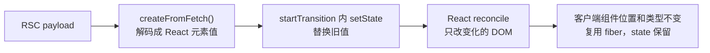

# RSC 交互后的更新链路：Next 与 TanStack Start

## 问题

页面首次渲染之后，用户点一次「+1」，服务端返回什么？客户端拿到新的 RSC payload 后怎么更新页面，客户端组件的 state 为什么不会丢？

## 简答

React 只提供「把 payload 解码成一个 React 元素值，再 `setState` 换掉旧值并正常 reconcile」这一种机制，没有局部合并 payload 的 API。Next 和 TanStack Start 的差别在框架层：Next 的 Server Action 返回整条路由的 RSC，替换路由段；TanStack Start 只重跑受影响的 loader，替换一个 match 的 `loaderData` 里的值。

## 来源事实

以下来自本地 demo 抓包和源码阅读，详见 `raw/sources/rsc-update-path-local-demos.md`。

### Next Server Action

1. 浏览器发 POST，`next-action` header 带 action id，参数在请求体。
2. 响应是 `text/x-component`，内容是整条路由的 RSC：RootLayout、Page、Sidebar 都重新渲染，包括和计数无关的 Sidebar。
3. 普通导航时客户端带 `next-router-state-tree` header，服务端只返回变化的路由段。这个裁剪用于导航，demo 中的 Server Action 响应仍包含整条路由。

### TanStack Start

1. 普通 server function 请求 `/_serverFn/<base64>`，base64 里是 `{file, export}`，参数和结果用 seroval 序列化（`t:10` 对象、`t:0` 数字、`i` 引用 id、`o` 标志位），结果外层包成 `{ result: { ... } }`。
2. 实验性 RSC 用 `@vitejs/plugin-rsc` 和 `tanstackStart({ rsc: { enabled: true } })` 开启。server function 返回 `renderServerComponent` / `createCompositeComponent` 的结果，响应类型 `application/x-tss-framed`：seroval 外壳里嵌入 Flight 数据，客户端插槽位置用 `ClientSlot` 占位。
3. demo 中点一次「服务端 +1」发两个请求：先 POST `increment`（只返回 `{ count }`），再由 `router.invalidate()` 触发 loader 重跑，GET `getCard` 拿新的 RSC。

下图对比点一次「+1」时两边的请求：

### TanStack Router 的客户端更新路径

按 router-core 1.171.37 / react-router 1.170.44 源码：

1. `router.invalidate()`（`router-core/src/router.ts:2495`）把已提交、缓存和预加载的 match 标为失效，最后 `return this.load({ sync })`（`:2570`）。
2. `load`（`:2421`）在客户端调 `loadClientRoute`（`load-client.ts:1941`），再进入 `runClientTransaction`（`:1820`）和 `executeClientLane`（`:1320`），后者取 `route.options.loader`（`:836`）并调用（`:646` 附近）。demo 里就是在这里调了 `getCard()`。
3. loader 返回后，在 `router.startViewTransition`（`:1882`）里定义 `commit`（`:1892`），执行 `await router.startTransition(commit, matches)`（`:1903`）。
4. `commit` 调 `commitMatches`（`:1624`），最终 `router.stores.setMatches(...)`（`stores.ts:153`）更新 atom。
5. React 版本里 `router.startTransition` 被 `Transitioner.tsx:31` 覆盖为 `React.startTransition`；组件通过 `useSelector`（`react-store/src/useSelector.ts:60`，基于 `useSyncExternalStoreWithSelector`）订阅 atom，atom 变化后重新渲染。

## 综合结论

### 客户端「合并」就是替换值再 reconcile

`createFromFetch` / `createFromReadableStream` 把 payload 解码成一个 React 元素值。框架把这个值放进自己的状态（Next 的路由缓存、TanStack 的 match），在 `startTransition` 里 `setState`，之后是普通的 React reconcile：和旧 fiber 对比，只改有变化的 DOM。

客户端组件的 state 能保住，是因为它在新树里的位置和类型没变，React 复用了同一个 fiber，不是因为 payload 做了局部 patch。如果新 payload 让客户端组件换了位置或类型，state 同样会丢。

### 差别在替换粒度

| | Next Server Action | TanStack Start RSC |
| --- | --- | --- |
| 服务端重跑什么 | 整条路由的服务端组件 | 被 invalidate 的 loader 里调用的 server function |
| 网络上传什么 | 整条路由的 RSC | 一个 server function 返回的 RSC 片段 |
| 客户端替换什么 | 路由段 | 一个 match 的 `loaderData` 里的值 |
| 请求次数 | 一次（action 响应带回新 RSC） | demo 中两次（mutation + loader 重跑） |

两边的 DOM 更新量都由 React diff 决定，差别在服务端计算量和传输量。TanStack demo 的两次请求是 demo 写法决定的：`increment` 只返回数据，也可以改成让 mutation 直接返回 RSC，这一点本次没有验证。

### 页面外层是不是服务端组件

TanStack Start 里路由组件默认是客户端组件，只有 server function 返回的部分是 RSC，所以 demo 里 `Home` 根本不在 payload 里。Next App Router 默认所有组件都是服务端组件，Server Action 之后整条路由都要重新生成。这是推断两者重跑范围不同的主要原因。

## 使用限制

- TanStack Start 的 RSC 支持是 experimental，响应格式（`x-tss-framed`）和 API 可能变化。
- 源码行号只对应上面列出的版本。
- Next 部分只覆盖 demo 中的 Server Action 和导航行为，没有测试 `revalidatePath`、`revalidateTag`、`router.refresh()` 等其他刷新方式。

## 还需要确认什么

- TanStack Start 能否让 mutation 的 server function 直接返回新 RSC，省掉第二次请求。
- Next 的 Server Action 在什么条件下只返回部分路由段。

## 相关页面

- [[wiki/topics/frontend/rsc|RSC]]
- [[wiki/topics/frontend/tanstack-start|TanStack Start]]
- [[wiki/syntheses/frontend/rsc-protocol-rendering-mental-model|RSC 的协议与渲染心智模型]]

## 来源指针

- `raw/sources/rsc-update-path-local-demos.md`
