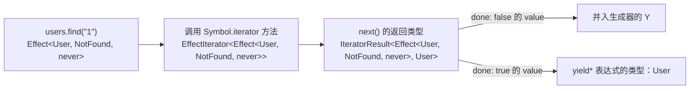

# Effect.gen 的类型推导

## 问题

下面这段代码里，`users`、`user`、`logger` 各自拿到了精确类型，整个 `program` 的类型是 `Effect<number, EmptyName | NotFound, Users | Logger>`。这些类型是怎么推出来的？`yield* Users` 交出去的是一个类，为什么得到的是服务的实现类型？

```ts
class Users extends Context.Service<Users, { find(id: string): Effect.Effect<User, NotFound> }>()("app/Users") {}
class Logger extends Context.Service<Logger, { info(msg: string): Effect.Effect<void> }>()("app/Logger") {}

export const program = Effect.gen(function* () {
  const users = yield* Users;
  const user = yield* users.find("1");
  const logger = yield* Logger;
  yield* logger.info(`hi ${user.name}`);
  if (user.name === "") return yield* Effect.fail<EmptyName>({ _tag: "EmptyName" });
  return user.name.length;
});
```

## 简答

靠两条规则：

1. TypeScript 里 `yield* x` 表达式的类型等于 x 的迭代器结束时（`done: true`）的 value 类型；而每个 Effect 的迭代器都声明为"先交出自己，结束时返回自己的 A"，所以每一行拿到各自的 A。
2. 生成器交出的所有 Effect 汇成一个联合类型 Y。`Effect.gen` 的签名用条件类型从 Y 里抽出 E 和 R，把 `return` 的类型作为 A。

普通的 `yield` 做不到第 1 条：`yield` 表达式的类型是生成器的 N，一个生成器只有一个 N，所有 `yield` 共用（见 [[wiki/topics/languages/javascript-generators|JavaScript 生成器与 yield 的类型]]）。

## 综合结论

### 三段类型定义

以下摘自 effect 4.0.5 的 `dist/Effect.d.ts`，略去注释：

```ts
interface Effect<out A, out E = never, out R = never> {
  [Symbol.iterator](): EffectIterator<Effect<A, E, R>>;           // 每个 Effect 都能被 yield*
}

interface EffectIterator<T extends Effect<any, any, any>> {
  next(...args: ReadonlyArray<any>): IteratorResult<T, Success<T>>; // 交出 T 自己，结束时返回 T 的 A
}

declare const gen: <Eff extends Effect<any, any, any>, AEff>(
  f: () => Generator<Eff, AEff, never>                             // Eff = 所有交出的 Effect 的联合
) => Effect<
  AEff,
  [Eff] extends [never] ? never : [Eff] extends [Effect<infer _A, infer E, infer _R>] ? E : never,
  [Eff] extends [never] ? never : [Eff] extends [Effect<infer _A, infer _E, infer R>] ? R : never
>;
```

- `[Eff] extends [...]` 用方括号包住，TypeScript 会把整个联合当作一个整体去匹配，不会对联合的每一项分别求值。
- E、R 声明为 `out`（协变），从联合里推出的 E、R 也是联合，所以每多一种失败、多用一个服务，类型就自动累加。

### 一行的推导过程



### 逐行结果

用 TypeScript 编译器 API 打印的实际推导结果：

| 这一行 | `yield*` 表达式的类型 | 交出去、并入 Y 的 Effect |
| --- | --- | --- |
| `yield* Users` | `{ find(id: string): Effect<User, NotFound, never> }` | `Effect<{ find… }, never, Users>` |
| `yield* users.find("1")` | `User` | `Effect<User, NotFound, never>` |
| `yield* Logger` | `{ info(msg: string): Effect<void, never, never> }` | `Effect<{ info… }, never, Logger>` |
| `yield* logger.info(…)` | `void` | `Effect<void, never, never>` |
| `return yield* Effect.fail<EmptyName>(…)` | `never` | `Effect<never, EmptyName, never>` |
| `return user.name.length` | 成为 AEff：`number` | — |

生成器的类型是 `Generator<Effect<never, EmptyName, never> | Effect<User, NotFound, never> | Effect<{ find… }, never, Users> | Effect<void, never, never> | Effect<{ info… }, never, Logger>, number, any>`，经过 `gen` 的条件类型得到 `Effect<number, EmptyName | NotFound, Users | Logger>`。

### yield* 一个 Service 类

`Context.Service<Users, Shape>()("app/Users")` 的类型最终继承自 `Key<Identifier, Shape>`，而 `Key<Identifier, Shape> extends Effect<Shape, never, Identifier>`（`dist/Context.d.ts:61`）。类写法把类自己作为 Identifier，所以：

- A 是 Shape：`yield* Users` 得到实现的类型；
- E 是 never：查服务不产生预期失败；
- R 是 `Users`：用了这个服务，R 里就多一项，`provide` 之后去掉。

运行时 `Users` 是一个函数对象，`Effect.isEffect(Users)` 为 true；它的迭代器第一次 `next()` 交出 `Users` 本身，fiber 用 `Users.key` 去 context 里查实现，再用 `next(实现)` 结束迭代器。

用函数写法 `Context.Service<Counter>("A")` 时，Identifier 就是实现类型 `Counter`。两个实现类型相同的服务在 R 里无法区分：实测给需要 A 的程序提供 B，类型变成 `Effect<number, never, never>`，编译通过，运行时报 `Service not found: A`。类写法的 R 是各自的类，不会混。

### 可以复用的做法：交出自己、返回答案

自己设计基于生成器的接口时，可以照搬这套写法：让请求对象的 `[Symbol.iterator]` 交出自己，返回值类型写成它携带的类型参数，驱动者负责把对应类型的答案送回去。

```ts
class Ask<A> {
  *[Symbol.iterator](): Generator<Ask<A>, A, any> {
    return yield this;
  }
}
// const name = yield* new Ask<string>(…) 得到 string
// 外层生成器的 Y 为 Ask<string> | Ask<number> …，可以像 Effect.gen 一样从中抽取信息
```

适用条件：请求的种类和答案类型能在请求对象上用类型参数表达，并且只有你自己写的驱动者会调用 `next`。

## 使用限制

- **少写 `*` 时 tsc 不报错。** `const users = yield Users` 中，`yield` 的类型是 N，`Effect.gen` 把 N 定为 `never`，于是 `users: never`，程序类型变成 `Effect<never, never, Users>`，tsc 诊断数为 0。运行时 `yield` 和 `yield*` 交出的是同一个对象，程序照样能跑。Effect 的 language service（effect-tsgo）有专门的规则 `missingStarInYieldEffectGen`。
- **失败分支要写 `return yield*`。** `yield* Effect.fail(…)` 的类型是 `never`，但控制流分析不会因此认为后面的代码不可达。不写 `return` 时，后续 `user.name` 报 `'user' is possibly 'undefined'`。
- **对外导出的函数写返回类型。** 推导出的 E、R 与预期不符时，错误会报在这个函数上，而不是在远处的调用方。
- **`next` 不做类型检查。** `EffectIterator.next` 接受 `any`，类型能对上是因为 fiber 送回的一定是执行该 Effect 得到的 A。业务代码不要手动驱动 Effect 的迭代器，运行一律通过 `Effect.runPromise`、`ManagedRuntime` 等入口。

## 来源指针

- `raw/sources/effect-ts.md`：`Effect.d.ts`、`Context.d.ts` 的类型定义位置，编译器打印的逐行类型，函数写法与类写法的对比结果，少写 `*` 与失败分支的实测
- `raw/sources/javascript-generators.md`：生成器类型参数的推导规则与 `Ask<A>` 实验
- [MDN · yield*](https://developer.mozilla.org/en-US/docs/Web/JavaScript/Reference/Operators/yield*)
