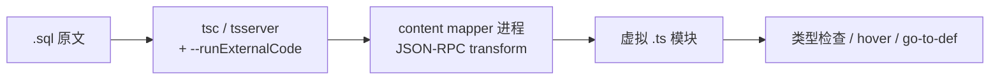

# Reylo：SQL import 进 TypeScript 的实现原理

**一句话结论：** TypeScript 7.1 的 Content Mapper 让编译器在类型检查时把 `.sql` 交给外部进程算出虚拟模块类型；Reylo 在该钩子里连活库做 PREPARE/catalog 推断，运行时另走 register / Vite 等 loader，类型与执行分离。

## 1. TypeScript 如何暴露能力

Content Mapper 是 TypeScript 7.1 的插件点：为某个文件扩展名注册外部进程，把外来文件原文变成 TypeScript 可解析的虚拟文本，并提供原文与虚拟文本之间的 span mapping。动机是让 Vue / Svelte / `.sql` 等进入与 `tsc` 同一套 program，而不只靠编辑器里的嵌入方案。

配置与信任边界：

- `tsconfig.json` 的 `contentMappers`：指定 `package`、`extensions`（以及可选 `options`）。
- CLI 必须显式 `--runExternalCode`；否则不执行 mapper。编辑器需 workspace trust 与 content mapper 权限；不可信工作区通常不向 LSP 传该开关。
- 包在 `package.json` 的 `typescript.contentMapper` 里声明 `exec`（必填启动命令）、可选 `compilerOptions` / `dynamicConfig`。

交给 mapper 与生成类型的路径：

1. 模块解析或 `include` 遇到已注册扩展名（如 `.sql`）。
2. TypeScript 按包启动 `exec` 进程，经 STDIO JSON-RPC 调用 `initialize` → `openProject` → 对每个文件 `transform` → 结束时 `closeProject`。
3. `transform` 返回虚拟 `text`（合法 TS/JS 等）、`extension`、可选 `mappings` 与诊断；checker 与语言服务在虚拟文本上工作，诊断经 span map 映回原文。
4. 增量身份可写入 `.tsbuildinfo`；无 `dynamicConfig` 时可不启进程就算身份，有则用 `openProject` 的 `configIdentity` / `watchedFiles`。Content-mapped 文件**不 emit 到 JavaScript**。

边界：Content Mapper **本身不**连数据库、不做 SQL 推断；它只保证外来扩展进入 program、产出可检查文本、诊断能映回原文。SQL→类型是 mapper 实现方（Reylo）在 `transform` 里完成的。

## 2. Reylo 库做了什么

Reylo（Colin McDonnell，[reylo.dev](https://reylo.dev/)、[colinhacks/reylo](https://github.com/colinhacks/reylo)）是挂在上述钩子上的 SQL 工具链，要求 TypeScript 7.1 beta、可连的开发库。技术亮点（不展开实现细节）：

- **直接 `import` `.sql`：** tsconfig 注册 `package: "reylo"`、扩展名 `.sql`（以及 `.reylo.yaml` / `.reylo.yml`），类型检查脚本带 `--runExternalCode`。
- **类型来自活库，不是手写也不是 codegen：** mapper 在 `transform` 里对语句做 PREPARE / Describe（文档：prepare 而不 run），结合 catalog 推断 Params、Row、cardinality 等，生成 `declare const query: Query<…>` 虚拟模块。
- **类型检查与运行时分离：** Content Mapper 不 emit JS；运行时靠 `reylo/register`、Vite / esbuild / webpack 等走同一套分析缓存，产出可执行的 `defineQuery(…).run(db, params)`。两边共用 `.reylo/` 查询缓存与 schema fingerprint。
- **表达力与可维护性同时拿：** 查询仍是原生 SQL；调用侧得到 ORM 式的参数/行类型与 `.run()`，而不靠维护平行的手写类型或生成文件。

限制速记：无活库且无缓存时 typecheck / build 会失败；`.reylo/` 不要 commit；CLI 不能省掉 `--runExternalCode`；编辑器需 Native Preview / 项目内 TS 7.1，且仅在受信任工作区跑 mapper。

## 相关页面

- [[wiki/topics/languages/typescript|TypeScript]]
- [[wiki/syntheses/languages/typescript-phantom-type-carriers|TypeScript Phantom Type Carriers]]（另一类「类型信息跨边界」手法；与 Content Mapper 不同）

## 来源指针

- [[raw/sources/reylo-typescript-content-mapper|核查记录]]
- [Announcing TypeScript 7.1 Beta](https://devblogs.microsoft.com/typescript/announcing-typescript-7-1-beta/)
- [microsoft/typescript-go#4712](https://github.com/microsoft/typescript-go/pull/4712)
- [reylo.dev](https://reylo.dev/) · [colinhacks/reylo](https://github.com/colinhacks/reylo)
