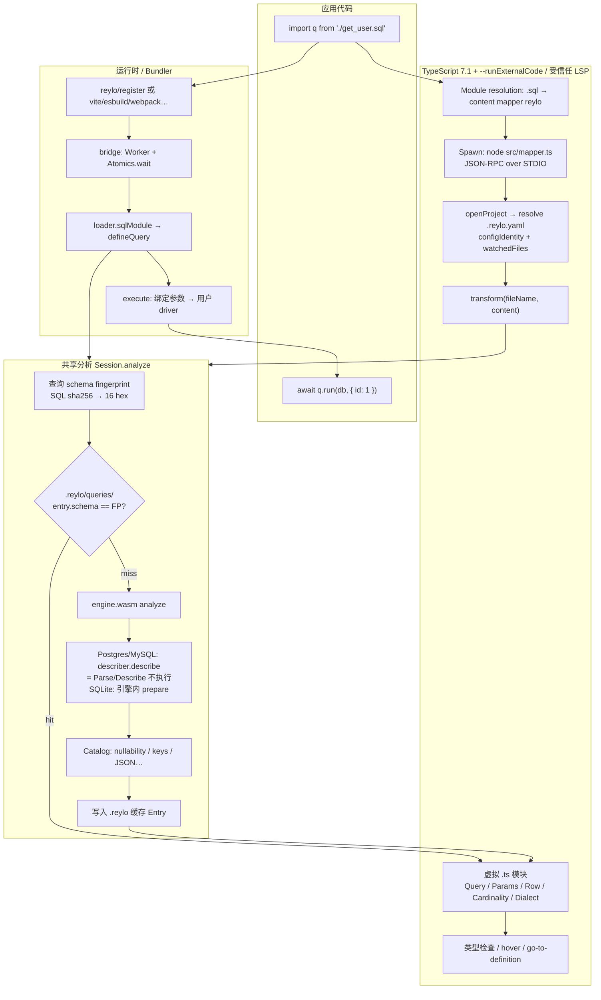

# Reylo：SQL import 进 TypeScript 的实现原理

**一句话结论：** TypeScript 7.1 让 `.sql` 能像普通模块一样 `import`，类型由 Reylo 连上开发库、让数据库解析 SQL 后推出来，真正跑查询时再走另一条运行时链路，两边靠同一份分析缓存对齐。

## 1. TypeScript 如何暴露能力

TypeScript 原来只处理自己认识的文件。7.1 增加了一个转接器，叫 Content Mapper，可以理解成“内容映射器”：编译器遇到指定扩展名的文件时，不直接解析原文，而是启动一个外部进程，把文件内容交过去，再拿回一段能被 TypeScript 解析的虚拟文本，用来做类型检查。

外部进程还能返回原文和虚拟文本的位置对照表，也就是 span mapping。这样报错、hover、跳转都能落回 `.sql` 文件里的正确位置。

它解决的是接入问题：Vue、Svelte、`.sql` 这类非 TS 文件，也能进入和 `tsc` 同一套编译流程，而不是只在编辑器里做一层嵌入。

**配置和信任边界：**

- `tsconfig.json` 的 `contentMappers` 用来登记：用哪个 `package`、处理哪些 `extensions`，还可以带 `options`。
- CLI 必须显式加 `--runExternalCode`，否则 TypeScript 不会执行外部 mapper。编辑器里要有 workspace trust 和 content mapper 权限，不可信工作区一般不会把这个开关传给 LSP。
- mapper 包在 `package.json` 的 `typescript.contentMapper` 里声明 `exec`，也就是启动命令；`compilerOptions` 和 `dynamicConfig` 是可选项。

一次 `transform` 大致这样走：

1. 模块解析或 `include` 遇到已注册的扩展名，比如 `.sql`。
2. TypeScript 按 `exec` 启动进程，通过 STDIO 跑 JSON-RPC。调用顺序是 `initialize`、`openProject`，然后对每个文件调用 `transform`，最后 `closeProject`。
3. `transform` 返回虚拟文本 `text`、扩展名 `extension`，还可以带 `mappings` 和诊断。checker 和语言服务在虚拟文本上工作，诊断再通过映射回到原文。
4. 被 mapper 接管的文件不会输出成 JavaScript。增量构建时，mapper 的配置身份信息可以写进 `.tsbuildinfo`；如果用了 `dynamicConfig`，就靠 `openProject` 返回的 `configIdentity` 和 `watchedFiles` 判断缓存还能不能用。

这张图只看类型侧：TS 把非 `.ts` 文件交给 content mapper，拿回虚拟模块，再做检查。

Content Mapper 本身不连数据库，也不懂 SQL。它只负责三件事：让外部扩展进入编译流程、产出可检查的文本、把诊断映射回原文。`.sql` 到类型的推断，是 Reylo 这个 mapper 实现方在 `transform` 里做的。

从 import 到类型检查再到运行时，完整链路如下：

上半部分是类型路径，下半部分是运行时路径，两条路在 `Session.analyze` 汇合。

## 2. Reylo 库做了什么

Reylo 是 Colin McDonnell 做的 SQL 工具链（[reylo.dev](https://reylo.dev/)、[colinhacks/reylo](https://github.com/colinhacks/reylo)），挂在 Content Mapper 这个转接器上。它要求 TypeScript 7.1 beta，以及一个能连上的开发数据库。

- **直接 `import` `.sql`。** 在 `tsconfig.json` 的 `contentMappers` 里注册 `package: "reylo"` 和 `.sql` 扩展名，顺带把 `.reylo.yaml` / `.reylo.yml` 也交给它；类型检查脚本要带 `--runExternalCode`。应用代码里写 `import q from './get_user.sql'`，`q` 就有类型。
- **类型来自活库，不是手写，也不是 codegen。** 这里的活库就是当前连着的开发数据库。mapper 在 `transform` 里对 SQL 做 PREPARE / Describe，只让数据库解析和描述语句，不执行查询；再结合 catalog（表、列、可空性、主键这些元数据）推断参数类型、结果行类型、返回一行还是多行，以及 SQL 方言差异，最后生成 `declare const query: Query<…>` 这样的虚拟模块。
- **类型检查和运行时分开。** Content Mapper 不产出 JavaScript。运行时由 `reylo/register` 或 Vite、esbuild、webpack 插件加载 `.sql`，生成 `defineQuery(…).run(db, params)` 这样的可执行查询。两边共用 `.reylo/` 缓存和 schema 指纹（一段短哈希，用来判断缓存还能不能用），缓存命中时不用重复分析。
- **原生 SQL 的表达力，ORM 式的调用体验。** 查询仍然是手写 SQL，复杂 join、子查询、窗口函数都能直接用；调用侧拿到参数和结果行的类型、补全和 `.run()`，不用维护一份手写类型，也不用把生成文件提交进仓库。

限制有几条，都很短：没有活库、缓存也没命中时，typecheck 和 build 会失败；`.reylo/` 是本地缓存，不要 commit；CLI 不能漏掉 `--runExternalCode`；编辑器要开 Native Preview，或者让项目使用 TS 7.1；mapper 只在受信任工作区里跑。

## 相关页面

- [[wiki/topics/languages/typescript|TypeScript]]
- [[wiki/syntheses/languages/typescript-phantom-type-carriers|TypeScript Phantom Type Carriers]]（另一类让类型信息跨边界的手法，和 Content Mapper 不是同一件事）

## 来源指针

- [[raw/sources/reylo-typescript-content-mapper|核查记录]]
- [Announcing TypeScript 7.1 Beta](https://devblogs.microsoft.com/typescript/announcing-typescript-7-1-beta/)
- [microsoft/typescript-go#4712](https://github.com/microsoft/typescript-go/pull/4712)
- [reylo.dev](https://reylo.dev/) · [colinhacks/reylo](https://github.com/colinhacks/reylo)
