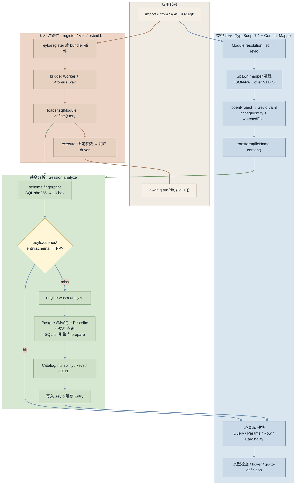

# Reylo：SQL import 进 TypeScript 的实现原理

**一句话结论：** TypeScript 7.1 让 `.sql` 能像普通模块一样 `import`；Reylo 连上开发库、让数据库解析 SQL 后推出类型；真正跑查询时再走 bundler / register 那条运行时链路。两边靠同一份分析缓存对齐。

## 1. TypeScript 如何暴露能力

能力本身在 TypeScript 主题页：[[wiki/topics/languages/typescript#Content Mapper（7.1）|Content Mapper（7.1）]]。

这里只记和 Reylo 相关的接点：

- 在 `tsconfig.json` 的 `contentMappers` 里注册 `package: "reylo"` 和 `.sql`（以及 `.reylo.yaml` / `.reylo.yml`）。
- 类型检查要带 `--runExternalCode`；编辑器要信任工作区。
- Content Mapper 只负责把 `.sql` 变成可检查的虚拟模块，并映射诊断位置。它不连库、不懂 SQL；`.sql` → Params / Row 的推断是 Reylo 在 `transform` 里做的。
- 被映射的文件不会 emit JS，所以运行时必须另有 loader（见下一章）。

## 2. Reylo 库做了什么

Reylo 是 Colin McDonnell 做的 SQL 工具链（[reylo.dev](https://reylo.dev/)、[colinhacks/reylo](https://github.com/colinhacks/reylo)），挂在 Content Mapper 上。它要求 TypeScript 7.1 beta，以及一个能连上的开发数据库。

- **直接 `import` `.sql`。** 应用代码写 `import q from './get_user.sql'`，`q` 就有类型。
- **类型来自开发库，不是手写，也不是 codegen。** mapper 在 `transform` 里对 SQL 做 PREPARE / Describe，只让数据库解析和描述语句，不执行查询；再结合 catalog（表、列、可空性、主键等）推断参数类型、结果行类型、基数和方言差异，生成 `declare const query: Query<…>` 虚拟模块。
- **类型检查和运行时分开。** Content Mapper 不产出 JavaScript。运行时由 `reylo/register` 或 Vite、esbuild、webpack 插件加载 `.sql`，得到 `defineQuery(…).run(db, params)`。两边共用 `.reylo/` 缓存和 schema 指纹；缓存命中时不用重复分析。
- **原生 SQL 的表达力，ORM 式的调用体验。** 查询仍是手写 SQL；调用侧有参数/结果类型、补全和 `.run()`，不必维护手写类型，也不必把生成文件提交进仓库。

限制很短：没有可连的开发库且缓存未命中时，typecheck / build 会失败；`.reylo/` 是本地缓存，不要 commit；CLI 不能漏 `--runExternalCode`；编辑器要开 Native Preview 或让项目用上 TS 7.1；mapper 只在受信任工作区跑。

从 import 到类型检查再到运行时，完整链路如下。

## 相关页面

- [[wiki/topics/languages/typescript#Content Mapper（7.1）|TypeScript · Content Mapper（7.1）]]
- [[wiki/topics/languages/typescript|TypeScript]]
- [[wiki/syntheses/languages/typescript-phantom-type-carriers|TypeScript Phantom Type Carriers]]（另一类让类型信息跨边界的手法，和 Content Mapper 不是同一件事）

## 来源指针

- [[raw/sources/reylo-typescript-content-mapper|核查记录]]
- [Announcing TypeScript 7.1 Beta](https://devblogs.microsoft.com/typescript/announcing-typescript-7-1-beta/)
- [microsoft/typescript-go#4712](https://github.com/microsoft/typescript-go/pull/4712)
- [reylo.dev](https://reylo.dev/) · [colinhacks/reylo](https://github.com/colinhacks/reylo)
