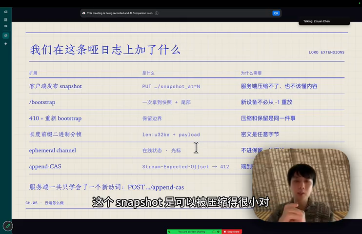
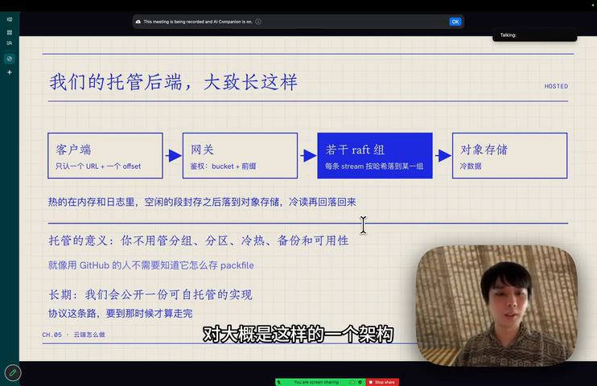
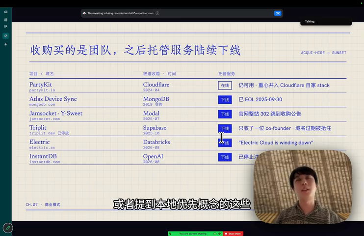

# Local-first 同步引擎还缺什么

## 问题

CRDT 库已经能让各端各自修改、最终收敛，为什么真正做一个本地优先应用还是远远不够？一个每天有人在用的产品（Lody）到底需要同步引擎额外解决哪些问题？

## 简答

CRDT 库解决的是「一篇文档内部怎么合并」。目录怎么同步、本地存在哪、预取取多少、跨流怎么保证一次生效、云端该被允许知道多少、鉴权放在哪、谁来付钱，都不在 CRDT 库里，需要同步引擎这一层补上。这场分享是 Lody 团队用真实用户反推出来的清单，每一页都对应一个他们实际改过几轮的问题。

事实来源说明：这一页的事实以讲者的幻灯片为准（关键几页截图存在 `raw/assets/`，文件名以 `2026-09-20-local-first-` 开头），转录稿只用于补充口头说明。素材文件 `raw/sources/local-first-sync-engine-talk.md` 是机器转录，专有名词的识别误差和校正映射写在该文件开头的注释里。

## 来源事实

### 讲者和这场的定位

- 讲者：陈子轩（Zixuan Chen）。2022 年和 Leon 开始做 loro.dev，2025 年开始做 lody.ai。[01:01]、自我介绍页
- 幻灯片上给出的英文标题是 **CRDT is not enough**；这场的立意是「必要复杂度只会转移」——复杂度不会消失，只是从应用开发者转到同步引擎上。[CH.03]

### 它承诺给用户的五种体验

- 秒开（数据读写都在本地）、离线可用（没网也能用）、多端协作（多端互相同步）、后端可换（随时换掉服务商）、数据归你（数据你说了算）。[五种体验页]
- 讲者对本地优先的定义：用户控制数据，可以自由切换云端作为备份，云端只是备份和额外副本，不是权威所有者；和 Local Only 的区别是仍然保留多设备同步的便利。[00:00]
- 最接近这个理想的现成例子是 Git：remote 挂了换一个继续干，本地 clone 和远端之间增量互传。[Git 页]
- 他引用 Martin Kleppmann 在 Local-first Conf 的分享描述社区对同步引擎的期待：请求失败、超时、数据有没有到服务器、怎么在前端告知用户，这些都交给同步引擎。[03:01]
- 但同步引擎不是万能的：强一致的场景做不好（幻灯片举 A/B 抢票、库存与订单，中间不能有分歧）。这类场景需要全局一致的判定，原理上不适合各自改、最后收敛的模型。[强一致页、04:00]

### CRDT 库今天已经给了我们什么

幻灯片上列的四个库是 Riak、Yjs、Automerge、Loro，能提供的五件事是：[CH.03、330s]

1. 结构化文档：map / list / text / 富文本，像 JSON 一样建模；
2. 最终一致：各自改，不用协调，最后一定收敛；
3. 天然的增量更新：每次只传 delta，不必传整份文档；
4. 合并结果符合预期：列表和富文本的自动合并，大部分场景就是想要的结果；
5. 乱序、重复都内置处理：所以它天生适合 P2P，也适合端到端加密。

讲者的结论是「接下来要讲的，全是这五条之上还缺的东西」。他在口头补充里强调这些库本质上是纯计算的状态，不覆盖网络层和持久化层这类 IO；P2P 环境下的实践、同步协议怎么设计、去中心化下的交互设计都还没有答案。[06:23]

### 从落地反推：引擎该接走什么

**目录和内容要分开同步（Flock）。** 真实应用是几千份文档，不是一篇，文档级 CRDT 只能同步单篇内容。Lody 的做法是先用一个 LWW 的 KV CRDT 同步「有哪些文档」这份目录，再按需拉正文；这份目录文档就叫 Flock。目录里要的字段是：有哪些文档、叫什么、归档了没、谁最后改的、什么时候改的——这些字段「后写的赢」就够了。分工是：CRDT 管一篇文档内部怎么合并，Flock 管「有哪些文档」。[CH.04、按需拉取页、08:13]

**同一个目录，格式换了四次。** 演进路径是 JSON（最初整包同步）→ v1 二进制（JSON 撑不住之后）→ 中间一版（导出和导入成为瓶颈，幻灯片上标为「卡顿」）→ v2 列式（增量导出）。效果数字：12 万行的目录一次导出，只导出增量约 0.2 ms，全量约 90 ms；格式抖动期间一度吃掉后台进程约 40% 的 CPU。整个切换过程用户无感。[CH.04、格式页、08:44]

**本地存什么、在哪查，都还是新问题。** 他们试过在 Web 上用 SQLite 存目录元数据：2026-01-03 启用，2026-01-10 撤回。幻灯片给的三条原因是：OPFS 的句柄是独占的，多 tab 必须自己选出一个 Host；读写全变成跨 tab 的异步 RPC，读写订阅开始出现竞态；没有现成方案，因为跨 tab 要同步的是应用专属的 Op 和 Result。[CH.04、本地存储页、09:51]

更难的还在后面——本地和云混着用，云端还要端到端加密：什么留在本地、什么放到云上；服务端看不到明文就没法替你建索引、替你查；全文搜索要做好，索引建在哪、什么时候更新、多设备怎么一致。讲者的说法是「存什么、在哪查、怎么搜，都还没有现成答案」。

**预取：完全懒加载太慢，加了预取之后改了五次。** 幻灯片上的时间线是：2025-12 metadata-first（正文按需）→ 2026-06-29 预取一切（点击前先 catch-up）→ 2026-06-30 Web 只取 20（pinned → 可见 → 未读）→ 整整十周里桌面仍然无感（96 篇常驻 + 3 路并发）→ 2026-09-16 全端 20（1000 个候选，只排 20）。结论有两句：拖慢首屏的往往是你自己的预取；这些只是当前的启发式规则，跟应用形态强相关，换一个产品答案大概率不一样。[CH.04、预取页、11:31]

**预取的成本在网络之前，先落在主线程上。** 讲者说一部分计算后来要移到 Web Worker 上做，这部分当时还没有完全解决。[12:10]

**一个事实，横跨两条流。** 发一条消息其实是两个动作：写 Flock 里那篇目录文档（对话、有新消息），以及写真正的消息正文。两者之间没有事务，幻灯片上的结论是「还没有一条机制能把两条流写成一次提交」。转录里补充了它的表现：发送或接收时任意一条流断开，就可能出现「提示有新消息、点进去看不到」。讲者说这不是再加一个 CRDT 能解决的，是同步引擎该提供的能力。[跨流页、12:51]

**冲突 UI 放到最后。** 幻灯片还有一页专门讲 CRDT 管不了的那些冲突（内容对不上、删除的文档还在、顺序对不上、操作冲突），做法是先用建模避免冲突，最后才做冲突 UI。[840s]

### 云端怎么做

**为什么还要一个云端。** Git 和 GitHub 的对照：Git 是协议，GitHub 提供组织、权限、CI 这些托管能力，别人也在这个协议上做不同的托管和自建方案。本地优先不等于不需要云端。[GitHub 页、14:36]

**问题不在 Cloudflare Durable Objects，在于后端被要求知道多少。** 幻灯片的框架分两列，左边是「后端要处理的东西太多」（一个 repo 一个 Durable Object，状态和 CRDT 文档都放后端，权限和组织也在后端），右边是「而 DO 其实不需要这么多」。讲者口头给的失败原因是：做版本比对要把更新加载进 CRDT 文档，内存和读取开销都高；把版本信息存在 DO 自带的 SQLite 上，每次更新都要更新版本向量；一个 repo 内还有不同权限；DO 按 WebSocket 连接时长计费，进 hibernation 省连接费用就要释放内存、状态只能落回 SQLite。[Durable Object 页、15:37]

**那服务端的这份合并，是为谁做的。** 幻灯片把两件事并列：服务端做合并要付出成本（加载内容、算增量、占内存），而端到端加密之后它其实只能做存储、排序和广播。讲者的判断是 CRDT 已经让客户端算完冲突，服务端再做一遍合并是反直觉的。[合并页、17:46]

**哑日志 + 聪明客户端（Durable Streams · ElectricSQL）。** 换到 ElectricSQL 的 Durable Streams 协议并自己实现后端之后，模型变成：一条 stream 就是一个 URL，append-only，offset 是不透明但可排序的令牌；客户端用 `GET ?offset=` 追平、`?live=long-poll` 长轮询或 SSE；服务端不理解内容，message bytes are never interpreted。[哑日志页、18:28]

**在这条哑日志上加了什么（LORO EXTENSIONS）。**

- 客户端发布 snapshot（`PUT .../snapshot_at=N`）：服务端压缩不了、也不该懂内容；
- `/bootstrap`：一次拿到快照 + 尾部，新设备不必从 0 重放；
- 410 + 重新 bootstrap：保留边界，压缩和保留是同一件事；
- 长度前缀二进制分帧（`len:u32be + payload`）：密文是任意字节；
- ephemeral channel：在线状态、光标这类不进保留区的数据；
- append-CAS（`Stream-Expected-Offset` → 412）：给端到端加密用。

幻灯片上的总结是：服务端一共只学会了一个新动词 `POST .../append-cas`。[扩展页、20:04]

**加密之后，后端被拿下也拿不到你的数据。** 幻灯片先给了一个动机案例：2026-07-25 的 OpenAI 事件——论坛的图片解析漏洞导致 RCE，SSO 缺陷被用来接管员工的 ChatGPT / Codex，攻击者用对方的 Codex 往内部 monorepo 提了一个 PR，全程不到 72 小时。讲者的结论是「一个被攻破的 agent 控制面，能力边界不是泄露，是代你行动」。端到端加密之后攻击者拿到的只是一堆 `application/octet-stream`，读不到仓库和对话，也构造不出一条合法的加密 update。[加密页、21:08]

局限也写在幻灯片上：这个结论要等端到端加密上线之后才成立，而当时「我们还没上线」；元数据仍然可见（URL、offset、大小、时间），也不防自己的账号被接管。

**我们今天的鉴权，还是中心化的。** 幻灯片分三列：[鉴权页、21:44]

| 今天：已上线 | 正在做，还没上线 | 还没有答案 |
| --- | --- | --- |
| 成员和角色在服务端；owner / admin / member；一个 workspace 一把 token；没有按文档的写权限 | 端到端加密下的授权；单 Owner + 提交序的哈希链 | 去中心化 / P2P 下怎么鉴权；起步也不会直接做 P2P 鉴权 |

底部两句是：选线性日志，不是因为 CRDT 做不了授权，而是还没找到更合适的 CRDT 方案；服务端上「加一次比较再写入」的单条日志，今天更好推理、也更好管。讲者口头补充说去中心化鉴权的方案（提到的 Beehive 之类）还比较 Alpha。

**托管后端大致长这样。**

客户端的接口面只有一个 URL 和一个 offset；网关查鉴权（bucket + 前缀）；每条 stream 按哈希落到某个 raft 组；热数据在内存和日志里，空闲的段封存后落对象存储，冷读再回落回来。幻灯片上的说法是：托管的意义是你不用管分组、分区、冷热、备份和可用性，就像用 GitHub 的人不需要知道它怎么存 packfile；长期会公开一份可自托管的实现协议。[托管页、21:44]

### Local-first 的用户体验

幻灯片把用户能感受到的差别归成三条：加载快、同步快、端到端加密，并贴了两条 X 上的用户评价：[CH.06、用户体验页]

> 昨天试着安装了 Lody，很丝滑。产品上看似和 codex remote 差不多，实际上手感觉要丝滑不少。
> —— @beautyyuyanli，X · 2026-08-08

> 对比过，远程控制的话还是 Lody 比较顺畅，CRDT 本地优先真的是降维打击
> —— @AstroHanRay，X · 2026-09-07

转录里还提到端到端加密是当时正在推、计划下个月落地的功能。[22:19]

### 商业模式

**收购的是团队，之后托管服务陆续下线。** 幻灯片列了一张表，把「项目被收购」和「托管服务随后下线」并列：

表里的几行包括：PartyKit → Cloudflare（2023-10，域名仍可用，重心并入 Cloudflare 自家 stack）；Atlas Device Sync → MongoDB（2018-08，已 EOL 2025-09-30）；Jamsocket / Y-Sweet → Modal（2025-07，官网 302 跳到收购公告）；Triplit → Supabase（2025-10，只收了一位 co-founder，域名过期被抢注）；Electric → Databricks（2026-08，Electric Cloud is winding down）；InstantDB → OpenAI（2026-08，已停止）。[商业模式页、22:55]

**卖一整套，或者只卖一个模块。** 要拿卖同步引擎赚钱，需要足够多的用户，或者有大公司深度依赖。卖一整套的问题：同步引擎是最核心的数据层，买方创新成本太高，行业还没有成熟的最佳实践，大客户不敢一次性采用；只卖一个模块的问题：只能做很小的一环，买家多是爱好者和 demo，单子做不大。

**infra 的生意，要等一次需求暴增。** 幻灯片给的通路是：某个场景的需求暴增 → 对基础设施的需求跟着暴增 → 这门生意才成立；本地优先今天还没等到这样一个场景。讲者认为本地 AI 正在让本地算力在经济上变得可行，组织与公司、个人与家庭这两类场景可能带来需求。[商业模式页、24:14]

幻灯片收尾的一句是：鉴权、端到端加密、跨端的事务性、去中心化的 UI/UX，以及商业模式，就是本地优先同步引擎今天还缺的东西。[24:52]

## 综合结论

按「谁负责哪一层」把这些缺口重排一遍：

1. **CRDT 库负责纯计算**：结构化文档、合并、增量、乱序和重复处理都在这一层，覆盖的是最终一致场景。强一致场景（库存、支付、抢占式预约）不属于它，也不该指望它。
2. **IO 和运行时需要另外设计**：Web 端存哪里（SQLite 在 OPFS 上的多 tab 问题让他们七天后就撤回）、目录怎么同步（Flock 这类 LWW 目录 CRDT）、预取取多少、把计算挪到 Web Worker。这些在 CRDT 库里没有对应物，而且答案跟应用形态强相关——预取策略在一个产品内三个月就被推翻两次。
3. **协议层的正确形状是流加游标，不是「服务端帮你算」**：append-only stream + 可排序的 offset 让客户端自己追平，再加 snapshot、bootstrap、ephemeral、append-CAS 这几类扩展，服务端只需要认识一个新动词。服务端继续做合并是这套设计里的反方向——CRDT 已经把计算交给了客户端。
4. **有些问题加 CRDT 解决不了，属于同步引擎的职责**：典型是跨流的事务性。目录流和内容流要么一起生效、要么都不生效，在协议没有提供之前只能在建模和时序上绕开，代价是 UI 上出现概率性的不一致提示。
5. **机密性和权限要分开看**：端到端加密可以只加在客户端，服务端继续当中转、只处理字节，而且这个结论只在加密上线之后才成立；鉴权则仍然依赖中心化的线性日志。去中心化鉴权还没有稳定方案，讲者选择了务实的路线，并把「还没有答案」明确写进幻灯片。
6. **商业模式决定了上面这些能力有没有人长期维护**：幻灯片把一批本地优先项目被收购、托管服务随后下线的事实并列出来，说明这不只是个别团队的选择问题。选用托管后端时，这算是实际风险。

## 对个人或项目的启发

- 选型时不要把 CRDT 等同于同步引擎：先问清楚 IO、协议、事务、鉴权、加密分别由谁提供，缺的部分是自己补还是先绕开。
- 目录和内容分开同步：先同步「有哪些文档」这份目录，再按需拉正文，这样启动时就不需要全量加载。
- 服务端越薄越好：append-only 日志加 offset 就够，合并留给客户端；能少给后端一个动词，就少一个安全面和成本项。
- 端到端加密设计成客户端自己加，服务端不必为它改协议，但要接受「鉴权仍然中心化」和「元数据仍然可见」这两个前提。
- 预取策略要当成产品迭代来做，不要当成一次性设计：它在同一产品内会因为端上差异反复调整。
- 浏览器里做本地存储，别默认 SQLite + OPFS 能直接跑通：多 tab 的句柄独占和跨 tab 读写是真实障碍，要有回退方案。
- 跨流一致性要在建模阶段就设计规避方案，不要指望再加一个 CRDT 自动解决。

## 待确认和已知限制

- 转录稿是机器生成、没有逐句校对。本页写作时用幻灯片截图核对过关键事实，但讲者的口头补充部分仍可能有误差。
- 讲者姓名和英文标题按幻灯片校正为陈子轩（Zixuan Chen）和「CRDT is not enough」；转录稿里分别误作陈志轩和「CRDT is unknown enough」。
- 本地全文搜索和端到端加密怎么结合：只有「可能是语义化搜索」的猜测，没有落地细节（这句转录为「余一化搜索」，未与讲者确认）。
- 幻灯片里的收购信息（包括 Electric → Databricks、InstantDB → OpenAI）来自讲者的整理，本仓库没有独立核实，也未逐条核对公告。
- 商业模式部分属于讲者的判断和预测（例如「下一波机会是本地 AI」），不是已验证的结论。
- 部分幻灯片只在缩略图分辨率下看过（例如冲突 UI 页、Web Worker 页的具体数字），本页没有引用这些页上的具体数值。

## 相关页面

- [[wiki/syntheses/systems/crdt-data-compression|CRDT 数据压缩策略]]
- [[wiki/syntheses/ai/lody-acp-extension|Lody 在 ACP 之上的协议扩展]]
- [[wiki/comparisons/product/obsidian-vs-logseq|Obsidian vs Logseq]]

## 来源指针

- 仓库内素材：[[raw/sources/local-first-sync-engine-talk.md]]（机器转录，带时间戳）
- 视频：[Local-first 同步引擎还缺什么](https://www.bilibili.com/video/BV1Myez6LEKc/)（25:20，2026-09-20 发布）
- 页面里的三张截图取自视频幻灯片，存在 `raw/assets/`：`2026-09-20-local-first-durable-streams-extensions.png`、`2026-09-20-local-first-hosted-architecture.png`、`2026-09-20-local-first-acqui-hire-table.png`。截图是 480p 抓帧（未登录状态下 B 站可给的最高画质），页面只引用正文需要核对的页。
- 名称校正依据（转录里的写法 → 实际名称）：
  - `Vlog` → Flock：Lody 仓库 `THIRD_PARTY_NOTICES.md` 中列出 `@loro-dev/flock`（"TypeScript bindings for the Flock CRDT"）与 `@loro-dev/flock-wasm`
  - `actree SQL` / `Durable strings` → ElectricSQL 的 Durable Streams：https://github.com/durable-streams/durable-streams
  - Lody 自己的流协议实现：`@loro-dev/streams-client`（"Stream-scoped Durable Streams client"）与 `@loro-dev/streams-crdt`，见 https://github.com/loro-dev/protocol
