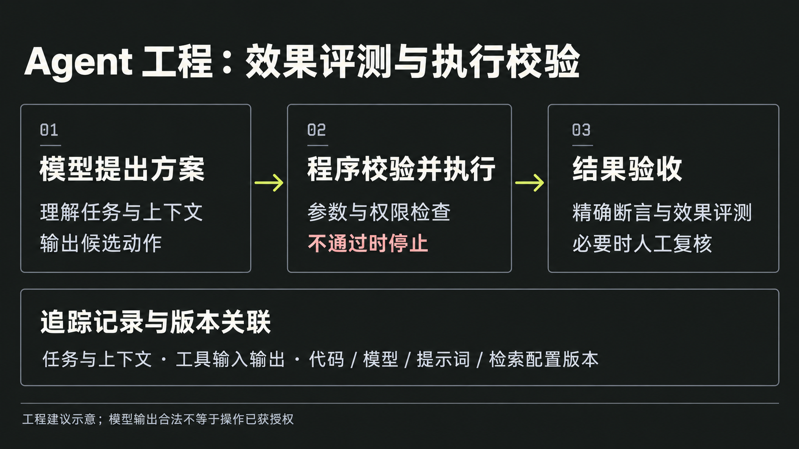

# Agent

## 摘要

Agent 指的是能基于当前上下文自主决定下一步动作，并通过工具调用或环境反馈继续推进任务的执行体。

## 关键点

- 和普通问答式 AI 相比，agent 的区别不在于“模型更强”，而在于它会把观察、决策、执行、再观察串成循环。
- 2024-12-24 的一条观察里把一个关键边界说得很清楚：如果流程本身已经能被人稳定写出来，那更接近 workflow；只有当下一步依赖模型持续判断时，才更像 agent。
- 工程上常见的 agent 既可以是通用执行体，也可以是更窄的 [[code-agent]]。
- 现有记录里的两个入口分别代表不同层级：
  - `aider` 更像直接可用的 coding agent；
  - `agno` 更像搭 agent 的框架层。

## 工程上的不确定性与验收

Agent 引入模型后，同一任务可能得到不同方案，因此需要对模型效果做评测，并由程序检查工具调用能否执行。分层、测试、版本管理、灰度和监控仍然适用。kimmking 的[知乎回答](https://www.zhihu.com/question/2024177621341075284/answer/2095217865989399922)用测试、调试、操作边界和发布四个环节说明了这种变化。

下面以“根据故障描述修改代码、运行检查并创建拉取请求（PR）”为例归纳工程做法。例子、具体检查项和配图是编者建议，原回答的观点与段落位置见[[raw/sources/kimmking-agent-engineering|来源核查记录]]。

| 环节 | 在项目维护任务中如何落实 |
| --- | --- |
| 测试与验收 | 先约定故障修复、相关检查通过、没有无关改动等要求。对参数格式、权限拒绝等行为保留精确断言；对修复质量、说明准确性建立代表性任务和评分标准，必要时人工复核。对容易波动的任务重复评测，避免以一次成功代替稳定性判断。 |
| 调试与追踪 | 关联任务上下文、代码版本、模型与提示词版本、检索材料、工具输入输出和最终补丁，以区分上下文缺失、模型判断错误与工具执行失败。日志应脱敏并限制访问与保留期限；保存记录不保证重跑得到相同结果，也不要求保存模型内部思维过程。 |
| 操作边界 | 模型提出候选动作，执行程序检查参数、可写目录、命令范围和授权。检查不通过就停止该动作；创建 PR、合并、部署分别遵守各自的授权条件。固定步骤由程序编排，不因模型提出请求就扩大权限。 |
| 版本与发布 | 将代码、模型、提示词、检索配置和评测集版本关联起来；变更后用同一组代表性任务检查回归，再决定是否扩大使用范围。记录配置组合是为了归因和恢复，不要求每次一起升级所有组件。 |

这里需要区分两类保证：[[wiki/syntheses/ai/llm-structured-output-reliability|结构化输出]]可以约束格式，但不能保证业务判断正确或操作已获授权。哪些步骤应由程序编排、哪些需要模型持续决策，见 [[wiki/comparisons/ai/workflow-vs-agent|Workflow vs Agent]]。

原回答把模型与提示词工作估为约三成，其余工程工作估为约七成，但没有列出样本和统计方法，只能作为作者的经验提醒。也不宜把传统软件等同于绝对确定、Agent 等同于完全不可复现；具体任务仍需分别判断效果、执行规则和环境依赖。

## 相关页面

- [[code-agent]]
- [[workflow-vs-agent]]
- [[agent-client-protocol]]
- [[agent-native-system-interface-design]]
- [[wiki/topics/ai/agent-harness|Agent Harness]]
- [[wiki/syntheses/ai/llm-structured-output-reliability|LLM 结构化输出的可靠性边界]]

## 来源指针

- `raw/sources/agent.md`
- https://github.com/Aider-AI/aider
- https://github.com/agno-agi/agno
- [kimmking：开发Agent和传统软件工程有哪些区别？](https://www.zhihu.com/question/2024177621341075284/answer/2095217865989399922)，发布于 2026-10-18。
- [[raw/sources/kimmking-agent-engineering|来源核查记录]]。
- [[wiki/comparisons/ai/workflow-vs-agent|Workflow vs Agent]]。
- [[wiki/syntheses/ai/llm-structured-output-reliability|LLM 结构化输出的可靠性边界]]。
