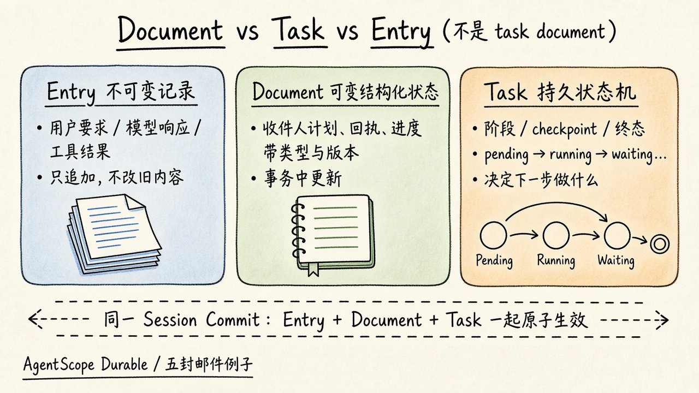

# AgentScope Durable：任务可恢复执行与 Document / Task 分工

## 摘要与范围

本文依据刘军的微信长文 [Durable Agent 详解：如何让 Agent 在云端长期稳定运行](https://mp.weixin.qq.com/s/z8JHkCyOVVKrXpKH-vy6tw)（访问日期 2026-11-04，Asia/Shanghai）整理。文中以 **AgentScope** 的 HarnessAgent 与 Durable 执行内核说明「会话恢复」和「任务执行恢复」的差别，并落到阿里云 **AgentCore** 的托管、Session Store 与 Brain–Hands 方向。

**范围：** 概念与数据模型梳理，重点回答「task document 是什么」。**不是** AgentScope / AgentCore 源码审计；实现细节以原文与 `raw/sources/agentscope-durable.md` 为准。概念上可与 [[wiki/topics/ai/pi-durable|Pi Durable]] 对照，见 [[wiki/comparisons/ai/agentscope-durable-vs-pi-durable|AgentScope Durable vs Pi Durable]]；二者产品与宿主不同，不能据此断言同一代码库。

## Durable 要解决什么

常见 Agent 框架能保存 Session，让对话接着聊。云上长任务还会遇到进程崩溃、网络中断、实例被替换：恢复后不仅要记得聊过什么，还要知道哪些步骤已确认、哪些在等待、哪些结果还没落盘，否则会重复发邮件或漏发。

文中用「向五位客户发送通知邮件」说明缺口：前三封已确认完成；第四封邮件服务已接受，本地还没保存结果就崩溃；第五封尚未开始。只重跑模型、整任务重做，或让用户说「继续」，都补不回丢失的执行事实。Durable 把进度、调用意图和执行结果保存在进程外，并在模型调用、工具执行等环节划出可提交的恢复边界。

会话恢复保持**对话**连续；Durable 进一步让**任务执行**连续。它不等于永不失败，也不自动保证外部动作恰好执行一次；服务不可用、凭据失效、结果无法确认时，任务仍可能失败或进入需人工处理的状态，但失败应留下可解释、可恢复的事实。

## 为什么「有会话历史」仍不够

普通循环把「执行到哪」留在函数调用栈、局部变量和 Promise 里。崩溃后会话文件可能只剩下用户要求、一次 `send_batch_emails` 的 tool call，以及尚未写入的 tool result。这能说明模型提出了什么，却不能证明工具内部发了几封。

即使把每封邮件拆成独立工具调用，仍有窗口：**有调用意图、没有结果**，只能说明「可能执行过」。请求可能没发出，也可能已被接受但响应丢失。可靠机制要同时处理：内部状态如何提交；外部动作如何确认（幂等标识、原操作查询，或补偿与人工路径）。

| 常见做法 | 能解决什么 | 仍缺少什么（据原文） |
| --- | --- | --- |
| 保存聊天记录 | 重建模型上下文 | 工具内部进度、可靠等待与恢复策略 |
| 用数据库存 messages | 提高历史保存能力 | 写入顺序、原子提交和执行状态机 |
| 崩溃后自动重启进程 | 恢复一个运行实例 | 从哪里继续、哪些动作不能重做 |
| 失败后重试整个 Agent | 再给任务一次机会 | 对已完成步骤和外部副作用的识别 |
| 给模型补一句「上次中断了」 | 帮助重新规划 | 缺失的业务事实与确定性的接续规则 |

## Session 里有哪些对象

AgentScope 用 **Session** 做统一状态与提交范围；一个 Session 可含多个 Conversation。文中表格：

| 对象 | 负责表达什么 | 邮件任务例子 |
| --- | --- | --- |
| Conversation | 对话记录及其上下文范围 | 用户与邮件助手的持续对话 |
| Entry | 不可变的会话记录 | 用户要求、模型响应、工具结果 |
| Document | 可在事务中更新的结构化状态 | 收件人计划、发送回执、当前运行进度 |
| Task | 带阶段、检查点和终态的持久状态机 | 模型生成、工具调用、逐封发送 |
| Submission | 应用提交及其处理结果 | 发送请求是否排队、是否被处理、是否获得回答 |
| Commit | 一组关联变化的原子提交 | 保存回执，同时完成子任务并更新发送进度 |

Entry 保留已经发生的记录；Document 保存后续阶段要读的数据；Task 决定下一步可以做什么。例如「第四封邮件已收到回执」是业务事实；「回执已经写入对话」和「父任务可以继续汇总」是需要一起推进的执行状态。

Document 带类型和版本：除业务数据外，也可保存 Agent 配置、待处理输入、运行中的模型与工具、使用量等。修改通过提交产生增量，必要时保存完整基线；恢复时用基线与后续增量重建。应用可注册自己的 Document 与 Task（邮件计划、审批阶段等），与内置任务共用同一套提交机制，不必把中间数据全塞进提示词或工具输出。

## FAQ：所谓「task document」是什么？

**文中没有名为「task document」的单一对象。** Document 与 Task 是两类东西，常在同一次 Commit 里一起改：

1. **Document**：可变、带类型与版本的结构化状态——计划、回执、进度表这类「业务事实」。
2. **Task**：持久状态机——当前阶段、checkpoint、等待谁、终态；决定调度器下一步跑哪段处理代码。
3. **Entry**：只追加的对话/结果记录，不拿来当可变业务表。

把「task document」当成一个词，容易把「业务数据」和「执行进度」糊成一团。正确读法是：**Session 里同时有 Document 与 Task（外加 Entry / Submission），靠 Commit 一起生效。**

## Commit：记录、文档与任务一起生效

若先写「工具完成」再存结果，中间崩溃会留下没有结果的完成记录；反过来可能让接管者以为还要再执行。一次 Commit 可同时：追加工具结果 Entry、更新邮件计划 Document 中的回执、将发送 Task 置为完成、更新会话中的工具运行状态。

提交顺序（据原文）：取得 Session 提交顺序 → 事务草稿中准备关联变化 → 校验并冻结写集合 → Storage 原子保存 → 采纳已持久化的新状态 → 更新视图、通知等待者、调度后续任务。同一 Session 内状态提交串行；模型请求和工具执行在提交事务之外推进，长时间外部调用不会因此占满状态事务。

Harness 管理数据的原子性，不等于发邮件、访问外部库或执行 shell 自动幂等；外部动作仍需单独定义确认和恢复规则。

## Task：把调用栈变成显式阶段

Task 保存类型与版本、输入、所属会话或父任务、当前状态和 checkpoint。恢复程序用任务类型找处理代码，用 checkpoint 决定从哪个阶段入口重新执行——**不会跳回崩溃前的某一行源代码**。

| 状态 | 含义 | 调度方式 |
| --- | --- | --- |
| pending | 已持久创建，等待运行 | 调度器启动对应阶段 |
| running | 正在执行某个阶段 | 提交下一检查点、等待或结果 |
| waiting | 等待指定任务结束 | 保存依赖与汇合策略，当前不跑代码 |
| sleeping | 等待一个时间点 | 保存唤醒时间与下一阶段 |
| completing | 结果已决定，所属子任务尚未全部收尾 | 等待子任务收敛 |
| terminal | 已结束 | 保留最终结果供其他任务读取 |

阶段若包含多个不可重复的外部动作，应继续拆分阶段，或为动作保存可确认的操作身份。只在函数里多写 `await`，不会增加持久恢复边界。

## 模型与工具：意图先落盘，再谈能不能重放

Agent 循环由模型生成任务和工具任务组成。输入受理后先保存 Submission；写入用户 Entry 并创建模型生成任务。模型提出 tool call 时，把模型响应、要创建的工具任务和「等待这些任务」的状态一起提交；重启后仍知道应执行哪些调用，不必让模型重新猜计划。

普通工具 Task 分两阶段：

- **call**：解析、校验、调用前检查，然后保存最终参数、重放策略和执行意图；提交成功后再执行工具并提交结果。
- **execute**：意图已保存、结果未确认时的恢复入口；只有调用时与恢复时策略均为 `safe`，才用已确认参数重跑；否则保存 `interrupted` 与已提交的部分输出。

工具声明「可安全重放」是作者对业务行为的承诺；框架不会自动让发邮件变成幂等。黑盒 `send_batch_emails()` 只能知道「这次调用中断了」，不知道内部完成了哪几封——更细恢复要把业务改成多阶段自定义 Task。

## 自定义任务：五封邮件如何接续

注册发送任务类型：用 Document 保存已确认收件人计划；为每封邮件建子任务；同一次 Commit 保存子任务身份与父任务等待状态。父任务等待不是内存里的 `Promise.all`，而是持久关系：等哪些 Task、`allSettled` 还是 `failFast`、结束后进哪一阶段。

邮件例的前提（原文明确写出）：邮件服务支持按稳定操作标识幂等受理，并能查询原操作。恢复时：

| 邮件 | 恢复时的事实 | 继续方式 |
| --- | --- | --- |
| 第 1～3 封 | 已提交终态与回执 | 直接读取，不再发送 |
| 第 4 封 | 已保存操作身份，没有确认结果 | 进入查询阶段；确认后补记回执 |
| 第 5 封 | 任务已存在，尚未开始外部动作 | 从其初始阶段执行 |

若服务既不幂等也无法查询，第 4 封仍只能保留不确定状态并交业务核实；状态机提供处理位置，不会凭空创造外部系统没保存的事实。

## 重新打开 Session 与宿主唤醒

重新打开同一 Storage → 恢复 Conversation、Entry、Document、Task、Submission → 核对任务类型/版本与阶段处理器 → 启动调度器：pending 或中断的 running 从已保存阶段进入；waiting 重查依赖；sleeping 等到点；completing 检查子任务收尾；terminal 直接提供结果。同 `requestId` 重试返回原 Submission。取消先持久记录取消意图，再通知活动阶段停止并等待所属子任务结束。

`resume()` 启动调度器；唤醒信息告诉宿主「现在有工作」以及「下次何时继续」。常驻宿主用本地定时器；云端宿主经 `onWake` 安排唤醒，进程回收后重新打开 Session 再 `resume()`。调度器判断任务是否可运行，宿主提供实际执行机会。

## AgentCore、Brain–Hands（高层面）

文中后半把 Durable 接到阿里云 **AgentCore**：已有 Harness 托管、任务中断续接、从已保存执行节点恢复。更细的 Durable 还要回答状态存在哪、何时继续、由哪个实例执行。

- **共同 Session Store**：统一保存、提交、读取的调用约定；Harness 原生状态、平台执行事实、工具执行事实、工作区与产物、用户可见视图可分层保存，用身份与版本关联。
- **Brain–Hands**：Brain 管理推理与上下文，Hands 管理工具实际执行；「等待工具」成为可持久表达的状态，推理进程不必一直挂着等工具。
- **Environment**：描述继续执行需要的内核、依赖、模型与工具配置及工作区权限；与 Session Store 分别保留运行条件与执行事实。
- **Agent as a Service**：用户可离线、连接可断、实例可换，任务仍有清晰身份、状态与后续安排。

这些多为架构方向描述；本次未对照 AgentCore 产品文档或源码做落地核查。

## 工程限制（据原文归纳）

1. Durable 不保证外部副作用恰好一次；缺幂等与查询时只能保留不确定状态。
2. 黑盒工具只能恢复到「整次调用」粒度；细粒度要自定义多阶段 Task。
3. 提交原子性覆盖 Harness 管理的数据，不覆盖外部系统。
4. 任务定义缺失或无法迁移时，原状态保留并报告阻塞，等兼容定义就绪再调度。
5. 同一阶段持续崩溃会受到重启次数限制，达到上限后记录失败原因并结束（避免每次启动重复踩同一错误）；具体次数以实现为准，本文未审计源码。
6. 多实例需要共享存储、执行权隔离与兼容环境；原文强调宿主与平台职责，细节需结合部署另查。

## 相关页面

- [[wiki/comparisons/ai/agentscope-durable-vs-pi-durable|AgentScope Durable vs Pi Durable]]
- [[wiki/topics/ai/pi-durable|Pi Durable：可恢复的 Agent 执行库]]
- [[wiki/topics/ai/agent-harness|Agent Harness]]
- [[wiki/syntheses/ai/agent-harness-runtime-architecture|Agent Harness 运行时架构与演进]]
- [[wiki/syntheses/ai/agent-loop-control-boundaries|Agent 循环工作流的控制边界]]

## 来源指针

- [[raw/sources/agentscope-durable.md|访问元信息与验证限制]]
- [Durable Agent 详解：如何让 Agent 在云端长期稳定运行](https://mp.weixin.qq.com/s/z8JHkCyOVVKrXpKH-vy6tw)（刘军；访问 2026-11-04 Asia/Shanghai）
