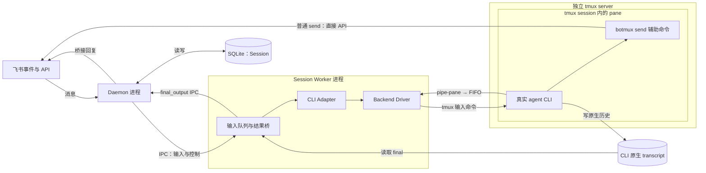
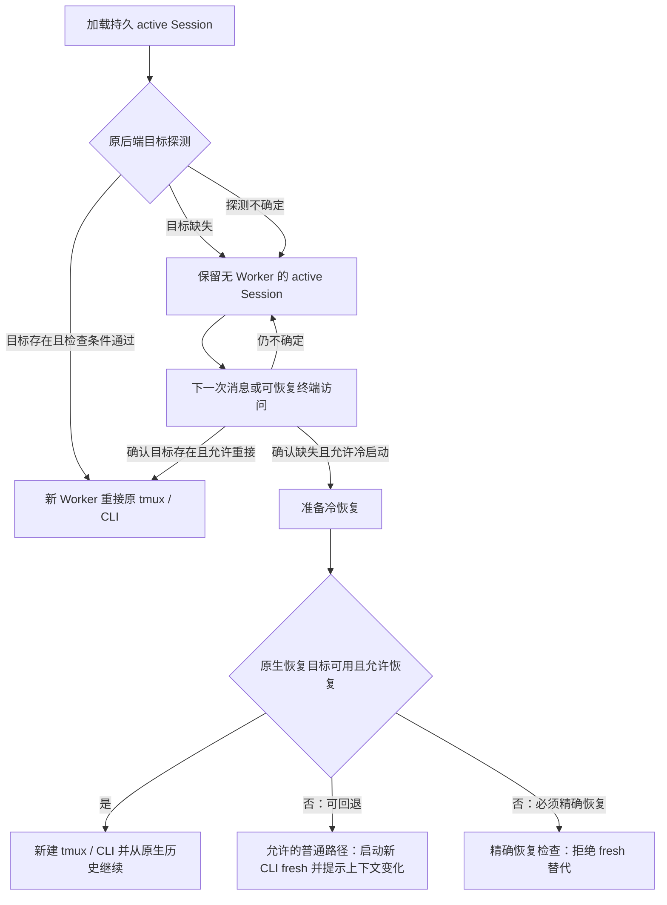

# Botmux 会话运行机制：Worker、CLI 与 tmux

## 摘要

Botmux 的普通本地会话由 daemon 接收消息和管理会话，由独立 Worker 进程操作真实的 agent CLI（命令行程序）。默认 tmux 后端把 CLI 放在独立 tmux server 的 pane 中，Worker 可以退出后重新接上它。模型推理、工具选择和 agent loop（反复调用模型与工具的执行循环）仍由 Claude Code、Codex 等 CLI 实现，Botmux 在外侧提供消息路由、输入控制、回复投递和恢复支持。

本文限定于源码提交 `a5bff44b7d8676e316d5969d928eb21ee1b48024` 的普通本地托管路径，不将该快照称为最新版本。Remote Runner、adopt 和 Codex RPC（远程过程调用）只有在说明边界时提及；workflow/goal 编排不是这里的普通对话循环。总体定位见 [[wiki/topics/ai/botmux|Botmux]]，跨部署协作见 [[wiki/topics/ai/botmux-team-federation|Botmux 团队发现与协作]]。

依据：[Worker 构造 CLI 参数](https://github.com/deepcoldy/botmux/blob/a5bff44b7d8676e316d5969d928eb21ee1b48024/src/worker.ts#L16664-L16710)、[向后端交付启动参数](https://github.com/deepcoldy/botmux/blob/a5bff44b7d8676e316d5969d928eb21ee1b48024/src/worker.ts#L18361-L18377)。

## 五个组件分别负责什么

| 组件 | 实际职责 | 不应归给它的职责 |
| --- | --- | --- |
| Daemon | 接收消息事件，确定路由与逻辑会话，启动/换代 Worker，保存会话，投递 Worker 回传的结果 | 不替 CLI 执行模型循环 |
| Session Worker | 一个会话的运行进程；排队和提交输入，准备 CLI 启动配置，读取终端与原生历史，通过 IPC（进程间通信）回报状态和结果 | 不是持久 Session 本身，也不是 tmux server |
| CLI Adapter | CLI 专属的启动参数、输入方式、提交确认、能力声明与恢复探测 | 不独自管理会话生命周期，不负责飞书消息路由 |
| Backend Driver | 启动或重接实际执行资源，写输入、读输出、调整终端尺寸、拆连接或销毁会话 | 不解释 CLI 的模型参数与技能语法 |
| tmux server | 持有 tmux session、window、pane 和其中的终端程序；供外部客户端按地址操作 | 不保存模型语义历史，不是权限沙箱 |

CLI Adapter 和 Backend Driver 都是 Worker 内使用的模块，不是另两个常驻进程。Worker 调用 `adapter.buildArgs()` 后才调用 `backend.spawn()`。本地后端通常通过终端交互；远端后端也可以实现 `submitTurn()`，不必模拟按键。[接口定义与调用点](https://github.com/deepcoldy/botmux/blob/a5bff44b7d8676e316d5969d928eb21ee1b48024/src/adapters/backend/types.ts#L120-L169)

这个版本的默认值始终是 `tmux`。只有显式选择 `BACKEND_TYPE=pty` 或 per-bot `backendType: 'pty'` 才使用 PTY（伪终端）后端，tmux 不可用不会自动降级为 PTY。普通 managed tmux 实际选择 `TmuxPipeBackend`，不是让 Worker 作为 CLI 的 PTY 父进程。[默认值](https://github.com/deepcoldy/botmux/blob/a5bff44b7d8676e316d5969d928eb21ee1b48024/src/config.ts#L51-L65)、[后端选择](https://github.com/deepcoldy/botmux/blob/a5bff44b7d8676e316d5969d928eb21ee1b48024/src/adapters/backend/session-backend-selector.ts#L557-L579)

图中的 FIFO（命名管道）是终端输出通道；CLI 原生 transcript（会话记录）是独立磁盘数据。两者都不是 SQLite Session 行。`botmux send` 的直连箭头仅表示普通、非 read-isolation 配置；隔离路径有 host-side 代理，见下文。

## 一次输入怎样变成回复

### 1. 入站消息定位到逻辑会话

飞书事件处理器先按 anchor 串行分派：已有会话走 `handleThreadReply`，没有会话走 `handleNewTopic`。不是每条消息都新建 Worker 或 CLI。已有 Worker 可以继续接收后续输入；没有 Worker 时才需要启动或恢复。[入站分派](https://github.com/deepcoldy/botmux/blob/a5bff44b7d8676e316d5969d928eb21ee1b48024/src/im/lark/event-dispatcher.ts#L2695-L2708)

Daemon 构造开场或后续输入，包括用户正文、附件与适用的身份/路由上下文。默认模式下，Claude-family 把稳定上下文放入追加系统提示，其他 CLI 可以收到内联提示块；具体输入外壳还受 CLI 和会话模式影响。[提示构造](https://github.com/deepcoldy/botmux/blob/a5bff44b7d8676e316d5969d928eb21ee1b48024/src/core/session-manager.ts#L1275-L1308)

### 2. Daemon 将输入交给 Worker

Daemon 以子进程方式启动 Worker，建立 Node IPC（进程间通信）通道，发送 `init` 或后续 `message`。启动消息包含 Botmux Session、CLI、工作目录、后端和当前输入信息。Worker 是按会话运行的，不是按消息运行的。[启动 Worker](https://github.com/deepcoldy/botmux/blob/a5bff44b7d8676e316d5969d928eb21ee1b48024/src/core/worker-pool.ts#L12466-L12487)、[发送 init](https://github.com/deepcoldy/botmux/blob/a5bff44b7d8676e316d5969d928eb21ee1b48024/src/core/worker-pool.ts#L12840-L12858)

“IPC 已发送”与“CLI 已提交”是不同边界。普通 IM 输入的追踪记录绑定 `turnId` 与 `workerGeneration`；旧 Worker 换代后的回执不能确认新一代输入。[输入追踪](https://github.com/deepcoldy/botmux/blob/a5bff44b7d8676e316d5969d928eb21ee1b48024/src/core/worker-pool.ts#L9015-L9043)、[回执代次检查](https://github.com/deepcoldy/botmux/blob/a5bff44b7d8676e316d5969d928eb21ee1b48024/src/core/worker-pool.ts#L13451-L13460)

### 3. Worker 提交 CLI 输入

Worker 决定何时写入，把一次逻辑提交包在提交事务中，再调用 Adapter 的 `writeInput()` 或 `writeStructuredInput()`。Adapter 决定粘贴、软换行和最终提交键的形式；Backend 执行实际终端操作。[写入调用](https://github.com/deepcoldy/botmux/blob/a5bff44b7d8676e316d5969d928eb21ee1b48024/src/worker.ts#L13584-L13621)

两个 CLI 的实现不能混用：

- Codex 对多行正文使用 bracketed paste（带边界标记的粘贴），避免每个换行被当作 Enter，再单独发送提交键，并读取原生 history 验证。[Codex 输入](https://github.com/deepcoldy/botmux/blob/a5bff44b7d8676e316d5969d928eb21ee1b48024/src/adapters/cli/codex.ts#L439-L489)
- Claude Code 的 tmux 输入按字节分块并限速，用反斜杠加 Enter 表达软换行，依据 keybindings 选择提交键；有原生 JSONL 路径时用记录确认提交，路径不可用时会走未验证分支。[Claude 输入](https://github.com/deepcoldy/botmux/blob/a5bff44b7d8676e316d5969d928eb21ee1b48024/src/adapters/cli/claude-code.ts#L1212-L1273)、[确认与限制](https://github.com/deepcoldy/botmux/blob/a5bff44b7d8676e316d5969d928eb21ee1b48024/src/adapters/cli/claude-code.ts#L1331-L1389)

这些确认只回答“用户输入有没有到达 CLI”，不是“模型是否成功完成”。Codex RPC 输入另走 `turn/start`，其原生确认代替终端粘贴确认，不能据终端后端推断所有模式都在发送按键。[RPC 分支](https://github.com/deepcoldy/botmux/blob/a5bff44b7d8676e316d5969d928eb21ee1b48024/src/worker.ts#L13541-L13548)

### 4. CLI 运行自己的 agent loop

CLI 接收输入后调用模型、运行工具并记录会话。Botmux 可以增加提示、技能和命令入口，但“由什么模型决定下一步、怎样执行工具循环”仍是所启动 CLI 的行为。Worker 在外侧读状态、处理提交失败和转发结果，不能因此称为 Botmux 自己实现了这些 CLI 的原生循环。

### 5. 回复有两条路径

| 路径 | 谁取得回复 | 谁向飞书发请求 |
| --- | --- | --- |
| 默认 `replyDelivery=send` | CLI 中的 agent 主动调用 `botmux send` 辅助命令 | 普通非隔离配置由辅助命令直接调用 Lark client |
| transcript 投递或兜底 | Worker 从 CLI 原生历史/事件中取得 final | Worker 发 `final_output` IPC，Daemon 组织并投递回复 |

普通 `botmux send` 在自己的命令进程中导入 Lark client，按会话/本轮目标调用 `sendMessage` 或 `replyMessage`。发送内容不必经过 Worker → Daemon。这里说的是消息内容的投递路径，不表示身份核验、发送记录或卡片协同从不联系 daemon。[辅助命令发送](https://github.com/deepcoldy/botmux/blob/a5bff44b7d8676e316d5969d928eb21ee1b48024/src/cli.ts#L10974-L10986)、[API 调用](https://github.com/deepcoldy/botmux/blob/a5bff44b7d8676e316d5969d928eb21ee1b48024/src/cli.ts#L11148-L11166)

read-isolation 路径不能按这条直连概括：Linux bwrap 保留 host execution outbox，macOS 隔离会话通过所属 daemon 的证明/代理路径发送。残留 capability 文件不是发送授权。[隔离发送判定](https://github.com/deepcoldy/botmux/blob/a5bff44b7d8676e316d5969d928eb21ee1b48024/src/cli.ts#L9234-L9287)

另一条路径读的是原生会话记录。Claude 有自己的 transcript 桥；Codex 等使用按 CLI 选择的结构化读取器，Hermes 等还可能读取 SQLite。Worker 把可归属于本轮的 final 发成 `final_output`，不是把终端屏幕文字直接当最终答案。[各 CLI 读取器](https://github.com/deepcoldy/botmux/blob/a5bff44b7d8676e316d5969d928eb21ee1b48024/src/worker.ts#L7110-L7150)、[结果 IPC](https://github.com/deepcoldy/botmux/blob/a5bff44b7d8676e316d5969d928eb21ee1b48024/src/worker.ts#L8903-L8916)

默认投递方式是 `send`；显式 `transcript` 把结果桥提升为主要回复通道，并改变发送提示。`promptInjection=none` 的支持组合也使用自动结果投递。没有对应 transcript 能力的 CLI 不会仅因配置值就获得采集能力。[投递策略](https://github.com/deepcoldy/botmux/blob/a5bff44b7d8676e316d5969d928eb21ee1b48024/src/core/reply-delivery.ts#L28-L62)

同一轮已有明确 `botmux send` 时，Worker 的发送标记检查会抑制普通桥接兜底，避免再次发出相同结果。Daemon 还会按 session/turn 身份去重，并在投递成功后记录结果。去重不是仅靠“模型输出了一个结束词”。[Worker 抑制条件](https://github.com/deepcoldy/botmux/blob/a5bff44b7d8676e316d5969d928eb21ee1b48024/src/worker.ts#L8780-L8859)、[Daemon 去重](https://github.com/deepcoldy/botmux/blob/a5bff44b7d8676e316d5969d928eb21ee1b48024/src/core/worker-pool.ts#L16630-L16651)、[投递与记录](https://github.com/deepcoldy/botmux/blob/a5bff44b7d8676e316d5969d928eb21ee1b48024/src/core/worker-pool.ts#L17864-L17929)

## Harness 添加了哪些运行支持

这里的 harness 指 Botmux 围绕真实 CLI 添加的运行支持，不等于模型循环全部由 Botmux 提供。相关概念见 [[wiki/topics/ai/agent-harness|Agent Harness]]。

| 内容 | 放在哪里/由谁使用 | 具体边界 |
| --- | --- | --- |
| 身份、路由、发送规则与本轮上下文 | 系统提示、用户输入外壳，或受条件控制的 hook additionalContext | 改变模型可见上下文，不构成操作系统权限限制 |
| 内置与用户技能 | CLI 插件参数、共享 skills 目录或会话提示目录 | 安装范围由 Adapter 能力、注入模式和配置共同决定 |
| `botmux` 辅助命令 | Worker 与 CLI 的 PATH 前方 | 提供 send/ask/history 等入口；命令仍要解析并验证会话来源 |
| 身份环境与 PID（进程标识）marker | CLI 启动环境、进程标记文件 | Session 身份较稳定，当前 turn 不能永远相信启动时 env |
| Hooks 与 MCP（模型上下文协议） | CLI 配置、进程 settings、Worker 的可信 Gateway host | 各 CLI 不同，安装尝试不等于机器上已经安装成功 |
| 输入与结果桥 | Worker、Adapter、Backend 与服务模块 | 是外侧的执行支持，不全是注入模型的提示文本 |

### 默认技能注入不是全部写入全局目录

带 `pluginDir` 的 CLI 通过会话启动参数加载 Botmux 插件。Claude-family 的 `--plugin-dir` 和 `--append-system-prompt` 分别提供技能与系统提示，不把内置技能都放进用户共享 skills 目录。[Claude 参数](https://github.com/deepcoldy/botmux/blob/a5bff44b7d8676e316d5969d928eb21ee1b48024/src/adapters/cli/claude-code.ts#L1197-L1207)

仅有 `skillsDir` 的 CLI 使用另一组选择：

- `prompt` 是缺省值：不写共享技能文件，而在会话提示中放精简目录，让模型按需调用 `botmux skill show`。
- `global` 把技能写到 CLI 共享目录，独立手动运行的 CLI 也可能发现它们。
- `off` 既不安装文件也不加入技能目录，但不代表关闭路由提示或运行支持。

选择顺序是 per-bot 覆盖 → 机器配置 → `prompt`。共享目录的安装判断还按“是否有任一 bot 需要 global”处理，不能用一个会话的偏好覆盖其他 bot 的文件。[模式与优先级](https://github.com/deepcoldy/botmux/blob/a5bff44b7d8676e316d5969d928eb21ee1b48024/src/skills/injection-mode.ts#L1-L23)、[共享目录判断](https://github.com/deepcoldy/botmux/blob/a5bff44b7d8676e316d5969d928eb21ee1b48024/src/skills/injection-mode.ts#L100-L119)

### Claude hooks 与 Codex hooks 不能画成同一套

Claude adapter 声明全局 settings 的 `SessionStart` 就绪 hook 和提问用 `PreToolUse` hook。`UserPromptSubmit` 的不可见上下文入口仅对 `claude-code` 变体声明；daemon 还要依据配置准备对应 sidecar，触发 hook 不代表每轮都会添加内容。[Claude hook 声明](https://github.com/deepcoldy/botmux/blob/a5bff44b7d8676e316d5969d928eb21ee1b48024/src/adapters/cli/claude-code.ts#L1530-L1555)

Claude 的 `statusLine` 则属于进程级 `--settings`，与上面的共享 hook settings 分开。它接收用量数据，不是最终答复解析器。[statusLine 范围](https://github.com/deepcoldy/botmux/blob/a5bff44b7d8676e316d5969d928eb21ee1b48024/src/adapters/cli/claude-code.ts#L1156-L1174)

Codex 没有这组 Claude 核心 hooks，提问可走 ask skill/catalog 兜底。独立 CodexNotifier 功能缺省关闭，不应据它推断普通 Codex 会话必装通知 hook。实际安装由 Worker pool/installer 消费 Adapter 声明，失败通常记录警告。[安装消费者](https://github.com/deepcoldy/botmux/blob/a5bff44b7d8676e316d5969d928eb21ee1b48024/src/core/worker-pool.ts#L4855-L4882)、[Notifier 默认值](https://github.com/deepcoldy/botmux/blob/a5bff44b7d8676e316d5969d928eb21ee1b48024/src/features/codex-notifier/config.ts#L12-L19)

MCP 也分配置入口与实际工具：Worker 仅在 Adapter 支持 Gateway 且会话 manifest 有 MCP entries 时启动可信 host，工具来自启用插件，配置里有 server 条目不等于固定获得一套 Botmux 工具。[Gateway 启动条件](https://github.com/deepcoldy/botmux/blob/a5bff44b7d8676e316d5969d928eb21ee1b48024/src/worker.ts#L1800-L1833)

### 零注入是零提示/技能注入，不是零运行配置

`promptInjection=none` 让输入构造直接返回用户正文及附件数据行，不再加入 Botmux 指令外壳；Claude 跳过 Botmux plugin 和追加系统提示。Worker 还会清空继承的 Botmux prompt 环境变量。[输入处理](https://github.com/deepcoldy/botmux/blob/a5bff44b7d8676e316d5969d928eb21ee1b48024/src/core/session-manager.ts#L1289-L1292)、[环境清理](https://github.com/deepcoldy/botmux/blob/a5bff44b7d8676e316d5969d928eb21ee1b48024/src/skills/zero-injection.ts#L16-L22)

此模式不发布或安装会话 skill catalog，却仍保存 operational MCP/plugin 状态。身份环境、CLI 启动设置、终端输入、结果采集与投递仍存在。若共享 skills 目录已经有 Botmux 技能，代码拒绝声称“零注入”，不会为了一个会话删除其他 bot 的共享技能。[零注入技能处理](https://github.com/deepcoldy/botmux/blob/a5bff44b7d8676e316d5969d928eb21ee1b48024/src/core/plugins/cli-generation.ts#L51-L70)、[共享技能检查](https://github.com/deepcoldy/botmux/blob/a5bff44b7d8676e316d5969d928eb21ee1b48024/src/skills/zero-injection.ts#L5-L13)

零注入需要能自动取得 final 的本地 CLI/后端组合。这个版本拒绝远端后端与 v3 workflow；Cursor/Antigravity 的 scratch 沙箱、Antigravity 的 zmx 后端也有明确限制，不能只改一个开关就假定回复会到达。[支持条件](https://github.com/deepcoldy/botmux/blob/a5bff44b7d8676e316d5969d928eb21ee1b48024/src/core/prompt-injection.ts#L54-L75)、[Worker 拒绝条件](https://github.com/deepcoldy/botmux/blob/a5bff44b7d8676e316d5969d928eb21ee1b48024/src/worker.ts#L1733-L1739)

## Session 有四类身份，另有执行资源地址

| 身份 | 代表什么 | 何时改变 |
| --- | --- | --- |
| 路由地址 | `appId` 加 scope 对应的 anchor：thread 用 `rootMessageId`，chat 用 `chatId` | 会话绑定目标变化时；不同 bot 可占同一可见话题 |
| Botmux `sessionId` | Botmux 持久逻辑会话的身份 | 新建/分叉逻辑会话，不随 Worker 重启自动改变 |
| CLI-native `cliSessionId` | Codex thread 等原生历史/恢复目标；不必等于 Botmux UUID | CLI 新建、分叉、清空或实际目标变化时 |
| `workerGeneration` | 当前 Worker 的执行代次，用于拒绝上一代回执与结果 | 每次预留新的 Worker 生命周期时递增并持久化 |

这是按职责划分的身份，不是四个互相替代的“session ID”。普通 activeSessions 的具体 map key 是 `${anchorId}::${larkAppId}`，scope 决定 anchor 的来源；不要把概念写法误写成源码另存了一列三元组 key。启用 principal lane 后还存在经过验证的内部虚拟路由，不能拿它直接调用飞书发送接口。[路由 key](https://github.com/deepcoldy/botmux/blob/a5bff44b7d8676e316d5969d928eb21ee1b48024/src/core/types.ts#L782-L790)、[内部路由限制](https://github.com/deepcoldy/botmux/blob/a5bff44b7d8676e316d5969d928eb21ee1b48024/src/core/types.ts#L134-L153)

`turnId` 是一次输入的归属标识，不是长期会话身份；`dispatchAttempt` 区分需要追踪的提交尝试。长生命周期 CLI 的启动 env 不能代表后来每一轮的 turn，Worker 会更新 PID marker 中的当前 turn 和进程出生标记，辅助命令沿进程树定位来源。安全敏感操作还需要更强的来源证明，marker 不等于通用授权。[更新 marker](https://github.com/deepcoldy/botmux/blob/a5bff44b7d8676e316d5969d928eb21ee1b48024/src/worker.ts#L3689-L3721)、[沿进程树解析](https://github.com/deepcoldy/botmux/blob/a5bff44b7d8676e316d5969d928eb21ee1b48024/src/core/session-marker.ts#L176-L220)

`persistentBackendTarget` 是第五种信息：执行资源的地址，不是对话身份。tmux 目标包含 `backendType: 'tmux'` 和 `sessionName`；Herdr 目标还可能有 `agentName`。托管 tmux 名称是 `bmx-<sessionId 前 8 位>`，这个名称指 tmux session，不是 pane 名。[名称生成](https://github.com/deepcoldy/botmux/blob/a5bff44b7d8676e316d5969d928eb21ee1b48024/src/adapters/backend/tmux-backend.ts#L196-L199)、[目标选择](https://github.com/deepcoldy/botmux/blob/a5bff44b7d8676e316d5969d928eb21ee1b48024/src/adapters/backend/session-backend-selector.ts#L557-L579)

### 持久 Session 与内存 DaemonSession

`Session` 保存 chat、scope、CLI、目录、状态、原生 ID、冻结的后端类型和后端目标等数据。`DaemonSession` 在内存中包着这个 Session，再持有当前 Worker 对象、端口、ready 状态、屏幕内容等运行信息。Worker 对象和 `cliReady` 不会因 JSON 行持久化就变成可跨重启恢复的进程状态。[持久字段](https://github.com/deepcoldy/botmux/blob/a5bff44b7d8676e316d5969d928eb21ee1b48024/src/types.ts#L1088-L1101)、[内存字段](https://github.com/deepcoldy/botmux/blob/a5bff44b7d8676e316d5969d928eb21ee1b48024/src/core/types.ts#L55-L87)

SQLite 以每个 bot 一份 `session-stores/<appId>/sessions.db` 保存会话。`sessions` 表以 `session_id` 为主键，`row` 是完整 Session 的 JSON 文本，另有 status 和由 JSON 提取的路由查询字段；`cliSessionId` 与 `persistentBackendTarget` 保存在 JSON 行中，不是两列独立后端状态。[数据库路径](https://github.com/deepcoldy/botmux/blob/a5bff44b7d8676e316d5969d928eb21ee1b48024/src/services/session-store.ts#L900-L907)、[表结构](https://github.com/deepcoldy/botmux/blob/a5bff44b7d8676e316d5969d928eb21ee1b48024/src/services/session-store.ts#L164-L176)

Worker 选定后端目标后回报 `persistent_backend_target`，发现原生 ID 后回报 `cli_session_id`，Daemon 更新 Session 并保存。恢复时读取冻结目标，不重新用 live 默认值猜原会话跑在哪里。[后端目标回报](https://github.com/deepcoldy/botmux/blob/a5bff44b7d8676e316d5969d928eb21ee1b48024/src/core/worker-pool.ts#L13446-L13449)、[原生 ID 回报](https://github.com/deepcoldy/botmux/blob/a5bff44b7d8676e316d5969d928eb21ee1b48024/src/core/worker-pool.ts#L14148-L14161)

换代前，`reserveWorkerGeneration()` 把递增值同时写入内存 Session 与 SQLite；写入失败会回滚，之后才允许替换旧 Worker。持久化保存的是识别与恢复依据，不是 CLI 堆内存、PTY 内容或全部模型上下文。[代次预留](https://github.com/deepcoldy/botmux/blob/a5bff44b7d8676e316d5969d928eb21ee1b48024/src/core/worker-pool.ts#L18050-L18080)

## Worker 怎样实际操作 tmux

`TmuxPipeBackend` 使用短命 tmux 命令进程控制独立 server，而不是让“长命 tmux 子进程的 stdout”承担全部交互。

| 动作 | 核心实现 |
| --- | --- |
| 新建执行资源 | `tmux new-session -d -s <sessionName> -x <cols> -y <rows> -- ...`，pane 内启动 shell wrapper、环境赋值与 CLI |
| 发送字面文本 | `tmux send-keys -t <target> -l -- <text>` |
| 发送提交键/控制键 | `tmux send-keys -t <target> Enter ...`，具体键由 Adapter 决定 |
| 多行粘贴 | 正文经 stdin 进入 `load-buffer -b <name> -`，再 `paste-buffer -b <name> -t <target> -d -p` |
| 订阅实时输出 | `mkfifo` 建命名管道，`pipe-pane -O -t <target> 'cat > <fifo>'` 复制 pane 输出 |
| 读取/恢复屏幕 | `capture-pane -e -p`，按用途选择当前视口或完整历史；这不是 final 解析 |
| 调整尺寸 | 托管 session 使用 `resize-window`，较老 tmux 使用 `resize-pane` |

启动依据：[detached session](https://github.com/deepcoldy/botmux/blob/a5bff44b7d8676e316d5969d928eb21ee1b48024/src/adapters/backend/tmux-pipe-backend.ts#L1116-L1148)。写入依据：[send-keys 与 paste-buffer](https://github.com/deepcoldy/botmux/blob/a5bff44b7d8676e316d5969d928eb21ee1b48024/src/adapters/backend/tmux-pipe-backend.ts#L540-L632)。屏幕与尺寸依据：[capture](https://github.com/deepcoldy/botmux/blob/a5bff44b7d8676e316d5969d928eb21ee1b48024/src/adapters/backend/tmux-pipe-backend.ts#L1224-L1239)、[resize](https://github.com/deepcoldy/botmux/blob/a5bff44b7d8676e316d5969d928eb21ee1b48024/src/adapters/backend/tmux-pipe-backend.ts#L731-L748)。

输入最终是发往 pane 终端的字节或按键。`paste-buffer -p` 仅在应用请求 bracketed paste 时添加 `ESC[200~`/`ESC[201~` 标记，不是把 Markdown 或 JSON 直接交给模型。Adapter 必须适应 CLI 的输入模式，所以不能对所有 CLI 统一使用同一种粘贴算法。

输出则是 pane 写出的文本和终端控制序列字节。Worker 对 FIFO 使用 `O_RDWR` 打开，避免读写端互相等待；`createReadStream` 读块，`StringDecoder('utf8')` 拼回跨块的多字节字符，再分发 `onData`。FIFO 读取错误只表明实时观察失败，不能直接证明 CLI 已退出。[FIFO 读取](https://github.com/deepcoldy/botmux/blob/a5bff44b7d8676e316d5969d928eb21ee1b48024/src/adapters/backend/tmux-pipe-backend.ts#L421-L438)、[解码与订阅](https://github.com/deepcoldy/botmux/blob/a5bff44b7d8676e316d5969d928eb21ee1b48024/src/adapters/backend/tmux-pipe-backend.ts#L471-L513)

`capture-pane` 可供重接客户端恢复屏幕；实时 FIFO 不会自动重放 Worker 离线期间的全部字节。屏幕历史、CLI 原生 transcript 和 Botmux 的逻辑会话存储，分别解决显示、模型会话恢复、消息路由与管理问题。[屏幕种子](https://github.com/deepcoldy/botmux/blob/a5bff44b7d8676e316d5969d928eb21ee1b48024/src/adapters/backend/tmux-pipe-backend.ts#L1224-L1239)

### 与普通 Node spawn 的真正差别

区别不是“Node 不能启动 CLI”，而是谁持有终端，以及连接断开后能靠什么重新定位和操作它。普通进程创建可以配管道或其他描述符，但并不自动提供带名字的持久终端、屏幕历史和重新附着机制。也不能笼统说“父 Node 一退出，所有子进程必死”；进程是否继续运行与是否还能恢复其 I/O 是两个问题。

在 Botmux 的显式 PTY 后端中，Worker 调用 `node-pty.spawn()`，直接持有 PTY 对象，并在 `kill()` 中杀掉该进程。默认 tmux 后端则把持有者放到 server：Worker 的 `kill()` 取消 pipe 订阅并拆 FIFO，`destroySession()` 才销毁自己拥有的 tmux session。这是源码中可检查的生命周期差异。[PTY 实现](https://github.com/deepcoldy/botmux/blob/a5bff44b7d8676e316d5969d928eb21ee1b48024/src/adapters/backend/pty-backend.ts#L31-L79)、[tmux 拆连接与销毁](https://github.com/deepcoldy/botmux/blob/a5bff44b7d8676e316d5969d928eb21ee1b48024/src/adapters/backend/tmux-pipe-backend.ts#L760-L780)

因此 tmux 的价值是让 CLI 终端生命周期可以独立于观察它的 Worker，而不是让模型历史永远不会丢失。TTY、PTY、字节流与屏幕的基础关系见 [[wiki/topics/systems/terminal|Terminal：终端、TTY 与 Shell]]。

## 重接与冷恢复不是同一件事

### tmux 与 CLI 仍活着：重接同一进程

Backend selector 发现原 tmux session 后创建 `TmuxPipeBackend(..., isReattach: true)`，不再新建 pane 中的 CLI。新 Worker 重建观察通道、恢复屏幕；原 CLI 的运行内存仍由原进程持有。这依赖后端地址可探测、CLI 确实仍在运行，以及 CLI 配置、身份和隔离检查允许复用。[重接选择](https://github.com/deepcoldy/botmux/blob/a5bff44b7d8676e316d5969d928eb21ee1b48024/src/adapters/backend/session-backend-selector.ts#L557-L567)、[重接初始化](https://github.com/deepcoldy/botmux/blob/a5bff44b7d8676e316d5969d928eb21ee1b48024/src/adapters/backend/tmux-pipe-backend.ts#L399-L419)

### backing 消失：保留 Session，随后从历史恢复

主机重启、tmux server 退出、CLI 崩溃或主动回收执行资源，都可能使原进程不存在。这个版本不会仅因托管 backing 缺失就自动关闭逻辑 Session，而是保留 `active`，由后续输入触发冷恢复。`active` 只是管理状态，不是进程存活证明。[缺失目标处理](https://github.com/deepcoldy/botmux/blob/a5bff44b7d8676e316d5969d928eb21ee1b48024/src/core/session-manager.ts#L3285-L3314)

冷恢复会启动新的 tmux/CLI，依据 `cliSessionId` 与原生记录请求 resume。它不恢复旧进程的堆内存、未保存工具状态或全部离线终端字节。SQLite 提供目标与策略，模型上下文能继续多少取决于 CLI 的原生恢复能力和记录是否仍可读取。

普通路径检测到恢复记录缺失、精确 ID 缺失或重复恢复失败时，可以转为 fresh 并发出适用的提示。但不能说“一定自动 fresh”：自动 Codex 升级与非 legacy Codex instance 的精确恢复目标不可用时会拒绝这个回退。[恢复探测与例外](https://github.com/deepcoldy/botmux/blob/a5bff44b7d8676e316d5969d928eb21ee1b48024/src/worker.ts#L16377-L16431)

### 探测失败：不知道，不等于不存在

恢复探测的 `unknown` 保留 active Session，不以临时超时或后端错误作为删除依据。终端访问的 lazy wake 在 unknown 时返回不可用，而不是新建一个可能与原进程重复的 CLI。[恢复探测](https://github.com/deepcoldy/botmux/blob/a5bff44b7d8676e316d5969d928eb21ee1b48024/src/core/session-manager.ts#L3316-L3330)、[终端唤醒](https://github.com/deepcoldy/botmux/blob/a5bff44b7d8676e316d5969d928eb21ee1b48024/src/core/session-manager.ts#L3433-L3468)

adopt 是例外：它观察用户原有进程，不能在目标缺失时擅自生成新的托管 CLI。另一方面，空的恢复输入只是重接，不应误当成新的一轮用户请求。持久进程、持久数据与可恢复调用约定必须分别判断。

## 相关页面

- [[wiki/topics/ai/botmux|Botmux]]：对象说明与整体职责。
- [[wiki/topics/ai/botmux-team-federation|Botmux 团队发现与协作]]：跨部署发现、信任和消息协作。
- [[wiki/topics/systems/terminal|Terminal：终端、TTY 与 Shell]]：终端字节与显示机制。
- [[wiki/topics/ai/agent-harness|Agent Harness]]：模型、运行循环与外侧运行支持的概念边界。

## 来源指针

- [[raw/sources/botmux|Botmux 源码核查记录]]：固定提交、证据对照表与核查边界。
- [Worker](https://github.com/deepcoldy/botmux/blob/a5bff44b7d8676e316d5969d928eb21ee1b48024/src/worker.ts)：CLI 启动、输入事务、原生结果读取与 IPC。
- [Worker pool](https://github.com/deepcoldy/botmux/blob/a5bff44b7d8676e316d5969d928eb21ee1b48024/src/core/worker-pool.ts)：进程换代、身份持久化与回复投递。
- [TmuxPipeBackend](https://github.com/deepcoldy/botmux/blob/a5bff44b7d8676e316d5969d928eb21ee1b48024/src/adapters/backend/tmux-pipe-backend.ts)：tmux 命令、FIFO 字节读取与连接生命周期。
- [Session store](https://github.com/deepcoldy/botmux/blob/a5bff44b7d8676e316d5969d928eb21ee1b48024/src/services/session-store.ts)：每 bot SQLite 数据库与完整 Session JSON 行。
