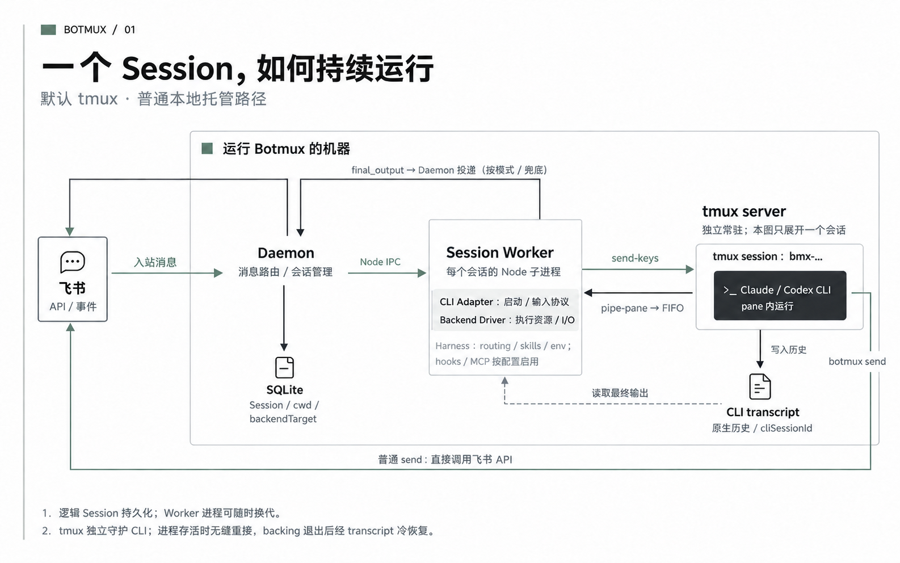
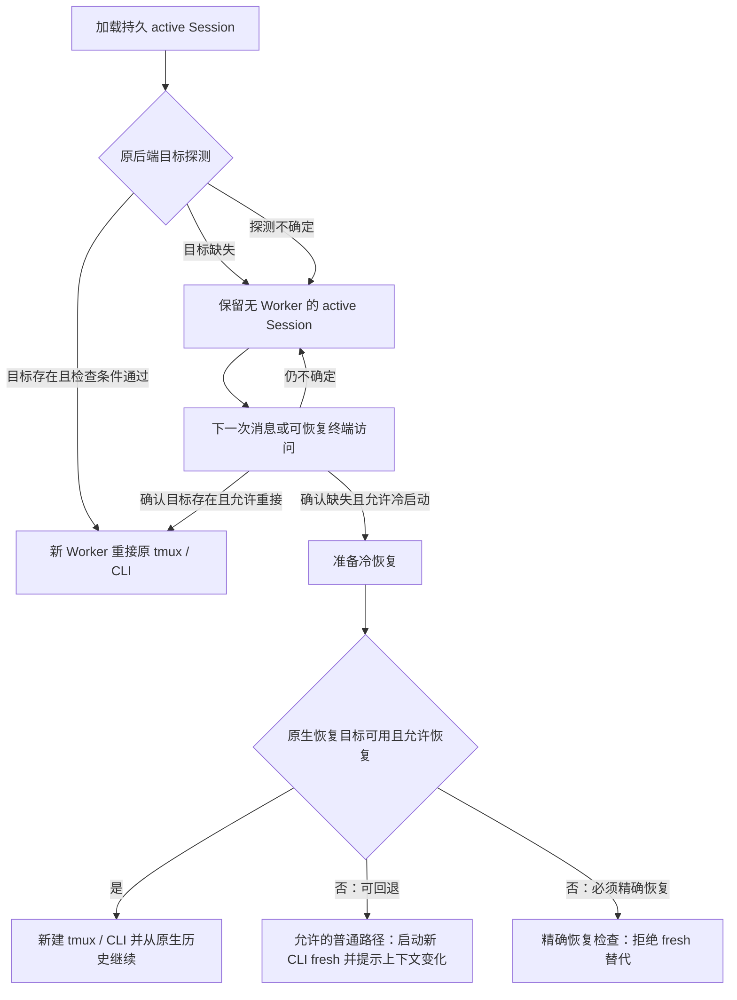

# Botmux 会话运行机制：Worker、CLI 与 tmux

## 摘要

Botmux 的普通本地会话采用双层进程架构：主 Daemon 负责接收飞书长连接消息并维护逻辑会话，由独立的 Session Worker 子进程具体操作真实的 agent CLI（命令行程序）。在默认 tmux 后端下，CLI 运行在独立常驻 tmux server 的 pane 中，使 CLI 的终端生命周期与 Worker 进程解耦。模型推理、工具选择和 Agent 执行循环仍由 Claude Code、Codex 等 CLI 自身实现，Botmux 在外侧提供消息路由、输入调度、结果投递与会话恢复支持。

本文基于源码快照 `a5bff44b7d8676e316d5969d928eb21ee1b48024` 的普通本地托管路径。总体定位见 [[wiki/topics/ai/botmux|Botmux]]，跨部署协作见 [[wiki/topics/ai/botmux-team-federation|Botmux 团队联邦与身份鉴权]]。

依据：[Worker 构造 CLI 参数](https://github.com/deepcoldy/botmux/blob/a5bff44b7d8676e316d5969d928eb21ee1b48024/src/worker.ts#L16664-L16710)、[向后端交付启动参数](https://github.com/deepcoldy/botmux/blob/a5bff44b7d8676e316d5969d928eb21ee1b48024/src/worker.ts#L18361-L18377)。

## 五个组件分别负责什么

| 组件 | 核心职责 | 边界约束 |
| --- | --- | --- |
| Daemon | 接收飞书事件，维护逻辑会话与路由映射，调度 Worker 生命周期，持久化会话并投递最终回复 | 原生模型推理与 Agent 工具循环交由 CLI 自行处理 |
| Session Worker | 绑定单一会话的执行进程；排队提交用户输入，组装 CLI 启动参数，读取终端流与原生转写，经 IPC 回报状态 | 生命周期服务于会话，不替代全局 Daemon 或 tmux server |
| CLI Adapter | Worker 内置模块；封装特定 CLI 的参数拼装、输入提交约定、确认机制与原生历史解析 | 不独立驻留进程，不参与消息网关路由 |
| Backend Driver | Worker 内置模块；负责具体后端的启动、终端按键输入、输出流订阅与尺寸调整 | 仅管理终端和执行流，不解析模型技能语法 |
| tmux server | 独立常驻进程；持有 tmux session/window/pane 并托管终端 CLI 进程，提供跨进程重接能力 | 仅维持终端运行环境，不持久化结构化模型上下文 |

CLI Adapter 和 Backend Driver 均作为 Worker 内部模块运行，而非独立外部进程。Worker 先调用 `adapter.buildArgs()` 完成参数组装，再由 `backend.spawn()` 拉起或接入执行目标。[接口定义与调用点](https://github.com/deepcoldy/botmux/blob/a5bff44b7d8676e316d5969d928eb21ee1b48024/src/adapters/backend/types.ts#L120-L169)

该快照默认执行后端为 `tmux`。仅在显式配置 `BACKEND_TYPE=pty` 或单个 bot 指定 `backendType: 'pty'` 时才启用 PTY 后端。默认托管路径采用 `TmuxPipeBackend`，通过短命命令与命名管道操作 tmux server。[默认值](https://github.com/deepcoldy/botmux/blob/a5bff44b7d8676e316d5969d928eb21ee1b48024/src/config.ts#L51-L65)、[后端选择](https://github.com/deepcoldy/botmux/blob/a5bff44b7d8676e316d5969d928eb21ee1b48024/src/adapters/backend/session-backend-selector.ts#L557-L579)

图中的 FIFO（命名管道）是终端输出通道；CLI 原生 transcript（会话记录）是独立磁盘数据。两者都不是 SQLite Session 行。`botmux send` 的直连箭头仅表示普通、非 read-isolation 配置；隔离路径有 host-side 代理，见下文。

## 一次输入怎样变成回复

### 1. 入站消息定位到逻辑会话

飞书事件处理器先按 anchor 串行分派：已有会话进入 `handleThreadReply`，新话题进入 `handleNewTopic`。单个会话复用常驻 Worker 处理连续输入，仅在初次进入或 Worker 退出后触发按需拉起或重接。[入站分派](https://github.com/deepcoldy/botmux/blob/a5bff44b7d8676e316d5969d928eb21ee1b48024/src/im/lark/event-dispatcher.ts#L2695-L2708)

Daemon 构造开场或后续输入，包括用户正文、附件与适用的身份/路由上下文。默认模式下，Claude-family 把稳定上下文放入追加系统提示，其他 CLI 可以收到内联提示块；具体输入外壳还受 CLI 和会话模式影响。[提示构造](https://github.com/deepcoldy/botmux/blob/a5bff44b7d8676e316d5969d928eb21ee1b48024/src/core/session-manager.ts#L1275-L1308)

### 2. Daemon 将输入交给 Worker

Daemon 启动 Worker 子进程并建立 Node IPC（进程间通信）通道，按会话生命周期发送 `init` 及后续 `message`。启动数据包含逻辑 Session、目标 CLI、工作目录、后端类型及本轮输入上下文。[启动 Worker](https://github.com/deepcoldy/botmux/blob/a5bff44b7d8676e316d5969d928eb21ee1b48024/src/core/worker-pool.ts#L12466-L12487)、[发送 init](https://github.com/deepcoldy/botmux/blob/a5bff44b7d8676e316d5969d928eb21ee1b48024/src/core/worker-pool.ts#L12840-L12858)

消息状态追踪绑定 `turnId` 与 `workerGeneration`：当 Worker 发生重启换代时，Daemon 依据代次严格隔离异步回执，确保上一代的残留状态不会干扰新代次执行。[输入追踪](https://github.com/deepcoldy/botmux/blob/a5bff44b7d8676e316d5969d928eb21ee1b48024/src/core/worker-pool.ts#L9015-L9043)、[回执代次检查](https://github.com/deepcoldy/botmux/blob/a5bff44b7d8676e316d5969d928eb21ee1b48024/src/core/worker-pool.ts#L13451-L13460)

### 3. Worker 提交 CLI 输入

Worker 控制输入时机，将逻辑提交封装在事务内，调用 Adapter 的 `writeInput()` 或 `writeStructuredInput()` 处理特定格式，最终交由 Backend Driver 执行实际的终端按键或粘贴操作。[写入调用](https://github.com/deepcoldy/botmux/blob/a5bff44b7d8676e316d5969d928eb21ee1b48024/src/worker.ts#L13584-L13621)

不同 CLI 的终端提交机制各有特化：

- Codex 对多行正文使用 bracketed paste（带边界标记的粘贴），避免换行符被提前解析为 Enter，粘贴完成后单独发送提交键，并读取原生 history 校验输入到达。[Codex 输入](https://github.com/deepcoldy/botmux/blob/a5bff44b7d8676e316d5969d928eb21ee1b48024/src/adapters/cli/codex.ts#L439-L489)
- Claude Code 的 tmux 输入按字节分块限速发送，用反斜杠加 Enter 表达软换行，依据 keybindings 选择提交按键，并通过原生 JSONL 记录确认输入提交成功。[Claude 输入](https://github.com/deepcoldy/botmux/blob/a5bff44b7d8676e316d5969d928eb21ee1b48024/src/adapters/cli/claude-code.ts#L1212-L1273)、[确认与限制](https://github.com/deepcoldy/botmux/blob/a5bff44b7d8676e316d5969d928eb21ee1b48024/src/adapters/cli/claude-code.ts#L1331-L1389)

在 Codex RPC 模式下，输入直接通过 `turn/start` 原生协议调用，由协议确认替代终端按键模拟。[RPC 分支](https://github.com/deepcoldy/botmux/blob/a5bff44b7d8676e316d5969d928eb21ee1b48024/src/worker.ts#L13541-L13548)

### 4. CLI 运行原生 Agent 循环

CLI 进程接收输入后，在其自身的执行环境中调用模型推理、调度本地工具并记录历史。Botmux 在外侧通过管道监听终端流、提供外围辅助工具与捕获完成事件，保持 CLI 原生工作流的完整性。

### 5. 回复的双轨投递路径

| 路径 | 触发与采集主体 | 消息发送链路 |
| --- | --- | --- |
| 默认主动发送 (`replyDelivery=send`) | CLI 内运行的 agent 主动调用辅助命令 `botmux send` | 辅助命令进程直接调用 Lark client 向飞书开放平台发请求 |
| 自动转写投递 (`replyDelivery=transcript`) | Worker 从 CLI 原生历史或结构化日志中解析 final 回答 | Worker 发送 `final_output` IPC 到 Daemon，Daemon 完成校验、去重后统一发卡 |

在默认 `send` 模式下，`botmux send` 在自身子进程中直接加载 Lark SDK 发送消息（在 read-isolation 模式下则走 host 代理授权路径）。[辅助命令发送](https://github.com/deepcoldy/botmux/blob/a5bff44b7d8676e316d5969d928eb21ee1b48024/src/cli.ts#L10974-L10986)、[API 调用](https://github.com/deepcoldy/botmux/blob/a5bff44b7d8676e316d5969d928eb21ee1b48024/src/cli.ts#L11148-L11166)、[隔离发送判定](https://github.com/deepcoldy/botmux/blob/a5bff44b7d8676e316d5969d928eb21ee1b48024/src/cli.ts#L9234-L9287)

在转写模式下，各 CLI 使用专属适配器解析转写文件（Claude 读取 JSONL 记录，Codex/Hermes 读取专属结构化存储或 SQLite）。Worker 确认回合结束并提取到完整回答后回传 `final_output` IPC。[各 CLI 读取器](https://github.com/deepcoldy/botmux/blob/a5bff44b7d8676e316d5969d928eb21ee1b48024/src/worker.ts#L7110-L7150)、[结果 IPC](https://github.com/deepcoldy/botmux/blob/a5bff44b7d8676e316d5969d928eb21ee1b48024/src/worker.ts#L8903-L8916)、[投递策略](https://github.com/deepcoldy/botmux/blob/a5bff44b7d8676e316d5969d928eb21ee1b48024/src/core/reply-delivery.ts#L28-L62)

双轨去重保护：同一回合内若 agent 已显式调用 `botmux send`，Worker 会自动抑制转写兜底发卡；Daemon 进一步按 `sessionId + turnId` 做严格的投递幂等去重，确保回复卡片精准送达一次。[Worker 抑制条件](https://github.com/deepcoldy/botmux/blob/a5bff44b7d8676e316d5969d928eb21ee1b48024/src/worker.ts#L8780-L8859)、[Daemon 去重](https://github.com/deepcoldy/botmux/blob/a5bff44b7d8676e316d5969d928eb21ee1b48024/src/core/worker-pool.ts#L16630-L16651)、[投递与记录](https://github.com/deepcoldy/botmux/blob/a5bff44b7d8676e316d5969d928eb21ee1b48024/src/core/worker-pool.ts#L17864-L17929)

## Harness 添加了哪些运行支持

这里的 Harness 指 Botmux 围绕原生 CLI 构建的外围执行支撑体系，负责环境注入、技能分发与执行监视。相关概念见 [[wiki/topics/ai/agent-harness|Agent Harness]]。

| 内容 | 挂载位置与使用方式 | 作用与边界 |
| --- | --- | --- |
| 身份与路由上下文 | 系统提示、用户输入信封、或条件性 hook `additionalContext` | 改变模型可见上下文，作为交互约定生效 |
| 内置与用户技能 | CLI 插件启动参数、共享 skills 目录或会话提示词目录 | 安装范围由 Adapter 适配能力与注入模式决定 |
| `botmux` 辅助命令 | 注入至 Worker 与 CLI 的 PATH 前列 | 提供 send/ask/history 等命令入口，内部解析校验调用来源 |
| 身份环境与 PID 标记 | CLI 启动环境变量、运行时进程标记文件 (marker) | 动态维护当前 turn 与会话归属，供辅助命令反查来源 |
| Hooks 与 MCP 网关 | CLI 全局配置、会话 settings、Worker 的 Gateway host | 依 CLI 适配能力启用，按需挂载工具扩展 |
| 输入与结果桥接 | Worker、Adapter、Backend 协同服务模块 | 在终端外侧监听执行流并捕获最终回复 |

### 技能注入模式与分发层级

支持 `pluginDir` 的 CLI（如 Claude-family）通过 `--plugin-dir` 专属参数加载 Botmux 插件，并通过 `--append-system-prompt` 注入系统规则，技能与提示完全隔离在当前会话生命周期内。[Claude 参数](https://github.com/deepcoldy/botmux/blob/a5bff44b7d8676e316d5969d928eb21ee1b48024/src/adapters/cli/claude-code.ts#L1197-L1207)

使用 `skillsDir` 共享目录的 CLI 支持三种分发策略：

- `prompt`（缺省）：不向磁盘写入物理技能文件，仅在会话提示中注入精简目录，模型按需调用 `botmux skill show` 查看详情；
- `global`：将技能实体文件写入 CLI 的共享技能目录；
- `off`：既不落盘技能文件也不注入目录索引。

策略按 per-bot 覆盖 → 机器全局配置 → `prompt` 优先级生效，确保多机器人共存时不产生全局文件冲突。[模式与优先级](https://github.com/deepcoldy/botmux/blob/a5bff44b7d8676e316d5969d928eb21ee1b48024/src/skills/injection-mode.ts#L1-L23)、[共享目录判断](https://github.com/deepcoldy/botmux/blob/a5bff44b7d8676e316d5969d928eb21ee1b48024/src/skills/injection-mode.ts#L100-L119)

### CLI 专属 Hooks 与 MCP 扩展支持

不同 CLI 的扩展点依据其原生能力进行差异化适配：

- Claude Adapter 声明 settings 中的 `SessionStart` 就绪 hook 和人机问答 `PreToolUse` hook；`UserPromptSubmit` 仅对特定变体声明。Claude 的 `statusLine` 则用于独立接收用量统计，不介入消息解析。[Claude hook 声明](https://github.com/deepcoldy/botmux/blob/a5bff44b7d8676e316d5969d928eb21ee1b48024/src/adapters/cli/claude-code.ts#L1530-L1555)、[statusLine 范围](https://github.com/deepcoldy/botmux/blob/a5bff44b7d8676e316d5969d928eb21ee1b48024/src/adapters/cli/claude-code.ts#L1156-L1174)
- Codex 原生不具备这组生命周期 hook，交互提问通过 ask skill 目录兜底实现。独立的 CodexNotifier 模块默认处于关闭状态。[安装消费者](https://github.com/deepcoldy/botmux/blob/a5bff44b7d8676e316d5969d928eb21ee1b48024/src/core/worker-pool.ts#L4855-L4882)、[Notifier 默认值](https://github.com/deepcoldy/botmux/blob/a5bff44b7d8676e316d5969d928eb21ee1b48024/src/features/codex-notifier/config.ts#L12-L19)
- MCP 服务集成：Worker 仅在 Adapter 支持网关且会话配置了 MCP 条目时启动受信 Gateway host，供 CLI 按需调用。[Gateway 启动条件](https://github.com/deepcoldy/botmux/blob/a5bff44b7d8676e316d5969d928eb21ee1b48024/src/worker.ts#L1800-L1833)

### 零注入模式（promptInjection=none）的运行机制

配置 `promptInjection: "none"` 时，Botmux 仅透传用户原始文本与附件，完全跳过 Botmux 系统提示与角色指令外壳；对 Claude 还会跳过 plugin 参数加载并清空继承的提示环境变量。[输入处理](https://github.com/deepcoldy/botmux/blob/a5bff44b7d8676e316d5969d928eb21ee1b48024/src/core/session-manager.ts#L1289-L1292)、[环境清理](https://github.com/deepcoldy/botmux/blob/a5bff44b7d8676e316d5969d928eb21ee1b48024/src/skills/zero-injection.ts#L16-L22)

在零注入下，底层运行支撑（终端 I/O 适配、会话追踪、进程环境与最终回答转写采集）依然保持运行。由于此时模型不会主动执行 `botmux send`，该模式依赖 CLI 原生具备转写采集能力以实现自动发卡，因此要求搭配本地受支持 CLI（如 Claude Code 或具备转写适配的 Codex）运行。[支持条件](https://github.com/deepcoldy/botmux/blob/a5bff44b7d8676e316d5969d928eb21ee1b48024/src/core/prompt-injection.ts#L54-L75)、[Worker 拒绝条件](https://github.com/deepcoldy/botmux/blob/a5bff44b7d8676e316d5969d928eb21ee1b48024/src/worker.ts#L1733-L1739)

## 会话的多层身份标识与执行目标

| 标识名称 | 代表含义 | 生命周期与变更时机 |
| --- | --- | --- |
| 路由地址 | `appId` 与 anchor（话题用 `rootMessageId`，单聊用 `chatId`） | 随消息来源绑定；不同机器人可挂载在同一可见话题 |
| Botmux `sessionId` | Botmux 内部持久化逻辑会话的全局唯一 UUID | 会话新建时分配，跨 Worker 重启与重接保持不变 |
| 原生 `cliSessionId` | CLI 原生上下文恢复目标（如 Codex thread ID） | 由 CLI 分配或由冷恢复参数指定，持久化在会话记录中 |
| `workerGeneration` | 当前 Worker 的执行代次计数器 | 每次拉起或换代 Worker 时递增并写入 SQLite |

这四类标识分工明确：内存中 `activeSessions` 以 `${anchorId}::${larkAppId}` 组合键索引当前活跃会话；`sessionId` 作为 SQLite 存储主键；`cliSessionId` 维护与原生 CLI 历史文件的映射；`workerGeneration` 则在异步消息回传时执行代次校验，防止换代前后的结果串线。[路由 key](https://github.com/deepcoldy/botmux/blob/a5bff44b7d8676e316d5969d928eb21ee1b48024/src/core/types.ts#L782-L790)、[内部路由限制](https://github.com/deepcoldy/botmux/blob/a5bff44b7d8676e316d5969d928eb21ee1b48024/src/core/types.ts#L134-L153)

此外，`persistentBackendTarget` 记录执行资源的物理定位：例如托管 tmux 目标的 `{ backendType: 'tmux', sessionName: 'bmx-<前8位>' }`。这个名称指向独立的 tmux session，用于在重连时准确命中同一执行实例。[名称生成](https://github.com/deepcoldy/botmux/blob/a5bff44b7d8676e316d5969d928eb21ee1b48024/src/adapters/backend/tmux-backend.ts#L196-L199)、[目标选择](https://github.com/deepcoldy/botmux/blob/a5bff44b7d8676e316d5969d928eb21ee1b48024/src/adapters/backend/session-backend-selector.ts#L557-L579)

### 持久 Session 与内存 DaemonSession

数据分为两层结构：
- `Session`：轻量持久化实体，保存 chatId、scope、CLI 类型、工作目录、状态、`cliSessionId` 以及冻结的 `persistentBackendTarget`。SQLite 在每个 bot 对应的 `session-stores/<appId>/sessions.db` 中将其以 JSON 字符串整行持久化。[数据库路径](https://github.com/deepcoldy/botmux/blob/a5bff44b7d8676e316d5969d928eb21ee1b48024/src/services/session-store.ts#L900-L907)、[表结构](https://github.com/deepcoldy/botmux/blob/a5bff44b7d8676e316d5969d928eb21ee1b48024/src/services/session-store.ts#L164-L176)
- `DaemonSession`：Daemon 内存中的活跃包装对象，除了包含底层 `Session` 外，还持有当前活跃的 Worker 进程句柄、实时端口、`cliReady` 标记与终端屏幕缓存。

在 Worker 选定后端与识别原生会话 ID 后，分别通过 IPC 回报 `persistent_backend_target` 与 `cli_session_id`，Daemon 随即持久化至 SQLite。在 Worker 换代前，`reserveWorkerGeneration()` 确保代次安全落盘后才释放旧 Worker，保障状态转换的原子性。[代次预留](https://github.com/deepcoldy/botmux/blob/a5bff44b7d8676e316d5969d928eb21ee1b48024/src/core/worker-pool.ts#L18050-L18080)

## Worker 怎样实际操作 tmux

`TmuxPipeBackend` 通过调用短命的 tmux 命令控制独立常驻的 tmux server：

| 动作 | 核心实现 |
| --- | --- |
| 创建会话 | `tmux new-session -d -s <sessionName> -x <cols> -y <rows> -- ...` 在后台创建 session 并启动 CLI |
| 发送文本 | `tmux send-keys -t <target> -l -- <text>` 纯字面量输入 |
| 提交控制键 | `tmux send-keys -t <target> Enter` 发送特定功能键 |
| 多行文本粘贴 | 内容通过 stdin 送入 `load-buffer -b <name> -`，再通过 `paste-buffer -b <name> -t <target> -d -p` 粘贴 |
| 实时流式输出 | `mkfifo` 创建命名管道，通过 `pipe-pane -O -t <target> 'cat > <fifo>'` 将 pane 输出重定向至 FIFO |
| 读取/恢复屏幕 | `capture-pane -e -p` 抓取当前视口或完整历史缓冲区，用于终端重接与恢复显示 |
| 调整窗口尺寸 | 托管 session 调用 `resize-window`，适配客户端视口变化 |

启动依据：[detached session](https://github.com/deepcoldy/botmux/blob/a5bff44b7d8676e316d5969d928eb21ee1b48024/src/adapters/backend/tmux-pipe-backend.ts#L1116-L1148)。写入依据：[send-keys 与 paste-buffer](https://github.com/deepcoldy/botmux/blob/a5bff44b7d8676e316d5969d928eb21ee1b48024/src/adapters/backend/tmux-pipe-backend.ts#L540-L632)。屏幕与尺寸依据：[capture](https://github.com/deepcoldy/botmux/blob/a5bff44b7d8676e316d5969d928eb21ee1b48024/src/adapters/backend/tmux-pipe-backend.ts#L1224-L1239)、[resize](https://github.com/deepcoldy/botmux/blob/a5bff44b7d8676e316d5969d928eb21ee1b48024/src/adapters/backend/tmux-pipe-backend.ts#L731-L748)。

实时数据流通过 FIFO 处理：Worker 以 `O_RDWR` 模式打开 FIFO 管道避免阻塞，通过 Node.js `createReadStream` 读取字节块并用 `StringDecoder('utf8')` 拼装 UTF-8 多字节字符后分发终端事件。[FIFO 读取](https://github.com/deepcoldy/botmux/blob/a5bff44b7d8676e316d5969d928eb21ee1b48024/src/adapters/backend/tmux-pipe-backend.ts#L421-L438)、[解码与订阅](https://github.com/deepcoldy/botmux/blob/a5bff44b7d8676e316d5969d928eb21ee1b48024/src/adapters/backend/tmux-pipe-backend.ts#L471-L513)

### 独立 tmux server 托管的核心价值

采用独立 tmux server 的核心价值在于**终端所有权与生命周期的彻底解耦**：

- **普通直接子进程模型**：进程的 I/O 管道直接与父进程绑定，父进程退出或异常中断通常导致管道破裂与子进程受牵连退出；显式 PTY 模式下 Worker 通过 `node-pty.spawn()` 托管子进程，Worker 退出时通过 `kill()` 连带清理。
- **tmux 独立托管模型**：CLI 进程驻留于独立的 tmux server。Session Worker 退出时，其 `kill()` 操作仅取消 `pipe-pane` 订阅并清理本地 FIFO 管道，原 tmux 会话及内部 CLI 进程继续无损运行。当新 Worker 启动时，可按 session 标识直接重连恢复。只有在明确销毁会话时，才触发 `destroySession()` 真正关闭 tmux 会话。[PTY 实现](https://github.com/deepcoldy/botmux/blob/a5bff44b7d8676e316d5969d928eb21ee1b48024/src/adapters/backend/pty-backend.ts#L31-L79)、[tmux 拆连接与销毁](https://github.com/deepcoldy/botmux/blob/a5bff44b7d8676e316d5969d928eb21ee1b48024/src/adapters/backend/tmux-pipe-backend.ts#L760-L780)

## 重接与冷恢复不是同一件事

### 目标存活：重接原 tmux 会话（Reattach）

Backend selector 探测到原 tmux session 依然存在且条件匹配时，创建 `TmuxPipeBackend(..., isReattach: true)`，直接复用原 pane 中的 CLI 进程。新 Worker 重新建立实时 FIFO 管道和屏幕捕获流，原 CLI 进程及其内存状态完整保持。[重接选择](https://github.com/deepcoldy/botmux/blob/a5bff44b7d8676e316d5969d928eb21ee1b48024/src/adapters/backend/session-backend-selector.ts#L557-L567)、[重接初始化](https://github.com/deepcoldy/botmux/blob/a5bff44b7d8676e316d5969d928eb21ee1b48024/src/adapters/backend/tmux-pipe-backend.ts#L399-L419)

### backing 退出：保留逻辑 Session 并执行冷恢复（Cold Resume）

当主机重启、tmux server 退出或 CLI 进程终止导致底层执行资源缺失时，Botmux 将逻辑 Session 继续维持在 `active` 状态，等待后续输入唤醒冷恢复流程：启动新的 tmux 会话，依据持久化的 `cliSessionId` 传参调用 CLI 原生 resume 机制恢复历史上下文。若检测到转写历史损坏或不支持精确恢复，在策略允许下可降级为 fresh 全新启动并发出提示。[缺失目标处理](https://github.com/deepcoldy/botmux/blob/a5bff44b7d8676e316d5969d928eb21ee1b48024/src/core/session-manager.ts#L3285-L3314)、[恢复探测与例外](https://github.com/deepcoldy/botmux/blob/a5bff44b7d8676e316d5969d928eb21ee1b48024/src/worker.ts#L16377-L16431)

### 探测状态未知（unknown）的防御策略

当因临时超时或后端通信故障导致无法确认底层执行资源状态时，探测结果标记为 `unknown`，此时系统保留逻辑 Session，避免因临时抖动误杀或重复新建 CLI 实例。终端延迟唤醒（lazy wake）在探测未知时返回暂不可用，等待状态确认。[恢复探测](https://github.com/deepcoldy/botmux/blob/a5bff44b7d8676e316d5969d928eb21ee1b48024/src/core/session-manager.ts#L3316-L3330)、[终端唤醒](https://github.com/deepcoldy/botmux/blob/a5bff44b7d8676e316d5969d928eb21ee1b48024/src/core/session-manager.ts#L3433-L3468)

adopt 是例外：它观察用户原有进程，不能在目标缺失时擅自生成新的托管 CLI。另一方面，空的恢复输入只是重接，不应误当成新的一轮用户请求。持久进程、持久数据与可恢复调用约定必须分别判断。

## 相关页面

- [[wiki/topics/ai/botmux|Botmux]]：对象说明与整体职责。
- [[wiki/topics/ai/botmux-team-federation|Botmux 团队发现与协作]]：跨部署发现、信任和消息协作。
- [[wiki/topics/systems/terminal|Terminal：终端、TTY 与 Shell]]：终端字节与显示机制。
- [[wiki/topics/ai/agent-harness|Agent Harness]]：模型、运行循环与外侧运行支持的概念边界。

## 来源指针

- [[raw/sources/botmux|Botmux 源码核查记录]]：固定提交、证据对照表与核查边界。
- [Worker](https://github.com/deepcoldy/botmux/blob/a5bff44b7d8676e316d5969d928eb21ee1b48024/src/worker.ts)：CLI 启动、输入事务、原生结果读取与 IPC。
- [Worker pool](https://github.com/deepcoldy/botmux/blob/a5bff44b7d8676e316d5969d928eb21ee1b48024/src/core/worker-pool.ts)：进程换代、身份持久化与回复投递。
- [TmuxPipeBackend](https://github.com/deepcoldy/botmux/blob/a5bff44b7d8676e316d5969d928eb21ee1b48024/src/adapters/backend/tmux-pipe-backend.ts)：tmux 命令、FIFO 字节读取与连接生命周期。
- [Session store](https://github.com/deepcoldy/botmux/blob/a5bff44b7d8676e316d5969d928eb21ee1b48024/src/services/session-store.ts)：每 bot SQLite 数据库与完整 Session JSON 行。
