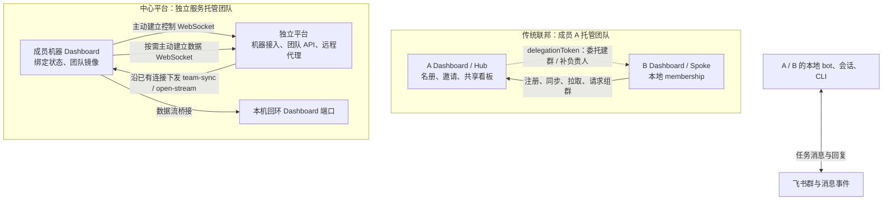
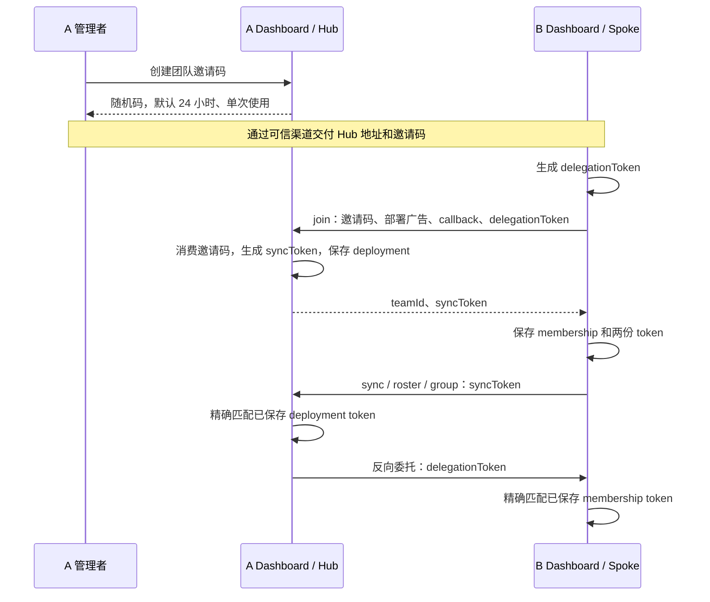
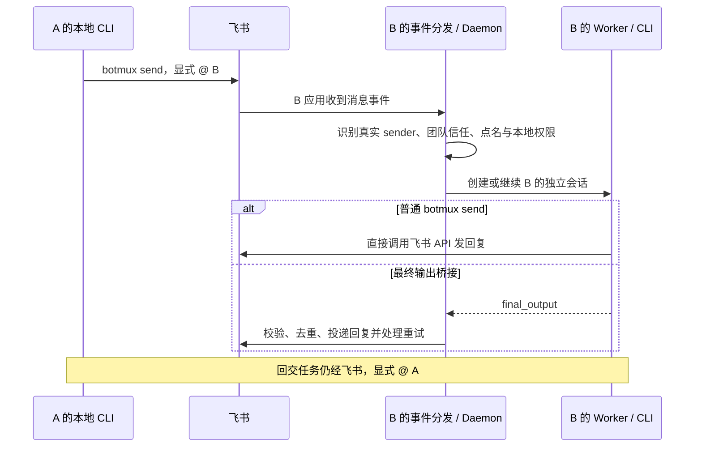

# Botmux 团队联邦与平台鉴权

## 摘要

Botmux 的跨部署组队让多台机器上的独立飞书机器人发现队友、建立团队信任并加入协作群。团队中心负责名册和组群，任务消息经过飞书，各机器人仍在自己的机器、会话和 CLI（命令行工具）中执行，不合并磁盘或模型上下文。[两条团队入口][multi-bot]、[飞书发送实现][send]

本文说明公开主仓提交 `a5bff44b7d8676e316d5969d928eb21ee1b48024` 的实现，不推定旧版本、未来版本或线上平台具备相同行为。源码核查记录见 [[raw/sources/botmux]]。

## 两种中心，不是两套任务执行器

| 维度 | 传统 Dashboard 联邦 | 中心平台团队 |
| --- | --- | --- |
| 中心是谁 | 创建团队的成员部署，其 Dashboard 充当 Hub | 独立平台服务，不是任意成员 Dashboard |
| 成员如何接入 | 部署用邀请码注册为 Spoke | 机器绑定平台，负责人加入平台团队并选择加入团队的 bot |
| 团队状态 | Hub 保存远端广告、群关系及共享看板 | 本机接收平台权威 `team-sync` 团队视图 |
| 主要同步方向 | Spoke 主动上报并按需拉取 | 本机建立控制连接，上报状态，平台沿连接推送 |
| 跨机任务 | 飞书群中显式点名对方 bot | 同样经过飞书，不是平台直接启动远端 CLI |
| 公开实现 | Hub/Spoke 入队、同步、名册与组群执行代码 | 平台客户端、隧道客户端、团队同步和本机权限判断 |

传统联邦并非完全无中心：每个团队依赖托管它的 Hub，但不同团队可由不同部署托管，一套部署也可加入多个 Hub。平台路线则把团队权威集中到独立服务。两种来源进入同一套本机团队信任判断，不代表接口或撤销语义相同。[Hub 存储][federation-store]、[多 Hub membership][membership]、[平台信任表][platform-store]

### 部署与网络方向

传统联邦没有“每台机器必须拥有公网域名”的要求。Hub 地址校验接受 HTTP(S)，实际要求是成员能访问 Hub 地址。内网 IP、内部主机名也可用。跨机使用 `localhost` 会指向请求发起机器自己，不能指代另一台机器。[地址校验][hub-url]、[注册请求][join-spoke]

但反向委托另需 Hub 能访问 Spoke 自报的 callback 地址。只允许成员出站时，同步可能正常，委托建群或补负责人却可能失败。反向请求可以在私有网络发生，不等于必须把成员 Dashboard 暴露到公网。[委托建群][group-core]、[补负责人][add-owners]

平台路线的 WebSocket（双向连接）由成员机器主动建立，收到 `open-stream` 后再主动拨数据连接，桥接到本机回环端口。机器子域由平台地址和 `machineId` 推导，成员不用自行购买域名。客户端还上报可直连地址候选，不能据此保证平台永远只用隧道、不尝试直连。[控制连接][tunnel-connect]、[数据桥接][tunnel-data]、[直连候选与注册][tunnel-register]、[子域规则][binding]

## A、B 如何通过传统联邦组队

以下 A、B 指两套部署。各部署可有多个 bot。假设 A 创建团队，B 加入。

1. A、B 分别配置自己的飞书应用、CLI 登录和本地工作目录，各自管理自己的 Dashboard。部署 owner 和 bot owner 的身份用于组群时邀请负责人。
2. A 在本机 Dashboard 创建团队，生成该团队的邀请码，通过可信渠道把 Hub 地址和邀请码交给 B，不共享 A 的 Dashboard 管理链接。
3. B 在自己的 Dashboard 输入地址和邀请码。本机 `join-remote` 读取部署身份和 bot 广告，生成反向 `delegationToken`，将它与 callback 地址一同提交给 A 的 `/api/federation/join`。
4. A 消费邀请码、拒绝自加入、清洗广告并登记部署，生成 `syncToken` 返回。公开的 `deploymentId` 重复时返回 409，不重新返回该部署原有 token。
5. B 保存 `{hubUrl, teamId, syncToken, deploymentId, delegationToken}`。后续同步和查询使用这里的凭证，不要求 B 浏览器持有 A 的管理 token。
6. 在团队名册中选择 bot 建群，检查 bot 和负责人实际入群结果。随后在群中点名 bot 做小任务，才算走到了执行链路。

依据：[本地团队与邀请][host-team]、[B 注册与保存][join-spoke]、[A 入队处理][join-hub]、[token 生成与重复 ID][federation-store]、[Dashboard 凭据保管][dashboard-token]。

### 谁生成、保存和检查凭据

邀请码是随机入队凭证，不是公钥。`syncToken` 是 Hub 生成的 24 字节随机 secret，`delegationToken` 是 Spoke 生成的另一份随机 secret。验证是查询保存的字符串，不是用公钥验证签名，也不是解析 JWT（JSON Web Token）。这里“签发”仅指生成并交付，不表示密码学签名。[邀请码][invite]、[syncToken][federation-store]、[反向 token 匹配][membership]

Bearer 是“持有凭证即可调用”的使用方式，不是 token 格式或签名算法。随机共享 secret、对称 MAC（消息认证码）和非对称签名必须分开理解。本实现的联邦 token 是第一种，不能因为带 Bearer 就叫 OAuth，也不能因为经过编码就叫 JWT。相关概念见 [[wiki/topics/architecture/oauth|OAuth]] 和 [[wiki/topics/architecture/jwt|JWT]]。

| 请求 | 接收方实际读取的凭据 | 验证后做什么 |
| --- | --- | --- |
| `POST /join` | body 中的 `inviteCode` | 消费邀请，注册部署并换发 `syncToken` |
| `POST /sync` | body 中的 `syncToken` | 更新该部署广告和心跳，返回团队群 ID |
| `GET /roster`、`GET /team-board` | Bearer，兼容自定义头和 query token | 查询 token 所属团队的名册或看板 |
| `POST /group`、`/team-sessions`、`/team-board-move` | 仅标准 Authorization Bearer | 请求组群、上报裁剪会话或修改共享看板 |
| Hub → Spoke 委托 | 仅标准 Bearer `delegationToken` | 验证本机 membership，执行有限建群/补人操作 |

Spoke 同步请求同时传 Bearer 和 body token，但 Hub 的 `/sync` 实际只读取 body。不能把所有联邦接口写成“只认 Bearer”。组群还要求 `requestId`，相同 token 与 request ID 返回缓存结果，包含可能已经产生副作用的失败结果。[token 提取与 sync][federation-api]、[组群幂等][group-api]

## 同步什么，不共享什么

| 路线 | 上报 | 返回或下发 | 不由这条同步复制 |
| --- | --- | --- | --- |
| 传统联邦 | bot app ID、名称、CLI、能力标签、角色存在标记、传输能力、owner；部署名称和 owner | `/sync` 返回团队群 ID；名册和看板按需拉取 | 完整角色 Markdown、技能、CLI 登录凭证、工作目录和完整会话正文 |
| 传统团队看板 | 仅团队群内最多 200 条裁剪会话，活跃优先 | Hub 保存各部署最近一次报告及共享看板位置 | CLI 终端、正文、完整上下文、磁盘或仓库 |
| 平台控制连接 | bot 概要、成员关系、版本和已应用 `teamSyncRev`，另含 Dashboard token 与网络候选 | `team-sync {rev, teams}` 的本机完整团队视图 | 此消息定义中没有完整 CLI 会话、文件或模型上下文 |

传统同步默认每两分钟尽力执行。Hub 名册把本地 bot 和远端广告聚合，五分钟未同步的远端标为 `stale`，不直接删除。`stale` 只是广告心跳陈旧，不证明飞书投递失败或 CLI 不健康。[同步 timer][sync-timer]、[名册聚合][roster]

看板会话行含 session ID、bot、CLI、状态、标题、chat ID、scope、adopt 和最后消息时间。Hub 白名单清洗标题至 200 字符。虽然没有正文，标题和 owner 等元数据仍可能透露任务信息，不能描述成“团队间零数据共享”。[裁剪和单独上报][sync-spoke]、[Hub 白名单][board-sanitize]

平台心跳默认每 30 秒上报。`team-sync` 经控制连接到达后，本机验证数据形状和 rev，完整替换平台团队表，并用 `platform:<teamId>` 前缀替换团队群镜像，不覆盖旧联邦群。表中有 bot union ID、真人成员 union ID 和群 ID，实际参与授权，不只是展示缓存。[心跳周期][heartbeat]、[接收与上报][tunnel-sync]、[完整替换][platform-store]

## 组群不等于保证所有对象入群

传统组群先验证所选 app ID 在团队名册中。远端 bot 没有 owner union ID 会被跳过，全部跳过则失败。邀请人集合由操作者和可加入 bot 的负责人组成，按 union ID 去重。Spoke 发起时，Hub 从 `syncToken` 对应的部署记录取操作者，不采信请求 body 任意指定的操作者。[选择与负责人][group-core]、[操作者来源][group-api]

Creator 只从所选 bot 中挑本地在线、具有飞书传输的 bot，不是任意 Hub bot。无飞书身份的 `apiOnly` bot 不能创建群或成为飞书群成员。普通远端 bot 可入群，但不直接由 Hub 冒用其应用身份当 Creator。[Creator 筛选][creator]

机器人按 app ID 加群，负责人按 union ID 逐人邀请。飞书应用可见范围与添加权限仍然有效，一个负责人失败不应阻断其他负责人。Hub 可委托该负责人的部署，用已入群的本地 bot 补人，最终仍失败的 ID 返回给调用者。群已创建与邀请完整是两件事。[飞书建群][chat-create]、[逐人邀请][owner-invite]、[反向补人][add-owners]

没有本地 Creator 时，Hub 可回调拥有所选 bot 的 Spoke 自己建群。回调超时后不换下一部署继续建，防止对方已建群但响应丢失导致重复。成功群关系保存在 Hub，之后由同步下发，成为本机团队群。[委托与超时][group-core]

## 一次跨机任务真正经过哪里

当前群的 `botmux bots list` 提供可点名的 `openId` 和 `mentionable`。`open_id` 是观察者应用相关的句柄，B 自己看到的 ID 不一定能供 A 点名。显示名不作为可信身份。跨部署学习和平台名册使用飞书事件中的 bot union ID。[当前群发现][multi-bot]、[ID 作用域][team-bots]

普通 `botmux send` 在辅助 CLI 内导入飞书 client，直接调用发送或回复 API，不必先让本机 Daemon 代发。原生最终输出桥接才是 Worker 报 `final_output` 后由 Daemon 校验、去重和承担重试。这两条链不能合成一种发送机制。[普通发送][send]、[最终输出桥接][final-output]

默认接力应明确点名 B。该版本还存在消息监听器和 `autoStartOnNewTopic` 的主动触发分支，后者要求新话题种子形态、配置与额外 bot 群消息权限，不能据此让普通未点名回复都触发。平台机器人大厅只学习 bot 身份，不把 bot 打卡当任务。[接收、学习与路由][event-route]

已有群的任务不逐条经过 Hub，也不带 `syncToken`。Hub 断联影响最新目录、看板、组群和委托；本地信任缺失或过期也会影响后续处理，不能承诺完全离线运行。会话与工作目录的独立性见 [[wiki/topics/ai/botmux-session-runtime|Botmux 会话与运行时]]。

## 平台绑定、机器认证与人的登录

公开主仓中的平台集成是可选客户端：隧道仅在存在本机绑定时启动，未绑定不阻塞本机机器人运行。客户端通过 HTTP 和 WebSocket 调用配置的平台地址。本文只描述公开代码中的接口与本机行为，不推定平台服务端的具体实现。[可选隧道][optional-tunnel]、[绑定实现][bind]、[团队接口][machine-client]

### 绑定材料不是 machineToken

本机先解码平台生成的 `{u, t}` 绑定材料：`u` 是平台地址，`t` 是绑定 code。随后向该平台 `POST /api/bind {code, machineId}`，从响应读取并保存 `machineToken`。本机随机生成的是初始 machine ID，不是 machineToken。[绑定请求与响应][bind]

因此，“机器凭证来自谁”的公开证据答案是：来自所绑定平台的 `/api/bind` 响应，不是飞书消息 API 返回，不是客户端硬编码。内部如何签发、验签、设定有效期与撤销，必须看对应平台服务端，不能只从客户端注释推定算法。[绑定字段][binding]、[绑定实现][bind]

后续本机以 Bearer machineToken 调 `/v1/machine/*`，控制和数据隧道则将它作为 URL 参数透传。客户端不解码或验签这份机器 token。保护 query 的访问日志也是平台部署需要处理的凭据保密条件。[机器请求][machine-call]、[隧道 token 透传][tunnel-connect]

### 公开客户端能证明的接口边界

| 边界 | 本机使用的接口或字段 | 必须由对应平台实现的部分 |
| --- | --- | --- |
| 机器绑定 | `/api/bind`、machineId、machineToken | 验绑定材料、机器归属、凭据签发与撤销 |
| 控制连接 | `/tunnel/control`，register、heartbeat、team-sync、open-stream、unbound | 接入认证、下发团队视图与开流 |
| 数据连接 | `/tunnel/data`，token、stream ID | 将代理请求交给对应数据流 |
| 团队业务 | `/v1/machine/teams`、agents、groups、group members | 团队成员和 bot 主动加入（opt-in）校验、平台代建群 |
| 浏览器管理 | `/open/<machineId>`、机器子域、本机管理 cookie、role/actor/scopes 头 | 人的登录、机器访问授权、代理身份传播 |

团队 API 客户端明确不自行决定成员或 opt-in 授权，只传凭证并解析平台结果。能力标签与 `mentionable` 是自报展示信息，不是权限凭据。向既有群补人还约定发起人和平台 bot 已在群、bot 已 opt-in 且不能向大厅补人。这些是公开调用约定，不替代平台服务端执行核查。[团队接口][machine-client]

人的浏览器登录与机器认证不同。本机生成平台 `/open/<machineId>` 跳板链接，并接收平台代理传来的身份。本机只有在已绑定、带有效管理 cookie 和有效 role 时才识别为平台身份。`owner` 加 `dashboard:manage` scope 才取得本机管理能力；缺 role 的有效管理 cookie 会落入 legacy owner 分支，不能概括成“所有平台代理请求都走相同角色检查”。[登录跳板][login-url]、[身份分支][request-identity]

这里不能把本机的飞书 OAuth 回调当作独立平台 SSO（单点登录）的实现，更不能仅因字段叫 token 就认定 JWT、HMAC（基于哈希的消息认证码）或非对称签名。公开客户端能说明入口、凭据用途和本机权限检查，平台登录协议与密码学实现仍需对应服务端证据。[本机 OAuth 回调][oauth-callback]

按这些接口判断，平台和主仓已分离执行职责，但没有消除接口耦合。替代平台至少须兼容绑定、两条隧道、业务 API、子域与代理身份、团队全量同步。只给本机提供一个反向代理地址并不等价。[隧道消息定义][tunnel-types]、[团队接口][machine-client]、[本机身份][request-identity]

## 团队信任的权限与安全限制

| 本机权限输入 | 实际含义 |
| --- | --- |
| 团队群 chat ID | bot 首次对话的团队背书，不能给所有群成员操作权 |
| 已学习或平台背书的 bot union ID | 可通过 bot 对话与操作权判断，支持 `/repo`、`/cd` 等编排 |
| 真人与目标 bot 同属平台团队 | 取得对话权，不因此成为管理员或取得操作权 |
| allowedUsers / blockedUsers | 管理员先放行，其他发送者的黑名单先于团队信任否决 |

`canOperate` 有可信团队 bot 例外，不能照文档概括写成“团队只给对话权”。命令内部仍可能有更窄的 owner 检查。没有配置任何白名单时还有开放模式兜底，实际权限须结合本机配置判断。[本机对话与操作判断][permissions]

传统团队 bot 在团队群出现后可被学习为部署级信任，默认按最后团队活动时间 30 天老化，不仅限最初那个群。平台权威表在下次全量同步时删除离队条目，但平台群也会触发学习表，删除平台条目不等于立即清除其他授权来源。[学习表][team-bots]、[接收学习][event-route]、[平台完整替换][platform-store]

### 源码呈现的风险边界

1. **成员广告不是独立核身。** 入队和同步会清洗字段并保存自报 bot、owner 和 callback，这些入口不向飞书验证广告所有权。token 证明调用者持有部署接入凭证，不证明硬件身份、真人身份或能力标签真实。飞书消息 sender 的身份另由事件提供。[入队][join-hub]、[token 匹配][federation-store]
2. **链路和文件要保护 secret。** 联邦允许 HTTP，callback 默认构造成 HTTP，token 在双方 JSON 存储中保存，这些写入步骤没有静态加密。公网或不可信链路应使用 TLS（传输层安全协议）或加密私网，不能把允许 HTTP 当安全保证。[注册地址][join-spoke]、[Hub 存储][federation-store]、[Spoke 存储][membership]
3. **回调目的地址受成员输入影响。** Hub 接收 callback 时只筛 HTTP(S) 前缀，随后向该地址发带 token 的 POST。相关入口没有目的主机允许列表，因此存在条件性的服务端请求伪造（SSRF）风险边界。能影响什么取决于 Hub 网络与目标服务，这不是漏洞利用实测。[callback 登记][join-hub]、[发出委托][group-core]
4. **同名 app ID 会影响组群元数据。** 名册先列本地 bot 再追加远端广告，组群按 app ID 建 Map，后写覆盖前写。获准成员自报重复 app ID 可影响 owner 与跳过判断。它不等于伪造飞书真实消息 sender。[名册顺序][roster]、[组群 Map][group-core]
5. **退出不等于所有信任立即撤销。** Hub 的 syncToken 记录无到期字段，查找只做匹配，删除记录才使 token 失配。Spoke 退队即使通知失败也删除本地 membership，`hubRevoked: false` 不能当作 Hub 已撤销，还须处理学习表和其他本地授权。[Hub 记录][federation-store]、[退队处理][leave]

反向委托是有限建群和负责人操作，不是通用远程 shell：建群要求包含本地 bot，补人只允许本部署或 bot owner。不过补人 `chatId` 来自 Hub，接收入口没有将它绑定到团队建群记录，持有 delegationToken 的 Hub 仍是高信任对象。[委托边界][delegate]

从以上固定版本实现推断，传统联邦适合已确认身份的成员及受保护网络，不能直接当作“不可信公网多租户服务已安全验收”。采用时应可信交付邀请码、保护凭据文件、限制 Hub 出站回调地址，并对 CLI 账号、工作目录和执行权限做独立限制。

## 相关页面

- [[wiki/topics/ai/botmux|Botmux]]
- [[wiki/topics/ai/botmux-session-runtime|Botmux 会话与运行时]]
- [[wiki/topics/architecture/oauth|OAuth]]
- [[wiki/topics/architecture/jwt|JWT]]

## 来源指针

- [[raw/sources/botmux]]：来源版本、历史问题与核查记录。
- 下列源码链接均固定到本文提交。

[multi-bot]: https://github.com/deepcoldy/botmux/blob/a5bff44b7d8676e316d5969d928eb21ee1b48024/docs-site/docs/zh/multi-bot.mdx#L13-L50
[dashboard-token]: https://github.com/deepcoldy/botmux/blob/a5bff44b7d8676e316d5969d928eb21ee1b48024/docs-site/docs/zh/dashboard.md#L13-L29
[host-team]: https://github.com/deepcoldy/botmux/blob/a5bff44b7d8676e316d5969d928eb21ee1b48024/src/dashboard/federation-spoke-api.ts#L522-L603
[hub-url]: https://github.com/deepcoldy/botmux/blob/a5bff44b7d8676e316d5969d928eb21ee1b48024/src/dashboard/federation-spoke-api.ts#L160-L165
[join-spoke]: https://github.com/deepcoldy/botmux/blob/a5bff44b7d8676e316d5969d928eb21ee1b48024/src/dashboard/federation-spoke-api.ts#L605-L637
[join-hub]: https://github.com/deepcoldy/botmux/blob/a5bff44b7d8676e316d5969d928eb21ee1b48024/src/dashboard/federation-api.ts#L165-L197
[invite]: https://github.com/deepcoldy/botmux/blob/a5bff44b7d8676e316d5969d928eb21ee1b48024/src/services/invite-store.ts#L18-L96
[federation-store]: https://github.com/deepcoldy/botmux/blob/a5bff44b7d8676e316d5969d928eb21ee1b48024/src/services/federation-store.ts#L36-L181
[membership]: https://github.com/deepcoldy/botmux/blob/a5bff44b7d8676e316d5969d928eb21ee1b48024/src/services/federation-membership-store.ts#L12-L79
[federation-api]: https://github.com/deepcoldy/botmux/blob/a5bff44b7d8676e316d5969d928eb21ee1b48024/src/dashboard/federation-api.ts#L76-L281
[group-api]: https://github.com/deepcoldy/botmux/blob/a5bff44b7d8676e316d5969d928eb21ee1b48024/src/dashboard/federation-api.ts#L285-L328
[sync-spoke]: https://github.com/deepcoldy/botmux/blob/a5bff44b7d8676e316d5969d928eb21ee1b48024/src/dashboard/federation-spoke-api.ts#L172-L277
[sync-timer]: https://github.com/deepcoldy/botmux/blob/a5bff44b7d8676e316d5969d928eb21ee1b48024/src/dashboard.ts#L8544-L8553
[roster]: https://github.com/deepcoldy/botmux/blob/a5bff44b7d8676e316d5969d928eb21ee1b48024/src/services/federation-roster.ts#L14-L96
[board-sanitize]: https://github.com/deepcoldy/botmux/blob/a5bff44b7d8676e316d5969d928eb21ee1b48024/src/services/team-board-store.ts#L90-L112
[group-core]: https://github.com/deepcoldy/botmux/blob/a5bff44b7d8676e316d5969d928eb21ee1b48024/src/dashboard/federated-group-core.ts#L94-L192
[add-owners]: https://github.com/deepcoldy/botmux/blob/a5bff44b7d8676e316d5969d928eb21ee1b48024/src/dashboard/federated-group-core.ts#L265-L305
[creator]: https://github.com/deepcoldy/botmux/blob/a5bff44b7d8676e316d5969d928eb21ee1b48024/src/dashboard.ts#L3031-L3089
[chat-create]: https://github.com/deepcoldy/botmux/blob/a5bff44b7d8676e316d5969d928eb21ee1b48024/src/services/groups-store.ts#L200-L227
[owner-invite]: https://github.com/deepcoldy/botmux/blob/a5bff44b7d8676e316d5969d928eb21ee1b48024/src/services/groups-store.ts#L539-L570
[send]: https://github.com/deepcoldy/botmux/blob/a5bff44b7d8676e316d5969d928eb21ee1b48024/src/cli.ts#L11148-L11168
[final-output]: https://github.com/deepcoldy/botmux/blob/a5bff44b7d8676e316d5969d928eb21ee1b48024/src/core/worker-pool.ts#L16630-L16651
[event-route]: https://github.com/deepcoldy/botmux/blob/a5bff44b7d8676e316d5969d928eb21ee1b48024/src/im/lark/event-dispatcher.ts#L4024-L4168
[team-bots]: https://github.com/deepcoldy/botmux/blob/a5bff44b7d8676e316d5969d928eb21ee1b48024/src/services/team-bots-store.ts#L1-L130
[permissions]: https://github.com/deepcoldy/botmux/blob/a5bff44b7d8676e316d5969d928eb21ee1b48024/src/im/lark/event-dispatcher.ts#L1964-L2206
[leave]: https://github.com/deepcoldy/botmux/blob/a5bff44b7d8676e316d5969d928eb21ee1b48024/src/dashboard/federation-spoke-api.ts#L704-L725
[delegate]: https://github.com/deepcoldy/botmux/blob/a5bff44b7d8676e316d5969d928eb21ee1b48024/src/dashboard/federation-api.ts#L319-L468
[optional-tunnel]: https://github.com/deepcoldy/botmux/blob/a5bff44b7d8676e316d5969d928eb21ee1b48024/src/dashboard.ts#L8644-L8669
[bind]: https://github.com/deepcoldy/botmux/blob/a5bff44b7d8676e316d5969d928eb21ee1b48024/src/platform/bind.ts#L18-L123
[binding]: https://github.com/deepcoldy/botmux/blob/a5bff44b7d8676e316d5969d928eb21ee1b48024/src/platform/binding.ts#L11-L88
[tunnel-types]: https://github.com/deepcoldy/botmux/blob/a5bff44b7d8676e316d5969d928eb21ee1b48024/src/platform/tunnel-client.ts#L9-L50
[tunnel-connect]: https://github.com/deepcoldy/botmux/blob/a5bff44b7d8676e316d5969d928eb21ee1b48024/src/platform/tunnel-client.ts#L113-L135
[tunnel-data]: https://github.com/deepcoldy/botmux/blob/a5bff44b7d8676e316d5969d928eb21ee1b48024/src/platform/tunnel-client.ts#L377-L497
[tunnel-register]: https://github.com/deepcoldy/botmux/blob/a5bff44b7d8676e316d5969d928eb21ee1b48024/src/platform/tunnel-client.ts#L306-L329
[heartbeat]: https://github.com/deepcoldy/botmux/blob/a5bff44b7d8676e316d5969d928eb21ee1b48024/src/platform/tunnel-client.ts#L53-L55
[tunnel-sync]: https://github.com/deepcoldy/botmux/blob/a5bff44b7d8676e316d5969d928eb21ee1b48024/src/platform/tunnel-client.ts#L249-L329
[platform-store]: https://github.com/deepcoldy/botmux/blob/a5bff44b7d8676e316d5969d928eb21ee1b48024/src/services/platform-team-store.ts#L36-L196
[machine-call]: https://github.com/deepcoldy/botmux/blob/a5bff44b7d8676e316d5969d928eb21ee1b48024/src/platform/team-agents-client.ts#L159-L181
[machine-client]: https://github.com/deepcoldy/botmux/blob/a5bff44b7d8676e316d5969d928eb21ee1b48024/src/platform/team-agents-client.ts#L228-L321
[login-url]: https://github.com/deepcoldy/botmux/blob/a5bff44b7d8676e316d5969d928eb21ee1b48024/src/core/dashboard-url.ts#L310-L337
[request-identity]: https://github.com/deepcoldy/botmux/blob/a5bff44b7d8676e316d5969d928eb21ee1b48024/src/dashboard/request-identity.ts#L169-L258
[oauth-callback]: https://github.com/deepcoldy/botmux/blob/a5bff44b7d8676e316d5969d928eb21ee1b48024/src/dashboard.ts#L3907-L3944
