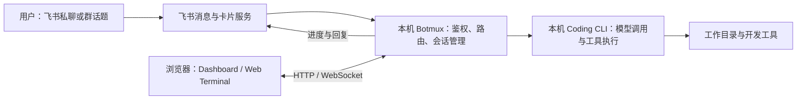
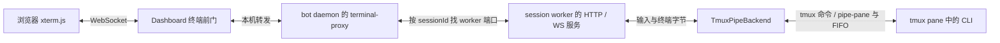

# Botmux：在飞书中使用本地 Coding CLI

## 它是什么

Botmux 运行在开发机或服务器上，把飞书消息交给已有的 AI 编程命令行工具（Coding CLI），管理它们的会话、输入和回复，并提供浏览器终端。以本地 Claude Code / Codex 为例，模型调用、工具执行和 agent 循环仍由 CLI 负责，Botmux 负责飞书接入与外部编排；它不是另一个模型，也不要求把原有 CLI 工作流重写成飞书应用。[项目定位][position]

本文沉淀 2026 年 7 月至 10 月的讨论。实现固定到 **2026-10-08 的 `a5bff44`**，不是对阅读时最新版本的声明。该提交比当时核对的正式 tag `v3.36.0` 多两个提交，主线实现、已发布版本和本机实际部署必须分开判断。来源与核查记录见 [[raw/sources/botmux|Botmux 证据底稿]]。

## 阅读路径

| 想解决的问题 | 页面 |
| --- | --- |
| 值不值得装、怎么接入、相比直接开 CLI 方便在哪里 | 本页 |
| 为什么有 worker，为什么用 tmux，session 怎样恢复，adapter 与 harness 做了什么 | [[wiki/topics/ai/botmux-session-runtime\|Botmux 会话运行时]] |
| 两台电脑怎样组队，谁提供 HTTP 服务，邀请码与 token 谁签发，Platform 怎样解耦 | [[wiki/topics/ai/botmux-team-federation\|Botmux 团队联邦与身份鉴权]] |

## 产品边界与一次使用过程

下图只描述本地 CLI 路线。远端 Runner 和 API 型适配器有独立执行路径，不能把所有后端都画成一个本地 tmux 进程。[适配范围][adapters]、[Remote Runner 协议][remote]

一次典型使用过程是：

1. 用户在飞书向机器人发消息，Botmux 检查发言权限和会话归属。
2. 新会话确定工作目录和 CLI；已有会话继续使用自己的运行身份。
3. 会话 worker 准备输入，通过适配器与执行后端操作 CLI。
4. 进度卡、终端画面和最终回答分别通过对应通道呈现。
5. 用户在同一话题追问，必要时进入 Web Terminal 操作 CLI 的原生界面。

这里最容易误解的是第 4 步：**终端有输出不等于已经发送最终回复**。普通模式可以由 CLI 调用 `botmux send` 主动发消息；支持的 CLI 还可通过原生会话记录提取最终回答。触发条件、去重和回合归属见 [[wiki/topics/ai/botmux-session-runtime|输入、输出与最终回复链路]]。

## 为什么它可能比直接开 CLI 方便

下面是结合产品机制得到的使用判断，不是对全体用户满意度的统计。

| 使用场景 | 具体减少的操作 | 仍需承担的条件 |
| --- | --- | --- |
| 人不在开发机旁边 | 在飞书发任务、追问和查看结果，不必先进入远程桌面 | 执行机器和 daemon 仍需在线；浏览器终端还要单独解决网络可达 |
| 同事不熟悉 CLI | 在已有群话题里提需求、补材料、收结果 | 管理员必须限制谁能把消息变成本机命令 |
| 多个独立任务并行 | 用话题和会话管理多份 CLI 上下文 | 会话、进程、磁盘和模型额度仍消耗执行机资源 |
| 聊天不能处理原生交互 | 进入 Web Terminal 查看菜单、确认状态或接管输入 | 可写链接和接管权限相当于终端控制能力，不能随意分享 |
| 多 bot / 多机协作 | 在共享群中发现机器人、分派任务和回复结果 | 不会自动共享模型上下文、同步文件或合并代码 |

这些判断对应官方列出的流式卡片、多人话题、Web Terminal、adopt 与团队功能。[能力入口][scenarios] 历史调研还找到过手机使用和私有化部署的正面反馈，但样本有限，不能用来推断普遍稳定性或相对其他产品的胜率；反馈来源保留在 [[raw/sources/botmux#历史反馈来源|证据底稿]]。

如果主要在桌面独立工作，也不需要飞书中的协作与通知，直接使用 CLI 已经覆盖大部分核心能力。Botmux 增加的是入口、会话管理和消息投递，同时也增加了一套需要维护和授权的运行服务。

## 安装、应用创建与真正可用是三件事

### 运行前提

在本文快照中，Botmux 本体采用自包含二进制，支持 macOS、Linux 和 Windows 上的 WSL2（Linux 子系统）。目标 CLI 仍要自行安装并完成认证，不能把“Botmux 不依赖系统 Node”理解成“所有 CLI 都无依赖”。npm 安装入口本身仍要求 Node ≥22。[安装说明][install]

默认本地后端是 **tmux ≥3.x**。缺失时会阻止相应会话启动，不再自动退回 PTY（伪终端）；确实要无 tmux 运行，应显式选择支持的其他后端。7 月记录里的“tmux 可选且会自动降级”不能直接沿用到此快照。[前置与默认后端][quickstart]

### 接入步骤

1. 按所选版本的官方安装说明安装 Botmux，并准备已登录的目标 CLI。
2. 通过 `botmux setup` 创建或导入飞书应用，再选择 CLI 和工作目录。
3. 核对机器人能力、事件订阅、应用权限、发布版本和可用范围。
4. 启动 daemon，用私聊或受控测试群完成一次真实消息往返。
5. 再检查终端入口、会话恢复和开机自启；这些不由“应用创建成功”自动证明。

官方 setup 的扫码创建路径可以连续完成应用创建、权限配置与发版；`--no-open-platform-auto` 跳过后续自动配置，手动导入应用是另一条路径。已经使用开放平台的一键创建时，应先检查该应用已完成哪些步骤，不应预设必须再创建一次，也不能仅凭“创建通过”推断本机 daemon 已接通。[setup 路径][setup]

### 首次使用时要明确的权限

- **飞书应用权限**决定机器人能调用哪些飞书 API（应用编程接口）。应用 scope 不是本机文件权限。
- **Botmux 对话权 `canTalk`** 决定谁能发任务；**操作权 `canOperate`** 决定谁能改目录、重启或关闭会话等。
- **CLI 权限与沙盒配置**决定收到任务后可以读写什么、执行什么。配置 `disableCliBypass: true` 只是阻止 Botmux 自动追加免审批 / 绕过沙盒参数，不会撤销 CLI 自身已有的宽权限配置。
- **终端访问权**决定谁能查看输出或直接输入。只读不等于内容不敏感，可写链接不应进入公开群卡片。

正常 onboarding 会把 owner 加入 `allowedUsers`。把 bot 拉进群本身不等于授权；`allowedChatGroups` 放开的是群内所有成员的对话权，不是只允许管理员讲话。[权限分层][permissions]、[配置字段][permission-config]、[CLI 与终端配置][cli-config]

## Dashboard 与 Web Terminal 不要混为一个入口

Dashboard 是配置和会话管理界面；Agent Workbench 是其中面向会话列表、终端与网页预览的工作区；Web Terminal 则呈现某个会话的终端字节流，并在获准时提交输入。它们不是三个独立的模型会话。[Workbench 说明][workbench]

### 浏览器的输入怎样到达 CLI

下面是经 Dashboard 打开的默认托管 tmux 路线。直接终端链接可以从 bot 级代理进入，不必经过 Dashboard。[Dashboard 前门][terminal-front]、[bot 级代理][terminal-proxy]、[浏览器连接][terminal-browser]

WebSocket（浏览器与服务端的双向连接）承载终端输入和输出。**worker 仍然参与**：它检查写权限，再把输入交给后端；只读浏览器也不能随意改变共享 pane 的尺寸。默认路线不是每打开一个网页就新建一个 CLI，也不是把终端控制全部交给浏览器。[输入与尺寸检查][terminal-input]

只读表示不能输入，不表示匿名可读。此快照的 HTTP 页面与 WebSocket 握手都检查读权限，需要有效只读 / 写入凭据，或经过 Dashboard / 平台前门认证的身份。文档站中“只读链接无凭证即可查看”的旧表述与该实现不一致，应以实际认证路径为准。[读权限检查][terminal-read-auth]

浏览器断开时，默认共享连接只移除该客户端和代理连接，不直接杀死 CLI。代码另有按客户端创建 tmux attach PTY 的可选分支，不能把该分支画成所有会话的默认实现。[断开处理][terminal-close]

### 不同 token 的有效期与用途

| 凭据 / 授权 | 本文快照的语义 |
| --- | --- |
| Dashboard 管理 token，URL 中常见 `t` | 本地持久保存，没有统一的时间到期字段；显式轮换会使旧值失效 |
| 会话终端写入 token，URL 中常见 `token` | 由本机秘密与 sessionId 计算，worker 重启不必导致它变化；持有它与持有普通只读链接不同 |
| 工作台签发的只读 grant | 绑定会话、认证会话与 worker 代次，有效时间受身份到期和最多 10 分钟共同限制 |
| 工作台接管输入的 lease（有到期时间的独占输入权） | 是独立的临时控制资格，文档默认 5 分钟，不等于所有 Dashboard token 都只有 5 分钟有效 |

依据：[Dashboard token 存取][dashboard-token]、[终端写入 token][terminal-write-token]、[只读 grant][terminal-read-grant]、[接管说明][workbench]。这些机制属于固定版本，不应用它们直接解释其他版本的一张错误截图。

“飞书消息能往返”和“手机能打开终端”有不同网络条件：飞书事件使用机器向飞书建立的长连接；Web Terminal 需要浏览器能访问暴露出来的 HTTP / WebSocket 地址。默认生成局域网地址时，换成手机蜂窝网络可能不可达。仅设置 `WEB_EXTERNAL_HOST` 只改变公布的地址，不能替代实际的路由、转发与访问控制。[消息连接检查][event-connection]、[终端远程访问][terminal-network]

源码中的 Dashboard / bot 终端代理和 worker 默认监听并非一律限定在 loopback（本机回环地址）。即使浏览器只使用 `127.0.0.1`，也应另查服务监听和防火墙范围，不能由访问地址推断服务只对本机开放。[监听配置][terminal-listen]、[worker 监听][worker-listen]

遇到“访问链接已失效”时，应先区分 Dashboard 登录凭据、终端写入 token、会话是否存在，以及服务是否可达。对同一条失效链接换一个浏览器，不能修复服务端的认证失败。可以在运行 Botmux 的机器上用 `botmux dashboard` 取得该版本支持的入口；该命令通常读取现有凭据，不等于每执行一次都轮换 token。带凭据链接应视为访问凭据，不应保存进公开笔记。[Dashboard 入口][workbench-entry]、[token 存取][dashboard-token]

## 讨论期间值得保留的版本变化

下表比较早期 `3.2.1` 使用背景与 2026-10-08 的源码 / 发布记录，不是滚动更新的 release 列表。

| 变化 | 实际影响与限制 |
| --- | --- |
| 自包含二进制与内置 supervisor | 部署不再等于 Node 源码 + PM2。跨越 `v3.18.0` 安装形态时需遵守迁移说明，不能直接照旧 npm 升级流程操作 |
| Codex App 共享接入与恢复增强 | 可接入已有线程，原 App Server 仍由原主人持有；不同 adopt 路线的 resume / relay 限制不能混用 |
| `promptInjection: "none"` | 可以关闭 Botmux 的提示、角色与技能目录注入，借助受支持 CLI 的最终回答采集；不会清除 CLI 原生指令或已经进入历史的提示 |
| 群内真人独立 lane | 同群可分开 CLI 上下文和 worktree，默认关闭，消息仍公开，不是隐私隔离 |
| Remote Runner | 可以把执行交给实现了规定协议的 provider，不表示传统团队联邦已变成共享执行集群 |
| 持久协调基础设施 | 有接口与 shadow 实现，不代表可直接运行多副本主入口；此快照明确拒绝 `BOTMUX_COORDINATION_MODE=primary` |

依据：[安装迁移][install]、[零注入说明][zero-injection]、[lane 语义][lanes]、[Remote Runner][remote]、[持久协调启动检查][coordination]。Codex adopt 的详细限制随具体接入方式而异，见 [[wiki/topics/ai/botmux-session-runtime|会话运行时]]。

`v3.36.0` 之后该快照还包含“优先私聊回复提问人”和持久 Lark 主入口协调器两个提交，不能列为 `v3.36.0` 已发布能力。优先私聊失败会回到原群话题，因此即便启用，也不能当作保密模式。[快照比较][snapshot-diff]、[私聊回退行为][private-replies]

## 使用边界

Botmux 让聊天消息获得了操作执行机的入口。部署时应把飞书身份、Botmux 授权、模型 / CLI 凭据和本机文件权限分别审查；加入团队、选择某个后端或开启 tmux，都不会自动形成安全沙盒。

团队目录、平台登录和远端执行是三个独立问题：目录回答“有哪些机器人”，登录回答“谁能访问入口”，执行后端回答“任务在哪里运行”。具体部署与 token 校验见 [[wiki/topics/ai/botmux-team-federation|团队联邦与身份鉴权]]，本地恢复和进程所有权见 [[wiki/topics/ai/botmux-session-runtime|会话运行时]]。

## 相关页面

- [[wiki/topics/ai/botmux-session-runtime|Botmux 会话运行时]]
- [[wiki/topics/ai/botmux-team-federation|Botmux 团队联邦与身份鉴权]]
- [[wiki/topics/ai/agent-harness|Agent Harness]]
- [[wiki/topics/systems/terminal|Terminal：终端、TTY 与 Shell]]
- [[wiki/topics/tooling/cmux|cmux]]

## 来源指针

- [[raw/sources/botmux|Botmux 证据底稿]]：来源快照、代码位置、历史反馈和验证记录。
- [固定源码快照](https://github.com/deepcoldy/botmux/tree/a5bff44b7d8676e316d5969d928eb21ee1b48024)
- [v3.36.0 发布说明](https://github.com/deepcoldy/botmux/releases/tag/v3.36.0)

[position]: https://github.com/deepcoldy/botmux/blob/a5bff44b7d8676e316d5969d928eb21ee1b48024/README.md#L29-L35
[scenarios]: https://github.com/deepcoldy/botmux/blob/a5bff44b7d8676e316d5969d928eb21ee1b48024/README.md#L70-L81
[adapters]: https://github.com/deepcoldy/botmux/blob/a5bff44b7d8676e316d5969d928eb21ee1b48024/README.md#L97-L125
[install]: https://github.com/deepcoldy/botmux/blob/a5bff44b7d8676e316d5969d928eb21ee1b48024/README.md#L37-L68
[quickstart]: https://github.com/deepcoldy/botmux/blob/a5bff44b7d8676e316d5969d928eb21ee1b48024/docs-site/docs/zh/quickstart.md#L7-L19
[setup]: https://github.com/deepcoldy/botmux/blob/a5bff44b7d8676e316d5969d928eb21ee1b48024/docs-site/docs/zh/quickstart.md#L21-L53
[permissions]: https://github.com/deepcoldy/botmux/blob/a5bff44b7d8676e316d5969d928eb21ee1b48024/docs-site/docs/zh/permissions.md#L3-L43
[permission-config]: https://github.com/deepcoldy/botmux/blob/a5bff44b7d8676e316d5969d928eb21ee1b48024/docs-site/docs/zh/bots-json.md#L207-L223
[cli-config]: https://github.com/deepcoldy/botmux/blob/a5bff44b7d8676e316d5969d928eb21ee1b48024/docs-site/docs/zh/bots-json.md#L42-L61
[workbench]: https://github.com/deepcoldy/botmux/blob/a5bff44b7d8676e316d5969d928eb21ee1b48024/docs/agent-workbench.md#L5-L25
[workbench-entry]: https://github.com/deepcoldy/botmux/blob/a5bff44b7d8676e316d5969d928eb21ee1b48024/docs/agent-workbench.md#L43-L90
[event-connection]: https://github.com/deepcoldy/botmux/blob/a5bff44b7d8676e316d5969d928eb21ee1b48024/docs-site/docs/zh/quickstart.md#L77-L90
[terminal-network]: https://github.com/deepcoldy/botmux/blob/a5bff44b7d8676e316d5969d928eb21ee1b48024/docs-site/docs/zh/web-terminal.md#L22-L47
[zero-injection]: https://github.com/deepcoldy/botmux/blob/a5bff44b7d8676e316d5969d928eb21ee1b48024/README.md#L83-L95
[lanes]: https://github.com/deepcoldy/botmux/blob/a5bff44b7d8676e316d5969d928eb21ee1b48024/docs/principal-lanes.md#L1-L25
[remote]: https://github.com/deepcoldy/botmux/blob/a5bff44b7d8676e316d5969d928eb21ee1b48024/docs/remote-runner.md#L1-L69
[coordination]: https://github.com/deepcoldy/botmux/blob/a5bff44b7d8676e316d5969d928eb21ee1b48024/src/services/durable-coordination-runtime.ts#L76-L85
[snapshot-diff]: https://github.com/deepcoldy/botmux/compare/v3.36.0...a5bff44b7d8676e316d5969d928eb21ee1b48024
[private-replies]: https://github.com/deepcoldy/botmux/blob/a5bff44b7d8676e316d5969d928eb21ee1b48024/docs/group-private-replies.md#L1-L7
[terminal-front]: https://github.com/deepcoldy/botmux/blob/a5bff44b7d8676e316d5969d928eb21ee1b48024/src/dashboard.ts#L3861-L3876
[terminal-proxy]: https://github.com/deepcoldy/botmux/blob/a5bff44b7d8676e316d5969d928eb21ee1b48024/src/core/terminal-proxy.ts#L239-L261
[terminal-browser]: https://github.com/deepcoldy/botmux/blob/a5bff44b7d8676e316d5969d928eb21ee1b48024/src/worker.ts#L21061-L21070
[terminal-input]: https://github.com/deepcoldy/botmux/blob/a5bff44b7d8676e316d5969d928eb21ee1b48024/src/worker.ts#L20237-L20320
[terminal-close]: https://github.com/deepcoldy/botmux/blob/a5bff44b7d8676e316d5969d928eb21ee1b48024/src/worker.ts#L20333-L20341
[dashboard-token]: https://github.com/deepcoldy/botmux/blob/a5bff44b7d8676e316d5969d928eb21ee1b48024/src/dashboard/auth.ts#L136-L189
[terminal-write-token]: https://github.com/deepcoldy/botmux/blob/a5bff44b7d8676e316d5969d928eb21ee1b48024/src/core/terminal-write-auth.ts#L102-L119
[terminal-read-grant]: https://github.com/deepcoldy/botmux/blob/a5bff44b7d8676e316d5969d928eb21ee1b48024/src/dashboard/terminal-view-capability.ts#L46-L80
[terminal-listen]: https://github.com/deepcoldy/botmux/blob/a5bff44b7d8676e316d5969d928eb21ee1b48024/src/config.ts#L294-L314
[worker-listen]: https://github.com/deepcoldy/botmux/blob/a5bff44b7d8676e316d5969d928eb21ee1b48024/src/utils/worker-http.ts#L11-L20
[terminal-read-auth]: https://github.com/deepcoldy/botmux/blob/a5bff44b7d8676e316d5969d928eb21ee1b48024/src/worker.ts#L2290-L2373
