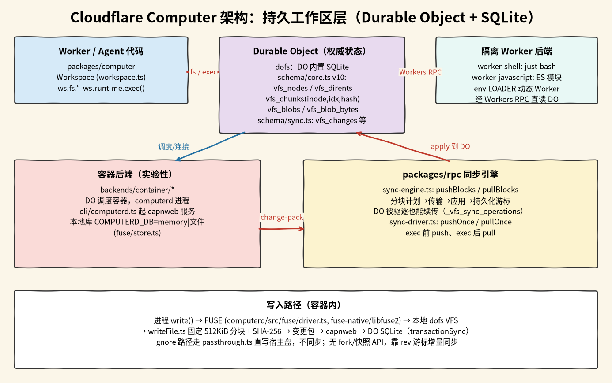

# Cloudflare Computer

## 摘要

Cloudflare Computer（仓库 [cloudflare/computer](https://github.com/cloudflare/computer)，npm 包 `@cloudflare/computer`，MIT）是一个跑在 Cloudflare Workers 平台上的 TypeScript 库：一个 Durable Object（DO，Cloudflare 的单实例有状态对象，自带 SQLite）里存一整套虚拟文件系统，作为这个工作区的唯一真实数据；需要执行代码时，再通过 `workspace.runtime.exec()` 交给某个执行后端。同一份文件可以给三种后端用：

- **容器后端**：在 Cloudflare Container 里跑守护进程 `computerd`，用 FUSE 把文件挂成真实目录，能跑任意 Linux 程序、有网络。
- **Worker shell 后端**：在 Dynamic Worker 里跑 [just-bash](https://github.com/vercel-labs/just-bash)（一个用 JavaScript 实现的 bash）。
- **Worker JavaScript 后端**：在新开的 Dynamic Worker 里执行一个 ECMAScript 模块。

官方介绍文章是 [Your agent needs a computer, not a container](https://blog.cloudflare.com/cloudflare-computer/)（2026-08-03）。它解决的问题是「agent 有一个一直存在的工作区，可以按需换运行时」，不是「大量分叉文件历史」，仓库里没有 fork 或快照接口。和 [[wiki/topics/ai/layerfs|LayerFS]]、[[wiki/topics/ai/perplexity-space|Perplexity SPACE]] 的分工见 [[wiki/comparisons/ai/cloudflare-computer-vs-layerfs-vs-space|三者对比]]。

本页依据 `main` 分支 `7415a44`（2026-10-15，包版本 0.5.1）的源码。npm 上的最新版是 0.6.0（2026-10-21 05:18 北京时间发布），这一版的改动没有读。仓库 README 说明 `docs/` 下的规格是「面向未来的」，与代码不一致时以代码为准。

## 包结构

| 包 | 作用 |
| --- | --- |
| `packages/dofs` | SQLite 文件系统本体：表结构、读写、改名、GC，以及同步用的变更记录、游标和变更包编解码 |
| `packages/rpc` | DO 与 `computerd` 之间的 RPC 接口定义（`SyncRPC`、`ShellRPC`、`WorkspaceRPC`）和同步引擎 |
| `packages/computerd` | 容器里的守护进程：FUSE 驱动、本地 SQLite、capnweb 服务、命令执行 |
| `packages/computer` | 对外入口：`Workspace`、`workspace.fs`、`workspace.runtime`、各执行后端、agent 工具 |

README 的状态表把 `Workspace`、`workspace.fs`、SQLite 文件系统层和 Worker JavaScript 后端标为 Stable；容器后端、Worker shell 后端、`workspace.push()` / `pull()` 与 DO↔`computerd` 的同步协议都标为 Experimental。

## 存储：DO 里的 SQLite 表

表结构在 `packages/dofs/src/schema/core.ts`（`SCHEMA_VERSION = 10`）和 `schema/sync.ts`：

- **`vfs_nodes`**：每个文件、目录、符号链接一行，主键 `inode`，记 `type`、`mode`、`mtime`、`size`、`link_target`，以及最近一次修改它的 `rev`。
- **`vfs_dirents`**：目录项，主键 `(parent_inode, name)`，值是 `child_inode`。表用 `WITHOUT ROWID`，解析路径的一段只读主键 B 树的叶子。
- **`vfs_chunks`**：文件内容的分块清单，主键 `(inode, idx)`，每行记这一块的 `hash` 和 `size`。
- **`vfs_blobs` / `vfs_blob_bytes`**：按 `hash` 存块内容，`vfs_blobs` 记大小和 `last_seen`（给 GC 用），字节放在 `vfs_blob_bytes`。哈希相同的块只存一份，不同文件共享。
- **`vfs_meta`**：存全局递增的 `rev` 计数器。
- 同步相关：`vfs_changes`（删除留下的墓碑记录）、`_vfs_watermark`、`_vfs_fetch_cursor`、`_vfs_push_cursor`（按后端分开的同步游标）、`_vfs_sync_operations`（可恢复的同步操作）、`_vfs_sync_skips`（被拒收的条目，例如往只读挂载里写）、`_vfs_mounts`（R2、Worker bundle 等只读或读写挂载）。

写文件的路径在 `packages/dofs/src/fs/writeFile.ts`：内容按固定 `CHUNK_SIZE = 512 * 1024` 切块（第 29 行），每块用 `node:crypto` 的 SHA-256 算哈希（`sha256()`），除最后一块外每块都必须正好 512 KiB。每次修改在一个事务里调用 `rev.ts` 的 `incrementRev()`，把新的 `rev` 写进被改节点。同步层就靠「比某个 `rev` 新的节点」和 `vfs_changes` 里的删除记录算出增量。

固定大小分块意味着在文件中间插入几个字节，插入点之后的块都会变；这和 LayerFS 用内容定义分块（CDC）不同。

## 隔离 Worker 后端：直接读写 DO，不同步

Worker shell 和 Worker JavaScript 两个后端都通过 `env.LOADER` 临时生成一个 Dynamic Worker。以 `packages/computer/src/backends/worker-shell/worker-shell.ts` 为例：

1. 组装要加载的模块表：just-bash 核心、按需开启的命令组和运行时桩。
2. 把一个指回宿主 DO 的 `WorkspaceServiceProxy` 放进加载出的 Worker 的 `env`，shell 通过 `env.HOST.getWorkspace()` 回调宿主 DO。
3. 用 `env.LOADER.get(...)` 得到 Worker，再取它的 `ShellWorker` 入口执行命令。

这条路上没有第二份存储，后端句柄声明 `sync: "none"`，`Workspace.push()` / `pull()` 直接返回。Worker JavaScript 后端（`backends/worker-javascript/`）同样跑在 Dynamic Worker 里，额外提供基于工作区的 `node:fs/promises`，以及 `ws:git`、`ws:artifacts`、`ws:container` 这类宿主模块。

## 容器后端：computerd、FUSE 和增量同步

容器后端（`packages/computer/src/backends/container/`）由 DO 自己调度一个 Cloudflare Container（`scheduling_policy: "durable_object"`），容器里跑 `computerd`：

- **连接**：`computerd`（`packages/computerd/src/cli/computerd.ts`）在 `/api` 提供 capnweb（Cloudflare 的对象 RPC 库）WebSocket 服务，DO 连上后拿到 `WorkspaceRPC`，其中 `sync` 部分是 `SyncRPC`（`packages/rpc/src/interface.ts`：`push`、`fetchChanges`、`watermarks`、`hasObjects`、`fetchObjects`、`pushObjects` 等）。
- **容器内存储**：`computerd` 自己也有一份 dofs 数据库。`COMPUTERD_DB` 为空或 `memory` 时放内存，设成绝对路径才落盘（`packages/computerd/src/fuse/store.ts`）。
- **FUSE 挂载**：`packages/computerd/src/fuse/driver.ts` 通过 `fuse-native`（绑定 libfuse 2.9）把这份数据库挂成目录，单文件内存上限 256 MiB（`MAX_FILE_BYTES`）。进程的 `write()` 经内核转给驱动，写进本地 dofs，同样按 512 KiB 分块并记 `rev`。
- **只留本地的路径**：`MOUNT_IGNORE`（如 `**/node_modules`、`**/.venv`、`/dist`）匹配的路径由 `fuse/passthrough.ts` 直接写容器磁盘，不进 dofs，也不同步回 DO。注释说明这里并不是内核的 FUSE passthrough，数据仍要经过 `computerd` 进程，只是跳过了 VFS、SQLite 和同步。

同步时机写在 `packages/computer/src/workspace.ts`：

1. **执行前推送**：`#pushForExec` 调 `pushOnce()`，把 DO 里比推送游标新的变更整批送到容器，再开始执行命令。
2. **执行后拉取**：命令结束后 `#pullForExec` 调 `pullOnce()`，把容器里的改动拉回 DO 并应用。
3. **重连对账**：`packages/rpc/src/sync-driver.ts` 的 `reconcileWatermarks()` 在连接或重连时比较双方游标。注释写明原因：DO 的游标在持久存储里，容器重启后内存数据库清空，如果不对账，`pushOnce` 会因为「本地 rev 不比已推送的新」直接跳过，下一次命令会看到空目录；对账发现对方落后，就把游标重置为 0，重新增量推送。

`packages/rpc/src/sync-engine.ts` 的 `pushBlocks` / `pullBlocks` 每次 `next()` 只处理一个完整的块：规划、传输、应用、持久化游标，然后才返回。注释的理由是 DO 可能在两次调用之间被驱逐，迭代器对象活不下来，所以进度放在 `_vfs_watermark` 和 `_vfs_sync_operations` 里，新建的迭代器可以从这里接着做。条目多或数据大时切成变更包（`dofs/src/sync/change-pack.ts`，`mode` 为 `entries` 或 `pack`）。传块内容前先用 `hasObjects` 问对方已有哪些哈希，只传缺的。

`tick()` 的顺序是先拉后推，配合 `applyChanges` 里的回环抑制，避免刚从对面收到的变更又被推回去。

## 使用限制

- **绑定 Cloudflare 平台**：存储依赖 Durable Object 的 SQLite，隔离后端依赖 Worker Loader（Dynamic Worker），容器后端依赖 Cloudflare Containers。
- **容器后端和同步协议是实验性的**：README 不建议用于生产；Worker shell 后端也是实验性的，还需要 `experimental` 兼容标志。
- **容器里的改动在拉取前只在容器里**：命令执行中途容器崩溃，尚未拉回的写入会丢；`COMPUTERD_DB=memory` 时容器重启会清空本地库，靠重连对账从 DO 全量重推。
- **`MOUNT_IGNORE` 的路径不持久**：它们只在容器磁盘上，DO 和其他后端看不到。
- **没有分叉和快照接口**：在 `7415a44` 的 `packages/computer/src` 里检索 `fork`、`snapshot`，只找到与容器重启记录相关的字样，没有工作区级的分叉或快照 API。
- **大文件**：固定 512 KiB 分块对中间插入不友好；容器内单文件上限 256 MiB。

## 相关页面

- [[wiki/comparisons/ai/cloudflare-computer-vs-layerfs-vs-space|Cloudflare Computer vs LayerFS vs Perplexity SPACE]]
- [[wiki/topics/ai/layerfs|LayerFS]]
- [[wiki/topics/ai/perplexity-space|Perplexity SPACE]]
- [[wiki/topics/ai/mirage|Mirage]]
- [[wiki/topics/systems/sandbox|Sandbox]]

## 来源指针

- [cloudflare/computer](https://github.com/cloudflare/computer)：README、`packages/computer/README.md`（状态表、后端表）、`packages/computerd/README.md`（`MOUNT_IGNORE`）
- 源码（`7415a44`）：`packages/dofs/src/schema/core.ts`、`schema/sync.ts`、`rev.ts`、`fs/writeFile.ts`；`packages/rpc/src/interface.ts`、`sync-driver.ts`、`sync-engine.ts`；`packages/computerd/src/cli/computerd.ts`、`fuse/driver.ts`、`fuse/store.ts`、`fuse/passthrough.ts`；`packages/computer/src/workspace.ts`、`backends/worker-shell/worker-shell.ts`、`backends/container/container-backend.ts`
- [Your agent needs a computer, not a container](https://blog.cloudflare.com/cloudflare-computer/)（2026-08-03）
- [npm `@cloudflare/computer`](https://www.npmjs.com/package/@cloudflare/computer)
- `raw/sources/cloudflare-computer.md`：阅读范围、核查位置与验证记录
- `raw/assets/cloudflare-computer-architecture.png`：按上述源码画的手绘风格示意图，不是官方素材
