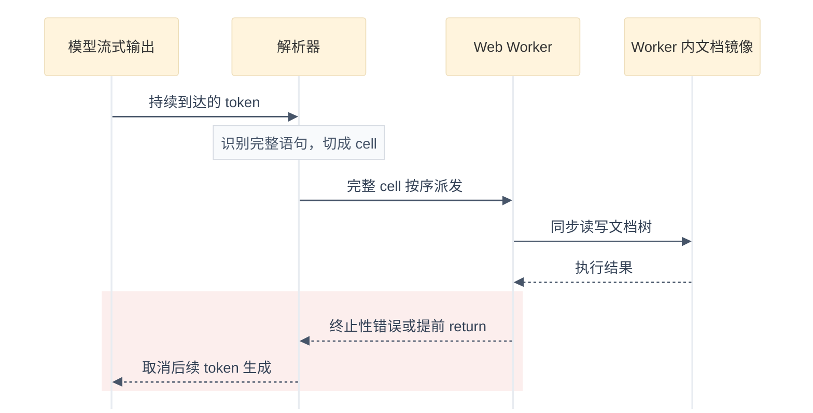

# Framer Harness 2

## 摘要

Framer Harness 2 是 Framer 设计文档 Agent 的第二代运行环境，作者 Adam Seckel，2026-11-02 发布。Framer 的设计文档本身是一棵树，等价于一份 AST，代码和 CMS 内容都从这棵树确定性生成。第一代 harness 让模型用 DSL 命令描述对树的写入；Harness 2 改为让模型直接编写 JavaScript 程序，并且边写边跑：模型还在生成后续代码时，写完整的语句就被解析器切成可执行 cell，送入专用 Web Worker 按序运行，画布在模型写完剩余代码之前就能看到首批修改。

## 背景：第一代 DSL harness 的三个限制

第一代 harness 中，模型发出创建节点、设置属性的 DSL 命令，命令到达即可应用，用户能看着页面成形。但遇到复杂任务时有三个限制：

- **重复编辑**：跨 100 个 frame 改同一个属性，需要 100 条编辑命令。
- **依赖编辑**：先读一个值、再用它执行写入，需要两次独立的模型调用，并在调用之间重放上下文。
- **多步工作流**：检查改动、发布到 staging、提升到生产，每一步之间都要回到模型。

即使模型一开始就知道完整工作流，harness 也迫使它一次只走一步。

## 核心机制一：流式 eager 执行

### 长程序的两个问题

把任务收进一个程序可以省掉多次模型调用和重复的输入 token，但程序变长后出现两个问题：

1. **反馈延迟**：必须等整个程序生成完才能开始执行，用户等待首个进展的时间变长。
2. **生成浪费**：提前 return 或终止性错误可能在几行后就结束执行，但模型已经花时间和 token 写完了后续不会运行的代码。

### cell 切分与 Web Worker 执行

旧方式是**先写完再跑**：模型把整段程序生成完，harness 才拿到完整程序开始执行。Harness 2 改成**边写边跑**：模型还在逐行写后续代码，已经写完整的语句就立刻被 harness 切出来拿去运行，写代码和跑代码两件事同时进行。

具体流程：

1. 代码随 token 流到达，解析器识别出完整的 JavaScript 语句。
2. 完整语句被分组为可执行的 cell，发送给专用 Web Worker。
3. cell 按 classic script 方式按序执行，cell 之间保留变量绑定；顶层 `await` 被转译成 classic script 支持的语法。
4. 文档编辑、发布到 staging 等耗时操作可以在模型写后续代码时就开始。

同一次解析还会把 `// @step Building buttons` 这样的注释转成 `emit("Building buttons")` 调用，在长程序执行过程中给用户推送进度。



这张图的配色在 Mermaid v12 上踩过几个实际的坑，维护时注意：

- v12 的 sequenceDiagram 已移除 `style` / `classDef` 单节点语法，且 neo look 会用内置粉彩数组覆盖 `actorBkg`，在 init 里覆盖调色板数组无效；统一 actor 配色只能靠 `themeCSS` 里的 `!important` 规则。
- init 指令是宽松 JSON，值里不能出现双引号（如带引号的字体名），否则整个指令静默回退默认样式；字体栈用 `system-ui,sans-serif` 这类无引号写法。
- actor 和 note 的投影是 mermaid 自带 CSS 滤镜，需要分别用 `.actor{filter:none}` 和 `rect.note[data-look=neo]{filter:none}` 覆盖。
- `mirrorActors` 等时序图配置放在 init 顶层的 `sequence` 字段下，不是 `config.sequence`。
- `rect` 内联颜色只接受 rgb / rgba / hsl，不支持 hex；图中仅保留红色一处强调色，标记「取消生成」这条异常路径。

图中每个环节都来自文章的明确描述：cell 的切分与派发、Worker 内执行、提前终止后取消生成；取消时已经应用到的文档编辑会保留。

### 提前取消与可操作错误

Harness 2 在提示词中要求 agent 在执行依赖某项前提的工作之前先检查条件。检查通过就继续执行，不再产生一次模型往返；遇到终止性错误或提前 return（包括「不需要任何修改」的情况），就取消剩余生成。

- 取消之所以能省 token，前提是 eager 执行：模型还在写代码时 harness 就发现执行已经停止。如果先缓冲整个程序再运行，发现停止时代价已经付出。
- 终止性错误需要说明哪里出错、如何恢复，让下一次尝试能纠正失败的假设，而不是只抛出一个异常名。

## 核心机制二：文档访问重设计

### 从 DSL 命令到方法调用

流式执行保留了实时视觉反馈，因此树修改 API 被重写为一组方法调用：DSL 的 `INSERT` / `PATCH` 变成 `tree.insert()` / `tree.patch()`，属性值可以直接引用其他节点。

```javascript
// "Clamp all opacity less than 50% to the opacity of this ("xxx") button"
const button = tree.get("xxx")
for (const node of tree.walk()) {
	if (node.opacity < 0.5) node.patch({ opacity: button.opacity })
}
```

这个程序把「读—写」循环压缩进一次请求：写入值直接来自实时文档，不需要先把值读进模型上下文、再在后续写入里原样回显。

### 容错写入与省 token 的 patch 格式

可恢复的写入错误不应该终止整个程序。Harness 2 对 `tree.patch` 的处理是：

- 合法属性正常应用；
- 超出支持范围的值被夹到合法区间，例如 `opacity: -0.1` 夹到 0；
- 不支持的属性直接跳过；
- 警告和错误挂在程序的最终结果上，程序结束后统一报告，agent 不必重跑已成功的写入。

嵌套数组和对象的局部修改支持点路径和稀疏数组作为一等 patch 格式，避免模型为了安全局部更新而写展开语法（spread），减少输出 token 并提高准确率：

```javascript
tree.patch(node, { "appearEffect.enter.x": "100px" })
tree.patch(node, { "boxShadow": [,, "0px 0px 10px #000",, "0px 0px 20px #000"] })
```

### Worker 内的同步文档镜像

提前取消只有在执行比生成更快返回时才有意义，而 Worker 与文档之间的往返会让读写落在生成后面。Harness 2 在 Web Worker 中保留一份文档的内存副本，程序可以同步读写它，带来三个结果：

1. **更少输出 token**：读写不需要反复写 `await`。
2. **遍历更快**：标准 JavaScript 即可遍历和修改包含数百万节点的文档。
3. **提示词更简单**：不需要教模型怎么写高性能查询。

## 统一 harness：外部 Agent 经 MCP 接入

2026 年 6 月首发的 Framer for Agents 中，站内 agent 与 ChatGPT Desktop、Claude Code、Cursor 等外部 agent 的接入方式不同：外部 agent 用自己的执行系统，通过 Framer 服务器发多次请求。

Harness 2 把同一套工具开放给外部 agent：外部 agent 通过 MCP 提交一个程序，程序直接在 Framer 内运行，同步访问本地文档，单次读写不再需要绕 MCP 服务器往返。新特性也因此可以同时交付给站内和外部 agent。

## 效果数据与证据边界

文章给出的官方自报数据：

- 成本最多降低 33%，速度提升 20%。
- 每条消息的缓存输入 token 平均减少 39%，质量没有测得下降。
- 工具步数在导语中写「减少 2x」，在结尾写「减少 43%」，两处数字不一致，原文如此；本页不代为统一。

这些数字来自 Framer 自己的工程博客，没有公开评测集、模型和对照配置，不能当作独立复现的结论。文章也没有给出失败率、取消触发比例等细分数据。

## 相关工作

Framer 在文末说明，写作调研时发现新加坡管理大学和北航作者的论文 *Executing as You Generate*（2026-04-01 首发，arXiv:2604.00491）已在 Python 上实现同一思路：AST 分块、持久执行状态、运行出错时提前中断生成。论文还提出一个 Framer 未想到的优化——处理后续 token 前先把已完成语句从解析缓冲区移除，Framer 表示计划采用。两者的差别是论文验证 Python 场景的收益，Framer 是生产环境 harness 的工程落地。

## 使用限制

- 机制围绕 Framer 自有的文档树和 `tree.*` API 设计，cell 能调用的能力由这套 API 限定，不是通用 JavaScript 运行时。
- 同步内存镜像意味着执行环境持有完整文档副本，文章没有讨论多用户并发编辑时副本如何与权威文档同步。
- 外部 agent 统一走 MCP 单程序的能力依赖 Framer 服务端实现，文章未披露协议细节和权限模型。

## 相关页面

- [[wiki/topics/ai/agent-harness|Agent Harness]]
- [[wiki/syntheses/ai/agent-harness-runtime-architecture|Agent Harness 运行时架构与演进]]
- [[wiki/topics/ai/openai-programmatic-tool-calling|OpenAI Programmatic Tool Calling]]
- [[wiki/topics/ai/mcp|MCP]]

## 来源指针

- `raw/sources/framer-harness-2.md`
- https://www.framer.com/blog/harness-2/
