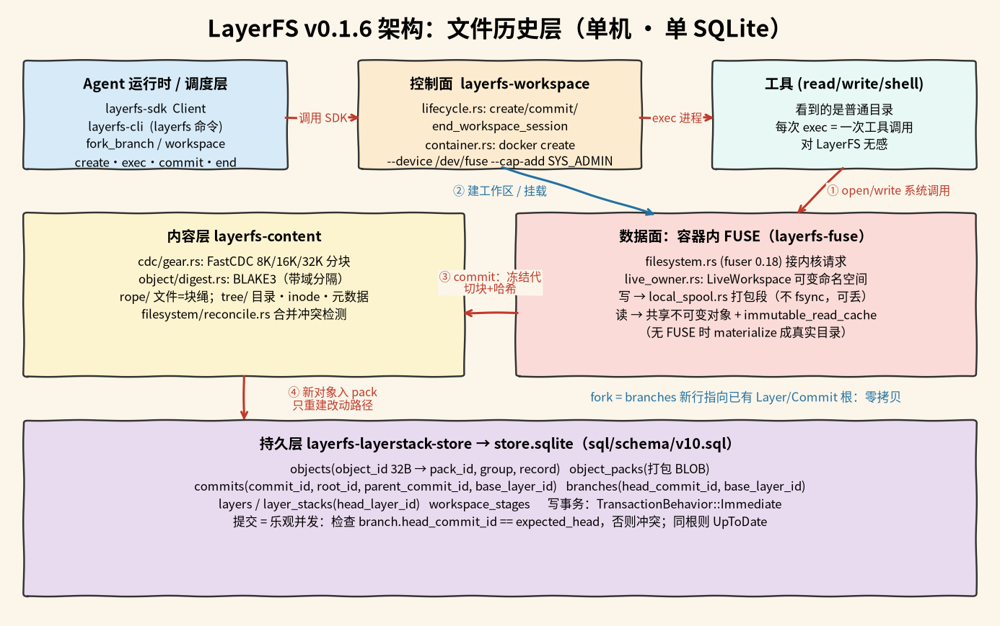
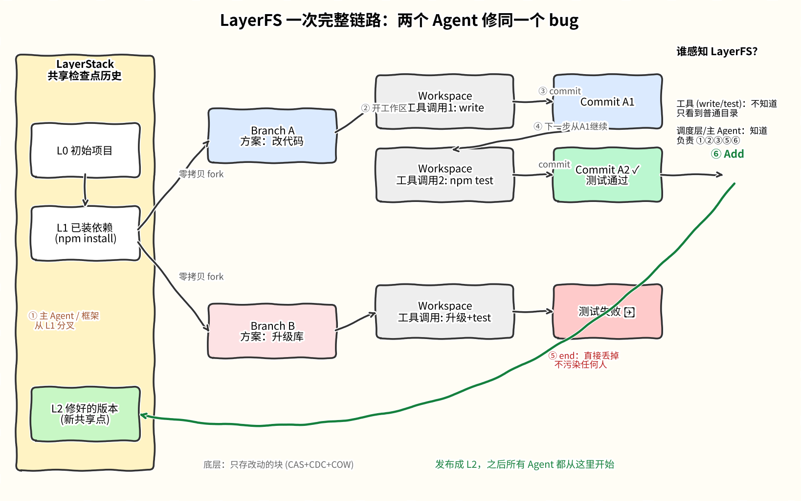

# LayerFS

## 摘要

LayerFS（[Ephemeral-AI-Lab/layerfs](https://github.com/Ephemeral-AI-Lab/layerfs)，Rust，MIT）是一个本地 Rust 库加命令行，把一个项目目录的每个历史状态存进**一个 SQLite 文件**，再把某个状态作为普通目录交给工具使用。设计目标是：agent 每做一次会改文件的工具调用，都在一个临时可写目录（Workspace）里做；结果要保留就存成一个不可变的 Commit，不要就丢掉。任何 Layer 或 Commit 都能零拷贝分出新的 Branch，多个分支共享没改过的数据，只多存改动的块。

一句话：逻辑上每条分支都是一整套目录，物理上只存改过的部分。

当前可用版本是 `v0.1.6` 开发预览版（Developer Preview），README 明确说它用于本地评估、agent 运行时集成和性能研究，不是生产存储，不保证崩溃或断电后数据不丢。`main` 分支上的 `core/` 正在重写，拆成了 13 个 crate，本页的实现细节都按 `v0.1.6` 的源码写。它和 [[wiki/topics/ai/cloudflare-computer|Cloudflare Computer]]、[[wiki/topics/ai/perplexity-space|Perplexity SPACE]] 的分工见 [[wiki/comparisons/ai/cloudflare-computer-vs-layerfs-vs-space|三者对比]]。



## 四层模型

从大到小：

1. **LayerStack**：一个项目共享的检查点历史，由一串不可变的 Layer 组成。每个 Layer 是一份完整的目录快照，例如 L0 是导入的初始项目，L1 是装好依赖或合入一轮成果后的状态。
2. **Branch**：从某个 Layer 或某个 Commit 分出来的独立路径，可以对应一个任务、一个 agent 或一个候选方案。
3. **Commit**：Branch 上保留下来的不可变中间状态，可以查看、对比、恢复，也能从它再分叉。
4. **Workspace**：一次工具调用用的临时可写目录，从 Branch 当前状态创建。工具在里面读写，结束后要么 `commit`，要么 `end --discard` 丢掉，然后清理。

流程是：Layer 或 Commit → 分出 Branch → 开 Workspace 跑工具 → 存成 Commit → 继续或再分叉。某个 Branch 的结果好，用 `Add`（CLI 是 `layerstack add`，SDK 是 `add_layer`）把它发布成 LayerStack 里的新 Layer，之后所有人从这个新 Layer 开始。

## 一次完整链路：两个方案修同一个 bug



1. **起点**：项目已经装好依赖，存成 LayerStack 里的 L1。
2. **分叉**：主 agent 或框架从 L1 零拷贝分出 Branch A（改代码）和 Branch B（升级库）。
3. **干活**：每次工具调用开一个 Workspace。A 先 `write` 改文件，提交成 Commit A1；再从 A1 开新 Workspace 跑 `npm test`，通过后提交成 A2，A2 的父提交是 A1。
4. **丢弃**：B 升级后测试失败，直接 `end --discard`，什么都不留，也不影响 A。
5. **发布**：主 agent 对 A2 调 `Add`，发布成 L2。

整个过程里，`write`、`npm test` 只看到一个普通目录；开 Workspace、提交、丢弃、分叉、`Add` 都由主 agent 或框架发起。底层只多存了 A 改过的那几个块。

## 内部实现（v0.1.6）

### crate 划分

| crate | 作用 |
| --- | --- |
| `layerfs-sdk` | Rust SDK 的 `Client`：`initialize_layerstack`、`fork_branch`、`create_workspace_session`、`exec_workspace_session`、`commit_workspace_session`、`end_workspace_session`、`add_layer`、`diff`、`analyze_dedup` 等 |
| `layerfs-cli` | `layerfs` 命令行 |
| `layerfs-workspace` | 控制面：Workspace 生命周期（`lifecycle.rs`）、Docker 容器管理（`container.rs`、`docker.rs`）、物化目录（`projection.rs`） |
| `layerfs-fuse` | 数据面：容器内的 FUSE 文件系统 |
| `layerfs-content` | 内容层：CDC 分块、对象哈希、文件和目录树结构、三方合并 |
| `layerfs-layerstack-store` | 持久层：SQLite 表结构和事务 |

### 存储：一个 SQLite 文件

表结构在 `crates/layerfs-layerstack-store/sql/schema/v10.sql`，主要的表：

- **`objects`**：`object_id` 是 32 字节哈希，记录每个对象落在哪个 `object_packs` 的哪一组、第几条，单个对象最大 16 MiB。
- **`object_packs`**：把很多小对象打包成一个 BLOB 存，避免每个块一行。
- **`commits`**：`commit_id`、`root_id`（整个目录树的根对象）、`parent_commit_id`、`base_layer_id`。
- **`branches`**：`base_layer_id` 和 `head_commit_id`。
- **`layers` / `layer_stacks`**：Layer 的根对象、父 Layer，以及每个 LayerStack 当前的 `head_layer_id`。
- **`workspace_stages`**：正在进行的 Workspace 对应哪个 Branch、基于哪个根。

内容寻址的细节在 `layerfs-content`：

- **分块**：`src/file/cdc/gear.rs` 实现 FastCDC（基于 Gear 滚动哈希的内容定义分块），`MINIMUM_CHUNK_BYTES = 8_192`、`TARGET_CHUNK_BYTES = 16_384`、`MAXIMUM_CHUNK_BYTES = 32_768`。切点由内容决定，在文件中间插入几个字节，只有附近一两块会变。
- **哈希**：`src/object/digest.rs` 用 BLAKE3，并在输入前加域分隔前缀（对象用 `layerfs/object/v2\0`，原始内容用 `layerfs/content-bytes/v1\0`），避免不同类型的数据算出同一个 ID。
- **结构**：文件是一串块的清单（`file/rope`），目录是一串条目的清单（`tree/`），整个目录状态归结为一个根对象 ID。存一个 Commit 只需记下新的根，没变的块和子目录直接引用旧对象。

### 分叉：只加一行记录

`crates/layerfs-layerstack-store/src/branch.rs` 的 `fork_branch` 只做校验和插入：从 Layer 分叉时新 Branch 的 `base_layer_id` 指向该 Layer、`head_commit_id` 为空；从 Commit 分叉时先确认这个 Commit 在源 Branch 的历史里。没有复制任何文件数据，所以是零拷贝。

### Workspace 的两种交付方式

- **物化（`--projection materialize`）**：把文件直接复制到一个真实目录给工具用，只需要 Rust，不需要 Docker；代价是有复制成本，多个 Workspace 不共享底座。
- **容器 FUSE**：`layerfs-workspace/src/container.rs` 用 `docker create` 起容器，参数里带 `--device /dev/fuse` 和 `--cap-add SYS_ADMIN`（第 111–114 行），容器里由 `layerfs-fuse`（基于 `fuser` 0.18）把 Workspace 挂成目录。SQLite 存储留在容器外的宿主上。

### 写路径（容器 FUSE）

1. 工具调 `open` / `write`，内核把请求转给 `layerfs-fuse`（`filesystem.rs`）。
2. 可变的目录树由 `live_owner.rs` 维护在沙箱一侧。被改写的字节写进 `local_spool.rs` 管理的分段文件（`/snapshots/<workspace-id>/`），注释写明这份数据「按约定可丢」，从不调用 `fsync` / `fdatasync`。
3. 读没改过的内容时，从共享的不可变对象读，并经 `immutable_read_cache` 缓存。

### 提交与并发

1. `commit` 时沙箱冻结当前这一代改动，交给宿主上的构建流程（0.1.6 的发布说明：「Commit transfers mutable state with no pause fence and one construction worker」）。
2. 宿主把改动文件用 CDC 重新分块、算哈希，只为数据库里还没有的对象做写入，并只重建改动路径上的目录对象，得到新的根。
3. `workspace.rs` 的 `commit_candidate` 用 `CommitId::derive(root_id, 父提交, base_layer_id)` 算出 Commit ID，在 `TransactionBehavior::Immediate` 事务里写入。
4. 新根和旧根相同、Layer 也没变时返回 `UpToDate`，不新建 Commit。
5. 乐观并发：提交前检查 Branch 的 `head_commit_id` 是否仍是开始时看到的那个（`expected_head`，`workspace.rs` 第 176 行附近），被别人改过就报 `CommitHeadMoved`。

把 Branch 合到一个更新过的 Layer 时，`prepare_reconciliation` 拿旧基础 Layer、Branch 头和当前 Layer 三个根做三方合并（`layerfs-content/src/filesystem/reconcile.rs`），冲突交给调用方按 `ReconcileChoice` 选择，SDK 有 `workspace_conflicts`、`resolve_workspace_conflict`。

## 怎么用

按 v0.1.6 快速上手，物化方式只需要 Rust，不用 Docker：

```bash
# 1. 编译（macOS 或 Linux，Rust 1.85 以上）
git clone https://github.com/Ephemeral-AI-Lab/layerfs.git && cd layerfs && git checkout v0.1.6
cargo build --locked --release -p layerfs-cli
export LAYERFS_BIN="$PWD/target/release/layerfs"
export LAYERFS_CONTEXT="$PWD/.layerfs/context"
mkdir -p "$PWD/.layerfs"

# 2. 建存储，导入项目（存储文件不要放在要导入的目录里），打印的 layer id 就是 L0
"$LAYERFS_BIN" db create "$PWD/.layerfs/store.sqlite"
"$LAYERFS_BIN" context use --store "$PWD/.layerfs/store.sqlite"
"$LAYERFS_BIN" layerstack init --name myproj /path/to/your/project

# 3. 分叉一个 Branch
"$LAYERFS_BIN" branch fork --name try-a --layer <layer-id>

# 4. 开 Workspace、执行、提交或丢弃；每次 exec 是一个新进程，对应一次工具调用
WS=$("$LAYERFS_BIN" workspace create <branch-id> --at "$PWD/.layerfs/ws" --projection materialize)
EX=$("$LAYERFS_BIN" workspace exec "$WS" -- /bin/sh -c 'npm test')
"$LAYERFS_BIN" workspace output "$EX" --follow
"$LAYERFS_BIN" workspace commit "$WS"
"$LAYERFS_BIN" workspace end "$WS"        # 不要结果时只执行 end "$WS" --discard

# 5. 查看状态与去重效果
"$LAYERFS_BIN" query branches
"$LAYERFS_BIN" query commits
"$LAYERFS_BIN" monitor analyze-dedup
```

`end` 不会自动提交。接进 agent，就是让调度层每次工具调用都走第 4 步（用 CLI 或 Rust SDK）。想让多个 Workspace 共享底座、真正省空间，要用容器 FUSE 模式。

## 常见问题

### 和 git 加 worktree 有什么区别

Git 管的是代码版本与交付，LayerFS 管的是 agent 跑起来时整个目录的状态。几个 agent、偶尔开几个分支时 worktree 够用，也更简单。差别出现在路径多、每一步都要能回退的场景：

- **依赖要重装**：`node_modules`、构建缓存通常不进 Git，新开 worktree 没有依赖，十个方案就要 `npm install` 十次。LayerFS 从装好依赖的 Layer 分叉，大家直接用。
- **磁盘占用**：每个 worktree 是完整的源码目录再加一份依赖。LayerFS 共享底座，只存改动。
- **提交粒度**：要做到每次工具调用都能回退，就得每次 `write` 之后 `git commit`，历史会很乱。LayerFS 本来就按工具调用记录，失败直接丢。
- **管理范围**：Git 不管构建产物、缓存、权限、mtime，回退后环境可能和当时不一样。LayerFS 记录的是整个目录。
- **从哪里分叉**：worktree 要先提交才能从某个状态分叉。LayerFS 任何 Commit 都能直接零拷贝分叉。

### 「单次工具调用隔离」和 CAS、CDC、COW 是什么意思

单次工具调用隔离：agent 每做一个会改文件的动作（改一个文件、跑一次 `npm install`），都先拿到一份临时的独立 Workspace，只在那里改。结果好就存成 Commit，不好就丢掉，别的 agent 和别的尝试看不到它的半成品。

三个省空间的做法：

- **CAS（Content-Addressed Storage，内容寻址存储）**：用内容的哈希当名字，内容相同的块只存一份，不管它出现在多少个分支里。
- **CDC（Content-Defined Chunking，内容定义分块）**：按内容特征决定切点，文件中间插几个字只影响附近一两块，其余块照样复用。
- **COW（Copy-on-Write，写时复制）**：分叉时什么都不复制，大家共用一份；谁改哪个文件，才单独记录那一部分。

举个估算的例子：1 GB 的项目分给 100 个 agent，每个改 1 MB，整盘复制要 100 GB，用这三种做法约是 1 GB 底座加 100 MB 改动再加元数据。这只是示意，不是实测数据；README 的原话是「每个状态逻辑上完整、物理上增量，新状态的成本应等于改动量」。

### 谁需要感知 LayerFS

工具不用感知，调度工具的 agent 系统要感知。

- **工具**：`read`、`write`、`shell`、编译器、测试、编辑器看到的就是普通目录，不用改。例外是工具不直接读写本地文件（走自己的远程存储或 API），那就要改成指向 Workspace 的路径，或直接调 SDK。
- **调度层**：每次工具调用前开 Workspace，结束后决定 commit 还是丢弃，要分叉时建 Branch，最后用 `Add` 发布。这些都要显式调用。

感知 LayerFS 的位置可以有两种：

- **框架层接入**：框架在每次工具调用外面自动开 Workspace、提交或丢弃，模型不知道 LayerFS 的存在；分叉和 `Add` 只能按框架写死的规则进行，例如测试通过才发布。
- **agent 自己接入**：把 SDK 作为工具交给模型，让模型自己决定何时分叉、合并、发布，这时模型明确知道 LayerFS。想让模型自己挑方案、多路试错，基本要走这一种。

### 为什么用 SQLite

README 没有专门解释，以下是推断：SQLite 是一个嵌入式文件，不用起服务，自带事务，适合管理「哈希到数据块」「Commit 到根」这类索引关系，做本地开发预览最省事。代价写在限制里：只能单机，存储效率还没达到项目自己定的 600 MB 目标。

### 能用在任何 agent 上吗

只要 agent 通过本地文件系统干活，换哪个模型或框架都行。实际前提：

- 你得能改 agent 的运行时，在工具调用前后插入开 Workspace、提交或丢弃。Claude Code、Cursor 这类闭源产品改不了这一层，最多把整个会话放在一个 Workspace 里，粒度就粗了。
- 环境是 macOS 或 Linux。容器 FUSE 模式需要 Docker、`/dev/fuse` 和 `CAP_SYS_ADMIN`，很多云沙箱默认不给。
- 只管文件。数据库、远程 API、浏览器里的状态它不记录。
- 只能单机。官方 SDK 目前是 Rust；`main` 上有 `sdk/js`，DeepSeek Harness 插件就用它（见下）。

### 支持分布式吗

不支持。README 写明一个 `Client` 绑定一个 SQLite 存储，没有跨机器同步。路线图把「验证过的存储导出、导入和同步」放在 0.2.0 之后的 Later 阶段，标为研究方向。多机只能每台机器各自一套 LayerFS，彼此不共享历史和去重。

### 为什么官方只给 DeepSeek Harness 做了集成

`main` 分支的 `dsh/` 目录是给 [DeepSeek Harness](https://github.com/deepseek-ai/deepseek-harness)（dsh）的插件包 `dsh-layerfs`，README 写明不改 dsh 的代码。它提供：

- 宿主插件 `layerfs-host`：往 bash 环境注入 `DSH_LAYERFS_PROJECT`、`DSH_LAYERFS_SDK` 等变量，把每次 SDK 调用记成会话里的 `plugin:layerfs/call` 记录，并提供 `/layerfs` 网页路由。
- 客户端插件 `layerfs-client`：在 dsh 网页里加一个 LayerFS 标签页，画出每个 agent（含子 agent）的分支和提交历史。
- agent 在 bash 里运行调用 LayerFS JS SDK 的 Node 小脚本来分叉、合并、发布，所以这里是「agent 自己接入」的方式。

SDK 本身是通用的，这只是一个参考集成。README 没写为什么选 dsh，推断原因是 dsh 能通过插件接入工具调用这一层，网页端适合展示多分支，而且同属 JS/TS 生态。

### 有没有类似的工作

最接近的是 Turso 的 [AgentFS](https://github.com/tursodatabase/agentfs/)：同样是 SQLite 存储加 FUSE 加写时复制，`agentfs run claude` 一条命令就能把 Claude Code、Codex 这类现成 agent 放进写时复制的沙箱，源码目录只读，改动记到一个 SQLite 文件里，有 TS、Python、Rust 三种 SDK。原理见 [AgentFS overlay](https://turso.tech/blog/agentfs-overlay)。区别是 AgentFS 按会话隔离、主打安全和审计，LayerFS 把粒度压到每次工具调用，并在分支之间按块去重，主打大量分叉。

下表除 AgentFS 外，其余各行是按这些工具的一般了解写的，没有逐项核实最新功能：

| 方案 | 隔离粒度 | 分叉成本 | 去重 | 适合 | 不适合 |
| --- | --- | --- | --- | --- | --- |
| LayerFS | 单次工具调用 | 零拷贝 | 跨分支块级（CAS + CDC） | 大量分叉和回退，依赖随快照一起走 | 生产存储、多机；要自己接调度层 |
| Turso AgentFS | 一个会话 | 复制整个 `.db` 文件 | 基本没有，改过的文件整份复制 | 直接跑现成闭源 agent，需要审计 | 大量细粒度分叉 |
| git worktree | 一个分支目录 | 完整目录 | Git 对象层有，工作目录没有 | 少量并行任务 | 依赖要重装，只管 Git 跟踪的文件 |
| Docker / OverlayFS | 一个容器 | 层共享，成本低 | 按层共享，层内整份文件复制 | 环境隔离 | 每一步都存一层 |
| ZFS / Btrfs 快照 | 一个数据集或子卷 | 零拷贝 | 块级写时复制 | 自有机器、性能要求高 | 需要特定文件系统和 root，云沙箱里通常用不了 |
| E2B、Modal 等云沙箱 | 一台虚拟机或沙箱 | 快照或 fork 数秒 | 平台处理 | 托管、跨机扩展 | 粒度粗，收费，状态不在自己手里 |

## 实际运行结果

2026-10 在一台 Linux 电脑上按快速上手跑通了 v0.1.6 的物化方式（由另一个 bot 代为运行，记录见 raw）。用的是一个故意写错的小项目：`calc.py` 里 `add` 写成 `a - b`，配一个测试脚本。

- **分叉**：从 L0 分出 `try-a` 和 `try-b`，都立即完成。
- **try-a**：第一个 Workspace 用 `sed` 改好 bug，提交成 Commit 1；第二个 Workspace 跑测试，输出 `TEST PASS`，提交成 Commit 2，父提交是 Commit 1。
- **try-b**：改成 `a*b`，测试失败，`end --discard` 后没有任何记录，`try-b` 的头指针仍为空。
- **发布**：`layerstack add <try-a>` 生成 L1，`diff` 显示改了 `calc.py`。

使用中遇到的问题：

- 编译需要系统装 `libsqlite3-dev`，文档没写。
- `workspace end` 之后马上开新 Workspace，偶尔报 connection reset，等一两秒重试就好。
- CLI 输出是 Rust 调试结构，stdout 被打成字节数组（`TEST PASS` 显示为 `[84, 69, 83, 84, …]`）。README 也说 CLI 的 JSON 输出只是预览格式，不是稳定接口。
- 跑测试生成的 `__pycache__` 也被提交了，因为它记录整个目录，忽略规则要自己处理。

项目太小，去重统计看不出省了多少空间；那台机器没有 Docker，容器 FUSE 模式没有试。详细记录见 `raw/sources/layerfs.md`。

## 使用限制

- **开发预览版**：不保证崩溃或断电后不丢数据，Workspace 的改动数据从不 `fsync`；重要数据要另留副本。
- **只能单机**：一个 `Client` 一个 SQLite 存储，没有跨机同步。
- **版本要一致**：0.1.6 的沙箱端和 0.1.5 的宿主不能共享同一个 Workspace，SDK、CLI、守护进程和运行时要用同一版本。
- **共享 `mmap` 的脏页不会被 Commit 捕获**（README 限制条目）。
- **提交构建只有一个工作线程**：README 写明 6 项去重和 CDC 构建测试比 0.1.5 慢 1.50–1.65 倍，冷启动导入 10 万文件的目标被豁免。
- **容器 FUSE 需要特权**：Docker、`/dev/fuse` 和 `CAP_SYS_ADMIN`。
- **代码在重写**：`main` 的 `core/` 与 0.1.6 不同，升级时要重新看接口。

## 相关页面

- [[wiki/comparisons/ai/cloudflare-computer-vs-layerfs-vs-space|Cloudflare Computer vs LayerFS vs Perplexity SPACE]]
- [[wiki/topics/ai/cloudflare-computer|Cloudflare Computer]]
- [[wiki/topics/ai/perplexity-space|Perplexity SPACE]]
- [[wiki/syntheses/ai/sandboxed-agent-workflows|动态工作流：用沙箱脚本编排多 Agent]]
- [[wiki/topics/systems/sandbox|Sandbox]]

## 来源指针

- [Ephemeral-AI-Lab/layerfs](https://github.com/Ephemeral-AI-Lab/layerfs)：`v0.1.6` 的 README（限制、路线图、组件表）、`explanation-zh.md`、`docs/versioned/0.1.6/quickstart.md`
- 源码（`v0.1.6`）：`crates/layerfs-layerstack-store/sql/schema/v10.sql`、`src/branch.rs`、`src/workspace.rs`；`crates/layerfs-content/src/file/cdc/gear.rs`、`src/object/digest.rs`、`src/filesystem/reconcile.rs`；`crates/layerfs-fuse/src/filesystem.rs`、`live_owner.rs`、`local_spool.rs`；`crates/layerfs-workspace/src/container.rs`；`crates/layerfs-sdk/src`
- `main`（`16e622e`）：`core/crates/`（13 个 crate）、`dsh/README.md`
- [CAS + CDC + COW foundations](https://learn.layerfs.ai/chapters/01-cas-and-cdc/)
- [tursodatabase/agentfs](https://github.com/tursodatabase/agentfs/)、[AgentFS overlay](https://turso.tech/blog/agentfs-overlay)
- `raw/sources/layerfs.md`：阅读范围、核查位置、运行记录
- `raw/assets/layerfs-architecture.png`、`raw/assets/layerfs-two-branch-bug-fix-flow.png`：按上述源码和流程画的手绘风格示意图，不是官方素材
