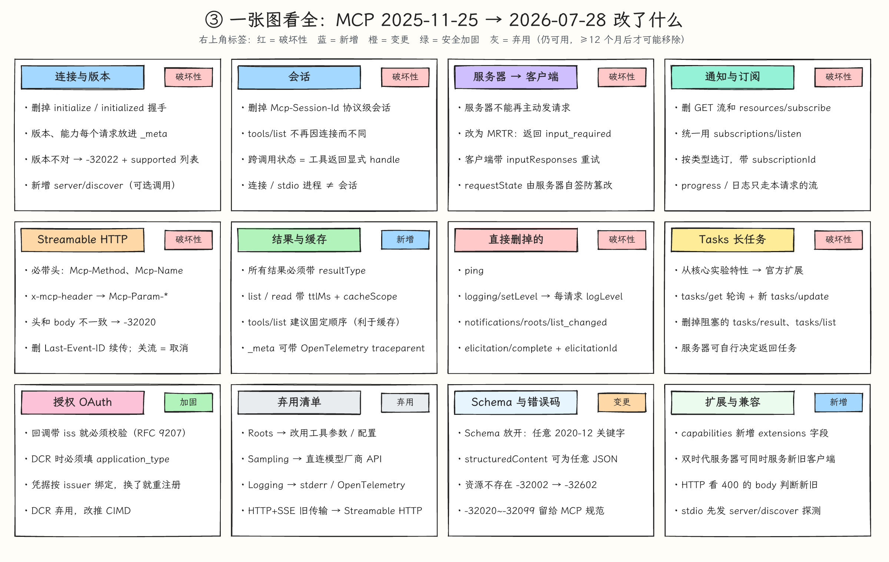
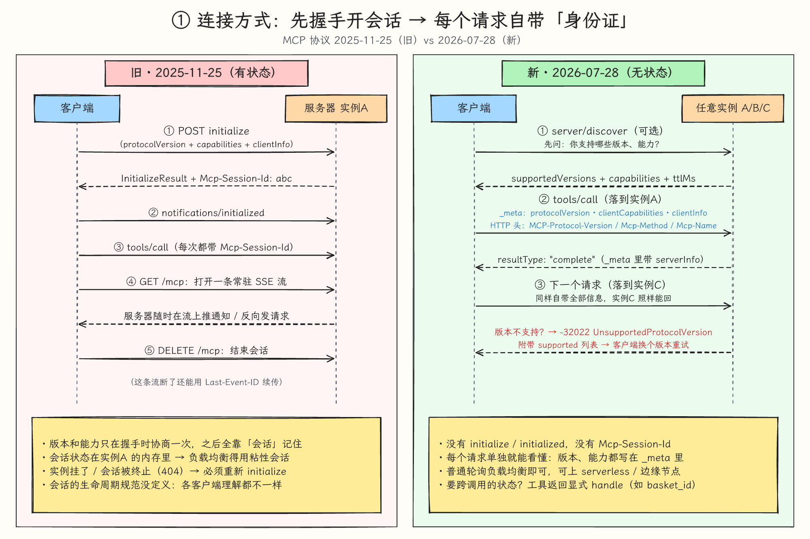
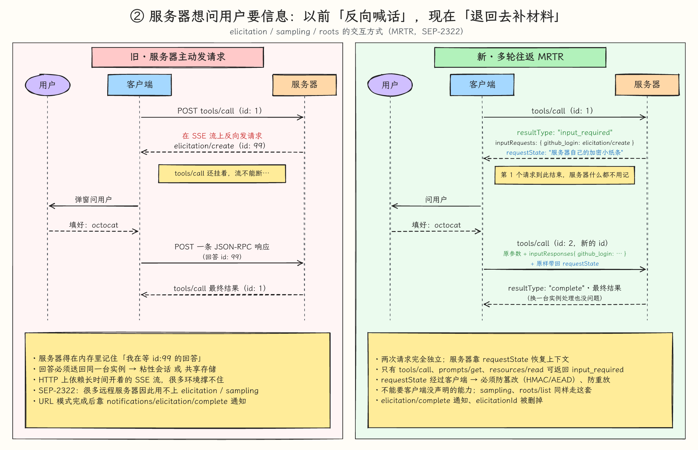
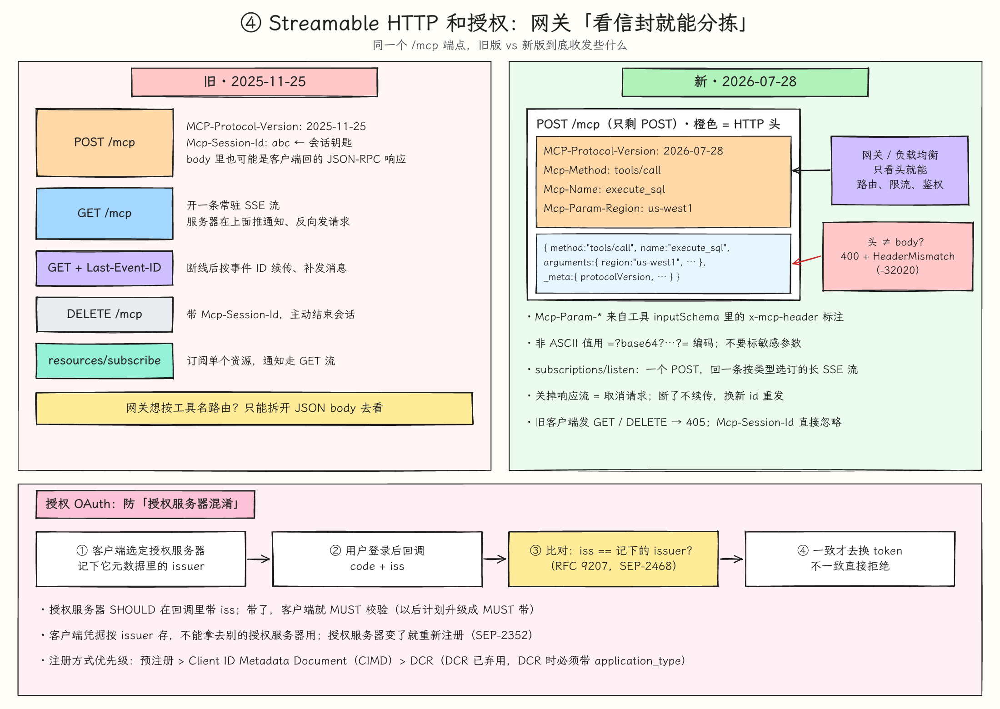
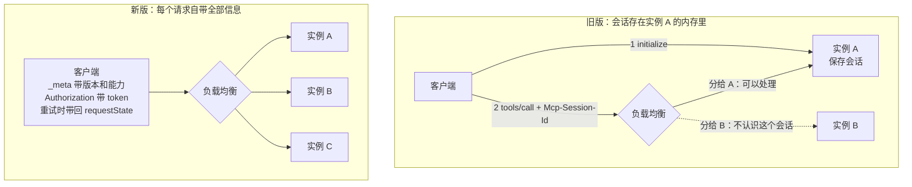

# MCP 2026-07-28 规范变更

## 摘要

MCP 2026-07-28 版把协议从「先握手、建立会话、双方都能主动发请求」改成「没有会话，每个请求自带协议版本和能力，只有客户端发请求、服务器回响应」。HTTP 层同时规定了必带的请求头，让网关只看请求头就能路由、限流和鉴权。本页逐项对照上一版 2025-11-25，说明每处改了什么、为什么改、对实现有什么影响。MCP 的整体演进见 [[wiki/topics/ai/mcp|MCP]]，授权流程见 [[wiki/topics/ai/mcp-authorization|MCP 授权流程]]。

## 版本号：没有「MCP 2.0」

- MCP 协议的版本号是日期（`YYYY-MM-DD`），表示最后一次做不兼容改动的日期，没有 1.0、2.0 这种编号。
- 当前版本是 2026-07-28，Anthropic 的发布文章称它是第五个规范版本；上一版是 2025-11-25。
- 「2.0」来自 SDK 的版本号，例如官方 C# SDK v2.0 实现的是 2026-07-28 规范。JSON-RPC 消息里的 `"jsonrpc": "2.0"` 是 JSON-RPC 自己的版本号，和 MCP 无关。
- 规范把 2025-11-25 及更早、需要 `initialize` 握手的版本叫 Legacy，把 2026-07-28 起每个请求自带元数据的版本叫 Modern，同时支持两种的实现叫 Dual-era。

下文的「旧版」指 2025-11-25，「新版」指 2026-07-28。

## 关键变化

### 1. 取消握手，每个请求自带版本和能力（SEP-2575）

旧版的第一步必须是 `initialize`：客户端发协议版本、能力和 `clientInfo`，服务器回自己的版本、能力、`serverInfo` 和 `instructions`，客户端再发 `notifications/initialized`。版本只在握手时协商一次，协商好的能力在整个会话里有效。

新版删除了 `initialize` 和 `notifications/initialized`：

- 每个请求的 `params._meta` 必须带 `io.modelcontextprotocol/protocolVersion` 和 `io.modelcontextprotocol/clientCapabilities`，建议带 `io.modelcontextprotocol/clientInfo`。缺必填项返回 `-32602`，HTTP 上是 400。
- 服务器建议在每个结果的 `_meta` 里带 `io.modelcontextprotocol/serverInfo`。`clientInfo` 和 `serverInfo` 都是自报的，只能用于展示和调试，不能用于安全判断。
- 版本不支持时返回 `UnsupportedProtocolVersionError`（`-32022`），`data.supported` 列出可用版本，客户端选一个重试。需要某项客户端能力而客户端没有声明时，返回 `MissingRequiredClientCapabilityError`（`-32021`）。
- 新增 `server/discover`：服务器必须实现，客户端可以不调用。它返回 `supportedVersions`、`capabilities`、`serverInfo`、`instructions` 和缓存提示，可用于一次拿到服务器信息，也可用于在 stdio 上探测对方是新版还是旧版。
- 规范新增「Statelessness」一节：服务器不能依赖同一连接上之前的请求确定上下文；一条打开的连接（包括 stdio 进程）不等于会话；跨请求的状态必须通过客户端每次都传的显式 ID 引用。

### 2. 删除 `Mcp-Session-Id`，跨调用状态改用显式 handle（SEP-2567）

旧版 Streamable HTTP 服务器可以在 `initialize` 时下发 `Mcp-Session-Id`，客户端之后每个请求都要带。服务器终止会话后对这个 ID 回 404，客户端只能重新 `initialize`；客户端也可以用 HTTP DELETE 结束会话。`tools/list` 等结果可以随会话变化。

新版删除了协议层会话和 `Mcp-Session-Id`：

- `tools/list`、`resources/list`、`prompts/list` 不能因连接不同而不同，也不能作为其他请求的副作用而变化；可以因请求携带的授权不同而不同。
- 需要跨调用保存状态时，由工具返回服务器生成的 handle，之后作为普通参数传回。例如 `create_basket()` 返回 `basket_id`，再调用 `add_item(basket_id, …)`。这是工具设计方式，不是新的协议结构。

SEP-2567 给出的理由是：会话在规范里存在一年多，含义始终不统一，有的客户端每次工具调用开一个新会话，有的整个应用只用一个，几乎没有客户端恢复会话。服务器作者无法知道会话的生命周期，用它保存应用状态并不可靠；列表结果随会话变化，也无法跨会话缓存。依赖会话 ID 的服务器（例如把浏览器实例挂在会话上）需要改成显式 handle，官方博客也承认这部分有迁移成本。

### 3. 服务器不再主动发请求，改为多轮往返 MRTR（SEP-2322）

旧版服务器处理请求时，可以在 SSE 流上主动向客户端发 `elicitation/create`（询问用户）、`sampling/createMessage`（借用客户端的模型）或 `roots/list`，客户端再 POST 一条 JSON-RPC 响应回来。这期间原请求一直挂着，服务器要在内存里记住在等哪个 ID 的回答。

新版规范明确这是破坏性改动，旧方式不再支持。MRTR（Multi Round-Trip Requests，多轮往返请求）的流程是：

1. 服务器发现缺信息，返回 `resultType: "input_required"`（`InputRequiredResult`）。其中 `inputRequests` 是一个 map，值只能是 `ElicitRequest`、`CreateMessageRequest` 或 `ListRootsRequest`；`requestState` 是一段不透明字符串。两者至少有一个。
2. 客户端询问用户或模型后，用新的 JSON-RPC id 重发原请求，带上 `inputResponses`，并把 `requestState` 原样带回。
3. 服务器根据重发请求里的信息完成处理。重发请求是独立的，可以由另一台实例处理。

约束：

- 只有 `tools/call`、`prompts/get`、`resources/read` 可以返回 `input_required`。
- 服务器不能索要客户端没有声明的能力，也不能假设客户端一定会重试；客户端没有补全时，服务器应再次返回 `input_required`，而不是报错。
- `requestState` 要按攻击者可控的输入处理。只要它影响授权、资源访问或业务逻辑，就必须做完整性保护（HMAC/AEAD），校验失败就拒绝；建议在其中放身份主体、短 TTL 和原请求摘要来防重放。要求「只能用一次」的场景，必须在服务器端另行保证。
- URL 模式 elicitation 的 `notifications/elicitation/complete`、`elicitationId` 和 `URLElicitationRequiredError`（`-32042`）一并删除。客户端靠重试原请求得知外部交互是否完成，需要关联时由服务器把标识编进 `requestState`。
- HTTP 和 stdio 上，服务器都不能再发 JSON-RPC 请求，客户端也不能再发 JSON-RPC 响应。

SEP-2322 的理由：不再需要跨实例共享存储或有状态的负载均衡，也减少对长 SSE 流的依赖；很多远程服务器正是因为 SSE 流和服务器端状态难以运维，才一直没有使用 elicitation、sampling 和 roots。

### 4. 通知统一走 `subscriptions/listen`（SEP-2575）

旧版客户端可以 GET MCP 端点打开一条常驻 SSE 流接收服务器消息，资源订阅用 `resources/subscribe` / `resources/unsubscribe`，list_changed 类通知跟着会话走。

新版删除了 GET 端点、`resources/subscribe` 和 `resources/unsubscribe`，改用 `subscriptions/listen`：

- 它是一个长时间保持的 POST 请求，响应就是通知流。客户端按类型选择订阅：`toolsListChanged`、`promptsListChanged`、`resourcesListChanged`，以及 `resourceSubscriptions`（一组资源 URI）。
- 服务器必须先发 `notifications/subscriptions/acknowledged` 说明实际接受了哪些类型，之后每条通知在 `_meta` 里带 `io.modelcontextprotocol/subscriptionId`，值是 listen 请求的 JSON-RPC id。一个客户端可以同时打开多个订阅。
- 服务器主动结束订阅时，建议先回成功响应再关流，让客户端区分正常结束和意外断开。stdio 重连后必须重新发 listen。
- `notifications/progress`、`notifications/message` 这类针对单个请求的通知，只在该请求自己的响应流上发，不走 listen 流。

### 5. Streamable HTTP：只剩 POST，必带请求头（SEP-2243、SEP-2575）

旧版端点同时支持 POST 和 GET，POST 的 body 可以是请求、通知或响应，有 `Mcp-Session-Id` 和 DELETE，服务器可以在 SSE 流上发请求，流可以用 `Last-Event-ID` 断点续传。

新版：

- 只有 POST。每条消息单独一个 POST，body 只能是请求或通知。服务器对每个请求回单个 JSON，或一条只属于这个请求的 SSE 流（中间可以有该请求的进度和日志通知，最后是最终响应）。
- 每个请求必须带 `MCP-Protocol-Version`，并且和 `_meta` 里的版本一致；所有请求都要带 `Mcp-Method`；`tools/call`、`resources/read`、`prompts/get` 还要带 `Mcp-Name`（工具名、prompt 名或资源 URI）。
- 工具可以在 `inputSchema` 的参数上标注 `x-mcp-header`，客户端必须把该参数的值放进 `Mcp-Param-{名字}` 请求头。只能标在 integer、string、boolean 参数上；非 ASCII 或有歧义的值用 `=?base64?…?=` 编码；标注不合法的工具，客户端要从列表中剔除。中间设备能看到请求头，所以不建议标注个人信息等敏感参数。
- 请求头与 body 不一致、缺请求头或请求头含非法字符，都返回 400 和 `HeaderMismatch`（`-32020`），防止网关按请求头路由而服务器按 body 执行。不支持的方法返回 404 和 `-32601`。
- `Last-Event-ID` 和 SSE 事件 ID 被删除。响应流断开后这个请求就算丢失，客户端用新的请求 ID 重发。关闭响应流就等于取消请求，HTTP 上不再需要 `notifications/cancelled`，stdio 上仍要发送。
- 只支持新版的服务器收到旧客户端流量时，GET 和 DELETE 回 405，忽略 `Mcp-Session-Id` 和 `Last-Event-ID`。
- 长流建议定期发 SSE 注释行（`:`）保持连接，并带 `X-Accel-Buffering: no`。

SEP-2243 的理由：以前路由信息都在 JSON body 里，负载均衡、网关、WAF 和限流器必须解析 body 才能拿到；现在可以直接按请求头路由、计量和鉴权。

stdio 上所有元数据都在消息体里。服务器不能往 stdout 写 JSON-RPC 请求；进程意外退出后客户端应重启它，进行中的请求直接重发，订阅重新建立。规范还说明，客户端不应把 stdio 进程的生命周期当作某次对话的边界。

### 6. 结果类型与缓存提示（SEP-2322、SEP-2549）

- 所有结果都必须带 `resultType`：`"complete"` 是普通结果，`"input_required"` 是 MRTR 的中间结果，扩展可以新增取值（Tasks 增加了 `"task"`）。旧服务器的结果没有这个字段时按 `"complete"` 处理。
- `server/discover`、`tools/list`、`prompts/list`、`resources/list`、`resources/templates/list`、`resources/read` 的完整结果必须带 `ttlMs`（保鲜时长，类似 `max-age`）和 `cacheScope`（`public` 或 `private`，`private` 缓存不能跨授权上下文共享）。
- TTL 只是保鲜提示，不是轮询间隔，需要轮询时必须加抖动和退避。收到对应的 list_changed 通知时缓存立即失效。`input_required` 结果和带 `inputResponses` 的重试结果不能缓存，分页结果每页单独缓存。
- `tools/list` 建议按固定顺序返回，便于客户端缓存，也能提高 LLM prompt cache 的命中率。

### 7. Tasks 移出核心协议，成为官方扩展（SEP-2663）

旧版 Tasks 标为实验性：请求方（客户端或服务器）在请求上加 `task` 参数把它变成任务，需要先声明 `tasks.requests.tools.call` 这类方法级能力，工具上还有 `execution.taskSupport`；用 `tasks/result` 阻塞等待结果，另有 `tasks/list`，并支持客户端托管的 elicitation / sampling 任务。

新版移到官方扩展 `io.modelcontextprotocol/tasks`：

- 客户端在每个请求的 `clientCapabilities.extensions` 里声明一次即可。
- 由服务器决定某个请求是否变成任务：返回 `resultType: "task"`（`CreateTaskResult`），含 `taskId`、状态、`ttlMs`、`pollIntervalMs`。服务器必须先持久化任务再返回响应。
- 客户端用 `tasks/get` 轮询（只读、幂等）。任务进入 `input_required` 状态时，`tasks/get` 给出 `inputRequests`，客户端用新增的 `tasks/update` 提交 `inputResponses`。`tasks/cancel` 是协作式取消，服务器不保证一定停下。
- 删除阻塞的 `tasks/result`、`tasks/list` 和客户端托管的任务。需要推送时，可通过 `subscriptions/listen` 订阅 `notifications/tasks`。
- HTTP 上 `tasks/*` 请求的 `Mcp-Name` 填 `taskId`，方便路由到持有该任务的实例。

SEP-2663 的理由：客户端必须先调用 `tools/list` 才知道哪个工具支持任务；`tasks/result` 迫使双方维持长连接；没有会话后 `tasks/list` 找不到合理的范围；服务器不能主动发请求后，客户端托管任务也无法表达。

### 8. 授权加固

新版在 OAuth 流程中增加了 RFC 9207 `iss` 校验（SEP-2468）、DCR 必须声明 `application_type`（SEP-837）、客户端凭据按 issuer 绑定（SEP-2352），并弃用 Dynamic Client Registration（PR #2858）。完整流程和每项加固防的攻击见 [[wiki/topics/ai/mcp-authorization|MCP 授权流程]]。

### 9. 删除项

以下内容在新版中被删除，不是弃用：

| 删除项 | 替代方式 |
| --- | --- |
| `initialize` / `notifications/initialized` | 每个请求的 `_meta`，以及可选的 `server/discover` |
| `Mcp-Session-Id`、HTTP DELETE | 工具返回的显式 handle |
| HTTP GET 流、`resources/subscribe` / `unsubscribe` | `subscriptions/listen` |
| `Last-Event-ID` 续传与消息补发 | 断开后用新 id 重发 |
| 服务器主动发请求（elicitation / sampling / roots） | MRTR `input_required` |
| `ping` | 无 |
| `logging/setLevel` | 每个请求在 `_meta` 里带 `io.modelcontextprotocol/logLevel`，没带就不能发 `notifications/message` |
| `notifications/roots/list_changed` | 无 |
| `notifications/elicitation/complete`、`elicitationId` | 重试原请求，需要时把标识放进 `requestState` |
| 核心协议里的实验性 Tasks（含 `tasks/result`、`tasks/list`） | 官方扩展 `io.modelcontextprotocol/tasks` |

### 10. 弃用项

按新的功能生命周期政策（SEP-2596），弃用的功能至少保留 12 个月，最早在 2027-07-28 之后发布的第一个版本中才可能删除。

| 功能 | 建议迁移到 |
| --- | --- |
| Roots | 通过工具参数、资源 URI 或服务器配置传目录 |
| Sampling | 直接调用模型厂商的 API |
| Logging | stdio 用 stderr，可观测性用 OpenTelemetry |
| Dynamic Client Registration | Client ID Metadata Documents |
| `includeContext: "thisServer"` / `"allServers"` | 不填，或填 `"none"` |
| 2024-11-05 的 HTTP+SSE 旧传输 | Streamable HTTP |

SEP-2577 弃用 Roots、Sampling、Logging 的理由是使用者少、与其他方案重复、实现负担重，例如 roots 只是参考信息，服务器可以不遵守。弃用期内 Roots 和 Sampling 仍可使用，但要通过 MRTR 的 `inputRequests` 发出 `ListRootsRequest` 或 `CreateMessageRequest`。

### 11. Schema、错误码与扩展机制

- `inputSchema` 和 `outputSchema` 允许任意 JSON Schema 2020-12 关键字；`structuredContent` 可以是任意 JSON 值；网络地址的 `$ref` 不能自动解析，提供解析开关时默认必须关闭；`anyOf`、`oneOf` 等组合关键字要设资源上限，防止 DoS（SEP-2106）。
- 「资源不存在」从 `-32002` 改为 `-32602`，客户端仍建议接受旧服务器的 `-32002`。`-32000` 到 `-32019` 留给各实现，`-32020` 到 `-32099` 由 MCP 规范专用。本版新错误码是 `HeaderMismatch`（`-32020`）、`MissingRequiredClientCapability`（`-32021`）、`UnsupportedProtocolVersion`（`-32022`）。
- `ClientCapabilities` 和 `ServerCapabilities` 新增 `extensions` 字段，用于协商可选扩展（如 MCP Apps `io.modelcontextprotocol/ui`、Tasks）。一方支持而另一方不支持时，支持的一方必须回退到核心协议行为或报错。
- `_meta` 保留 `traceparent`、`tracestate`、`baggage` 三个 key 用于 OpenTelemetry 链路追踪（SEP-414）。
- 两个版本都不支持 JSON-RPC 批量请求：新版 HTTP 每个 POST 只能放一条消息，stdio 一行一条消息。

### 12. 新旧共存

- 服务器可以做成 Dual-era：带新式 `_meta` 的请求按无状态方式处理，先发 `initialize` 的客户端按旧语义处理，两种可以在同一个端点上同时服务。
- 客户端在 HTTP 上先发新式请求。收到 400 时看 body：是新版能识别的 JSON-RPC 错误，说明对方是新版服务器，按它给出的版本修正后重试；body 为空或无法识别，就退回 `initialize`，必要时再退回更早的 HTTP+SSE。
- 客户端在 stdio 上先发 `server/discover`，收到无法识别的错误或超时就退回 `initialize`。探测结果按服务器进程（stdio）或 origin（HTTP）缓存。
- 新版客户端连旧版服务器会失败（建议 stdio 上先 discover，让失败更明确）；旧版客户端连只支持新版的服务器也会失败，且旧客户端无法自动升级，所以只支持新版的服务器拒绝 `initialize` 时，应在错误里写明支持的版本。只要有一方是 Dual-era 就能互通。

## 为什么新版可以直接用普通负载均衡

旧版的问题是协议状态存在处理握手的那台服务器的内存里：

- `initialize` 协商出的版本和能力、`Mcp-Session-Id` 对应的会话，都只有握手的那台实例知道。负载均衡把下一个请求分给另一台实例时，那台实例不认识这个会话。
- 服务器反向发 elicitation 后，要在内存里记住「在等哪个 ID 的回答」，客户端的回答也必须回到同一台实例。
- GET 常驻流和 `Last-Event-ID` 续传，同样要求消息回到持有这条流的实例。

所以旧版多实例部署只能用粘性会话或共享会话存储；SEP-2575 指出实例一挂会话状态就丢失。[[wiki/syntheses/ai/mcp-sse-multi-instance-routing|MCP SSE 多实例路由策略]] 记录的就是这类方案。

新版让每个请求自带处理所需的全部信息，任意实例都能独立处理：

具体由这几项保证：

1. **版本和能力**：每个请求的 `_meta` 都带，服务器不需要记住握手结果。
2. **跨调用的业务状态**：由工具返回 handle（如 `basket_id`），客户端在后续参数中传回；实际数据由服务器存在各实例都能访问的位置。
3. **中途向用户要输入**：服务器把进度写进带完整性保护的 `requestState` 交给客户端，客户端重试时原样带回，任意实例都能验证后继续处理。
4. **身份**：MCP 授权规范要求每个 HTTP 请求都带 `Authorization` 头，每台实例都能独立验证 token。
5. **路由**：`Mcp-Method`、`Mcp-Name` 等请求头让网关不解析 body 就能路由、限流和鉴权；Tasks 的 `Mcp-Name` 填 `taskId`，需要时可以把请求路由到持有该任务的实例。

协议无状态不等于应用无状态。handle 指向的数据、Tasks 持久化的任务，仍要放在多实例共享的存储里；变化在于这些状态由应用显式管理，而不是藏在传输层会话里。

## 对实现的影响

- **服务器**：可以放在普通轮询负载均衡后面，也可以部署到 serverless 或边缘节点；所有「握手时记下来」的逻辑要改掉；依赖 `Mcp-Session-Id` 的状态改成显式 handle；需要用户确认的工具改写成「先返回缺什么，等客户端重试」。
- **客户端**：每个请求组装 `_meta` 和对应 HTTP 请求头；实现「收到 `input_required`，收集输入，重试」的循环；原来依赖 GET 流的通知改用 `subscriptions/listen`。
- **网关**：可以按 `Mcp-Method`、`Mcp-Name` 路由和计量，但要注意 `Mcp-Param-*` 会暴露参数值。

## 相关页面

- [[wiki/topics/ai/mcp|MCP]]
- [[wiki/topics/ai/mcp-authorization|MCP 授权流程]]
- [[wiki/syntheses/ai/mcp-sse-multi-instance-routing|MCP SSE 多实例路由策略]]
- [[wiki/topics/ai/mcp-client|MCP Client]]

## 来源指针

- [MCP 2026-07-28 变更日志](https://modelcontextprotocol.io/specification/2026-07-28/changelog)
- [基础协议：`_meta`、Statelessness、错误码](https://modelcontextprotocol.io/specification/2026-07-28/basic/index.md)
- [版本与兼容](https://modelcontextprotocol.io/specification/2026-07-28/basic/versioning.md)、[版本号说明](https://modelcontextprotocol.io/docs/2026-07-28/learn/versioning.md)
- [MRTR](https://modelcontextprotocol.io/specification/2026-07-28/basic/patterns/mrtr.md)、[订阅](https://modelcontextprotocol.io/specification/2026-07-28/basic/patterns/subscriptions.md)、[取消](https://modelcontextprotocol.io/specification/2026-07-28/basic/patterns/cancellation.md)
- [Streamable HTTP](https://modelcontextprotocol.io/specification/2026-07-28/basic/transports/streamable-http.md)、[stdio](https://modelcontextprotocol.io/specification/2026-07-28/basic/transports/stdio.md)
- [server/discover](https://modelcontextprotocol.io/specification/2026-07-28/server/discover.md)、[工具](https://modelcontextprotocol.io/specification/2026-07-28/server/tools.md)、[缓存](https://modelcontextprotocol.io/specification/2026-07-28/server/utilities/caching.md)、[日志](https://modelcontextprotocol.io/specification/2026-07-28/server/utilities/logging.md)
- [弃用清单](https://modelcontextprotocol.io/specification/2026-07-28/deprecated.md)
- 2025-11-25 对照：[生命周期](https://modelcontextprotocol.io/specification/2025-11-25/basic/lifecycle.md)、[传输](https://modelcontextprotocol.io/specification/2025-11-25/basic/transports.md)、[Tasks](https://modelcontextprotocol.io/specification/2025-11-25/basic/utilities/tasks.md)、[Elicitation](https://modelcontextprotocol.io/specification/2025-11-25/client/elicitation.md)
- SEP：[2575 无状态化](https://modelcontextprotocol.io/seps/2575-stateless-mcp.md)、[2567 去掉会话](https://modelcontextprotocol.io/seps/2567-sessionless-mcp.md)、[2322 MRTR](https://modelcontextprotocol.io/seps/2322-MRTR.md)、[2243 HTTP 头](https://modelcontextprotocol.io/seps/2243-http-standardization.md)、[2549 列表 TTL](https://modelcontextprotocol.io/seps/2549-TTL-for-list-results.md)、[2577 弃用 Roots / Sampling / Logging](https://modelcontextprotocol.io/seps/2577-deprecate-roots-sampling-and-logging.md)、[2663 Tasks 扩展](https://modelcontextprotocol.io/seps/2663-tasks-extension.md)
- 发布文章：[官方博客](https://blog.modelcontextprotocol.io/posts/2026-07-28/)、[Anthropic](https://claude.com/resources/articles/bringing-mcp-2026-07-28-to-claude)、[C# SDK v2.0](https://devblogs.microsoft.com/dotnet/announcing-v20-of-the-official-mcp-csharp-sdk/)
- `raw/sources/mcp.md`：本次对照的阅读记录与配图核对记录
- `raw/assets/mcp-2026-07-28-overview.png`、`raw/assets/mcp-2026-07-28-lifecycle.png`、`raw/assets/mcp-2026-07-28-mrtr.png`、`raw/assets/mcp-2026-07-28-http-auth.png`：按本页内容用 roughjs 绘制的手绘风格示意图，不是 MCP 官方素材，细节以正文和规范为准
