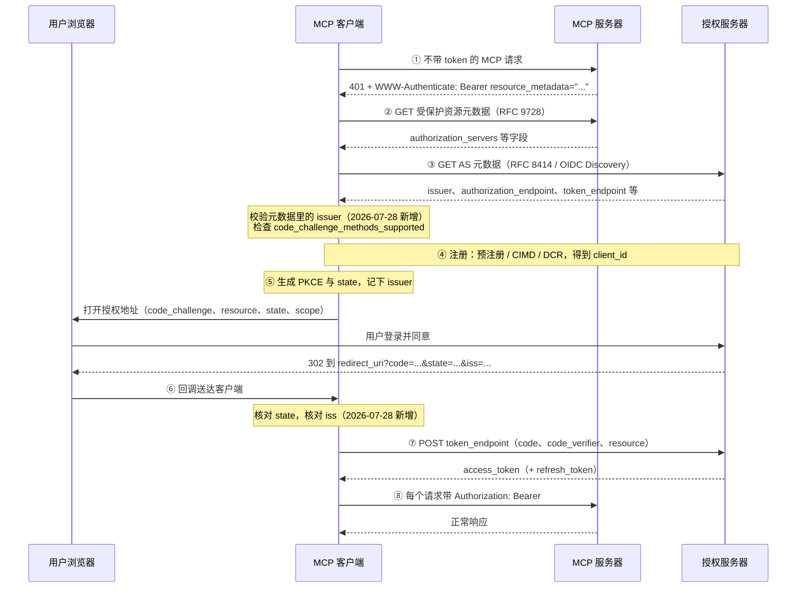

# MCP 授权流程

## 摘要

MCP 的 HTTP 传输用 OAuth 授权：MCP 服务器是 OAuth 的资源服务器，只校验 token，不发 token；发 token 的是授权服务器（authorization server，下称 AS）。MCP 客户端第一次访问时并不知道该去哪个 AS 登录，所以规范规定了一条从 401 开始的发现链：先读 MCP 服务器的受保护资源元数据，找到 AS，再读 AS 元数据，注册客户端，然后走授权码 + PKCE 拿 token。本页按步骤说明这条链，解释回调里 `state` 和 `iss` 分别防什么，以及 2026-07-28 版本在授权上加了哪些检查。通用 OAuth 概念见 [[wiki/topics/architecture/oauth|OAuth]]，协议其他变化见 [[wiki/topics/ai/mcp-2026-07-28|MCP 2026-07-28 规范变更]]。

## 角色

| 角色 | 在 MCP 里是谁 | 做什么 |
| --- | --- | --- |
| 用户 | 使用 Claude、IDE 等 Host 的人 | 在浏览器里登录 AS 并同意授权 |
| MCP 客户端 | Host 里连接某个 MCP 服务器的组件 | 发现 AS、注册、发起授权、换 token、每个请求带 token |
| MCP 服务器 | OAuth 资源服务器 | 返回 401 指路，校验 token 的受众是否是自己 |
| 授权服务器 | 可以和 MCP 服务器部署在一起，也可以是独立的身份系统 | 让用户登录、发 code、在 token 端点发 token |

AS 的实现不在 MCP 规范范围内，所以现成的 OAuth / OIDC 身份系统可以直接充当 AS。

## 完整流程

下图按 2026-07-28 授权规范的时序图整理。除标注「2026-07-28 新增」的检查外，步骤与 2025-11-25 版相同。



### ① 被 401 拒绝，拿到元数据地址

客户端不带 token 访问时，MCP 服务器返回 `401 Unauthorized`，并在 `WWW-Authenticate` 头的 `resource_metadata` 参数里给出受保护资源元数据的地址（RFC 9728 §5.1）。服务器还应在其中带 `scope`，说明访问需要哪些权限：

```http
HTTP/1.1 401 Unauthorized
WWW-Authenticate: Bearer resource_metadata="https://mcp.example.com/.well-known/oauth-protected-resource",
                         scope="files:read"
```

没有这个头时，客户端按顺序自己拼 well-known 地址：先试 MCP 端点路径对应的地址（`https://example.com/public/mcp` 对应 `https://example.com/.well-known/oauth-protected-resource/public/mcp`），再试根路径 `https://example.com/.well-known/oauth-protected-resource`。

### ② 读受保护资源元数据（RFC 9728）

MCP 服务器必须实现 RFC 9728 受保护资源元数据，其中 `authorization_servers` 列出给它发 token 的 AS。列出多个 AS 时，由客户端选择用哪一个；每个 AS 都是独立的，客户端必须分别保存各 AS 的注册信息和 token，不能假设一个 AS 的凭据能在另一个 AS 使用。

### ③ 读授权服务器元数据（RFC 8414 / OIDC Discovery）

AS 至少提供 RFC 8414 授权服务器元数据或 OpenID Connect Discovery 1.0 之一，客户端两种都要支持。对 `https://auth.example.com` 这类没有路径的 issuer，依次尝试：

1. `https://auth.example.com/.well-known/oauth-authorization-server`
2. `https://auth.example.com/.well-known/openid-configuration`

issuer 带路径时（如 `https://auth.example.com/tenant1`），按规范列出的三种路径插入或追加方式依次尝试。

元数据里最常用的字段：

```json
{
  "issuer": "https://auth.example.com",
  "authorization_endpoint": "https://auth.example.com/authorize",
  "token_endpoint": "https://auth.example.com/token",
  "code_challenge_methods_supported": ["S256"],
  "client_id_metadata_document_supported": true,
  "authorization_response_iss_parameter_supported": true
}
```

这里的地址都是示例，实际值以各 AS 的元数据为准。`authorization_endpoint` 是用户登录和同意的页面，`token_endpoint` 是用 code 换 token 的接口。拿到元数据后有两项检查：

- 2026-07-28 授权规范要求，元数据里的 `issuer` 必须和用来拼 well-known 地址的 issuer 完全一致，否则不能使用。例如从 `https://attacker.example/.well-known/oauth-authorization-server` 取回的文档写着 `"issuer": "https://honest.example"`，必须拒绝。2025-11-25 版授权规范中没有这条要求。
- 元数据里没有 `code_challenge_methods_supported`，就视为 AS 不支持 PKCE，客户端必须停止授权。

### ④ 注册客户端，拿到 `client_id`

AS 需要知道发起授权的是哪个应用。规范给出三种方式，客户端按以下顺序选择：

1. **预注册**：客户端事先在这个 AS 登记过，直接用写死的 `client_id`（及凭据），或由用户在界面里填入自己注册的客户端信息。
2. **Client ID Metadata Documents（CIMD，客户端 ID 元数据文档）**：AS 元数据里 `client_id_metadata_document_supported` 为真时使用。客户端把一份 JSON 元数据放在自己的 HTTPS 地址上，直接用这个地址当 `client_id`，文档里至少有 `client_id`、`client_name`、`redirect_uris`，且 `client_id` 必须和文档地址完全一致。AS 遇到 URL 形式的 `client_id` 时去取这份文档，并用其中的 `redirect_uris` 校验授权请求。这适合客户端和 AS 事先没有任何关系的场景。
3. **Dynamic Client Registration（DCR，RFC 7591）**：客户端调用 AS 的 `registration_endpoint` 现场注册，领取 `client_id`。2026-07-28 起标为弃用，只为兼容不支持 CIMD 的 AS 保留。

2025-11-25 版已经是这个优先顺序（DCR 作为后备），2026-07-28 版把 DCR 正式标为弃用。

### ⑤ 打开浏览器发起授权

客户端在跳转前生成并记下几样东西，然后让浏览器打开 `authorization_endpoint`：

- **PKCE**（RFC 7636）：客户端生成随机的 `code_verifier`，授权请求只带它的哈希 `code_challenge`，能用 `S256` 时必须用 `S256`。换 token 时要出示原始 `code_verifier`，所以 code 在跳转途中被截走也无法单独兑换。MCP 规定客户端必须实现 PKCE。
- **`resource`**（RFC 8707）：写 MCP 服务器的规范 URI（如 `https://mcp.example.com`），授权请求和 token 请求都必须带，不管 AS 是否支持。AS 据此把 token 的受众限定为这台 MCP 服务器。
- **`state`**：随机值，回调时核对，见下文「state 与 iss 分别防什么」。规范建议客户端使用并核对 `state`。
- **`scope`**：优先用 401 里 `WWW-Authenticate` 给出的 `scope`。
- **记下 issuer**：2026-07-28 起，客户端必须把所选 AS 已校验元数据里的 `issuer`，和 PKCE `code_verifier`（以及 `state`）存在同一条按请求区分的记录里。

### ⑥ 回调到 `redirect_uri`

用户登录并同意后，AS 把浏览器重定向到客户端登记的 `redirect_uri`，code 拼在地址后面：

```text
http://localhost:3000/callback?code=一次性code&state=随机值&iss=https://auth.example.com
```

- 桌面端和 CLI 通常在本机临时监听 `localhost` 端口接收回调，Web 客户端用自己站点上的回调页面。
- 回调地址必须是 `localhost` 或 HTTPS，并且事先登记在 AS；AS 必须按登记值精确匹配，防止 code 被送到别的地址。
- 客户端先核对 `state`，再核对 `iss`，都通过后才把 code 发往 token 端点。

### ⑦ 向 token 端点换 token

换 token 是 RFC 6749 §4.1.3 规定的表单 POST，PKCE 增加 `code_verifier`（RFC 7636 §4.5），MCP 要求再带一次 `resource`：

```http
POST /token HTTP/1.1
Host: auth.example.com
Content-Type: application/x-www-form-urlencoded

grant_type=authorization_code
&code=一次性code
&redirect_uri=http://localhost:3000/callback
&client_id=https://app.example.com/oauth/client-metadata.json
&code_verifier=原始随机值
&resource=https://mcp.example.com
```

成功时返回（RFC 6749 §5.1）：

```json
{
  "access_token": "eyJ...",
  "token_type": "Bearer",
  "expires_in": 3600,
  "refresh_token": "def..."
}
```

桌面端、CLI 这类无法安全保存密钥的公开客户端只带 `client_id`，靠 PKCE 保护兑换；CIMD 客户端也可以用 `private_key_jwt` 在 token 端点做客户端认证。

### ⑧ 带 token 访问，过期后刷新

- 每个 HTTP 请求都必须带 `Authorization: Bearer <access-token>`，token 不能放在 URL 查询参数里。
- MCP 服务器必须确认 token 是专门签发给自己的（受众校验，RFC 8707），不能接受或转发其他 token；token 无效或过期回 401，权限不足回 403 并在 `WWW-Authenticate` 里带 `error="insufficient_scope"`。
- 客户端也只能把这台 MCP 服务器的 AS 签发的 token 发给它。
- access token 过期后，客户端向同一个 `token_endpoint` POST `grant_type=refresh_token` 和 `refresh_token` 换新 token（RFC 6749 §6）。AS 不一定签发 refresh token，客户端不能假设一定有；拿到的 refresh token 在传输和存储中都要保密。

## state 与 iss 分别防什么

两者都是「跳转前记下本次登录的信息，回调时核对」，但核对的问题不同：`state` 回答「这个回调是不是我自己发起的那次登录」，`iss` 回答「这个 code 是不是我要找的那个 AS 签发的」。

### state：防伪造回调（CSRF）

攻击方式：攻击者用自己的账号走一遍授权，拿到一个 code 但不兑换，然后诱导用户打开 `http://localhost:3000/callback?code=攻击者的code`。客户端如果不做检查，就会兑换这个 code，用户实际登录的是攻击者的账号，之后上传的数据都进了攻击者的账号。

防御方式：客户端每次发起登录时生成随机 `state` 存在本地，AS 回调时原样带回。伪造链接里要么没有 `state`，要么是攻击者自己那次的 `state`，和本地记录对不上，客户端丢弃这个回调。MCP 安全章节要求丢弃不含 `state` 或 `state` 不一致的结果。

### iss：防授权服务器混淆（mix-up）

前提：客户端对接多个 AS，其中一个由攻击者控制。MCP 里每台服务器都可以通过受保护资源元数据指定自己的 AS，攻击者可以搭一台 MCP 服务器并指向自己的 AS。所有 AS 的回调都落到同一个 `redirect_uri` 时，客户端光看回调地址分不清 code 是谁签发的。RFC 9700 §4.4.1 描述的攻击过程：

1. 用户在客户端里选择攻击者的 AS（A-AS）。客户端记下「本次选的是 A-AS」，生成 `state=S`，把浏览器重定向到 A-AS 的授权地址。
2. A-AS 不让用户登录，而是立即把浏览器重定向到正规 AS（H-AS）的授权地址，把 `client_id` 换成客户端在 H-AS 的 `client_id`，`state=S` 原样带着。
3. 用户看到熟悉的 H-AS 登录页并同意。H-AS 签发 code，回调 `redirect_uri?code=H-AS的code&state=S`。
4. 客户端用 `S` 查到「本次选的是 A-AS」，于是把 H-AS 的 code 发到 A-AS 的 token 端点。攻击者拿到了 code，公开客户端的场景下可以直接兑换。

`state` 在这个过程中没被篡改，它确实属于用户自己发起的那次登录，所以核对能通过；`state` 里也没有任何信息能说明 code 是谁签发的。RFC 9207 为此在授权响应中增加 `iss` 参数：回调里写着 `iss=H-AS`，客户端记录里是 A-AS，对不上就中止，不把 code 交出去。

2026-07-28 MCP 规范规定，客户端在把 code 发往任何 token 端点之前，按下表处理（比较时用简单字符串比较，不做大小写、默认端口、末尾斜杠或百分号编码的规范化）：

| AS 元数据 `authorization_response_iss_parameter_supported` | 回调里有 `iss` | 客户端动作 |
| --- | --- | --- |
| `true` | 有 | 和记下的 issuer 比较 |
| `true` | 没有 | 拒绝 |
| `false` 或未声明 | 有 | 和记下的 issuer 比较 |
| `false` 或未声明 | 没有 | 继续 |

错误响应同样适用：`iss` 不一致时，客户端不能处理或展示其中的 `error`、`error_description`、`error_uri`。规范目前要求 AS「应该」带 `iss`，并说明以后计划升级为「必须」。

另一种防法是 RFC 9700 §4.4.2.2 的「每个 AS 用不同的回调地址」：根据 code 落在哪个地址判断签发方，例如 `/callback/a`、`/callback/b`。RFC 9700 指出它有三个限制：客户端只注册一次就用于多个 AS 的场景无法使用；它和客户端注册绑得很紧，难以自动部署；攻击者可能用分配给自己 AS 的回调地址在正规 AS 注册一个新客户端来绕过。因此 RFC 9700 建议只在没有其他办法时使用，优先用 issuer 校验。

## 并行登录不需要串行

`state` 和 `iss` 都要求核对「本次登录」的记录，但这不意味着一次只能进行一个登录。2026-07-28 规范要求把 issuer 和 PKCE `code_verifier`、`state` 存在同一条按请求区分的记录里，所以可以每次登录各存一条，用 `state` 当键：

```text
state=8f3a…  →  { issuer: A, code_verifier: v1, redirect_uri, 发起时间 }
state=c71e…  →  { issuer: B, code_verifier: v2, redirect_uri, 发起时间 }
```

回调到达时，客户端先用地址里的 `state` 找到对应记录，再用记录里的 issuer 核对 `iss`，最后用记录里的 `code_verifier` 去这个 AS 的 token 端点兑换。几个登录同时进行也不会互相混用。需要串行的只是同一次登录内部的步骤：跳转、回调、兑换。

以下是实现建议，不是规范条文：

- 回调可能由另一个进程或另一台实例接收（例如做了负载均衡的 Web 客户端），记录要放在共享存储里，或签名后编进 `state` 随回调带回。
- 每条记录只用一次，用完删除，并设置过期时间，避免重放。

## 2026-07-28 的授权加固

| 改动 | 内容 | 防的问题 |
| --- | --- | --- |
| RFC 9207 `iss` 校验（SEP-2468） | 跳转前记下 issuer；回调带 `iss` 时必须精确比较，一致才兑换 code | mix-up：恶意 AS 骗客户端把正规 AS 的 code 交给它 |
| 元数据 `issuer` 校验 | AS 元数据的 `issuer` 必须和拼 well-known 地址用的 issuer 一致 | 从攻击者地址取回冒充正规 AS 的元数据 |
| 凭据绑定 issuer（SEP-2352） | 预注册凭据和 DCR 得到的凭据按 issuer 保存，不能拿到别的 AS 使用；资源元数据里的 AS 变了就重新注册。CIMD 的 `client_id` 是自托管的 HTTPS 地址，可以跨 AS 使用，不需要重新注册 | 把一个 AS 的客户端凭据交给另一个 AS |
| DCR 必须带 `application_type`（SEP-837） | 用 `localhost` 回调的桌面、移动和 CLI 客户端应声明 `native`，远程 Web 应用声明 `web` | OIDC 下省略时默认为 `web`，会和 `localhost` 回调冲突；官方博客认为 CLI 遇到的 redirect_uri 报错很可能与此有关 |
| 弃用 DCR（PR #2858） | 注册顺序为预注册 > CIMD > DCR，DCR 只为兼容不支持 CIMD 的 AS 保留；官方博客说明它会在以后的版本中移除 | 规范和博客没有单独写弃用理由；CIMD 让客户端在与 AS 没有事先关系时也不必现场注册 |

此外，Enterprise-Managed Authorization 和 OAuth Client Credentials 以官方扩展的形式提供，不属于核心规范。

## 使用限制

- 本页描述的是 MCP HTTP 传输的授权。规范要求使用 stdio 传输的实现不按这套流程，而是从运行环境中获取凭据。
- `iss` 校验只有在记下的 issuer 本身可信时才有效：规范说明如果预期 issuer 来自未经校验的来源，这项检查不提供保护。
- AS 目前只是「应该」在回调里带 `iss`。AS 既不带 `iss` 也没有声明支持时，客户端按表继续兑换，此时只能靠只对接一个 AS，或用不同回调地址来防 mix-up。
- 规范只规定协议层检查。哪些工具需要用户确认、token 的权限范围多大，仍由 MCP 服务器和客户端各自设计。

## 相关页面

- [[wiki/topics/architecture/oauth|OAuth]]
- [[wiki/topics/ai/mcp|MCP]]
- [[wiki/topics/ai/mcp-2026-07-28|MCP 2026-07-28 规范变更]]
- [[wiki/topics/ai/mcp-remote|mcp-remote]]

## 来源指针

- MCP 2026-07-28 授权规范：[总览与授权响应校验](https://modelcontextprotocol.io/specification/2026-07-28/basic/authorization/index.md)、[授权服务器发现](https://modelcontextprotocol.io/specification/2026-07-28/basic/authorization/authorization-server-discovery.md)、[客户端注册](https://modelcontextprotocol.io/specification/2026-07-28/basic/authorization/client-registration.md)、[安全考虑](https://modelcontextprotocol.io/specification/2026-07-28/basic/authorization/security-considerations.md)
- [MCP 2025-11-25 授权规范](https://modelcontextprotocol.io/specification/2025-11-25/basic/authorization.md)（用于对照哪些检查是新增的）
- [MCP 2026-07-28 变更日志](https://modelcontextprotocol.io/specification/2026-07-28/changelog)、[官方博客](https://blog.modelcontextprotocol.io/posts/2026-07-28/)
- RFC 6749 §4.1.3、§5.1、§6：<https://www.rfc-editor.org/rfc/rfc6749>
- RFC 7636 PKCE：<https://www.rfc-editor.org/rfc/rfc7636>
- RFC 8707 Resource Indicators：<https://www.rfc-editor.org/rfc/rfc8707>
- RFC 9207 Authorization Server Issuer Identification：<https://www.rfc-editor.org/rfc/rfc9207>
- RFC 9700 §4.4 Mix-Up Attacks：<https://www.rfc-editor.org/rfc/rfc9700>
- `raw/sources/mcp.md`：本次阅读的规范章节与核查记录
