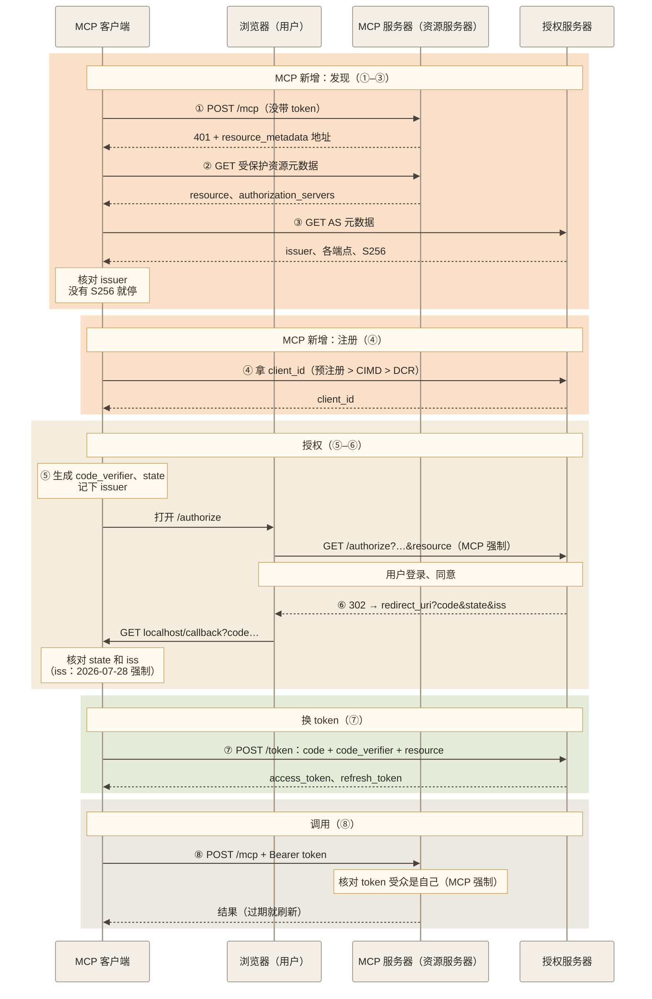

# MCP 授权流程

## 摘要

MCP 的 HTTP 传输用的就是 OAuth 授权码 + PKCE：MCP 服务器是资源服务器，只校验 token；发 token 的是授权服务器（下称 AS）。和平时接 GitHub、Google 登录的区别在于，**MCP 客户端事先不认识要连的服务器**：用户随手填一个地址，客户端既不知道该去哪个 AS 登录，也没在那个 AS 注册过。所以 MCP 在普通流程前面加了「发现」和「自动注册」，并把几个在普通 OAuth 里可选的检查改成必须。

本页只讲 MCP 和普通 OAuth 不一样的地方，外加一遍带完整 HTTP 示例的流程。各个 RFC 本身的原理（元数据怎么拼地址、DCR 和 CIMD 的区别、PKCE 防什么、mix-up 攻击过程等）见 [[wiki/topics/architecture/oauth|OAuth]]；协议其他变化见 [[wiki/topics/ai/mcp-2026-07-28|MCP 2026-07-28 规范变更]]。

## 普通 OAuth vs MCP OAuth

| | 普通 OAuth（如「用 GitHub 登录」） | MCP |
| --- | --- | --- |
| 客户端怎么知道 AS 在哪 | 开发者写进配置 | 运行时发现：401 → 受保护资源元数据（RFC 9728）→ AS 元数据（RFC 8414 / OIDC Discovery），两种 AS 元数据客户端都要支持 |
| `client_id` 从哪来 | 开发者在 AS 后台预注册 | 预注册 > CIMD > DCR，按这个顺序自动选；DCR 在 2026-07-28 标为弃用 |
| PKCE | RFC 9700 对公开客户端要求必须用，机密客户端推荐用 | 客户端必须实现；AS 元数据没有 `code_challenge_methods_supported` 就必须停止授权；能用 `S256` 必须用 `S256` |
| `resource`（RFC 8707） | 可选扩展，由客户端和 AS 自行决定是否使用 | 授权请求和 token 请求都必须带，不管 AS 是否支持 |
| token 受众 | 视部署而定 | MCP 服务器必须确认 token 是签发给自己的，不能接受或转发别人的 token |
| AS 元数据的 `issuer` 校验 | RFC 8414 §3.3 本来就要求 | 2026-07-28 明确写成客户端要求（2025-11-25 版没写） |
| `iss` 回调参数（RFC 9207） | 可选 | 2026-07-28 起：回调带 `iss` 就必须比对；AS 声明支持却没带就必须拒绝 |
| 凭据保存 | 通常只对接一个 AS | 按 issuer 分开存，不能拿到别的 AS 用（SEP-2352） |
| DCR 的 `application_type` | 可省略，默认 `web` | 必须带；用 `localhost` 回调的客户端声明 `native`（SEP-837） |
| 一个客户端对接多少 AS | 通常一个 | 很多个，而且任何人都能搭一台 MCP 服务器指向自己的 AS，所以 mix-up 是现实威胁 |
| stdio 传输 | 不适用 | 不走这套流程，从运行环境拿凭据 |

## 角色

| 角色 | 在 MCP 里是谁 | 做什么 |
| --- | --- | --- |
| 用户 | 使用 Claude、IDE 等 Host 的人 | 在浏览器里登录 AS 并同意授权 |
| MCP 客户端 | Host 里连接某个 MCP 服务器的组件 | 发现 AS、注册、发起授权、换 token、每个请求带 token |
| MCP 服务器 | OAuth 资源服务器 | 返回 401 指路，校验 token 的受众是否是自己 |
| 授权服务器 | 可以和 MCP 服务器部署在一起，也可以是独立的身份系统 | 让用户登录、发 code、在 token 端点发 token |

AS 的实现不在 MCP 规范范围内，现成的 OAuth / OIDC 身份系统可以直接充当 AS。

## 完整流程

下图按 2026-07-28 授权规范的时序图整理，编号和下文各节一致。实线是请求，虚线是响应；浅橙底色的两段（发现、注册）是 MCP 在普通授权码 + PKCE 之上新增的步骤，标着「MCP 强制」的是普通 OAuth 里可选、MCP 里必须做的检查或参数。



手绘版（同一流程，留作对比）：[oauth-mcp-discovery-sequence.png](../../../raw/assets/oauth-mcp-discovery-sequence.png)

下面用一个例子把每一步的请求和响应写全：MCP 服务器在 `https://mcp.example.com/mcp`，AS 是 `https://auth.example.com`，客户端是一个 CLI，在本机 `3000` 端口接收回调。地址和值都是示例。

### ① 被 401 拒绝，拿到元数据地址（MCP 新增：发现）

```http
POST /mcp HTTP/1.1
Host: mcp.example.com
Content-Type: application/json

{"jsonrpc":"2.0","id":1,"method":"tools/list","params":{"_meta":{...}}}
```

```http
HTTP/1.1 401 Unauthorized
WWW-Authenticate: Bearer resource_metadata="https://mcp.example.com/.well-known/oauth-protected-resource/mcp",
                         scope="files:read"
```

MCP 服务器应在 `WWW-Authenticate` 里带 `scope`。没有这个头时，客户端按顺序自己拼：先试端点路径对应的地址 `https://mcp.example.com/.well-known/oauth-protected-resource/mcp`，再试根路径 `https://mcp.example.com/.well-known/oauth-protected-resource`。

### ② 读受保护资源元数据（MCP 新增：发现）

```http
GET /.well-known/oauth-protected-resource/mcp HTTP/1.1
Host: mcp.example.com
```

```json
{
  "resource": "https://mcp.example.com/mcp",
  "authorization_servers": ["https://auth.example.com"],
  "scopes_supported": ["files:read", "files:write"],
  "bearer_methods_supported": ["header"]
}
```

MCP 服务器必须实现 RFC 9728。`resource` 要和客户端实际请求的 URL 一致（RFC 9728 §3.3，见 [[wiki/topics/architecture/oauth#第一层：受保护资源元数据（RFC 9728）|OAuth：受保护资源元数据]]）。`authorization_servers` 列出多个 AS 时由客户端选；每个 AS 独立，注册信息和 token 都要分开存。

### ③ 读 AS 元数据（MCP 新增：发现）

issuer 没有路径时依次尝试：

```http
GET /.well-known/oauth-authorization-server HTTP/1.1
Host: auth.example.com
```

```http
GET /.well-known/openid-configuration HTTP/1.1
Host: auth.example.com
```

issuer 带路径时（如 `https://auth.example.com/tenant1`），按规范列出的三种路径插入或追加方式依次尝试，拼法区别见 [[wiki/topics/architecture/oauth#第二层：授权服务器元数据（RFC 8414）|OAuth：授权服务器元数据]]。拿到的元数据：

```json
{
  "issuer": "https://auth.example.com",
  "authorization_endpoint": "https://auth.example.com/authorize",
  "token_endpoint": "https://auth.example.com/token",
  "registration_endpoint": "https://auth.example.com/register",
  "code_challenge_methods_supported": ["S256"],
  "client_id_metadata_document_supported": true,
  "authorization_response_iss_parameter_supported": true
}
```

两项 MCP 强制的检查：

- `issuer` 必须和拼 well-known 地址用的 issuer 完全一致，否则不能用。例如从 `https://attacker.example/.well-known/oauth-authorization-server` 取回的文档写着 `"issuer": "https://honest.example"`，必须拒绝。2025-11-25 版授权规范没有这条。
- 没有 `code_challenge_methods_supported`，就视为不支持 PKCE，客户端必须停止授权。

### ④ 拿到 `client_id`（MCP 新增：自动注册）

按 预注册 > CIMD > DCR 的顺序选。

**CIMD**（AS 元数据里 `client_id_metadata_document_supported` 为真时）：客户端事先在自己的 HTTPS 地址上放一份文档，直接用这个地址当 `client_id`。AS 收到授权请求后会来取：

```http
GET /oauth/client-metadata.json HTTP/1.1
Host: app.example.com
```

```json
{
  "client_id": "https://app.example.com/oauth/client-metadata.json",
  "client_name": "Example MCP CLI",
  "redirect_uris": ["http://localhost:3000/callback"],
  "grant_types": ["authorization_code", "refresh_token"],
  "token_endpoint_auth_method": "none"
}
```

文档至少有 `client_id`、`client_name`、`redirect_uris`，`client_id` 必须和文档地址完全一致。

**DCR**（AS 不支持 CIMD、有 `registration_endpoint` 时的后备，2026-07-28 起弃用）：

```http
POST /register HTTP/1.1
Host: auth.example.com
Content-Type: application/json

{
  "client_name": "Example MCP CLI",
  "redirect_uris": ["http://localhost:3000/callback"],
  "grant_types": ["authorization_code", "refresh_token"],
  "response_types": ["code"],
  "token_endpoint_auth_method": "none",
  "application_type": "native"
}
```

```http
HTTP/1.1 201 Created
Content-Type: application/json

{
  "client_id": "dcr-7f3c9a",
  "client_name": "Example MCP CLI",
  "redirect_uris": ["http://localhost:3000/callback"],
  "token_endpoint_auth_method": "none"
}
```

MCP 要求 DCR 请求带 `application_type`，用 `localhost` 回调的桌面、移动和 CLI 客户端声明 `native`，远程 Web 应用声明 `web`。DCR 拿到的凭据按 issuer 保存。三种方式各自的原理和风险见 [[wiki/topics/architecture/oauth#客户端注册：预注册、DCR、CIMD|OAuth：客户端注册]]。

### ⑤ 打开浏览器发起授权

跳转前客户端生成 PKCE 对（`code_verifier` 和它的 S256 哈希 `code_challenge`）和随机 `state`，并把所选 AS 已校验元数据里的 `issuer` 和它们存在同一条按请求区分的记录里（2026-07-28 新增要求）。然后让浏览器打开：

```text
https://auth.example.com/authorize
  ?response_type=code
  &client_id=https%3A%2F%2Fapp.example.com%2Foauth%2Fclient-metadata.json
  &redirect_uri=http%3A%2F%2Flocalhost%3A3000%2Fcallback
  &scope=files%3Aread
  &state=8f3a1c2e9b
  &code_challenge=E9Melhoa2OwvFrEMTJguCHaoeK1t8URWbuGJSstw-cM
  &code_challenge_method=S256
  &resource=https%3A%2F%2Fmcp.example.com%2Fmcp
```

（实际是一行，这里为了阅读拆开。）MCP 相对普通 OAuth 的要求：

- `resource` 写 MCP 服务器的规范 URI，必须带，不管 AS 是否支持。
- `scope` 优先用 401 里 `WWW-Authenticate` 给出的值。
- 规范建议使用并核对 `state`。

### ⑥ 回调到 `redirect_uri`

```http
HTTP/1.1 302 Found
Location: http://localhost:3000/callback?code=SplxlOBeZQQYbYS6WxSbIA&state=8f3a1c2e9b&iss=https%3A%2F%2Fauth.example.com
```

- 回调地址必须是 `localhost` 或 HTTPS，并事先登记在 AS；AS 按登记值精确匹配。
- 客户端用 `state` 找到本次记录，再比对 `iss` 和记录里的 issuer，都通过才把 code 发往 token 端点。`iss` 的处理规则见下文。

### ⑦ 向 token 端点换 token

```http
POST /token HTTP/1.1
Host: auth.example.com
Content-Type: application/x-www-form-urlencoded

grant_type=authorization_code
&code=SplxlOBeZQQYbYS6WxSbIA
&redirect_uri=http%3A%2F%2Flocalhost%3A3000%2Fcallback
&client_id=https%3A%2F%2Fapp.example.com%2Foauth%2Fclient-metadata.json
&code_verifier=dBjftJeZ4CVP-mB92K27uhbUJU1p1r_wW1gFWFOEjXk
&resource=https%3A%2F%2Fmcp.example.com%2Fmcp
```

```json
{
  "access_token": "eyJ...",
  "token_type": "Bearer",
  "expires_in": 3600,
  "refresh_token": "def..."
}
```

和普通授权码兑换（RFC 6749 §4.1.3 加 RFC 7636 的 `code_verifier`）相比，MCP 只多了一个必带的 `resource`。公开客户端只带 `client_id`；CIMD 客户端也可以用 `private_key_jwt` 做客户端认证。

### ⑧ 带 token 访问，过期后刷新

```http
POST /mcp HTTP/1.1
Host: mcp.example.com
Authorization: Bearer eyJ...
Content-Type: application/json

{"jsonrpc":"2.0","id":2,"method":"tools/list","params":{"_meta":{...}}}
```

- 每个 HTTP 请求都必须带 `Authorization: Bearer`，不能放在 URL 查询参数里。
- MCP 服务器必须确认 token 的受众是自己，不能接受或转发其他 token；无效或过期回 401，权限不足回 403 并在 `WWW-Authenticate` 里带 `error="insufficient_scope"`。
- 客户端也只能把这台 MCP 服务器的 AS 签发的 token 发给它。
- 过期后用 `grant_type=refresh_token` 到同一个 `token_endpoint` 刷新。AS 不一定签发 refresh token，客户端不能假设一定有。

## state 与 iss 分别防什么

两者都是「跳转前记下，回调时核对」：`state` 回答「这个回调是不是我自己发起的那次登录」（防伪造回调），`iss` 回答「这个 code 是不是我要找的那个 AS 签发的」（防 mix-up）。攻击步骤、为什么 `state` 和 PKCE 都拦不住 mix-up，见 [[wiki/topics/architecture/oauth#mix-up 攻击与 RFC 9207 iss|OAuth：mix-up 攻击与 RFC 9207 iss]]。

MCP 特殊在 mix-up 的前提很容易满足：任何人都可以搭一台 MCP 服务器，在受保护资源元数据里指向自己的 AS，而一个客户端通常连很多台服务器、所有 AS 共用一个回调地址。

MCP 安全章节要求丢弃不含 `state` 或 `state` 不一致的结果。2026-07-28 规范规定，客户端把 code 发往任何 token 端点之前，按下表处理 `iss`（比较用简单字符串比较，不做大小写、默认端口、末尾斜杠或百分号编码的规范化）：

| AS 元数据 `authorization_response_iss_parameter_supported` | 回调里有 `iss` | 客户端动作 |
| --- | --- | --- |
| `true` | 有 | 和记下的 issuer 比较 |
| `true` | 没有 | 拒绝 |
| `false` 或未声明 | 有 | 和记下的 issuer 比较 |
| `false` 或未声明 | 没有 | 继续 |

错误响应同样适用：`iss` 不一致时，客户端不能处理或展示其中的 `error`、`error_description`、`error_uri`。规范目前要求 AS「应该」带 `iss`，并说明以后计划升级为「必须」。另一种防法「每个 AS 用不同回调地址」及其限制，见 OAuth 页同一节。

## 并行登录不需要串行

2026-07-28 规范要求把 issuer 和 PKCE `code_verifier`、`state` 存在同一条按请求区分的记录里，所以可以每次登录各存一条、用 `state` 当键，同时连几个 MCP 服务器、去几个 AS 登录也不会混用。记录结构和实现建议（共享存储或签名编进 `state`、只用一次、设过期时间）见 [[wiki/topics/architecture/oauth#一次登录一条记录|OAuth：一次登录一条记录]]。

## 2026-07-28 的授权加固

| 改动 | 内容 | 防的问题 |
| --- | --- | --- |
| RFC 9207 `iss` 校验（SEP-2468） | 跳转前记下 issuer；回调带 `iss` 时必须精确比较，一致才兑换 code | mix-up：恶意 AS 骗客户端把正规 AS 的 code 交给它 |
| 元数据 `issuer` 校验 | AS 元数据的 `issuer` 必须和拼 well-known 地址用的 issuer 一致 | 从攻击者地址取回冒充正规 AS 的元数据 |
| 凭据绑定 issuer（SEP-2352） | 预注册凭据和 DCR 得到的凭据按 issuer 保存，不能拿到别的 AS 使用；资源元数据里的 AS 变了就重新注册。CIMD 的 `client_id` 是自托管的 HTTPS 地址，可以跨 AS 使用，不需要重新注册 | 把一个 AS 的客户端凭据交给另一个 AS |
| DCR 必须带 `application_type`（SEP-837） | 用 `localhost` 回调的桌面、移动和 CLI 客户端应声明 `native`，远程 Web 应用声明 `web` | OIDC 下省略时默认为 `web`，会被按 `web` 客户端检查回调；官方博客认为 CLI 遇到的 redirect_uri 报错很可能与此有关 |
| 弃用 DCR（PR #2858） | 注册顺序为预注册 > CIMD > DCR，DCR 只为兼容不支持 CIMD 的 AS 保留；官方博客说明它会在以后的版本中移除 | 规范和博客没有单独写弃用理由；CIMD 让客户端在与 AS 没有事先关系时也不必现场注册 |

此外，Enterprise-Managed Authorization 和 OAuth Client Credentials 以官方扩展的形式提供，不属于核心规范。

## 使用限制

- 本页描述的是 MCP HTTP 传输的授权。规范要求使用 stdio 传输的实现不按这套流程，而是从运行环境中获取凭据。
- `iss` 校验只有在记下的 issuer 本身可信时才有效：规范说明如果预期 issuer 来自未经校验的来源，这项检查不提供保护。
- AS 目前只是「应该」在回调里带 `iss`。AS 既不带 `iss` 也没有声明支持时，客户端按表继续兑换，此时只能靠只对接一个 AS，或用不同回调地址来防 mix-up。
- 规范只规定协议层检查。哪些工具需要用户确认、token 的权限范围多大，仍由 MCP 服务器和客户端各自设计。
- 「完整流程」里的 HTTP 示例是按规范字段拼的示例，地址、`client_id`、code 都是虚构值；PKCE 的两个值取自 RFC 7636 附录 B，code 取自 RFC 6749 的示例。没有对真实 MCP 服务器或 AS 抓包核对。

## 相关页面

- [[wiki/topics/architecture/oauth|OAuth]]：本页用到的各个 RFC 的原理
- [[wiki/topics/ai/mcp|MCP]]
- [[wiki/topics/ai/mcp-2026-07-28|MCP 2026-07-28 规范变更]]
- [[wiki/topics/ai/mcp-remote|mcp-remote]]

## 来源指针

- MCP 2026-07-28 授权规范：[总览与授权响应校验](https://modelcontextprotocol.io/specification/2026-07-28/basic/authorization/index.md)、[授权服务器发现](https://modelcontextprotocol.io/specification/2026-07-28/basic/authorization/authorization-server-discovery.md)、[客户端注册](https://modelcontextprotocol.io/specification/2026-07-28/basic/authorization/client-registration.md)、[安全考虑](https://modelcontextprotocol.io/specification/2026-07-28/basic/authorization/security-considerations.md)
- [MCP 2025-11-25 授权规范](https://modelcontextprotocol.io/specification/2025-11-25/basic/authorization.md)（用于对照哪些检查是新增的）
- [MCP 2026-07-28 变更日志](https://modelcontextprotocol.io/specification/2026-07-28/changelog)、[官方博客](https://blog.modelcontextprotocol.io/posts/2026-07-28/)
- RFC 6749 §4.1.3、§5.1、§6：<https://www.rfc-editor.org/rfc/rfc6749>
- RFC 7636 PKCE：<https://www.rfc-editor.org/rfc/rfc7636>
- RFC 7591 Dynamic Client Registration：<https://www.rfc-editor.org/rfc/rfc7591>
- RFC 8414 Authorization Server Metadata：<https://www.rfc-editor.org/rfc/rfc8414>
- RFC 8707 Resource Indicators：<https://www.rfc-editor.org/rfc/rfc8707>
- RFC 9207 Authorization Server Issuer Identification：<https://www.rfc-editor.org/rfc/rfc9207>
- RFC 9700 §4.4 Mix-Up Attacks：<https://www.rfc-editor.org/rfc/rfc9700>
- RFC 9728 Protected Resource Metadata：<https://www.rfc-editor.org/rfc/rfc9728>
- 「完整流程」的 Mermaid 时序图和 `raw/assets/oauth-mcp-discovery-sequence.png`（脚本 matplotlib 画的手绘版）都是按本页各节整理的，不是 MCP 规范的官方配图
- `raw/sources/mcp.md`：本次阅读的规范章节与核查记录
