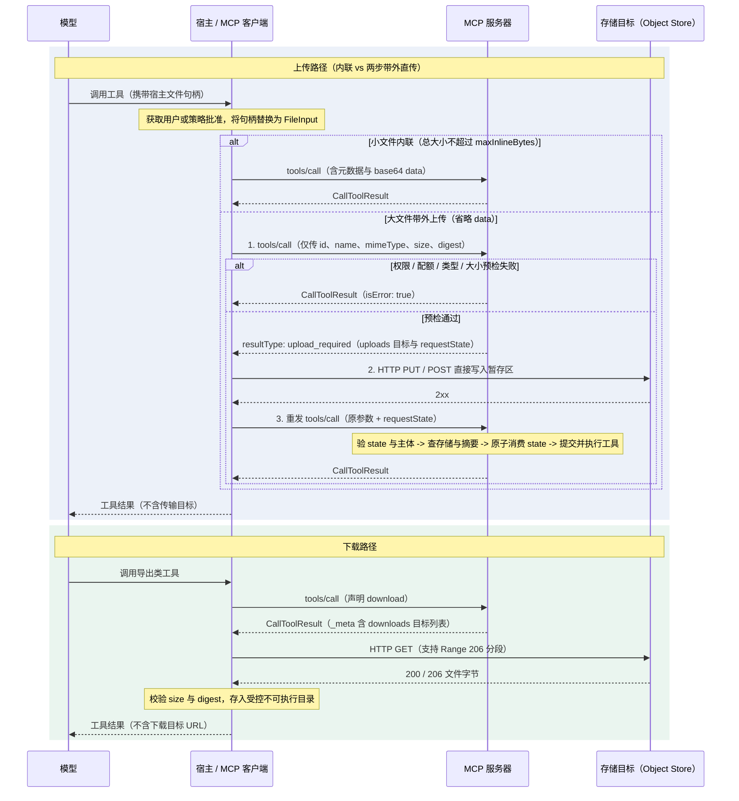

# MCP 文件传输（File Uploads）

## 摘要

MCP 文件传输扩展（扩展标识符 `io.modelcontextprotocol/files`，仓库 `experimental-ext-file-uploads`）是 MCP File Uploads Working Group 维护的**实验性草案扩展**，尚未提交为 SEP，协议字段和流程仍可能发生破坏性变更。它建立在 MCP `2026-07-28` 协议之上，用来在客户端和工具之间收发 PDF、电子表格、图片等二进制文件，同时让文件内容和传输地址不进入模型上下文、也不占用 JSON-RPC 消息体。

其核心机制是：上传支持小文件内联和大文件两步带外直传（复用 MRTR 重试模式，通过 `resultType: "upload_required"` 和 `requestState` 让客户端直接把字节 `PUT`/`POST` 到对象存储，再携带原参数重试工具调用）；下载由工具在结果的 `_meta` 中列出下载目标，客户端直接 HTTP `GET` 拉取。2026-11-24 Anthropic 宣布该能力正在 Claude 与 Claude Code 中逐步向符合条件的计划推出（连接器开发者文档将其标注为 Beta）。

## 协议机制与核心数据流

### 能力协商与文件参数标记

1. **服务端声明**：在 `server/discover` 的 `capabilities.extensions` 中声明 `io.modelcontextprotocol/files`。支持带外上传时填入 `{ "upload": {} }`，仅返回下载时填入 `{}`；可选字段 `maxInlineBytes` 表示单次请求允许的内联文件解码总字节数（省略或 `0` 表示只接受带外上传）。
2. **客户端声明**：在每次请求（含 `tools/list` 和 `tools/call`）的 `_meta["io.modelcontextprotocol/clientCapabilities"].extensions` 中按方向声明 `upload` 和/或 `download`，同一次逻辑调用的所有重试必须保持相同声明。若请求未声明所需方向而工具无法降级，服务端应在不执行工具的前提下返回 JSON-RPC 错误 `-32021`（`MissingRequiredClientCapabilityError`）并在 `data.requiredCapabilities` 中指明缺失扩展。
3. **参数标记（`x-mcp-file`）**：服务端在 `Tool.inputSchema` 的文件对象参数上标注 `x-mcp-file`（含 `accept` 类型提示与单文件上限 `maxSize`），并要求符合 `FileInput` 结构：`id`（单次调用内唯一，1–128 字符）、`name`、`mimeType`、`size`、可选 SHA-256 `digest`（base64url 无填充）以及可选 base64 `data`。
4. **上下文隔离**：草案要求宿主**不应**把 `x-mcp-file` schema 直接展示给以 token 生成参数的模型，而是向模型提供宿主自定义句柄，在发请求前替换为真实 `FileInput`；且**不得**把文件字节或任何上传/下载目标 URL 放进模型上下文。

### 上传与下载流程

### 上传关键规则与五步重试校验

- **为什么用两步调用 + HTTP 直传**：草案说明，直接走 HTTP 写入能让现有对象存储 API 无需改造即接收字节，也避免把大文件塞进 JSON-RPC 后才发现权限或配额不通过。
- **空文件不触发带外上传**：`size` 为 `0` 时客户端不传 `data`，服务端不得为此签发上传目标；如果所有文件都无需带外传输，直接执行工具。
- **支持 `multipart/form-data`**：对只接受表单直传的存储（如 S3 POST Policy），`UploadTarget` 可设置 `method: "POST"` 并附带 `form: { fields, fileField }`，客户端按数组顺序发送表单字段后将文件作为最后一部分上传。
- **第 2 次调用的强制顺序**：重试请求本身**不能证明字节已到达**，服务端收到带 `requestState` 的第 2 次调用时必须按顺序执行：
  1. 校验 `requestState` 由自己签发、未过期且未被消费（失败返回 `-32602`）。
  2. 核对工具名、全部参数（按 JSON Schema 值相等比较，忽略键顺序与数字拼写）及认证主体与 `requestState` 绑定一致（不符返回 `-32602`）。
  3. 向存储端独立确认每个目标文件已到达（如 `HEAD`），重检字节数、内容类型与 SHA-256 摘要（若目标仍可被覆写，须先复制到目标不可写的暂存路径再验摘要，防止校验后被替换）。
  4. 若工具不可安全重复执行，须在所有实例共享存储中原子的标记该 `requestState` 为已消费（避免并发重放导致重复执行）。
  5. 将确认后的文件从暂存区提交到最终位置，执行工具（或创建 MCP Task）并返回结果。若某一步失败或上传未到达，返回 `isError: true` 且不得运行工具。
- **与 Tasks 组合的顺序**：若工具耗时较长需返回 [[wiki/topics/ai/mcp-tasks|MCP Tasks]]，服务端必须在创建 Task 之前先完成 `upload_required` 上传流程。
- **失败与「结果未知」边界**：第 1 步传输中若有任一目标未返回 `2xx`，客户端不得发起第 2 次调用，并告知用户工具未执行（但不能断言远端没有残留字节，暂存区清理依赖服务端在 `requestState` 过期后回收）。第 2 次调用发出后若超时未获响应或收到 `-32602`，工具可能已经执行，客户端与网关**不得**自动重发或重启调用，必须向用户/模型明确报告结果未知；不可重复执行的工具应通过业务参数支持幂等键。

### 下载关键规则

- 工具在 `CallToolResult.content` 中用文本说明交付的文件，并在 `result._meta["io.modelcontextprotocol/files"].downloads` 中返回 `DownloadTarget` 数组，且只能列出已就绪可拉取的文件。
- 客户端发送 HTTP `GET` 拉取文件；使用 `credentials: "omit"` 时可发 `Range` 请求获取 `206` 分段或断点续传（`size` 与 `digest` 指解码去压缩后的完整文件）。
- 客户端必须对下载流做字节上限保护（超出声明 `size` 立即中止）、拉完后校验 `size` 和 `digest`，把 `name` 缩减为安全文件名（防止路径穿越），写入受控且不自动执行或加载配置的目录，不设可执行权限，且未经用户同意不覆盖已有文件。

## 安全模型与工程限制

### 协议层安全规则

| 安全问题 | 草案规范要求 |
| --- | --- |
| 凭据隔离（`omit` vs `include`） | `omit` 由目标 URL 自带短效签名，客户端严禁附带 MCP 凭据、Cookie 或客户端证书；`include` 附带原 MCP `Authorization` 头，但仅限 `path` 目标或与服务器规范 URI 同源（RFC 6454）的 `url`，且该源不可与其他应用共享，服务端须核验 token 归属同一用户。stdio 服务器无规范 URI，只能签发 `url` + `omit`。 |
| SSRF 与重定向 | 客户端必须拦截解析到 IANA 非公网可达地址（如内网、回环）的 `url` 目标（运维白名单或受控 `path` 除外）；一律禁止跟随 `3xx` 重定向（按传输失败处理）；拒绝 `Authorization`、`Cookie`、WHATWG 禁用请求头，以及 `include`/`path` 下的 `X-Forwarded-*`、`X-Original-URL`、`X-HTTP-Method-Override` 等代理头。 |
| 服务端主导请求与数据外泄 | 宿主在首次调用前征求用户授权时并不知道服务端稍后会返回哪个 `omit` 目标 URL，恶意服务器可利用 `omit` + `POST`/`form` 将文件外泄到任意公网地址或伪造请求。规范建议宿主对 `omit` 目标（尤其无人值守时的 `form` 目标）实施运维级域名白名单。 |
| 敏感凭据防泄露 | 客户端与服务端必须在日志、链路追踪和错误报告中脱敏目标 URL、目标请求头、`form` 字段、`requestState` 和内联 `data`；服务端也不得把目标 URL 放进工具结果的 `content` 或 `structuredContent`。 |
| 可写目标与有效期 | 预签名 URL 往往无法主动撤销，须设置尽量短的有效期（且必须早于 `requestState` 过期），建议启用单次写入条件（如 `If-None-Match: *`）并把 `Content-Length` 纳入签名。 |
| 网关中继（Relay）约束 | 网关不得将 `credentials: "include"` 的 `url` 目标透传给下游调用方，也不能把下游调用方凭据转发给上游；必须把调用方身份绑定到 `requestState`；自身未实现扩展时不应透出该能力。 |

### Claude / Claude Code Beta 的托管限制

以下约束来自 Anthropic 连接器开发者文档（`claude.com/docs/connectors/building/files`，2026-11 状态），属于 Claude 客户端托管策略，不是协议本身的要求：

- **必须经 Connectors Directory 上架且主机预审**：仅对从目录安装且 URL 精确匹配的固定地址（或固定多地址）连接器生效；手动按 URL 添加或每客户自定义 URL 模式不支持，且静默不传文件、不报错。所有存储域名（即便由 MCP 服务器自身收发，最多 50 个）均需发邮件向 Anthropic 申请审批，拒绝纯 IP 以及多租户共享的公共存储/CDN 域名。
- **协议与 SDK 兼容**：要求 MCP `2026-07-28` Streamable HTTP；`server/discover` 须在 2 秒内返回一致结果（若任一实例返回非 `401` 错误，Claude 可能在约 1 天内对该服务器停用扩展）。由于需要原样返回 `resultType: "upload_required"`，高阶封装（如 Python `MCPServer` 2.3.0、`FastMCP` 4.0.10）和旧版 `@modelcontextprotocol/sdk` 1.32.2 会改写结果或不支持，当前文档要求使用低阶 `Server`（实测版本为 TypeScript `@modelcontextprotocol/server` 2.4.0、Python `mcp` 2.3.0）。
- **数量、大小与时长上限**：
  - 单次上传最多 10 个文件（Claude Code 最多 8 个），单次下载最多 10 个文件；单次工具响应体小于 1,000,000 字节（不含带外文件本体）；目标 URL ≤ 8,192 字节，`requestState` 建议低于 32,000 ASCII 字符。
  - 每次 `tools/call` 须在 60 秒内响应；Claude 聊天中两步上传加文件传输总时长上限约 200 秒；上传接收时限取 `max(80s, 30s + 每 4 MiB 1s)`，读停顿超过 30 秒失败；单次 `GET` 须 30 秒内开始响应、总限时 290 秒。
  - `include` 凭据限制更多：大文件下载不走 `Range` 续传、多文件上传须 5 分钟内逐个启动、含个人健康数据的连接器直接拒绝 `include`。
- **组织与合规排除**：Team / Enterprise 需组织 Owner 分别打开上传和下载开关；启用 HIPAA、零数据保留（ZDR）、客户托管密钥（CMEK）、IP 白名单或默认数据驻留在美国境外的组织当前无法使用；本地 Claude Code 若设置 `DISABLE_TELEMETRY`、`DO_NOT_TRACK` 或 `CLAUDE_CODE_DISABLE_NONESSENTIAL_TRAFFIC` 也不会执行文件传输。

### 草案阶段尚未敲定的设计项

草案正文明确列出了进入 Beta / SEP 前需要解决的开放设计项：

1. **存储提交句柄回传**：部分对象存储会在直传 HTTP 响应中返回提交句柄（如 ETag），当前重试请求没有逐文件回传字段。
2. **执行器网关与自由文本引用**：把多个子工具包在单一通用执行器后面的网关会隐藏内部 `x-mcp-file` schema；Markdown 等文本参数中引用的图片同样没有显式文件参数。
3. **传输失败主动通知**：当前客户端传输失败后只通过「不发第 2 次调用」体现，服务端要等到 `requestState` 过期才清理暂存区，尚无主动释放配额信号。
4. **下载格式与长耗时文件生成**：下载目前挂在 `_meta`，后续是否改用 `resource_link`，以及长时间导出文件如何与 Tasks 衔接尚未定论。
5. **摘要是否强制**：强校验 `digest` 能防同大小字节替换，但会迫使客户端两遍读文件（浏览器难以原生对大文件做流式哈希），目前仍为工具按需在 schema 中声明。

## 相关页面

- [[wiki/topics/ai/mcp|MCP]]
- [[wiki/topics/ai/mcp-2026-07-28|MCP 2026-07-28 规范变更]]
- [[wiki/topics/ai/mcp-tasks|MCP Tasks]]
- [[wiki/topics/ai/skills-over-mcp|Skills over MCP]]
- [[wiki/topics/ai/mcp-authorization|MCP 授权流程]]

## 来源指针

- [File Uploads and Downloads 扩展草案（`specification/draft/file-uploads.md`）](https://github.com/modelcontextprotocol/experimental-ext-file-uploads/blob/main/specification/draft/file-uploads.md)：含能力协商、五步重试校验、目标校验、网关中继、安全分析与 Open Questions
- [Claude 连接器文档：Support file uploads and downloads](https://claude.com/docs/connectors/building/files)：含目录与域名审批要求、低阶 SDK 示例、数量/超时上限与排障清单
- [Anthropic 公告：MCP servers can now ship skills, run tasks, and more with Claude](https://claude.com/resources/articles/skills-over-mcp-tasks-and-more)
- `raw/sources/claude-skills-over-mcp-tasks-and-more.md`：本次公告存档与规范核查记录
