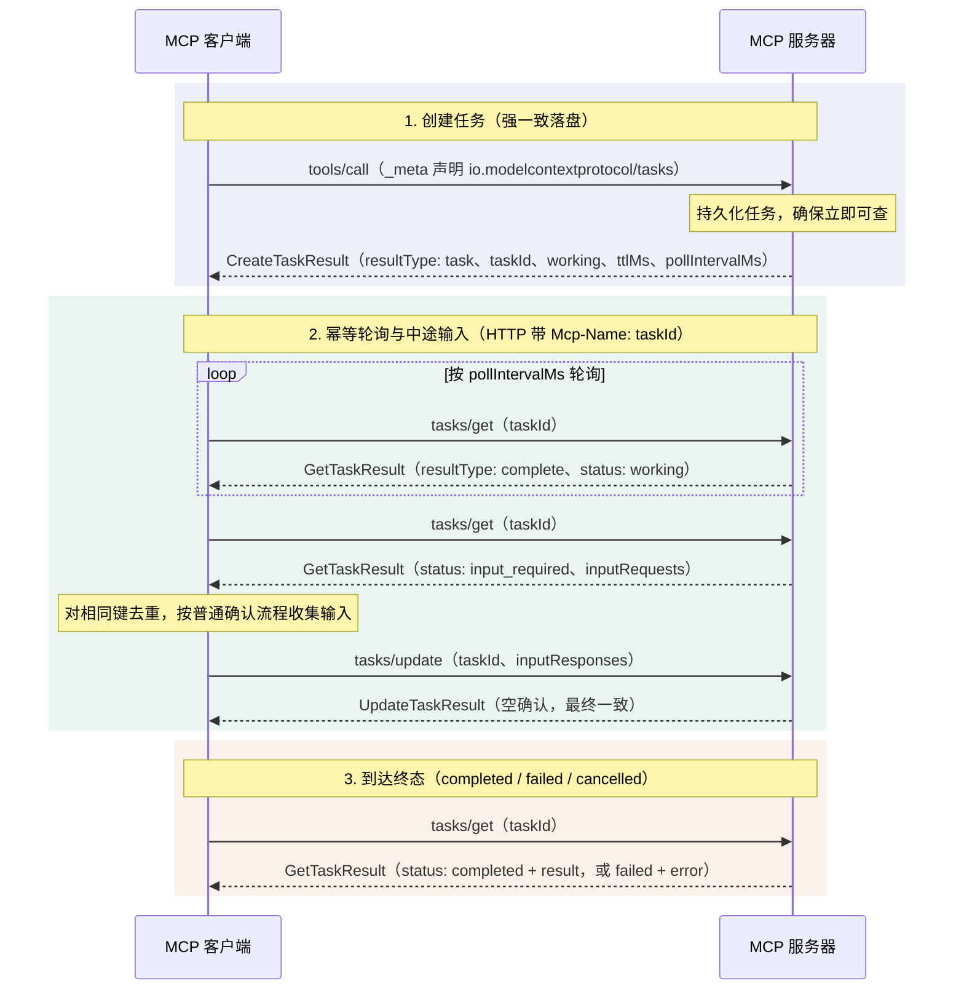

# MCP Tasks

## 摘要

MCP Tasks 是 MCP（Model Context Protocol）的官方异步执行扩展（扩展标识符 `io.modelcontextprotocol/tasks`，对应 SEP-2663 Final，规范当前处于 Beta、计划晋升核心协议，已发布 `2026-07-28` 稳定 schema）。它让 MCP 服务器在面对耗时的 `tools/call`（如 CI 流水线、批量数据导出、多步研究或人工审批）时，立即返回一个持久化任务句柄（`resultType: "task"` 与 `taskId`），而无需长时间阻塞 HTTP 连接或挂起对话。

客户端拿到句柄后通过 `tasks/get` 轮询状态（或可选订阅 `notifications/tasks`），在任务中途需要输入时通过 `tasks/update` 提交响应，并在断线或重启后凭 `taskId` 继续获取最终结果。2026-11-24，Anthropic 宣布 MCP Tasks 在 Claude 与 Claude Code 中进入 GA（全面可用）。

## 协议机制与核心数据流

### 服务端主导的能力协商与多态返回

1. **客户端声明**：在每条请求的 `_meta["io.modelcontextprotocol/clientCapabilities"].extensions` 中携带 `"io.modelcontextprotocol/tasks": {}`（当前不定义额外配置字段）。
2. **服务端声明**：在 `server/discover` 响应的 `capabilities.extensions` 中广告 `"io.modelcontextprotocol/tasks": {}`。
3. **单次请求动态决定**：客户端不必在请求参数里附加 `task` 标记，也不必先调用 `tools/list` 检查每个工具是否支持任务；只要请求声明了该扩展，服务端即可按需对 `tools/call` 返回普通 `CallToolResult` 或 `CreateTaskResult`（`resultType: "task"`），客户端必须同时处理两种返回形态。
4. **未声明时的处理**：服务端绝不能向未在当前请求中声明该扩展的客户端返回 `CreateTaskResult`；若该操作必须以任务方式执行，服务端必须返回 JSON-RPC 错误 `-32021`（`MissingRequiredClientCapability`）并在 `data.requiredCapabilities` 中指明缺失 `io.modelcontextprotocol/tasks`。

当前规范仅支持 `tools/call` 任务化，未来可能扩展到其他请求方法。

### 任务生命周期时序

### 五种状态与两类错误的边界

| 状态 | 类型 | 载荷字段 | 说明 |
| --- | --- | --- | --- |
| `working` | 非终态 | 基础 `Task` 字段 | 作业仍在运行，可附带 `statusMessage` 描述进度。 |
| `input_required` | 非终态 | 额外内联 `inputRequests` | 等待客户端回应（如 `elicitation/create`），回应后回到 `working`。 |
| `completed` | 终态 | 额外内联 `result` | 原请求在协议层正常结束，返回完整 `CallToolResult`；**工具业务报错（`isError: true`）仍属于 `completed`**。 |
| `failed` | 终态 | 额外内联 `error` | 仅用于执行期发生 JSON-RPC 协议错误，不得用来表达工具层 `isError: true`。 |
| `cancelled` | 终态 | 基础 `Task` 字段 | 任务在完成前已取消，不可再变更为其他状态。 |

注意响应的 `resultType` 区分：仅首次创建返回 `CreateTaskResult` 时设为 `"task"`；后续 `tasks/get`、`tasks/update`、`tasks/cancel` 的响应均设为 `"complete"`。

### 四个核心协议设计（SEP-2663）

1. **创建强一致，更新与取消最终一致**：服务端在返回 `CreateTaskResult` 之前必须把任务持久化到 `tasks/get` 立即可查的状态（在最终一致存储中须等待一致后再响应），避免客户端发出猜测性轮询。相对地，`tasks/update` 与 `tasks/cancel` 只回空确认，不强制同步读取最新任务体，状态变化留给后续 `tasks/get` 观察。
2. **读写分离（`tasks/get` 与 `tasks/update`）**：`tasks/get` 是纯只读幂等请求，可安全重试和缓存；提交输入响应单独走 `tasks/update`（允许部分提交，服务端对未知、已回答或过期键直接忽略）。`inputRequests` 中的每个键在单个任务生命周期内不得复用，方便客户端在连续轮询时去重展示。
3. **协作式取消（`tasks/cancel`）**：只表达取消意图，服务端只需确认收到，不保证一定停止后台作业（任务仍可能进入 `completed` 或 `failed`）；发送取消后客户端即可清理本地状态，且不得使用 `notifications/cancelled` 取消任务。
4. **与 `2025-11-25` 旧版任务不兼容**：`2025-11-25` 核心协议里的实验性 Tasks 已移除并由本扩展取代，两者在线路层不兼容——删除了阻塞长连接的 `tasks/result`（调用须返回 `-32601`）、缺少安全调用方边界的 `tasks/list`、客户端托管的 elicitation/sampling 任务，以及 `tools/call` 上的 `task` 参数与旧能力字段（`tasks.requests.*`、`execution.taskSupport`）。

### 传输路由、可选推送与扩展组合

- **Streamable HTTP 路由头**：发送 `tasks/get`、`tasks/update`、`tasks/cancel` 时，客户端必须把请求头 `Mcp-Name` 设为 `taskId`（`Mcp-Method` 设为方法名），便于网关或负载均衡把后续请求路由到持有该任务状态的实例。
- **可选推送通知**：轮询是默认路径；若服务端支持推送，客户端可通过 `subscriptions/listen` 订阅指定 `taskIds`，接收包含完整 `DetailedTask` 的 `notifications/tasks`。任务不支持 `notifications/progress` 和 `notifications/message`。
- **与 MRTR 及 File Uploads 组合**：若工具在真正启动后台作业前需要同步收集输入（MRTR `input_required`）或带外上传文件（`upload_required`），服务端必须在返回 `CreateTaskResult` 之前先同步完成这两类交互。前期 MRTR 的 `inputRequests` 键空间与任务创建后的键空间相互独立。

## 安全边界

- **任务 ID 不可猜测**：服务端可能把 `taskId` 当作访问后台状态的凭据，必须使用足够高熵值生成，防止第三方枚举或撞库。
- **逐请求鉴权**：每次 `tasks/get`、`tasks/update`、`tasks/cancel` 都必须独立校验身份与访问权限，确保调用方只能操作自己的任务。
- **移除列表接口减少信息泄露**：去掉 `tasks/list` 后，无会话模型下服务端不会因权限边界不清把一个调用方的任务列表暴露给其他调用方。
- **任务内的提问不跳过确认**：经 `inputRequests` 传回客户端的 `elicitation/create` 等请求，宿主必须沿用与独立请求相同的安全校验与用户确认界面，不得因为处于已批准的后台任务中就跳过检查。

## Claude 与 Claude Code（GA）的落地行为与工程限制

以下细则来自 Anthropic 2026-11-24 公告与 Claude Code MCP 文档，描述 Anthropic 客户端实现，不代表所有 MCP 客户端：

### 支持范围与前置条件

- **协议与版本**：仅在 MCP `2026-07-28` 连接上启用（设置 `MCP_SDK_GENERATION=v1` 或 `MCP_PROTOCOL_NEGOTIATION=legacy` 会关闭任务能力）。终端 CLI、Agent SDK、GitHub Actions 需 Claude Code v2.1.304+（关闭 feature flag 拉取如 Bedrock 或关闭遥测时，仅交互式终端 v2.1.317+ 可用）；VS Code 扩展与 Desktop App 本地会话需 v2.1.331+ 且开启 feature flag 拉取。
- **调用来源与会话形态**：
  - 支持主会话，以及主会话启动的非 fork subagent（本地需 v2.1.331+ 且服务器不能定义在 subagent 自己的文件中；云端若任务在 2 分钟内结束则交回 subagent，超过 2 分钟由主会话接手）。
  - 单次非交互运行 `claude -p "<prompt>"` 不启用任务；Agent SDK 或 `claude -p --input-format stream-json` 需同时满足输入流保持打开、`CLAUDE_AUTO_BACKGROUND_TASKS=1`、未设置 `CLAUDE_CODE_DISABLE_MCP_TASK_BACKGROUND=1` 且 `CLAUDE_CODE_MCP_AUTO_BACKGROUND_MS` 不为 `0`。
  - 云端会话和 claude.ai 聊天仅对支持 `2026-07-28` 的 claude.ai connector 生效，**不支持** `.mcp.json` / 插件服务器、Project 线程、无痕聊天和云端定时任务（routines）；Desktop 本地会话不支持 claude.ai connector 和 `claude_desktop_config.json` 服务器。

### 轮询、超时与服务端实现限制

| 维度 | Claude / Claude Code 行为 | 服务端实现注意点 |
| --- | --- | --- |
| 结果获取方式 | 不使用 `tasks/result`、`tasks/list` 和 `notifications/tasks`，固定轮询 `tasks/get` | 必须通过 `tasks/get` 返回完整终态与结果 |
| `pollIntervalMs` 调度 | 非云端夹紧到 `250–30,000 ms`（缺省 `2,000 ms`）；云端新任务下限 `1,000 ms`（缺省最多 `10s`），满 1 分钟降频到每 `10s`，满 10 分钟降频到每 `30s` | 建议 1 分钟以上作业设 `10,000–30,000 ms`，短作业设 `2,000 ms`，不要超过 `30,000 ms` |
| `taskId` 与 `inputRequests` | `taskId` 最多 128 个不含空格的可打印 ASCII 字符；单任务超过 16 个 `inputRequests` 键会被忽略 | 控制 `taskId` 字符集与长度，避免单任务内发起过多并发输入请求 |
| 保留期与时长上限 | 非云端后台任务默认不限时，云端与 claude.ai 聊天最长跟踪 **7 天**；客户端不会因 `ttlMs` 过期主动放弃跟踪 | 建议任务结束后至少保留结果 1 小时以上，方便用户退出后 `--resume` 取回；HTTP 首包须在单次调用超时前先返回 `CreateTaskResult` |
| 未知任务与失败重试 | 收到 `-32602` 后持续重试最多 5 分钟，仍无结果则报 `outcome unknown.` | 出现结果未知后不应盲目重试同一工具，须先查服务端实际状态防重复副作用 |
| 强制同步等待 | 设 `CLAUDE_CODE_MCP_AUTO_BACKGROUND_MS=0` 同步等全部 MCP 调用；设 `CLAUDE_CODE_DISABLE_MCP_TASK_BACKGROUND=1` 先同步等，超过 2 分钟降级为普通后台调用 | 降级后的普通后台调用不具备退出后恢复能力；等待期间按 `Esc` 或超时会发 `tasks/cancel` |

### 退出恢复与任务内提问（Elicitation）的差异

- **远程 HTTP vs 本地 stdio**：退出 Claude Code 不会向远程服务器发 `tasks/cancel`，远程任务继续运行，后续在交互式会话中运行 `claude --resume`（且保持服务器名与连接配置不变）即可恢复跟踪；**本地 stdio 服务器子进程会在 Claude Code 退出时终止**（即使 `/tasks` 文案提示继续运行），除非该服务明确能脱离进程存活，否则退出前应先等待完成或手动停止。
- **不同界面对任务内 `elicitation/create` 的支持差异**：
  - **交互式终端**：弹出表单或链接确认框，非同步等待时可按 `Esc` 延后，再通过 `/tasks` 重开回答（需 v2.1.324+）。
  - **云端会话与 claude.ai 聊天**：在权限提示后弹出表单回答；但在 **Cowork 模式和定时任务**中无法回答，任务会被取消。
  - **`claude -p` 与 Agent SDK**：直接请求服务端取消任务，**不调用** `Elicitation` hook 或 `onElicitation` 回调。
  - **VS Code 扩展与 Desktop 本地会话**：不展示任务提问弹窗，除非配置了 `Elicitation` hook 接管并接受请求，否则直接请求取消任务。
- **其他 `inputRequests` 方法**：`roots/list` 仅在非云端会话提供；客户端无法处理的方法会直接触发取消任务。

## 相关页面

- [[wiki/topics/ai/mcp|MCP]]
- [[wiki/topics/ai/mcp-2026-07-28|MCP 2026-07-28 规范变更]]
- [[wiki/topics/ai/skills-over-mcp|Skills over MCP]]
- [[wiki/topics/ai/mcp-file-uploads|MCP 文件传输（File Uploads）]]
- [[wiki/syntheses/ai/agent-harness-runtime-architecture|Agent Harness 运行时架构与演进]]

## 来源指针

- [MCP Tasks 扩展概览](https://modelcontextprotocol.io/extensions/tasks/overview)
- [SEP-2663: Tasks Extension（Final）](https://modelcontextprotocol.io/seps/2663-tasks-extension)：含设计动机、读写分离、强一致创建与协作取消、安全考量及与 `2025-11-25` 的不兼容对照
- [ext-tasks `2026-07-28` 稳定 Schema（`schema/2026-07-28/schema.ts`）](https://github.com/modelcontextprotocol/ext-tasks/blob/main/schema/2026-07-28/schema.ts)
- [Claude Code MCP 文档：MCP tasks that run on the server / MCP tasks for server authors](https://code.claude.com/docs/en/mcp#mcp-tasks-for-server-authors)：含版本号、轮询策略、7 天云端上限、退出恢复与各会话提问限制
- [Anthropic 公告：MCP servers can now ship skills, run tasks, and more with Claude](https://claude.com/resources/articles/skills-over-mcp-tasks-and-more)
- `raw/sources/claude-skills-over-mcp-tasks-and-more.md`：本次公告存档与规范核查记录
