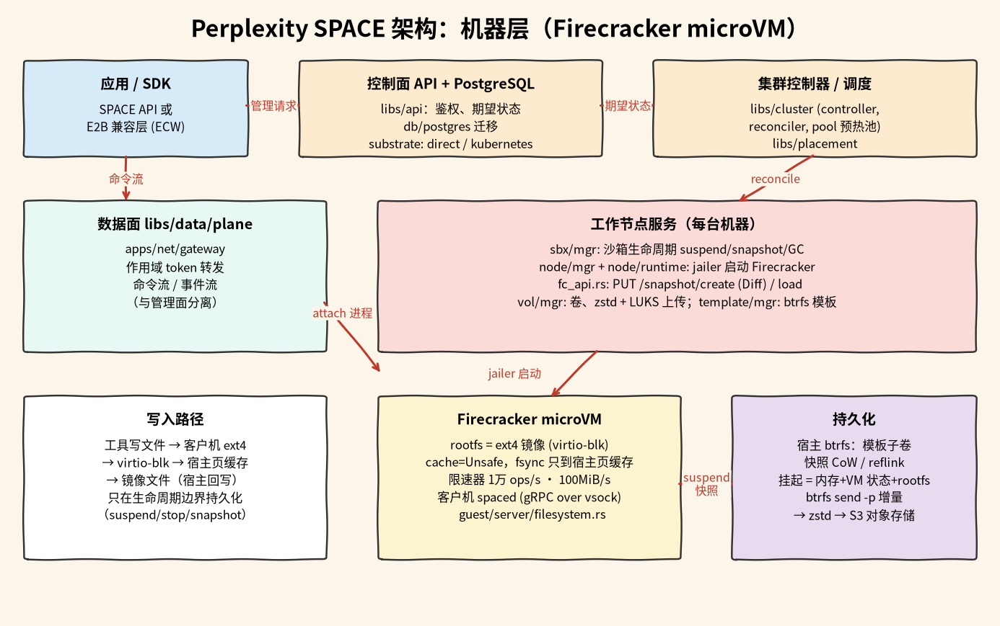

# Perplexity SPACE

## 摘要

SPACE（Sandboxed Platform for Agentic Code Execution，[perplexityai/SPACE](https://github.com/perplexityai/SPACE)，Rust，Apache-2.0，2026-10 初开源）是一套自己部署的沙箱服务。应用通过 HTTP API 创建 Linux 环境、执行命令、读输出、暂停、挂起、唤醒和删除；每个沙箱是一台独立的 [Firecracker](https://firecracker-microvm.github.io/) 微虚拟机（microVM），靠 KVM 硬件虚拟化隔离。它还带一个兼容 E2B 的接口层（ECW），可以直接用 E2B 的 Python SDK。可以理解为开源、自托管版的 E2B。

它管的是「整台机器」这一层：给 agent 一台隔离的机器，负责这台机器的启动、暂停、挂起和恢复。它没有内容寻址存储，也没有文件级历史，持久化发生在挂起、停止、快照这些生命周期节点上。和 [[wiki/topics/ai/cloudflare-computer|Cloudflare Computer]]、[[wiki/topics/ai/layerfs|LayerFS]] 的分工见 [[wiki/comparisons/ai/cloudflare-computer-vs-layerfs-vs-space|三者对比]]。

本页依据 `main` 分支 `57c7c0c`（2026-10-18）的文档和关键路径源码。仓库的 Rust 代码约 98 万行（含测试），只顺着本页提到的路径读，没有通读。

## 核心概念

| 概念 | 含义 |
| --- | --- |
| Template | 起始文件系统和运行配置，许多沙箱共用同一个模板 |
| Sandbox | 一台有自己可写文件系统和生命周期的 microVM |
| Process | 沙箱里运行的程序，同一沙箱的进程共享环境和文件 |
| Command session | 一条命令的连接信息和授权；创建时分配进程 ID，连接上才启动进程 |
| Operation | 异步生命周期请求（创建、暂停、挂起、唤醒、删除）的记录，调用方轮询它 |

## 架构

### 控制面：期望状态加调和

1. API（`crates/libs/api`）鉴权后把期望状态写进 PostgreSQL，立即返回 operation ID，接受请求不代表沙箱已就绪。
2. 控制器和适配器（`crates/libs/cluster`、`crates/libs/placement`）把运行中的系统调和到期望状态。有两种适配器：直接调用工作节点服务的 direct 适配器，以及本地 Kind 安装用的 Kubernetes 适配器（`controllers/substrate/direct.rs`、`controllers/substrate/kubernetes/`）。
3. Kubernetes 上可以配置预热池（warm pool），保留已启动的沙箱，创建时跳过冷启动；单节点可以用基础快照（base snapshot，保存模板启动后的内存和 VM 状态），新沙箱从快照恢复。

### 工作节点：jailer 和 Firecracker

- 每台工作节点上的服务负责 VM、网络、卷、模板和凭据：`sbx/mgr`（沙箱生命周期、挂起、快照、GC）、`node/mgr` 与 `node/runtime`（启动 VM）、`vol/mgr`（卷与上传）、`template/mgr`（模板）。
- VM 由 jailer 启动：`crates/libs/node/runtime/supervisor/src/service.rs` 调 `launch::launch_via_jailer`。jailer 是 Firecracker 自带的启动器，按 Firecracker 文档，它在 chroot、cgroup 和独立命名空间里以非特权用户运行 VMM 进程；SPACE 具体传了哪些 jailer 参数本次没有逐项核对。
- Firecracker 的控制 API 客户端在 `crates/libs/node/runtime/core/src/fc_api.rs`。
- 客户机里跑守护进程 `spaced`（`crates/libs/spaced/guest`），宿主一侧的 `spaced-host` 通过 vsock 与它通信，命令、文件读写都走 gRPC。

### 数据面：命令流与管理请求分开

应用的管理请求走 API，命令输出走单独的数据面（`crates/libs/data/plane`，网关在 `crates/apps/net`）。API 用用户会话或服务 token 鉴权，数据面用按会话签发的连接 token，两种 token 不能混用。一次文件读取依次经过数据面、node-api、sandbox-manager、spaced-host、客户机 vsock 和客户机里的路由进程，按 64 KiB 分块流式传输。

## 磁盘与写入路径

依据 `docs/space/design/guest-io.md`：

1. 每个沙箱的根文件系统是一个 ext4 镜像，作为 virtio 块设备接到 VM 上。
2. 驱动器用 Firecracker 默认的 `Unsafe` 缓存模式，设备不提供 flush。客户机里的 `fsync` 只要写到宿主的页缓存就返回，客户机里没有任何操作能保证数据在宿主故障后还在。
3. 宿主靠自己的回写和生命周期快照持久化镜像。
4. 每个根盘有 Firecracker 限速器，默认 10,000 次操作/秒和 100 MiB/s，突发额度默认 30 秒。注释提醒：4 KiB 一次请求时，10,000 次/秒只相当于约 39 MiB/s。
5. 通过 API 上传文件时，新建或覆盖普通文件会先写临时文件再改名，读者只会看到旧内容或完整的新内容；临时文件和改名都不 sync，所以确认写入不代表能撑过沙箱崩溃或宿主故障。追加和原地写会在确认前 `fsync`。

宿主上用 btrfs 的写时复制从模板创建每个沙箱的根盘（`docs/architecture.md` 的服务职责表），模板目录是 btrfs 子卷（`template/mgr/src/volume.rs`）。

## 生命周期与快照

| 状态 | 能否执行 | 保留什么 |
| --- | --- | --- |
| Running | 能 | 内存和可写文件系统 |
| Paused | 不能 | 内存留在工作节点上，文件系统也在，不是持久快照 |
| Suspended | 不能 | VM 内存、运行状态和根文件系统的快照，释放 VM 资源 |
| Deleted | 不能 | 什么都不留 |

- 通过 SPACE API 创建的沙箱默认 6 小时没有访问或命令就自动挂起，这是空闲时限，不是最长寿命。
- **内存差量快照**：`fc_api.rs` 第 81–85 行把快照类型固定为 `Diff`，并在加载快照时开启脏页追踪。注释的理由是全量快照每次挂起都要写整个内存文件，差量快照只和脏页数量有关，而且不影响恢复延迟。
- **磁盘快照**：挂起和暂停前先让客户机 flush 文件系统，失败就不继续。普通停止会先尝试 `syncfs`（总预算 30 秒），失败也会继续停止。删除直接丢盘，不 flush。
- **上传**：`vol/mgr` 用 zstd 压缩后流式送进对象存储的分块上传（每块 64 MiB，默认共享 1 GiB 缓冲预算），加密的沙箱产物是 LUKS 格式（`snapshot.luks`、`cow.luks`）。根盘可以用 `btrfs send -p` 只发送与模板父子卷不同的部分（`docs/snapshot-upload-streaming.md`、`volume.rs` 约第 1742–1760 行）。
- **整机分叉**：E2B 兼容路由 `/sandboxes/{sandboxID}/fork`（`crates/libs/api/src/fork_operations.rs`，`SPACE_SANDBOX_FORK_ENABLED` 默认开启）可以从一个沙箱分出新沙箱，粒度是整台 VM。具体是否先做快照再恢复成新 VM，本次只从函数和常量名（`fork_restore_activation_lease_seconds`、fork 快照保留期）推断，没有读完实现。

## 使用限制

- **部署门槛高**：安装文档要求 Linux x86_64 宿主，有 `/dev/kvm`、`/dev/net/tun`、loop 设备、btrfs 支持和允许特权容器的 Docker，不能直接在 macOS 上跑；入门路径是本地 Kind 集群。模板目录不是 btrfs 子卷时仍可用，但走 reflink 加全量编码的旧路径，没有 `btrfs send` 增量（`volume.rs` 注释）。
- **写入不是每次都持久**：确认写入不保证能撑过沙箱崩溃、强制停止或宿主故障，持久化发生在挂起、停止、快照时。
- **一台宿主上的突发 I/O 没有总量限制**：每个沙箱各自有限速器，但很多空闲沙箱同时用掉突发额度时，SPACE 不配置宿主级的 cgroup I/O 权重。
- **没有文件级历史和跨沙箱去重**：快照和分叉都以整台沙箱为单位；去重只来自 btrfs 的写时复制和相对模板的增量发送。
- **ECW 的生命周期名称不同**：ECW 的 pause 对应 SPACE 的 suspend，resume 对应 restore。
- **刚开源**：文档里有大量滚动升级和兼容开关的说明，接口还在变化。

## 相关页面

- [[wiki/comparisons/ai/cloudflare-computer-vs-layerfs-vs-space|Cloudflare Computer vs LayerFS vs Perplexity SPACE]]
- [[wiki/topics/ai/cloudflare-computer|Cloudflare Computer]]
- [[wiki/topics/ai/layerfs|LayerFS]]
- [[wiki/topics/systems/qemu|QEMU]]
- [[wiki/comparisons/systems/thread-isolation-vs-process-isolation|线程级隔离 vs 进程级隔离]]
- [[wiki/topics/systems/sandbox|Sandbox]]

## 来源指针

- [perplexityai/SPACE](https://github.com/perplexityai/SPACE)：README、`docs/architecture.md`、`docs/space/design/guest-io.md`、`docs/snapshot-upload-streaming.md`、`docs/base-snapshots.md`、`docs/warm-pools.md`、`docs/ecw.md`、`docs/configuration.md`
- 源码（`57c7c0c`）：`crates/libs/node/runtime/core/src/fc_api.rs`、`crates/libs/node/runtime/supervisor/src/service.rs`、`crates/libs/template/mgr/src/volume.rs`、`crates/libs/spaced/guest/server/src/run.rs`、`crates/libs/api/src/fork_operations.rs`
- [SPACE Guide](https://space.docs.perplexity.ai/guide/index.html)
- `raw/sources/perplexity-space.md`：阅读范围、核查位置与验证记录
- `raw/assets/perplexity-space-architecture.png`：按上述文档和源码画的手绘风格示意图，不是官方素材
