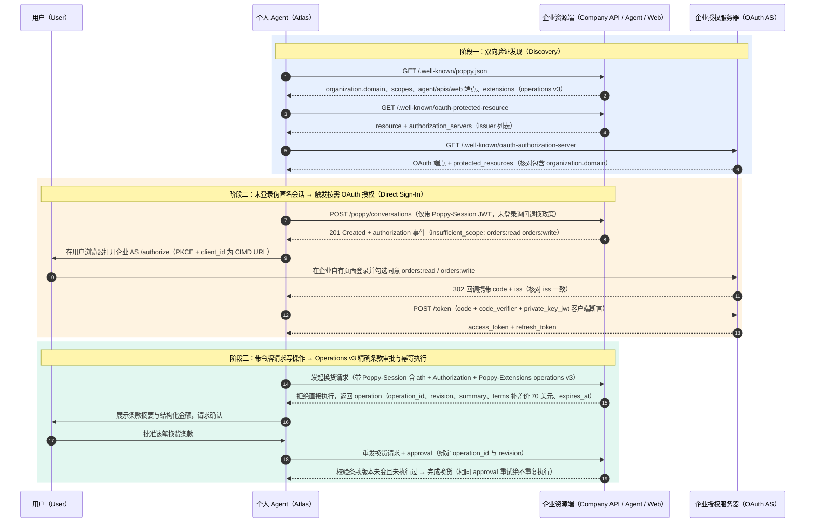
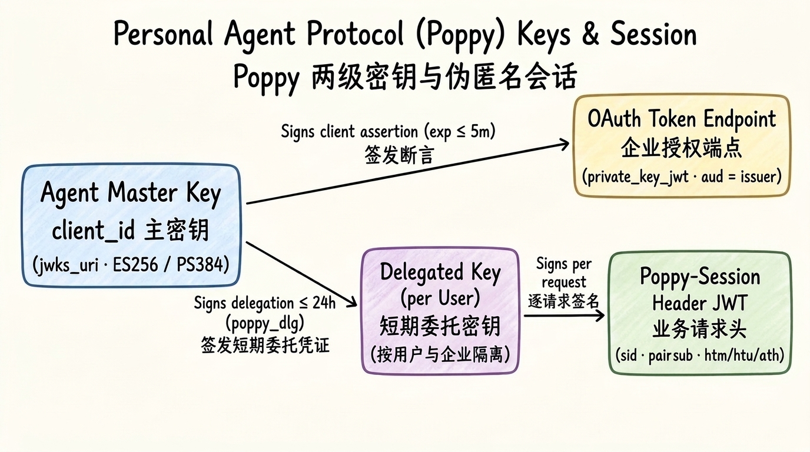

# Personal Agent Protocol（Poppy）

## 摘要

**Personal Agent Protocol**（简称 **Poppy**，当前规范版本 **1.0**，Apache 2.0 许可）是一套定义个人智能体（[[wiki/topics/ai/personal-agent|Personal Agent]]，代表单个自然人用户行动的软件）如何与外部企业（Company）协同办事的开放协议。它基于 HTTPS、[[wiki/topics/architecture/oauth|OAuth 2.0]]、[[wiki/topics/architecture/jwt|JWT]]、OpenAPI 和 [[wiki/topics/ai/mcp|MCP]] 构建，标准化了服务发现（`/.well-known/poppy.json`）、伪匿名跨通道会话（`Poppy-Session`）、细粒度账户授权（Direct / Device Sign-In），以及在同一个会话内横跨 **API（OpenAPI / MCP）**、**受控网页浏览（Browser Join）** 与 **企业客服 Agent 对话（Company Agent Conversations）** 的完整交互流程。[Introduction][intro]、[Spec §1][spec]

它解决的核心问题是打破当前个人 Agent 访问外部商业服务时的“全有或全无”困境：要么企业通过反爬与验证码全面封杀 Agent，要么用户把主账号密码交给 Agent 让其伪装成真人在网页上点击（导致用户无法限制 Agent 权限，企业也无法区分人机或提供更高效的接口）。通过 Poppy，企业和用户可以在**完全封禁 → 匿名查询 → 登录后只读 → 绑定具体条款经用户批准后执行写操作 → 完全代管**之间按需选择。[Introduction][intro]

## 协议分层与架构角色

Poppy 将**请求身份识别**、**跨通道会话连续性（Sessions）**与**账户访问授权（Account Access）**三者解耦。企业在域名下发布一次配置，任何兼容的 Personal Agent 均可按相同规范接入：[Spec §1.1, §2][spec]

| 协议层 | 机制与载荷 | 解决的问题与独立性边界 |
| --- | --- | --- |
| **1. Discovery（发现层）** | `GET /.well-known/poppy.json` + RFC 9728 受保护资源元数据 + RFC 8414 授权服务器元数据 | 发现企业支持的通道（`apis`、`web`、`agent`）、权限 `scopes` 与风险提示 `scope_hints`、不支持的任务及扩展；双向验证域名与 OAuth `issuer` 绑定 |
| **2. Operator Recognition（运营商识别）** | HTTP Message Signatures（RFC 9421）+ Web Bot Auth 签名 | 让现有的边缘 WAF / 反爬网关在进入业务层前识别合法的 Agent 运营商；仅作兼容性准入，不替代会话校验或账户授权 |
| **3. Sessions（会话层）** | 每个请求携带 `Poppy-Session` 头（由短期委托密钥签名的 `poppy-session+jwt`） | 标识 Personal Agent（`iss`）、当前会话（`sid`）及按企业隔离的伪匿名用户 ID（`sub`）；**未登录请求同样携带**，用于跨 API、对话和网页串联购物车等状态 |
| **4. Account Access（账户授权层）** | 标准 OAuth 2.0（Direct Sign-In 授权码+PKCE / Device Sign-In 设备码）+ `private_key_jwt` 客户端断言 + 可选 DPoP | 用户在企业自有页面登录并勾选授予 Agent 的 `scopes`；仅提供未登录服务（如公开查房态）的企业无需运行 OAuth 服务器 |
| **5. Interaction Channels（交互通道）** | OpenAPI 3.0/3.1、远程 MCP、Browser Join 网页会话、`poppy` 企业 Agent 对话（支持转真人与 Direct Conversation） | 企业按自身已有资产开放一个或多个通道，同一 `sid` 与账户授权在各通道间共享 |
| **6. Task Coverage & Extensions（任务覆盖与扩展）** | `tasks.endpoint`（`excluded_tasks`、`skill_index`、`feedback`）与 `Poppy-Extensions`（如 `operations` v3） | 提前声明不提供的操作与替代路径、分发带 SHA-256 校验的 Agent Skills，以及对换货/扣款等写操作执行绑定精确条款的审批与防重 |

## 核心数据流：从发现企业到条款审批执行

下面以官方规范中的典型场景——**用户让个人 Agent（Atlas）去户外品牌企业（Manzanita Supply）退换一件不够保暖的冲锋衣，补差价 70 美元换购加厚款**——串联一次完整的协议交互时序：[Spec §3–§8][spec]、[Operations Extension][ops]



## 关键机制拆解

### 1. 双向防冒用发现与 `scope_hints`

企业通过 `https://{domain}/.well-known/poppy.json` 暴露能力。为防止恶意站点复制别人的 `poppy.json` 或将 Agent 诱导至假冒的 OAuth 服务器，协议要求两项强制核对：[Spec §3, §3.2, §10.3][spec]

1. **`organization.domain` 必须等于最终返回 `poppy.json` 的主机名**（允许 HTTPS 重定向，但最终 URL 路径必须精确为 `/.well-known/poppy.json` 且不带查询参数，防止利用站点文件上传接口伪造发现文档）。
2. **域名与 OAuth `issuer` 双向互认**：Agent 从 `https://{organization.domain}/.well-known/oauth-protected-resource`（RFC 9728）读取 `authorization_servers` 找到企业 `issuer` 后，拉取该 `issuer` 的授权服务器元数据（RFC 8414），必须确认其中的 `protected_resources` 列表反过来包含了 `https://{organization.domain}`。

在权限声明上，除了用自然语言在 `auth.scopes` 中说明每个 scope 解锁哪些任务外，企业还可以在 `auth.scope_hints` 中为每个 scope 标注两个结构化风险字段，供个人 Agent 在发起授权前评估影响程度：[Spec §4.7][spec]

- `changes`：`none`（只读无修改）、`reversible`（可逆修改，如修改收货地址）或 `irreversible`（不可逆操作，如取消订单、删数据、发消息、扣款；遇到未知枚举值一律按 `irreversible` 处理）。
- `personal_data`：`true`（会读取或修改联系方式、地址、支付方式等个人敏感信息）或 `false`。

### 2. Agent 身份、委托密钥（Delegated Keys）与伪匿名 `Poppy-Session`

Poppy 没有要求个人 Agent 事先去每家企业后台手动注册 OAuth 客户端，而是结合 **CIMD（Client ID Metadata Document）** 与**两级密钥架构**解决身份与隐私问题：[Spec §4.1, §5.1, §5.2, §10.7][spec]



- **按企业隔离的伪匿名 `User ID`（Pairwise `sub`）**：Personal Agent 为每个用户在每家企业生成一个稳定、不透明且互不相同的 `User ID`（严禁包含或由邮箱、手机号、姓名做哈希派生）。这样企业在未登录状态下也能跨会话识别回访用户，但**不同企业之间无法通过 `User ID` 串通比对出同一个自然人**。Agent 也可在隐私浏览模式下为单次匿名会话生成用完即弃的临时 `User ID`。[Spec §5.1][spec]
- **为什么用委托密钥（`poppy_dlg`）签 `Poppy-Session`**：Agent 的每个 API、对话和网页抓取请求都要签名 `Poppy-Session` JWT。如果直接用 `jwks_uri` 里的主私钥高频签名，不仅主密钥暴露面大，且签名服务会看到用户每次访问了哪家企业。因此主密钥只用来签发有效期不超过 24 小时、**不包含任何用户 ID 或企业标识**的委托凭证（`typ: poppy-delegation+jwt`），放入 `Poppy-Session` 头的 `poppy_dlg` 字段；真正的每次请求由绑定单个 `User ID` 的短期委托私钥签名。[Spec §5.2, §10.7][spec]
- **可选 RSA 盲签名（Blind Signing）防平台自窥探**：如果个人 Agent 运营商希望连自己的后端签名服务都不知道用户连接了哪些企业，可使用 RFC 9474 的确定性盲签名变体（`PS384`）：在用户终端设备上生成含高熵 `jti` 的客户端断言或委托凭证，盲化后发给服务端主密钥签名，终端去盲后发给企业。为此规范强制要求所有企业同时接受 `ES256` 和 `PS384`。[Spec §4.1, §5.2, §10.7][spec]
- **请求级防重放与令牌绑定**：每个 `Poppy-Session` JWT 均绑定当前请求的 HTTP 方法（`htm`）、去查询参数的 URL（`htu`）以及当前访问令牌的 SHA-256 哈希（`ath`），与 OAuth DPoP（RFC 9449）同构。会话校验失败统一返回 **HTTP 400 `{"error": "invalid_session"}`**，刻意不使用 HTTP 401，以免标准 OAuth 库误以为访问令牌失效而将其丢弃。[Spec §5.2, §5.3][spec]

### 3. 三类交互通道的协同与 Browser Join

同一会话（`sid`）下的状态与账户授权横跨三种通道，企业可按改造进度渐进开放：[Spec §6, §7, §8][spec]

1. **结构化 API（OpenAPI 与远程 MCP）**：
   - 在 `poppy.json` 的 `apis` 中列出 `openapi`（3.0/3.1）或 `mcp`（Streamable HTTP，兼容 MCP 2025-06-18 与 [[wiki/topics/ai/mcp-2026-07-28|2026-07-28 规范]]）。
   - 与普通 [[wiki/topics/ai/mcp-authorization|MCP 授权流程]] 的一点重要区别：个人 Agent 在初始 OAuth 登录时**不传 `resource` 参数**（一次登录覆盖该企业所有服务）；当具体调用的 MCP 服务器在自己的 RFC 9728 元数据中声明了专属 `resource` URL 时，Agent 再用已拿到的刷新令牌带 `resource` 参数静默换取该 MCP 服务器专用的访问令牌，无需再次弹窗打扰用户。[Spec §4.5, §7][spec]
2. **受控浏览器加入会话（Browser Join，访问令牌不进浏览器）**：
   - 当某些长尾操作没有 API、必须由个人 Agent 控制浏览器（含无头浏览器）在企业网站上完成时，直接把 OAuth 访问令牌塞进浏览器 URL 或脚本极易泄露，而靠 Cookie 单步注入又容易遭受跨站会话固定（CSRF，攻击者把受害者浏览器绑进攻击者控制的会话以窃取用户输入的支付/地址信息）。
   - Poppy 通过 `web.browser_session_endpoint` 设计了**三步双向绑定握手**：[Spec §6, §10.6][spec]
     1. **浏览器取码**：Agent 控制的浏览器顶层导航打开 `GET {browser_session_endpoint}`，企业返回含隐藏一次性 `code` 的表单，并种下绑定该浏览器的短效 Cookie（`__Host-poppy_join`，`SameSite=Strict; HttpOnly; Secure`，响应带 `Cache-Control: no-store` 与 `frame-ancestors 'none'`）。
     2. **Agent 后台授权**：Agent 在模型不可读的宿主代码中从自己浏览器页面读取该 `code`（严禁授权来自对话或外部页面的 `code`），通过后端 HTTP 请求发送 `POST {browser_session_endpoint}/authorize`，携带 `Poppy-Session` 头及含 `poppy:browser-sign-in` scope 的访问令牌。
     3. **浏览器提交换取会话 Cookie**：浏览器提交第 1 步的表单 `POST {browser_session_endpoint}`，企业同时核验第 1 步的绑定 Cookie 与第 2 步的后台授权记录后，为浏览器种下正式业务会话 Cookie。**全程 OAuth 访问令牌从未经过浏览器**。
   - 若企业网站无法按 OAuth scope 限制网页内的按钮操作（一旦登录网页即拥有账户完整权限），企业必须在 `poppy.json` 中声明 `"web": { "unscoped": true }`，并在 OAuth 授权页明确告知用户 `poppy:browser-sign-in` 代表完整网站访问权；若企业具备完善的 API/Agent 且不希望 Agent 爬网页，可声明 `"web": { "disabled": true }`。[Spec §6][spec]
   - 配合 **`browser-control` 扩展（v1）**，当网页遇到必须由真人亲自完成的步骤（如航司值机确认危险品声明）时，企业页面可声明移交控制权，由个人 Agent 将浏览器画面交给用户操作完成后再接回。[Extensions][ext]
3. **与企业 Agent 及真人客服的结构化对话（Conversations）**：
   - 通过 `agent.protocols`（类型为 `poppy`）发起 JSON over HTTPS 对话，支持长轮询（`?cursor=...&wait=30`）与 SSE 流式事件（`text-delta`、`working`、`state`）。每条 `POST` 请求带用户级唯一 `id` 保障重试幂等。[Spec §8.2–§8.6][spec]
   - **人机身份显式标注与因果游标**：每条消息必填 `author.type`（`agent` 或 `human`，Agent 转述或总结用户的话必须标为 `agent`，只有原封不动转发用户原话才标为 `human`）；AI 消息可带 `as_of_request` / `as_of_cursor` 标明撰写该消息时已看到了对方哪一步，解决全双工交叉发言时的语境对齐；用户侧可通过 `context`（`locale`、`time_zone`、`user_available`）动态告知企业“用户当前是否在线可回答问题”。[Spec §8.4, §8.8][spec]
   - **真人客服转接（Handoff）与直接对话（Direct Conversation）**：Agent 可调用 `POST .../handoff` 请求企业真人客服接入（状态变为 `responder: "human"`）；当企业要求直接跟用户本人核实（发出 `user_requested` 事件）或用户主动要求自己聊时，Agent 通过 `parent_conversation_id` 开启关联的 **Direct Conversation**，让用户看到干净的独立对话界面，而企业侧保留此前与 Agent 沟通的完整上下文。[Spec §8.9, §8.10][spec]

### 4. `operations` 扩展（v3）：绑定精确条款的审批与至多一次执行

在常驻型 Agent 中，像退换货补差价、改签机票、取消订阅这类具有外部业务副作用的写操作，既需要确保**用户批准的就是最终实际执行的精确条款**，又需要解决 [[wiki/syntheses/ai/agent-harness-runtime-architecture#限制二：长任务崩溃与外部副作用不确定性|长任务崩溃恢复时的外部写操作防重]]。Poppy 的 `operations` 扩展（v3）在协议层标准化了三步确认闭环：[Operations Extension §1–§7][ops]

1. **拦截并返回条款对象（Operation）**：个人 Agent 正常发起请求（声明 `Poppy-Extensions: "operations";v="3"`），企业**不执行动作**，而是拒绝请求并返回结构化 `operation`（API 返回 HTTP 403 `approval_required`，MCP 工具返回 `isError: true` + `structuredContent.operation`，对话放入 `extensions.operations.operation`）：
   ```json
   {
     "operation_id": "exc_5Rt2",
     "revision": "1791487200-k3Jd9Qx2mW8v",
     "summary": "Exchange the Stormline Jacket (M) on order ord_7Hk2 for the Stormline Insulated Jacket (M), for $70.00 more, charged to the card used for the order.",
     "terms": {
       "order_id": "ord_7Hk2",
       "item_id": "itm_4Qa",
       "replacement_sku": "stormline-insulated-m",
       "price_difference": { "amount": "70.00", "currency": "USD" }
     },
     "expires_at": "2026-10-08T12:20:00-07:00"
   }
   ```
   其中 `summary` 严禁渲染链接、图片或 HTML（防止审批卡片钓鱼跳转）；若后续价格或尺码变动，企业保持 `operation_id` 不变、更换新的 `revision`。
2. **用户确认或按预授权指令确认**：个人 Agent 向用户展示条款并获取确认（对应常驻架构中的 Deferred tool call 挂起恢复），或在用户此前已明确给出包含该具体条件的指令时代表用户确认。
3. **携带绑定 `revision` 的批准重发（保证 At-most-once）**：Agent 附带 `approval`（包含 `operation_id` 与所批准的 `revision`）重新发起原请求。企业核对当前条款与 `revision` 完全一致且未过期后执行操作；**携带相同 `approval` 的网络重试绝不会重复执行第二次操作**。

### 5. 任务覆盖边界（Task Coverage）与企业技能分发（Skill Index）

为避免个人 Agent 在企业不支持的操作上反复盲试 API 或刷网页，企业可通过 `poppy.json` 中的 `tasks.endpoint` 返回三项指引：[Spec §9][spec]

- **`excluded_tasks`**：明确列出不通过本协议提供的操作（如“发起电汇”“注销账户”）及面向人类的替代办理路径（`alternative`，可指向特定网页、App Universal Link、OpenAPI `operation_id` 或 MCP `tool`）。
- **`skill_index`**：复用 Agent Skills 发现提案（`0.2.0` schema，参见 [[wiki/topics/ai/awesome-agent-skills|Agent Skills]]），向个人 Agent 分发带 `sha256:` 完整性摘要校验的 `SKILL.md` 或归档包，说明如何按正确顺序组合调用该企业的多个 API 完成复杂业务流程。规范明确规定企业 Skill 仅属于不可信业务说明，不赋予任何权限，且默认禁止执行其中的脚本。[Spec §9.4][spec]
- **`feedback.endpoint`**：当个人 Agent 发现某项用户任务在现有 API、企业 Agent 和网页中均无法完成且不在排除列表中时，可向企业发送不含用户个人隐私的结构化任务反馈，企业也可直接同步返回替代操作指引 `alternative`。[Spec §9.3][spec]

## 与 MCP、ACP 的协议边界对照

在当前 Agent 协议栈中，[[wiki/topics/ai/mcp|MCP]]、[[wiki/topics/ai/agent-client-protocol|ACP]] 与 **Poppy** 分别处于不同连接面，互不替代且可组合使用（例如 Poppy 在 `apis` 中直接挂载企业的远程 MCP 服务器）：

| 协议 | 连接双方 | 核心职责 | 身份与信任假设 |
| --- | --- | --- | --- |
| **[[wiki/topics/ai/mcp\|MCP]]** | Agent Host ↔ 外部工具 / 数据源 | 标准化工具（Tools）、资源（Resources）与提示词模板的发现和调用 | 工具级调用；HTTP 传输采用 OAuth 2.0（RFC 9728 + RFC 8414），按单个 MCP Server 粒度授权 |
| **[[wiki/topics/ai/agent-client-protocol\|ACP]]** | 编辑器 / UI 客户端 ↔ Coding Agent | 标准化本地或远程会话生命周期、流式消息/终端/Diff 更新与工具权限弹窗 | 同一用户控制下的可信客户端与 Agent 子进程（主要经 stdio JSON-RPC 通信） |
| **Poppy（本页）** | 用户的 Personal Agent ↔ 外部商业公司（Company） | 标准化企业服务发现、跨通道伪匿名会话、企业账户 OAuth 登录，以及 API / MCP / 网页浏览 / 企业 Agent 对话与商业条款审批 | 跨组织零信任边界：企业需防范恶意爬虫与越权，个人 Agent 需防范恶意企业提示词注入、跨站追踪与凭据泄露 |

## 工程限制与安全边界

1. **跨企业提示词注入（Cross-Company Prompt Injection）**：个人 Agent 同时持有用户的私人上下文并在多家企业维持活跃会话，而企业返回的对话消息、API 描述、网页内容、`excluded_tasks` 指引和 `skill_index` 均会进入模型上下文。实现方必须将企业返回的所有内容严格作为数据而非指令处理，**严禁因为企业 A 返回的内容要求去访问或向企业 B 发送数据**，只允许执行用户任务本身所需的动作。[Spec §10.1][spec]
2. **模型上下文与密钥彻底隔离**：遵循 IETF `draft-ietf-wimse-aims` §8，OAuth 访问令牌、刷新令牌、`Poppy-Session` JWT、私钥、授权码、PKCE `code_verifier`、设备码及 Browser Join 一次性 `code` **严禁进入大模型上下文**，必须由模型不可读的宿主代码完成签名、换票与请求头注入。[Spec §6, §10.2][spec]
3. **域名校验不能替代防钓鱼识别**：`/.well-known/poppy.json` 与 OAuth 元数据的双向校验只能证明“当前域名控制者认可该配置”，不能证明高仿域名（如 `manzanita-supply-support.example`）真的是用户想找的品牌。识别正确域名并在授权时向用户清晰展示真实域名，仍是个人 Agent 宿主软件的责任。[Spec §10.3][spec]
4. **跨设备登录的诱导授权（Consent Phishing）风险**：当 Direct Sign-In 的授权链接被发到用户另一台设备打开，或使用 Device Sign-In 时，攻击者可能自己发起登录请求再把链接/设备码骗受害者批准，从而拿到受害者账户的令牌。因此非本机闭环回调的场景必须遵循 RFC 10027（BCP 247），每次强制携带 `prompt=consent` 并在企业授权页完整列出所有将授予的 scopes。[Spec §4.2, §4.3, §10.8][spec]

## 相关页面

- [[wiki/topics/ai/personal-agent|Personal Agent 与 Super-agent]]
- [[wiki/syntheses/ai/always-on-and-super-agent-architecture|常驻型 Agent（Always-on / Super-agent）的系统架构]]
- [[wiki/topics/ai/mcp|MCP]]
- [[wiki/topics/ai/mcp-authorization|MCP 授权流程]]
- [[wiki/topics/ai/agent-client-protocol|Agent Client Protocol]]
- [[wiki/topics/architecture/oauth|OAuth]]
- [[wiki/topics/architecture/jwt|JWT]]

## 来源指针

- [[raw/sources/personal-agent-protocol|Personal Agent Protocol（Poppy）v1.0 来源核查记录]]
- [Personal Agent Protocol 官网](https://personalagentprotocol.org) 与 [文档索引 (`llms.txt`)](https://personalagentprotocol.org/llms.txt)
- [Introduction][intro]
- [Specification v1.0][spec]
- [Extensions 总览][ext] 与 [Operations Extension v3][ops]

[intro]: https://personalagentprotocol.org/docs/introduction.md
[spec]: https://personalagentprotocol.org/docs/1.0/spec.md
[ext]: https://personalagentprotocol.org/docs/1.0/extensions.md
[ops]: https://personalagentprotocol.org/docs/1.0/extensions/operations.md
