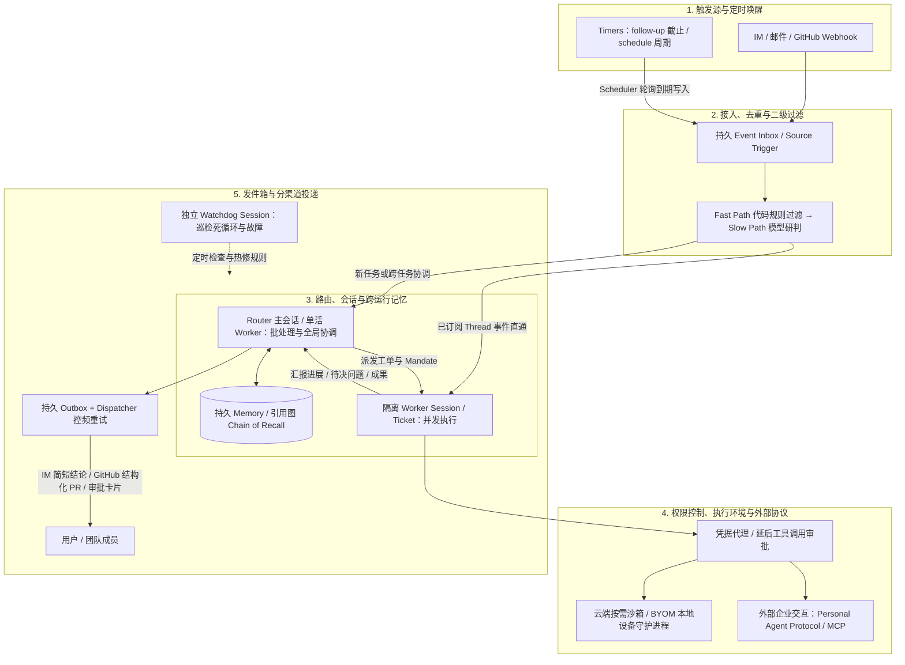

# Personal Agent 与 Super-agent

## 摘要

**Personal Agent（个人智能体）** 与 **Super-agent（超级智能体）** 指脱离单次手动会话（Session）、在后台长期存续并跨渠道响应外部事件的常驻型（Always-on）自主 Agent 系统。两者底层共享同一套基础模型与工具调用循环（[[wiki/topics/ai/agent|Agent Loop]]），区别在于外围架构接管了唤醒调度、跨运行状态管理、多任务并发路由以及对外服务协议：当系统面向个人跨设备处理邮件、日程、即时通讯与外部商业服务时，通常称为 **Personal Agent**；当系统作为连续实体同时横跨 IM 群聊、代码仓库与 CI 推进多项复杂任务时，DeepSeek Harness 将这一形态及其系统架构统称为 **Super-agent**。[Anthropic 指南][always-on]、[DeepSeek Super-agent §1][dsh-article]

## 为什么需要脱离单会话模型

在传统的单会话 Agent（如命令行或 IDE 内的单窗口 [[wiki/topics/ai/code-agent|Code Agent]]）中，一个 Session 同时承担两项职责：**管理模型的上下文窗口**，以及充当**人类管理项目的最小工作单元**。当模型单次执行能力提升后，继续以手动单 Session 为中心会遇到三个工程瓶颈：[DeepSeek Super-agent §1–§2][dsh-article]

1. **人的注意力成为多任务并发上限**：经验上一个人同时只能手动切换和跟踪 3 到 5 个活跃 Session，跨窗口同步背景信息的负担随并发数线性增加。
2. **单步同步循环阻塞交互**：即便给单 Session Agent 接上外部消息通道或 [[wiki/topics/ai/mcp|MCP]]，只要底层仍是单会话同步 ReAct 循环，长耗时命令就会阻塞后续消息响应，不同任务的中间推理也会交错污染同一个上下文窗口。
3. **设备生命周期与外部服务边界受限**：绑定单台开发机的 Agent 在机器休眠或断网时即停摆；而在访问外部商业公司（电商、航司、SaaS）时，要么被反爬机制拦截，要么需要交出用户主密码伪装成真人在网页上点击。[DeepSeek Super-agent §1][dsh-article]、[Poppy Introduction][poppy-intro]

| 维度 | 单会话交互式 Agent | 常驻型 Personal Agent / Super-agent |
| --- | --- | --- |
| **驱动方式** | 人类在终端或聊天框逐轮输入 Prompt | 环境事件（Webhook、群聊、邮件、PR/CI）与定时器（跟进截止时间、周期计划）共同触发 |
| **基本工作单元** | 单个手动管理的 Session | 后台按事件唤醒的短运行周期（Run），或由全局路由层派发的隔离工单（Ticket / Worker Session） |
| **物理运行态** | 对话期间进程常驻，关闭终端或睡眠即停止 | 绝大部分时间处于休眠态，事件到达时由计算容器唤醒执行、落盘状态后再次休眠 |
| **人机交互时机** | 全程流式展示每一步推理与工具输出 | 后台静默执行；仅在需要澄清/授权、遇到阻塞或产出可交付结果时按渠道规范通知人 |
| **外部服务接入** | 本地环境变量凭据或面向工具的 [[wiki/topics/ai/mcp\|MCP]] | 外部代理注入凭据、延后工具调用审批，以及面向外部企业的 [[wiki/topics/ai/personal-agent-protocol\|Personal Agent Protocol（Poppy）]] |

## 四个核心特征

DeepSeek Harness 将常驻型 Super-agent / Personal Agent 的目标体验归纳为四个特征，这四个特征无法由单个 ReAct 循环提供，必须由外围系统架构协同实现：[DeepSeek Super-agent §1][dsh-article]

- **Continuous（跨渠道连续）**：用户直接在日常工作环境（IM 群聊、邮件、GitHub Issue/PR 评论）中与它交互，始终面对同一个 Agent 实体，无需关心“会话 X 是否知道会话 Y 里的改动”。
- **Productive（高并发产出）**：前一条指令或长耗时命令尚未跑完时即可接收新指令，后台隔离多个上下文并行推进复杂任务。
- **Proactive（事件驱动主动响应）**：监听环境事件流与定时触发器，识别值得处理的事项并在后台主动推进（如静默复现问题或预拟日程回复），其余时间保持安静。
- **Persistent（持续在线与异常自愈）**：计算与状态、执行环境解耦，不随单台终端设备休眠而中断，并在长程运行中通过持久队列与外部巡检恢复故障。

## 核心数据流与系统全貌

下图展示一次外部事件进入常驻型 Agent，经内部调度与记忆读取、调用本地工作区或外部商业服务，最终将结果送达用户的完整路径：[Anthropic 指南][always-on]、[DeepSeek Super-agent §2–§5][dsh-article]、[Poppy Spec §1][poppy-spec]

## 主题版图与页面导航

围绕 Personal Agent 与 Super-agent，本知识库按**内部系统架构**、**外部交互协议**和**底层持久与工作区组件**三层组织相关页面：

### 1. 内部系统架构（如何唤醒、路由、记忆与自愈）

- [[wiki/syntheses/ai/always-on-and-super-agent-architecture|常驻型 Agent（Always-on / Super-agent）的系统架构]]：对比整合 Anthropic《Building always-on agents》的五个基础组件（Event Inbox、Timers、Memory、Permissions、Outbox）与 DeepSeek《Exploring Super-agent Design》及 `dsh-superagent-prototype` 的五大模块（Router-Worker 两层架构、二级过滤与 Thread 订阅直通、Inline & Spill + Chain of Recall、全双工异步调用、计算/状态/BYOM 环境解耦与独立 Watchdog）。
- [[wiki/syntheses/ai/agent-loop-control-boundaries|Agent 循环工作流的控制边界]]：从 Turn-based、Goal-based、Time-based 到 Proactive loop 的控制权移交，以及“最大化 Agent 产出、最小化人的注意力投入”的双重优化目标。

### 2. 外部服务与商业交互协议（如何代表用户对外办事）

- [[wiki/topics/ai/personal-agent-protocol|Personal Agent Protocol（Poppy）]]：个人 Agent 代表用户与外部企业（Company）交互的开放协议（v1.0），定义 `/.well-known/poppy.json` 发现、按企业隔离的伪匿名 `Poppy-Session` JWT、标准 OAuth Direct/Device Sign-In、跨 OpenAPI / MCP / 网页 Browser Join / 企业客服 Agent 对话的统一会话，以及 `operations` 精确条款审批与幂等扩展。
- [[wiki/topics/ai/mcp|MCP]] 与 [[wiki/topics/ai/mcp-authorization|MCP 授权流程]]：连接宿主与外部工具/数据源的标准协议及其基于 RFC 9728 / RFC 8414 的运行时 OAuth 授权流程。
- [[wiki/topics/ai/agent-client-protocol|Agent Client Protocol]]：编辑器/客户端与 Coding Agent 之间的会话、流式更新与权限确认协议（特别是 v2 Draft 面向后台长任务与多观察者拆解 `session/prompt` 生命周期的设计）。

### 3. 底层持久运行时、工作区与记忆组件

- **可恢复执行与 Harness 演进**：[[wiki/syntheses/ai/agent-harness-runtime-architecture|Agent Harness 运行时架构与演进]]、[[wiki/topics/ai/pi-durable|Pi Durable]]、[[wiki/topics/ai/agentscope-durable|AgentScope Durable]]、[[wiki/topics/ai/tetral|Tetral]]。
- **持久工作区与多端接入**：[[wiki/topics/ai/rivet-agentos|Rivet agentOS：执行环境与持久会话]]、[[wiki/topics/ai/cloudflare-computer|Cloudflare Computer]]、[[wiki/topics/ai/botmux|Botmux：在飞书中使用本地 Coding CLI]]、[[wiki/syntheses/architecture/machine-identity-and-agent-provisioning|机器身份与 Agent 节点自举授权范式]]。
- **跨会话记忆与本地证据索引**：[[wiki/topics/ai/agent-memory|Agent Memory]]、[[wiki/syntheses/ai/agent-memory-implementation|如何实现 Agent Memory]]、[[wiki/topics/ai/obelisk|Obelisk]]、[[wiki/comparisons/ai/agent-memory-approaches|Agent 记忆方案对比：gbrain、memU、agentmemory 与 Letta]]。

## 工程限制与风险边界

1. **不可信事件流放大提示词注入（Prompt Injection）风险**：常驻型 Agent 直接监听公开群聊、外部邮件、GitHub 评论及第三方企业返回的数据。若缺乏确定性发送者准入检查（如 `dsh-superagent` 的 `Gate` 与 `Mandate` 范围校验）或跨企业数据隔离（如 Poppy §10.1 禁止因企业 A 的返回内容去操作企业 B），攻击者可通过外部事件诱导 Agent 执行未授权操作。[DeepSeek Super-agent §8.4][dsh-article]、[dsh-superagent Authorization][dsh-auth]、[Poppy Spec §10.1][poppy-spec]
2. **云端控制面与本地设备（BYOM）的信任耦合**：将云端常驻 Agent Loop 通过轻量守护进程连接到个人电脑或开发机（BYOM）时，若云端会话被外部输入注入或服务端遭入侵，攻击面会延伸到存有未提交代码、内网权限和私人数据的全部挂载终端。[DeepSeek Super-agent §8.4][dsh-article]
3. **凭据一旦进入模型上下文即可能外泄**：无论是内部研发环境还是外部商业操作，模型都可能被诱导在回复中复述上下文里的字符串。因此访问令牌、密码、私钥与一次性验证码必须通过外部代理注入（Credential Proxy）或在模型不可读的宿主代码中处理，确保 Agent“能使用凭据但看不见凭据”。[Anthropic 指南][always-on]、[DeepSeek Super-agent §8.4][dsh-article]、[Poppy Spec §10.2][poppy-spec]
4. **跨月度运行的长期记忆衰减与噪音控制**：引用图按需召回（Chain of Recall）和文件索引适合近期任务续接；当系统连续运行数月后，过期事实清理与全局记忆分片仍是主要瓶颈。同时，主动触发规则若未经“仅记录不行动（observe）”阶段验证就全量开启，极易产生大量无效通知消耗人类注意力。[Anthropic 指南][always-on]、[DeepSeek Super-agent §8.1][dsh-article]、[dsh-superagent Philosophy][dsh-phil]

## 相关页面

- [[wiki/syntheses/ai/always-on-and-super-agent-architecture|常驻型 Agent（Always-on / Super-agent）的系统架构]]
- [[wiki/topics/ai/personal-agent-protocol|Personal Agent Protocol（Poppy）]]
- [[wiki/topics/ai/agent|Agent]]
- [[wiki/topics/ai/agent-harness|Agent Harness]]
- [[wiki/syntheses/ai/agent-loop-control-boundaries|Agent 循环工作流的控制边界]]
- [[wiki/syntheses/ai/agent-harness-runtime-architecture|Agent Harness 运行时架构与演进]]
- [[wiki/topics/ai/botmux|Botmux：在飞书中使用本地 Coding CLI]]

## 来源指针

- [[raw/sources/building-always-on-agents|Anthropic《Building always-on agents》核查记录]]（William Hu，2026-11-13）
- [[raw/sources/deepseek-superagent|DeepSeek《Exploring Super-agent Design》与 dsh-superagent-prototype 核查记录]]（2026-11-01，原型仓库固定提交 `8c32a9dc5d72c033816c6a8110b37f40cf94fba4`）
- [[raw/sources/personal-agent-protocol|Personal Agent Protocol（Poppy）v1.0 核查记录]]（2026-11-10 / v1.0）

[always-on]: https://claude.com/resources/articles/building-always-on-agents
[dsh-article]: https://x.com/DeepSeekHarness/status/2116857257245987236
[dsh-phil]: https://github.com/deepseek-ai/dsh-superagent-prototype/blob/8c32a9dc5d72c033816c6a8110b37f40cf94fba4/docs/000-philosophy.md
[dsh-auth]: https://github.com/deepseek-ai/dsh-superagent-prototype/blob/8c32a9dc5d72c033816c6a8110b37f40cf94fba4/docs/002-authorization.md
[poppy-intro]: https://personalagentprotocol.org/docs/introduction.md
[poppy-spec]: https://personalagentprotocol.org/docs/1.0/spec.md
