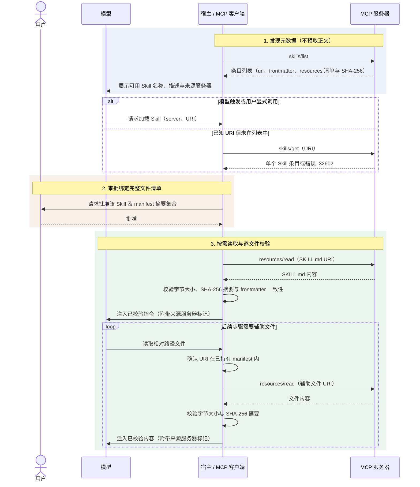

# Skills over MCP

## 摘要

Skills over MCP 是 MCP（Model Context Protocol）的官方扩展（扩展标识符 `io.modelcontextprotocol/skills`，对应 SEP-2640 Final，当前在 MCP 扩展体系中处于 Beta 阶段），基于 MCP `2026-07-28` 协议和既有的 Resources 原语，让 MCP 服务器在工具之外按目录结构分发符合 Agent Skills 规范的 `SKILL.md` 及辅助文件。

它解决的问题是「工具定义与工作流知识分离」：工具名称和 schema 只说明单个接口能做什么，不涵盖多步组合流程、排错步骤或按账号/组织定制的操作手册。把 Skill 放在 MCP 服务器上后，说明文档随服务端代码同步演进，用户不必单独安装本地 Skill 包，客户端也可以先看元数据、用到时再拉正文以节省上下文。2026-11-24 起，Anthropic 在 Claude 与 Claude Code 中将该能力推入公开 Beta。

## 协议机制与核心数据流

### 能力声明

支持 Skills over MCP 的服务器必须在 `server/discover` 响应中同时声明基础 `resources` 能力和 `io.modelcontextprotocol/skills` 扩展，且必须实现 `skills/list` 与 `skills/get`，并通过 `resources/read` 提供 Skill 文件内容：

```json
{
  "capabilities": {
    "resources": {},
    "extensions": {
      "io.modelcontextprotocol/skills": {
        "directoryRead": true
      }
    }
  }
}
```

- `directoryRead` 为可选布尔值（默认 `false`），为 `true` 时表示服务器额外实现 `resources/directory/read`。
- 客户端只有在观察到服务端声明该扩展后，才能调用 `skills/list` 与 `skills/get`；未声明 `directoryRead: true` 时不得调用 `resources/directory/read`。

### 发现、审批与按需读取流程

下图对应 `ext-skills` Beta 规范中静态清单（manifest）型 Skill 的完整加载路径（假设客户端已完成 `server/discover`）：



### 关键设计细节

1. **标识与命名规则**：每个 Skill 是包含 `SKILL.md` 的目录，`SKILL.md` 必须以含 `name` 与 `description` 的 YAML frontmatter 开头，其父目录末段路径必须与 `name` 一致。Skill 的唯一标识是「宿主分配的服务器标识 + `SKILL.md` URI」二元组，而不是 `name`。服务器建议使用 `skill://` scheme，但宿主不得仅凭 URI scheme 把普通资源识别为 Skill。
2. **完整条目与原子分页**：`skills/list` 和 `skills/get` 返回的条目包含三个核心字段——`uri`、`frontmatter`（原样保留全部 YAML 字段）以及 `resources`（包含 `SKILL.md` 和全部辅助文件的完整清单，每项带 `uri`、`sha256` 摘要和字节 `size`），同时附带 `resultType: "complete"`、`ttlMs` 与 `cacheScope`。单条 Skill 的清单不可跨分页拆分；服务器可以返回空或部分列表，但对所有提供的 Skill 都必须支持 `skills/get` 按 URI 直接查询（未知 URI 返回 JSON-RPC `-32602`）。
3. **按需拉取（Lazy Retrieval）**：规范要求宿主**不得**在连接、列举或用户审批阶段提前拉取任何 Skill 文件，只能在加载 Skill 时读取 `SKILL.md`，在实际用到辅助文件时再调 `resources/read`。持久化审批绑定的是 manifest 里的摘要集合，不需要提前下载文件本体。
4. **目录列举与清单快照边界（`resources/directory/read`）**：当 Skill 指令引用目录（如「从 `templates/` 选模板」）时，若服务端声明了 `directoryRead: true`，客户端可调用 `resources/directory/read` 获取该目录的直接子项（非递归，子目录 `mimeType` 为 `inode/directory`）。对带静态清单的 Skill，宿主可以直接用本地已持有的 manifest 回答目录查询；若实时目录结果出现 manifest 中没有的新文件，宿主**不得**把它当作已批准清单的扩展去读取，必须先通过 `skills/get` 刷新条目，触发旧审批失效并重新向用户确认。
5. **动态生成 Skill（`"resources": "dynamic"`）**：内容由服务端按账号或实时数据动态生成、无法提前给出稳定摘要时，条目可将 `resources` 设为 `"dynamic"`，并通过 `resources/directory/read` 发现文件。规范允许宿主拒绝加载这类 Skill；即使接受，也仍须校验 `SKILL.md` 的 frontmatter，且不得将持久化审批视为覆盖未来任意变化的内容。
6. **规模约定**：规范建议服务端单个 Skill 不超过 512 个文件、总计 16 MiB（含 `SKILL.md`）；宿主须至少支持到此规模。

## 安全模型与信任边界

`ext-skills` 规范明确指出：**MCP 提供的 Skill 比普通远程工具调用风险更高**。远程工具在服务端运行，而 MCP Skill 会把服务端编写的指令和辅助文件送进宿主模型上下文，进而驱动模型调用宿主本地工具或执行本机代码。规范由此规定了七项强制约束：

| 风险面 | 规范要求（`ext-skills` Beta） |
| --- | --- |
| 普通读取绕过加载 | 通过 `resources/read` 直接读 `SKILL.md` 不会激活 Skill；加载必须走宿主的 Skill 路径，经过校验和用户审批。 |
| 摘要误当信任根 | manifest 中的 SHA-256 摘要未签名，且与正文来自同一服务器或中间网关，只能检验清单与内容一致，不能证明内容安全或防网关同时篡改。 |
| 服务端静默更新（Rug Pull） | 持久化审批必须绑定审批时的完整 `{uri, digest}` 集合；只要增、删或改动任一文件，旧审批立即撤销，必须重新确认后才能加载或执行。 |
| 冒充本地或其他服务器 Skill | 宿主必须用自己分配的服务器标签做命名空间隔离（不信服务端自报的 `serverInfo.name`），不得让 MCP Skill 静默覆盖本地文件系统 Skill 或其他服务器的同名 Skill；内容入上下文时必须标注 MCP 来源。 |
| 隐式本地代码执行与提权 | 远程 Skill 不得在未经单 Skill 明确审批的情况下触发宿主侧代码执行（含声明式 hook、脚本或正文指示模型运行命令）；Agent Skills frontmatter 的 `allowed-tools` 对 MCP 来源默认忽略，除非用户单独批准。 |
| 跨服务器混淆代理与嵌套提权 | 模型在执行 A 服务器的 Skill 时，宿主须将资源读取绑定到 A 服务器，跨到 B 服务器的 `resources/read` 须逐次经用户确认并标明双方服务器名；目录内嵌套的其他 `SKILL.md` 作为普通辅助文件读取时不生效，激活须重新获批。 |
| 本地磁盘缓存污染 | 本地缓存目录必须排除在所有文件系统 Skill 扫描路径之外；防篡改二选一（仅宿主可写且不原地改写，或每次读取重算 SHA-256 核对）；宿主重启或服务器断开后，缓存文件仍保持 MCP 不可信来源属性。 |

## Claude 与 Claude Code 的实现及工程限制

以下行为来自 Anthropic 2026-11-24 公告及 Claude Code MCP 文档（对应 Claude Code v2.1.331+，基于 MCP `2026-07-28` 协议），属于特定宿主实现，不代表所有 MCP 客户端：

- **命名与触发**：在终端、VS Code 和 Desktop App 的 Code 标签页中，MCP Skill 以 `<server>:<skill>` 暴露（例如 `/docs:pdf`），可通过 `/` 自动补全或 `/skills` 查看；claude.ai connector 自动加 `claude_ai_<name>:` 前缀，插件服务器加 `plugin_<plugin>_<server>:` 前缀。
- **审批与权限控制**：
  - 默认 `auto` 模式下，由分类器在不读 Skill 正文的前提下决定是否允许加载；`Manual` 或 `acceptEdits` 模式下弹出审批提示，选择 **Allow this version** 后绑定当前清单直到文件变化。
  - 可通过 `/permissions` 配置规则：`deny` 写 `Skill(mcp__docs__*)` 禁用该服务器全部 Skill（含手动斜杠命令），`Skill(docs:pdf)` 禁用单个 Skill，`mcp__docs` 同时禁用工具与 Skill；`ask` 强制每次确认（在 `auto` 和 `bypassPermissions` 模式下也生效）；`allow` 的 `Skill(mcp__docs__*)` 仅适用于用户/本地/托管添加的服务器，不适用于 connectors、`.mcp.json` 或插件服务器。
  - 禁用某服务器的 Skill 不会阻止普通 MCP 资源读取，如需一并阻断还须拒绝 `ReadMcpResourceTool`。
- **安全扫描范围与数量/体积限制**：
  - Anthropic 仅对 claude.ai Directory 的三方 connector，以及开启「Skill and plugin security scanning」的 Enterprise 自定义 connector 做扫描；**通过 `claude mcp add` 等方式直接添加的服务器（即使指向 Directory 中的地址）不经过 Anthropic 安全扫描**。
  - 单服务器最多展示 100 个 Skill；进入扫描流程的 Skill 受单文本文件 100 KB、单 Skill 总计 400 KB 限制；常见图片、PDF、字体、音视频和依赖锁文件不扫描也不计入上限；包含压缩包、WebP/OTF 等不支持二进制或 `dist/` 等目录下文本的 Skill 无法加载。
- **支持范围与不可用环境**：
  - 订阅计划：Pro / Max / Ultra 默认开启；Team 需组织 Owner 在管理后台开启 connectors 开关（Enterprise 即将全面开放），非 connector 服务器还需在 managed settings 中设置 `disableDirectMcpSkills: false`。
  - 模型与网络前提：需直连 Anthropic、开启 feature flag 拉取，并使用 Fable、Claude Opus 4.8、Sonnet 5、Haiku 5.5 或更新模型。
  - **明确不支持的场景**：cloud sessions、`claude -p`、`claude remote-control` server mode、GitHub Actions、Agent SDK、Desktop App 中的 connectors / Desktop extensions / `claude_desktop_config.json` 服务器、第三方云提供商或自定义 `ANTHROPIC_BASE_URL` / `apiKeyHelper` / `ANTHROPIC_AUTH_TOKEN`，以及启用 HIPAA、零数据保留（ZDR）或客户托管加密密钥（CMEK）的组织。

## 相关页面

- [[wiki/topics/ai/mcp|MCP]]
- [[wiki/topics/ai/mcp-2026-07-28|MCP 2026-07-28 规范变更]]
- [[wiki/topics/ai/mcp-file-uploads|MCP 文件传输（File Uploads）]]
- [[wiki/syntheses/ai/skill-engineering-artifact-protocol|Skill 工程化的产物协议范式]]
- [[wiki/topics/ai/awesome-agent-skills|Awesome Agent Skills]]

## 来源指针

- [Skills over MCP 概览](https://modelcontextprotocol.io/extensions/skills/overview)与 [SEP-2640](https://modelcontextprotocol.io/seps/2640-skills-extension)
- [ext-skills Beta 规范全文（`specification/beta/skills.mdx`）](https://github.com/modelcontextprotocol/ext-skills/blob/main/specification/beta/skills.mdx)：含目录读取、清单快照与 Security Considerations 细则
- [Claude Code MCP 文档：Use skills from MCP servers](https://code.claude.com/docs/en/mcp#use-skills-from-mcp-servers)：含版本号、权限规则、扫描上限与不支持环境清单
- [Anthropic 公告：MCP servers can now ship skills, run tasks, and more with Claude](https://claude.com/resources/articles/skills-over-mcp-tasks-and-more)
- `raw/sources/claude-skills-over-mcp-tasks-and-more.md`：本次公告存档与规范核查记录
