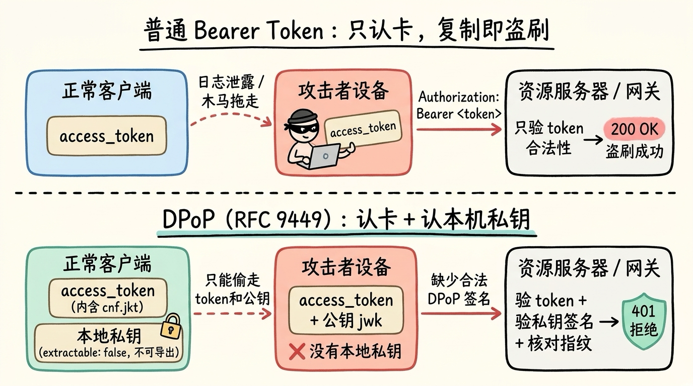
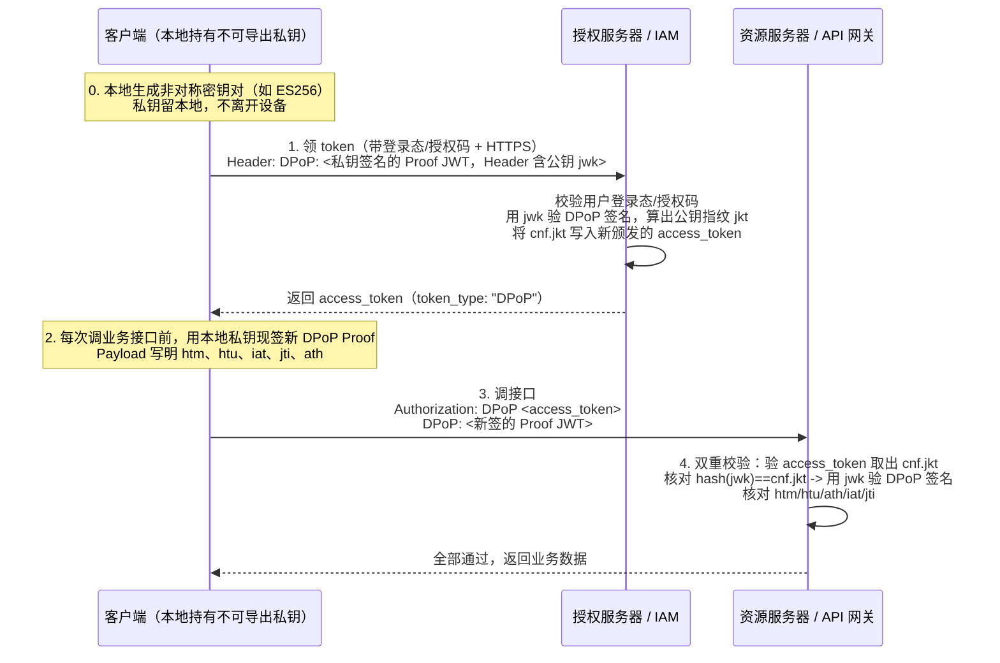
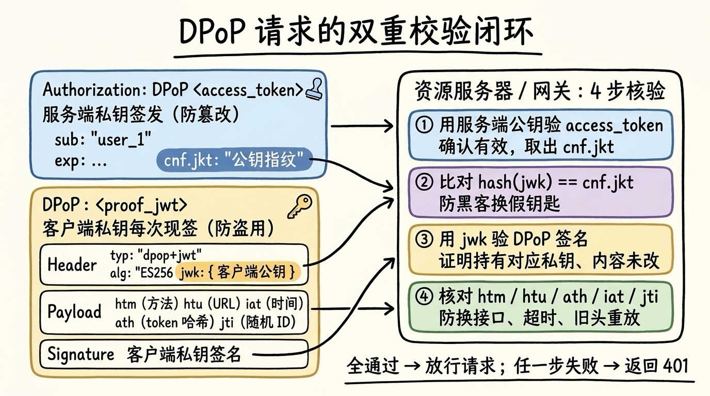

# DPoP

## 摘要

DPoP（Demonstrating Proof of Possession，演示拥有证明，RFC 9449）是 [[wiki/topics/architecture/oauth|OAuth 2.0]] 的应用层**发送方绑定（Sender-Constrained）**机制。它把颁发的 `access_token`（以及公开客户端的 `refresh_token`）和客户端本地持有的一对非对称密钥绑定：每次请求接口时，客户端必须用本地私钥对本次请求现签一个 `DPoP` 请求头，服务端核对后才放行。即使攻击者偷走了 `access_token`，没有客户端本地私钥也无法在别的设备上使用（RFC 9449 §1）。

DPoP 解决的是「**凭证原样被复制后异地盗用**」的问题，而不替代用户登录或客户端身份认证（RFC 9449 §1）。

## 为什么普通 Bearer Token 不够

普通 JWT（JSON Web Token，RFC 7519）或随机字符串形式的 `Authorization: Bearer <token>` 只能**防篡改**（服务端验签会拦下改过内容或过期的 token），但**防不住原样复制盗用**：

- 只要 token 进了日志、被代理抓包、或被木马/恶意插件从浏览器存储里抄走，攻击者拿到自己电脑上原样发给服务端，服务端验签通过就会直接放行。
- 传统的 Session Cookie 同样存在「被木马拖走后异地盗刷」的问题；`HttpOnly` 只能拦住网页内的 JavaScript 读取 `document.cookie`，拦不住终端木马或恶意插件。

DPoP 的思路是把「只认凭证本身」改成「**凭证 + 每次请求现场用本地私钥签名**」：



## 先理清几个容易混的概念

### 1. 签名/验签 vs 加密/解密

普通 JWS 形式的 [[wiki/topics/architecture/jwt|JWT]] 和 DPoP 做的都是**签名 / 验签（私钥签名 → 公钥验签）**，而不是加密（公钥加密 → 私钥解密）：前两段只是 Base64URL 编码，谁都能解码看到原文，靠第三段签名保证原文未被改动且确实出自对应私钥。关于两种方向为何相反及常见工程实例，见 [[wiki/topics/systems/asymmetric-cryptography|非对称加密与数字签名]]。

### 2. JWT、JWK 与 jkt 的关系

- **JWT（JSON Web Token）**：三段式 `Header.Payload.Signature` 凭证格式。DPoP 请求头里的证明（DPoP Proof）本质上就是一个标准 JWT。
- **JWK（JSON Web Key）**：用 JSON 对象表示的一把密钥（例如 `{"kty":"EC","crv":"P-256","x":"...","y":"..."}`）。
- **jkt（JWK Thumbprint，RFC 7638）**：把 JWK 按规范序列化后算出的 SHA-256 哈希指纹，用来简短唯一地标识一把公钥。

## 核心流程

DPoP 的信任建立分两步：**首次领 token 时把公钥指纹刻进 `access_token`**，**之后每次调业务接口时用私钥现签一个一次性 `DPoP` 头**（RFC 9449 §3、§5、§7）。



**第一次交公钥为什么不怕黑客冒充？**

- 首次领 `access_token` 时，请求必须同时携带有效的登录凭证或一次性授权码（外加 PKCE），并通过 HTTPS 传输。攻击者没有用户的登录态或授权码，无法通过第一步身份校验；传输层的 TLS 加密也防止中间人中途替换公钥。
- 首次请求也必须带完整的、用私钥签过名的 `DPoP` Proof（只是此时还没有 `access_token`，不带 `ath` 字段），用来当场证明客户端确实持有该公钥对应的私钥（RFC 9449 §5）。

## DPoP Proof JWT 的格式与字段

DPoP Proof 是放到 HTTP 请求头 `DPoP: <jwt>` 中的紧凑格式 JWT（RFC 9449 §4.2）：

```json
// Header
{
  "typ": "dpop+jwt",
  "alg": "ES256",
  "jwk": {
    "kty": "EC",
    "crv": "P-256",
    "x": "l8tFrhx-34tV3hRICRDY9zCkDlpBhF42UQUfWVAWBFs",
    "y": "9VE4jf_Ok_o64zbTTlcuNJajHmt6v9TDVrU0CdvGRDA"
  }
}

// Payload
{
  "jti": "8f3a1c2e-5d4b-4a9e-9c12-7e6f5a4b3c2d",
  "htm": "POST",
  "htu": "https://api.example.com/v1/docs",
  "iat": 1764057721,
  "ath": "fUHyO2r2Z3DZ53EsNrWBb0xWXoaNy59IiKCAqksmQEo"
}
```

### Header 要点

- **`typ` 必须是 `"dpop+jwt"`**（RFC 9449 §4.2）：遵循 RFC 8725 的显式类型约定（类似 RFC 9068 的 `at+jwt`），防止攻击者把 DPoP Proof 和普通 `access_token` 或其他 JWT 互相混用（Cross-JWT Confusion，RFC 9449 §11.5）。
- **`alg` 必须是非对称签名算法**（RFC 9449 §4.2、§11.6）：不能是 `HS256` 等对称算法，也不能是 `none`。实际落地最常用 `ES256`（P-256 椭圆曲线），相比 RSA 公钥和签名更短，且浏览器 Web Crypto API 与移动端安全区均原生支持。授权服务器通过元数据 `dpop_signing_alg_values_supported` 声明支持的算法列表（RFC 9449 §5.1）。
- **`jwk` 只放公钥，不能包含私钥字段**（RFC 9449 §4.2）：
  - 普通 `access_token` 不应把 `jwk` 塞进 Header（验签方本来就持有服务端官方公钥或通过 `kid` 从可信 `jwks_uri` 拉取，自带 `jwk` 既多余又容易引发误信 Header 公钥的漏洞）。
  - DPoP 之所以把客户端公钥 `jwk` 放进 Header，是因为服务端不必为全网千万级客户端建表存公钥，只在 `access_token` 中存短小的哈希指纹 `cnf.jkt`；每次请求由客户端自带 `jwk`，服务端先比对指纹再验签，从而实现无状态校验。

### Payload 字段

| 字段 | 全称 | 说明 | 防护目标 |
| --- | --- | --- | --- |
| `jti` | JWT ID | 每次请求生成的唯一随机标识 | 配合服务端短期去重缓存，防同一请求原样重放（RFC 9449 §4.2、§11.1） |
| `htm` | HTTP Method | 大写 HTTP 方法，如 `GET`、`POST` | 防把读接口的证明拿去调写/删接口 |
| `htu` | HTTP URI | 目标请求 URI，去掉 `?query` 和 `#fragment` | 防把 A 接口的证明拿去调 B 接口 |
| `iat` | Issued At | 签发时间戳（Unix 秒） | 限定证明只在极短时间窗口内有效 |
| `ath` | Access Token Hash | `base64url(SHA-256(access_token))` | 调资源服务器时必填（RFC 9449 §4.2），把 Proof 与当前 `access_token` 绑定 |
| `nonce` | Server Nonce | 可选，服务端下发的临时随机数 | 防攻击者在临时控制客户端时提前预签未来可用的 Proof（RFC 9449 §8、§9、§11.2） |

## 服务端双重校验闭环

调资源服务器时，HTTP 请求同时携带两份凭证（RFC 9449 §7.1）：

```http
POST /v1/docs HTTP/1.1
Host: api.example.com
Authorization: DPoP <access_token>
DPoP: <dpop_proof_jwt>
```

其中 `access_token` 如果是 JWT，会在 payload 中携带由服务端签名的 `cnf`（Confirmation，RFC 7800）字段（RFC 9449 §6.1）：

```json
{
  "sub": "user_10086",
  "exp": 1764064921,
  "cnf": {
    "jkt": "0ZcOCORZNYy-DWpqq30jZyJGHTN0d2HglBV3uiguA4I"
  }
}
```

（若 `access_token` 是随机字符串 opaque token，则 `cnf.jkt` 保存在服务端记录中，并在 RFC 7662 内省响应里返回，见 RFC 9449 §6.2。）



这套四步校验把四条攻击路径全部堵死：

1. **只偷走 `access_token`（和公钥）**：攻击者没有客户端本地私钥，签不出合法的 `DPoP` 第三段签名（卡在步骤 ③）。
2. **攻击者自己生成假公钥 + 假私钥签 `DPoP`**：假公钥算出的指纹与 `access_token` 中的 `cnf.jkt` 不一致（卡在步骤 ②）。
3. **攻击者篡改 `access_token` 里的 `cnf.jkt`**：`access_token` 由服务端私钥签名，改一个字节步骤 ① 验签即失败。
4. **攻击者截获一整份完整的旧 `DPoP` 头重放**：`DPoP` 是按单次请求签发的，换接口不匹配 `htm`/`htu`，晚几秒超过 `iat` 窗口，立刻原样重放会被 `jti` 去重拦下（卡在步骤 ④）；开启 `DPoP-Nonce` 后也无法提前批量预签。

## 核心代码示意

### 前端：生成不可导出密钥对与签发 DPoP Proof

浏览器端使用 Web Crypto API 生成 `extractable: false` 的密钥对并存入 IndexedDB——应用代码只能调用 `crypto.subtle.sign` 签名，无法读取或导出私钥明文。`access_token` 推荐只保存在内存中：

```ts
// 1. 本地生成一对不可导出密钥（存 IndexedDB，只需生成一次）
const { publicKey, privateKey } = await crypto.subtle.generateKey(
  { name: 'ECDSA', namedCurve: 'P-256' },
  false, // 关键：禁止导出私钥明文
  ['sign', 'verify'],
);
const publicJwk = await crypto.subtle.exportKey('jwk', publicKey);

// 2. 每次发请求前，现签一个 DPoP Proof JWT
async function createDpopProof(method: string, url: string, accessToken?: string) {
  const header = { typ: 'dpop+jwt', alg: 'ES256', jwk: publicJwk };
  const payload: Record<string, unknown> = {
    jti: crypto.randomUUID(),
    htm: method.toUpperCase(),
    htu: url.split('?')[0].split('#')[0],
    iat: Math.floor(Date.now() / 1000),
  };

  if (accessToken) {
    const digest = await crypto.subtle.digest('SHA-256', new TextEncoder().encode(accessToken));
    payload.ath = toBase64Url(digest);
  }

  const signingInput = `${toBase64Url(JSON.stringify(header))}.${toBase64Url(JSON.stringify(payload))}`;
  const sig = await crypto.subtle.sign(
    { name: 'ECDSA', hash: 'SHA-256' },
    privateKey,
    new TextEncoder().encode(signingInput),
  );
  return `${signingInput}.${toBase64Url(sig)}`;
}
```

### 服务端：颁发绑定指纹的 `access_token`（Node.js + `jose` 示意）

```ts
import { calculateJwkThumbprint, importJWK, jwtVerify, SignJWT } from 'jose';

// 1. 校验用户登录态或授权码后，验请求头里的 DPoP Proof
const dpopHeader = req.headers['dpop'];
const protectedHeader = JSON.parse(Buffer.from(dpopHeader.split('.')[0], 'base64url').toString());
const clientPublicKey = await importJWK(protectedHeader.jwk, 'ES256');

const { payload } = await jwtVerify(dpopHeader, clientPublicKey, { typ: 'dpop+jwt' });
// 同时校验 payload.htm === 'POST'、payload.htu === tokenEndpointUrl、iat 与 jti

// 2. 计算公钥指纹 jkt，并写入服务端签发的 access_token
const jkt = await calculateJwkThumbprint(protectedHeader.jwk, 'sha256');
const accessToken = await new SignJWT({ sub: userId, cnf: { jkt } })
  .setProtectedHeader({ alg: 'RS256', typ: 'at+jwt', kid: SERVER_KEY_ID })
  .setIssuedAt()
  .setExpirationTime('2h')
  .sign(SERVER_PRIVATE_KEY);
```

## 与其他方案的取舍

| 方案 | 凭证绑定在哪 | 适用场景 | 主要代价 |
| --- | --- | --- | --- |
| **普通 Bearer Token + RT 轮换** | 不绑定设备，靠短生命周期 + 轮换检测重放（RFC 9700 §4.14） | 绝大多数常规业务、公开客户端 | 有效期内 `access_token` 泄露仍可被异地盗用 |
| **BFF + `HttpOnly` Cookie** | Token 留在后端，浏览器只持同域 Cookie | 前后端同域的常规 Web 应用 | 跨主域场景受第三方 Cookie 限制或易串号；仍需配合其他手段防终端木马拖走 Cookie |
| **mTLS（RFC 8705）** | 传输层 TLS 客户端证书 | 服务端对服务端（S2S）、受控企业内网或可分发证书的环境 | 浏览器 SPA 与普通移动 App 极难分发管理客户端证书；经 CDN/反代需透传证书信息 |
| **DPoP（RFC 9449）** | 应用层 HTTP Header + 本地非对称私钥 | 浏览器 SPA、原生 App、跨域/跨产品调用高敏企业 API、金融/FAPI 2.0 合规场景 | 客户端、授权服务器、所有资源服务器/网关三端均需改造；每次请求多一次非对称验签 |

## 工程限制与安全边界

1. **防不住驻留在页面里的 XSS（RFC 9449 §11.4）**：即使浏览器密钥设为 `extractable: false`，留在受害者页面里的恶意脚本仍可调用 `crypto.subtle.sign` 借用私钥替自己发请求。DPoP 防的是**凭证脱离原设备后被攻击者在外部机器滥用**，不是替代 XSS 防护。
2. **仅保护 HTTP 请求头中的凭证，不保护请求体完整性（RFC 9449 §11.7）**：标准 DPoP Proof 只签 `htm`、`htu`、`ath` 等字段，不签 HTTP Body 或 Query 参数。
3. **浏览器同源隔离限制**：IndexedDB 遵循同源策略（Same-Origin Policy），`https://a.example.com` 生成的不可导出 `CryptoKey` 无法被 `https://b.example.com` 直接读取；多子域共用时需额外设计托管或桥接机制。
4. **网关性能与 Header 体积开销**：每次 API 请求都会增加一次非对称验签 CPU 开销与数百字节的 `DPoP` 请求头；`jti` 防重放需要短期共享缓存，或者依赖 `DPoP-Nonce` 带来额外的一次 401/400 协商往返（RFC 9449 §8、§9）。
5. **反向代理下的 `htu` 对齐问题**：经过多层负载均衡、CDN 或反代后，后端收到的协议（`http`/`https`）、Host 或路径前缀可能与客户端看到的原始 URL 不一致，需要统一规范化 `htu` 比对规则。
6. **原生 DOM 资源加载无法自定义 Header**：`<video src>`、``、直接文件下载等浏览器原生请求无法附带 `Authorization` 和 `DPoP` 头，需要通过 `fetch` + Blob、短时签名 URL 或其他机制单独处理。

## 来源与相关页面

- RFC 9449（OAuth 2.0 Demonstrating Proof of Possession）：https://www.rfc-editor.org/rfc/rfc9449
- RFC 7638（JSON Web Key Thumbprint）：https://www.rfc-editor.org/rfc/rfc7638
- RFC 7800（Proof-of-Possession Key Semantics for JWTs）：https://www.rfc-editor.org/rfc/rfc7800
- RFC 8705（OAuth 2.0 Mutual-TLS Client Authentication and Certificate-Bound Access Tokens）：https://www.rfc-editor.org/rfc/rfc8705
- RFC 8725（JSON Web Token Best Current Practices）：https://www.rfc-editor.org/rfc/rfc8725
- RFC 9700（Best Current Practice for OAuth 2.0 Security）：https://www.rfc-editor.org/rfc/rfc9700
- `raw/assets/dpop-bearer-vs-dpop.png`、`raw/assets/dpop-dual-verification.png`：根据 RFC 9449 绘制的概念与校验流程示意图
- [[wiki/topics/architecture/oauth|OAuth]]
- [[wiki/topics/architecture/jwt|JWT]]
- [[wiki/topics/systems/asymmetric-cryptography|非对称加密与数字签名]]
- [[wiki/comparisons/architecture/session-vs-jwt-vs-dual-token|Session vs JWT vs 双 Token]]
