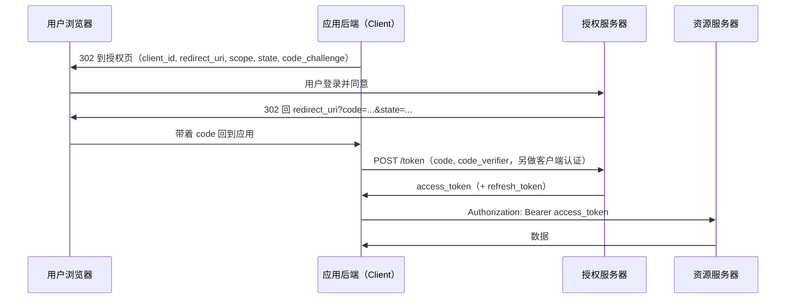
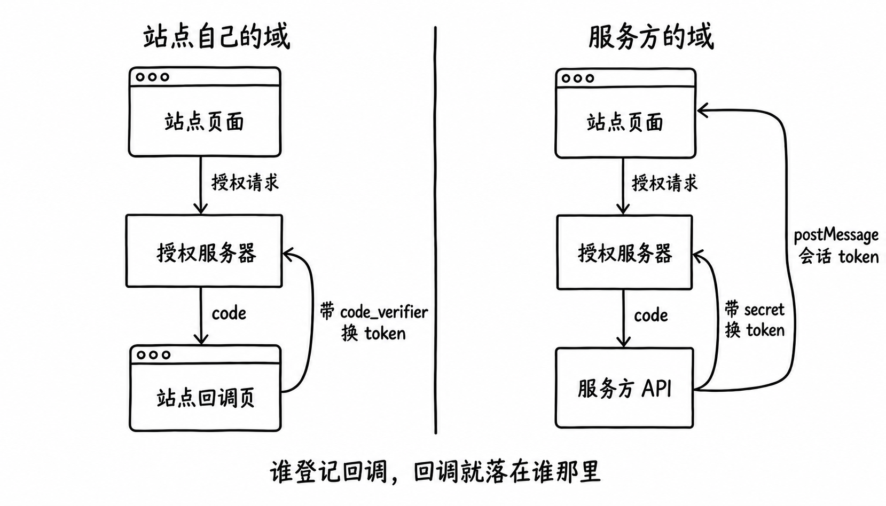
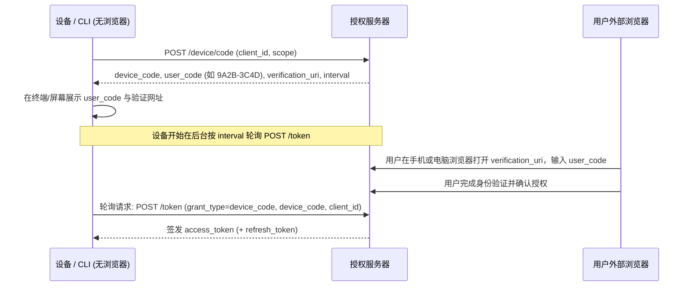
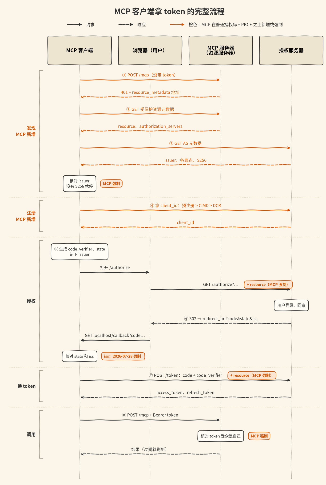
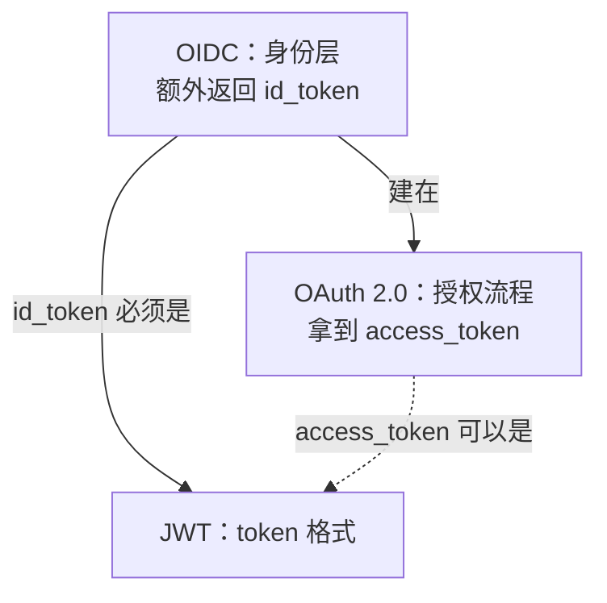

# OAuth

## 摘要

OAuth 2.0（RFC 6749）是一套**授权协议**：客户端获得限定访问范围的 access_token 后访问资源。授权可由资源所有者参与，也可采用客户端凭证等不需要用户交互的方式。

它规定"怎么拿到 token"，不规定"token 长什么样"。token 可以是随机字符串，也可以是 [[wiki/topics/architecture/jwt|JWT]]。OAuth 本身也不负责"用户是谁"，这部分由建在它之上的 OpenID Connect（OIDC）补上。

## 四个角色

| 角色 | 是谁 |
| --- | --- |
| Resource Owner | 用户，数据的所有者 |
| Client | 第三方应用，想代表用户访问数据。事先在授权服务器注册，拿到 `client_id`（机密客户端还需配置客户端认证方式，不一定使用共享 secret） |
| Authorization Server | 负责让用户登录、确认授权、发 token |
| Resource Server | 存放数据的 API，收到请求时校验 access_token |

## 授权方式

| 方式 | 适用场景 | 现状 |
| --- | --- | --- |
| 授权码（Authorization Code）+ PKCE | 有用户参与的 Web、App、SPA | 推荐的默认方式 |
| 客户端凭证（Client Credentials） | 服务对服务，没有用户 | 常用 |
| 设备码（Device Authorization，RFC 8628） | 电视、CLI 等不方便输入或接收回调的设备 | 常用 |
| 刷新（Refresh Token） | 换取新的 access_token | 取决于授权方式与服务器策略；客户端凭证流程通常不签发 refresh_token（RFC 6749 §4.4.3） |
| 隐式（Implicit） | 早期浏览器应用 | RFC 9700 建议不再使用 |
| 密码（Resource Owner Password） | 应用直接收用户密码 | RFC 9700 规定不得使用 |

### 授权码流程



要点：

- `code` 很短（分钟级），只能用一次。
- 图中是有后端的机密客户端：兑换时同时提交 PKCE 的 `code_verifier` 并完成客户端认证，二者不互相替代。公开客户端也可直接兑换，但不应依赖保存在浏览器或 App 中的共享 secret。
- `state` 用来确认回调是自己发起的，防止伪造的回调（CSRF）。
- 客户端对接多个授权服务器时，`state` 挡不住授权服务器混淆（mix-up）：回调里的 `state` 是真的，但 code 可能来自另一个授权服务器。需要核对回调里的 `iss`（RFC 9207），或给每个授权服务器配不同的回调地址（RFC 9700 §4.4.2）。攻击过程见下文「mix-up 攻击与 RFC 9207 iss」。
- PKCE（RFC 7636）：客户端先生成随机的 `code_verifier`，授权请求里带它的哈希 `code_challenge`，换 token 时带原值。即使 `code` 被截获，没有 `code_verifier` 也换不到 token。原本为没有 secret 的公开客户端（App、SPA）设计。RFC 9700 规定公开客户端必须用，机密客户端推荐用。

### 为什么必须使用授权码（code）换取令牌？

如果不通过中间的短期授权码，而是在用户同意后直接把长效 `access_token` 放在重定向 URL 中返回（即早期 OAuth 2.0 的隐式模式 Implicit Flow）：

1. **前端传输暴露面过大**：重定向 URL 中的长效令牌会完整暴露在浏览器地址栏、写入系统浏览历史，并可能随外链跳转通过 HTTP `Referer` 头或前端第三方脚本泄露给不受信方；
2. **缺乏客户端身份核验**：直接在前端发 token 无法验证接收方的真实身份。通过授权码流程，真正的令牌仅在应用后端与授权服务器之间的安全信道（Server-to-Server）中兑换，结合机密客户端的 `client_secret` 或公开客户端的 PKCE（`code_verifier`），能够有效防御令牌被仿冒客户端窃取。

RFC 9700（OAuth 2.0 安全最佳实践）已明确弃用隐式模式，推荐所有场景统一采用授权码流程。

### 回调地址登记在谁那里，决定谁去换 token

授权服务器处理授权请求前会校验 `redirect_uri`：它必须与客户端预先登记的地址**完全一致**。Google 的规则写明回调地址不能含通配符（文档原文 `Redirect URIs cannot contain ... Wildcard characters (*)`），不匹配时报 `redirect_uri_mismatch`。所以一个客户端服务多个客户站点时，回调只可能落在少数几个固定地址；想让回调落到每个客户自己的域，就得让每个客户自己注册一个客户端。



| | 回调登记在应用自己的域 | 回调登记在服务方的域 |
| --- | --- | --- |
| 客户端 | 每个接入应用一个 `client_id` | 服务方一个共享客户端，或客户自带 `client_id` 和 secret 交给服务方 |
| 回调落到 | 应用自己的 origin | 服务方域 |
| 谁去换 token | 浏览器，公开客户端加 PKCE，没有 secret | 服务方，机密客户端持 secret，在服务端之间换 |
| 站点怎么拿到凭据 | 同源读回 `code`，token 存在自己的 origin | 跨源 `postMessage` 交服务方自己的会话 token |
| 怎么确认回调来自同一个浏览器 | `state` 和 `code_verifier` 存在应用自己 origin 的存储里，回调同源可直接比对 | 回调与站点不同源，要另找手段，例如在回调域写 HttpOnly cookie，靠 `SameSite=Lax` 顶层导航带上 |

三种实际做法落在这条轴的不同位置：

- **Auth0 的 SPA**：每个接入应用是一个独立 application，自己在 **Allowed Callback URLs** 里登记回调，`redirect_uri` 必须命中这份列表。SPA 属于公开客户端（官方文档：single-page apps and native apps are public），不持有 secret，必须走 PKCE，token 由浏览器跨源请求 `/oauth/token` 换取。弹窗模式用 `response_mode=web_message`，`redirect_uri` 取 `window.location.origin`，这个 origin 还要登记进 **Allowed Web Origins**；`code` 由 Auth0 的页面 `postMessage` 给开启弹窗的页面，`auth0-spa-js` 的 `runPopup` 先要求消息来自 Auth0 域，再比对 `state`。它也先开一个空白弹窗、等授权 URL 拿到之后再把弹窗指过去（`openPopup('')` 之后设 `location.href`），理由和一般弹窗登录一样：`window.open` 必须落在用户点击的同步调用栈里。Auth0 支持子域通配和 `https://{organization_name}.example.com` 这类占位符，但官方不建议在生产用通配，推荐占位符。
- **komo 托管版**：一个 Google 客户端服务全部接入站点，回调只能固定在评论 API 域，`code` 兑换在服务端完成，再用 `postMessage` 把 komo 自己的会话 token 交给站点。见 [[wiki/topics/product/komo|komo]]。
- **Supabase**：回调固定在自己的项目域（`<ref>.supabase.co/auth/v1/callback`），但 `client_id` 和 secret 由客户自己在 Google 建好再填给 Supabase。这说明「回调域固定」和「客户自带客户端」是两件可以分开选的事。

一处与第三方 cookie 有关的边界：`auth0-spa-js` 的静默续期用隐藏 iframe 请求 `/authorize`（`prompt=none` 加 `web_message`），这个请求能不能带上 Auth0 域的会话 cookie 取决于浏览器对第三方 cookie 的处理。Auth0 在跨源登录文档里写明现代浏览器会限制或阻止第三方 cookie，并建议把应用和 Auth0 放在同一个顶级域；该文档讲的是嵌入式登录，它对 SPA 静默续期的影响范围本次没有逐条核对。

### 设备码流程（RFC 8628）

用于无法直接运行浏览器或接收本地 HTTP 回调的客户端（如智能电视、机房 SSH 终端、路由器等）：



要点：
- 轮询请求必须携带 `client_id`（公开客户端）或完成客户端认证（机密客户端），授权服务器据此校验 `device_code` 是否归属于发起申请的同一应用，防止其他非法应用冒领令牌（RFC 8628 §3.4）；
- 设备在后台以 `interval`（通常为 5 秒）轮询，未确认前服务器返回 `authorization_pending` 错误码；
- 轮询过快返回 `slow_down`，设备必须增加等待间隔；
- `user_code` 采用适合人类短时记忆和输入的字符集（通常 8 位，去除了容易混淆的 `0/O`、`1/I` 等字符）。

### 命令行（CLI）与无头环境的授权演进

历史早期工具（如旧版 `git`、旧版 `docker login`）曾在终端中直接要求输入用户名与主账号密码，但该做法在现代安全工程中已被彻底弃用：一方面主密码容易残留在终端历史（`~/.bash_history`）、控制台输出或进程环境中，扩大了泄露面；另一方面现代企业普遍接入了 SSO、企业微信/飞书扫码与多因素认证（2FA/MFA），纯黑框终端无法交互式处理复杂的现代认证流程。

现代命令行工具收敛为两种无密授权架构：

- **桌面环境（本地回环 Web Flow）**：如 GitHub CLI（`gh auth login`）在具备图形界面的开发机上运行时，先在本地监听临时回环端口（如 `http://127.0.0.1:<port>/callback`），调起系统默认浏览器打开授权页；用户点击授权后，浏览器直接重定向至本地回环端口自动完成 code 交接与令牌兑换，全程无需用户手动输入代码；
- **无头/远程环境（设备码 Device Flow）**：在通过 SSH 远程连接的服务器、Docker 容器或无界面设备中，因无法接收本地浏览器重定向，程序自动退回设备码流程（RFC 8628），在终端打印短码并引导用户在外部浏览器中完成带外确认。

#### 公开客户端的“无 Secret 困境”与防御模型

终端 CLI 与原生 App 属于公开客户端（Public Client），其二进制分发给所有终端用户，任何硬编码的 `client_secret` 均可被逆向工具轻易提取，因此规范严格禁止公开客户端依赖保密密钥。设备码流程通过两道防线替代 secret 的安全防护：

1. **高熵长随机码内存流转**：展示在屏幕上的仅为 8 位适合输入的 `user_code`，而设备在后台轮询使用的 `device_code` 为长达数十字节的高熵随机字符串，仅保存在终端进程内存与轮询请求中，不显示于终端屏幕，也不通过浏览器传递，外部截获难度极高；
2. **官方 Web 域的带外显式背书（Out-of-band Consent）**：即使外部仿冒者截获了 `client_id`，也必须等待真正的账号主人在登录后的授权服务器官方安全页面中输入对应验证码并点击批准，服务端才会在后台将该用户的授权与该 `device_code` 关联绑定。

#### 为什么第一方官方 CLI 依然走标准 OAuth 授权？

GitHub CLI（`gh`）、AWS CLI、Vercel CLI 等官方第一方工具访问自研服务器时，依然表现得像“第三方应用”一样弹窗走标准 OAuth，而非内置特权私有接口。这一设计体现了**第一方与第三方平权（First-party & Third-party Parity）**的架构哲学：

1. **消除特权后门**：避免在公开 OAuth 之外再维护一套私有特权通道，从源头消灭特权接口被逆向挖掘沦为安全黑洞的风险；
2. **权限透明与最小权限裁剪（Scopes Control）**：官方 CLI 依然需要按需声明申请的权限范围（如 `repo`, `read:org`），用户在网页授权时保留完整的知情权与权限审计能力；
3. **支持控制台一键独立吊销（Revocation Kill-Switch）**：所有已授权的 CLI 终端均列在用户的应用管理列表中。一旦某台开发机丢失或失控，用户可在网页端单独吊销该终端的访问令牌，无需重置人类主账号密码；
4. **跨私有化实例通用适配**：标准 OAuth 抽象使得同一套 CLI 二进制能够无缝连接公有云服务与企业私有化部署实例（如 GitHub Enterprise Server），底层认证协议完全统一。

#### 企业级 CLI 的双身份模型：以飞书 lark-cli 为例

在现代企业协作生态中，官方工具（如 `lark-cli`）进一步演进出 **Bot 身份（机器凭证）与 User 身份（人类凭证）并存的双身份架构**：

- **Bot 身份（自动化底座）**：通过在本地初始化配置企业自建应用的 `appId`（即 `client_id`）与 `appSecret`，CLI 可直接向开放平台申请 `tenant_access_token`，代表机器人身份执行通用业务调用（如发送群卡片、监听 Webhook、执行自动化构建）；
- **User 身份（敏感个人资产操作）**：当 CLI 需要代用户读写私人日程、个人云文档或待办清单时，企业风控机制严格禁止机器人在无人类确认的情况下越权探测。CLI 随即触发 `lark-cli auth login` 唤起 RFC 8628 设备码流程，由员工在手机飞书上扫码完成带外显式授权，获取 `user_access_token` 并加密持久化至本地安全钥匙串（macOS Keychain），实现人机权能的精准隔离。

#### Web 登录态收敛（Cookie/Session）vs CLI 直接持有 Token

这一差异解释了为什么 Web 应用与命令行工具在 OAuth 落地形态上截然不同，并揭示了 Web 为何坚决避免前端直接轮询持有外部 Token：

- **第一方 Web 场景（SSO 登录态收敛与 XSS 隔离）**：
  在拥有自建后端的 Web 应用中，如果让前端 JavaScript 直接持有外部 Access Token 并存入 `localStorage`，页面将完全暴露在 XSS（跨站脚本注入）或第三方 npm 依赖投毒的致命风险下（恶意脚本可轻易窃取存储的明文 Token）。
  因此 Web 标准架构强制要求：用户授权后回调重定向至业务后端；后端使用 `code` 向认证中心换取 Access Token 并提取用户信息后，**随即收敛为业务系统自身的原生登录态（向浏览器植入带有 `HttpOnly; Secure; SameSite` 标志的 Session ID Cookie）**。前端脚本物理上无法读取 `HttpOnly` Cookie，构筑起抵御 XSS 窃据的安全防火墙。前端浏览器与业务后端始终基于第一方 Session 通信，OAuth 仅作为外部身份提供商（IdP），浏览器本身无感知且无需存储外部 Access Token；
- **同设备 302 重定向 vs 跨设备扫码轮询的本质差异**：
  * **同设备秒级回路**：在同浏览器中，302 重定向利用浏览器底层原生网络栈秒级无缝完成跳转与授权确认，无需用户跨设备操作，且完全消除无谓的高并发 HTTP 空轮询开销；
  * **电脑端扫码登录的轮询本质**：飞书/微信电脑网页端扫码登录虽然前端在轮询，但这属于**跨设备（Cross-device）交互**——电脑屏幕无法自扫，必须由手机 App 充当物理生物识别（指纹/人脸）设备。前端轮询换回的仅是临时登录票据（Ticket），业务后端验证后依然立即收敛为第一方的 `HttpOnly` Cookie，外部平台的 Access Token 绝不在前端裸奔；
- **终端 CLI / 桌面工具场景**：
  CLI 缺乏独立业务后端为其代持凭据，亦无浏览器的自动 Cookie 管理容器。CLI 程序身兼调用方与执行宿主，因此必须通过设备码（Device Flow）将 Access Token 领回本地，并依赖操作系统级安全存储（macOS Keychain 或受限文件）自行管理令牌的持久化与刷新。

针对非个人交互型客户端、需要在后台无人类干预常驻运行的计算节点（如 Agent、CI Runner、Kubernetes 节点），则进一步演进为独立的机器资产开户自举范式，详见 [[wiki/syntheses/architecture/machine-identity-and-agent-provisioning|机器身份与 Agent 节点自举授权范式]]。

## 对接陌生服务时，RFC 6749 缺的几块

上面的授权码流程有个默认前提：**客户端事先就认识授权服务器**。开发者在 GitHub 或 Google 后台手动建应用，把授权地址、token 地址、`client_id` 写进配置。客户端要连「事先不认识的」服务时（MCP 就是这样，用户随手填一个服务器地址），这个前提不成立，RFC 6749 没回答的问题由后来的几份 RFC 补上：

| 问题 | 补上它的规范 | 本页小节 |
| --- | --- | --- |
| 这个 API 由哪个授权服务器发 token？ | RFC 9728 受保护资源元数据 | 元数据发现 |
| 授权服务器的各个地址在哪？支持什么？ | RFC 8414（或 OIDC Discovery） | 元数据发现 |
| 没在这个授权服务器注册过怎么办？ | RFC 7591 DCR、CIMD 草案 | 客户端注册 |
| 桌面端、CLI 的回调地址怎么写？ | RFC 8252 | 原生应用的回调 |
| code 被截走或被注入怎么办？ | RFC 7636 PKCE | PKCE |
| token 被拿去别的 API 用怎么办？ | RFC 8707 | Resource Indicators |
| 回调里的 code 是哪个授权服务器签发的？ | RFC 9207 | mix-up 攻击与 RFC 9207 iss |

下文把授权服务器简称 AS（authorization server）。这些规范在 MCP 里怎么串成一条链、MCP 额外强制了什么，见 [[wiki/topics/ai/mcp-authorization|MCP 授权流程]]。



## 元数据发现：RFC 9728 与 RFC 8414

资源服务器（API）和 AS 本来就是分开的角色：一个 API 可以信任好几个 AS，一个 AS 也给很多 API 发 token。所以发现分两层：先问 API「谁给你发 token」，再问那个 AS「你的各个接口在哪」。

### 第一层：受保护资源元数据（RFC 9728）

API 拒绝没带 token 的请求时，可以在 `WWW-Authenticate` 里给出元数据地址（§5.1）：

```http
HTTP/1.1 401 Unauthorized
WWW-Authenticate: Bearer resource_metadata="https://api.example.com/.well-known/oauth-protected-resource"
```

客户端去取这份文档：

```http
GET /.well-known/oauth-protected-resource HTTP/1.1
Host: api.example.com
```

```json
{
  "resource": "https://api.example.com",
  "authorization_servers": ["https://auth.example.com"],
  "scopes_supported": ["files:read", "files:write"],
  "bearer_methods_supported": ["header"]
}
```

没有 `WWW-Authenticate` 时可以自己拼地址：资源标识带路径时，把 well-known 片段插在 host 和路径之间，例如 `https://api.example.com/v1/files` 对应 `https://api.example.com/.well-known/oauth-protected-resource/v1/files`。

**校验**（§3.3）：文档里的 `resource` 必须和拼地址用的资源标识完全一致；地址来自 `WWW-Authenticate` 时，`resource` 必须和客户端实际请求的 URL 一致。不一致就整份不用，防止一个服务指着别人的元数据冒充。

### 第二层：授权服务器元数据（RFC 8414）

```http
GET /.well-known/oauth-authorization-server HTTP/1.1
Host: auth.example.com
```

```json
{
  "issuer": "https://auth.example.com",
  "authorization_endpoint": "https://auth.example.com/authorize",
  "token_endpoint": "https://auth.example.com/token",
  "registration_endpoint": "https://auth.example.com/register",
  "code_challenge_methods_supported": ["S256"],
  "authorization_response_iss_parameter_supported": true,
  "client_id_metadata_document_supported": true
}
```

| 字段 | 作用 |
| --- | --- |
| `issuer` | AS 的身份标识，一个 HTTPS URL |
| `authorization_endpoint` | 用户登录、同意的页面 |
| `token_endpoint` | 用 code 或 refresh_token 换 token |
| `registration_endpoint` | DCR 注册接口，有这个字段才支持 DCR |
| `code_challenge_methods_supported` | 支持的 PKCE 方法 |
| `authorization_response_iss_parameter_supported` | 回调里会不会带 `iss`（RFC 9207 新增的字段） |
| `client_id_metadata_document_supported` | 接不接受 URL 形式的 `client_id`（CIMD 草案新增的字段） |

issuer 带路径时，RFC 8414 和 OIDC Discovery 的拼法不一样，对接多租户 AS 时很容易拼错：

| issuer | RFC 8414 | OIDC Discovery |
| --- | --- | --- |
| `https://auth.example.com` | `https://auth.example.com/.well-known/oauth-authorization-server` | `https://auth.example.com/.well-known/openid-configuration` |
| `https://auth.example.com/tenant1` | `https://auth.example.com/.well-known/oauth-authorization-server/tenant1`（插在中间） | `https://auth.example.com/tenant1/.well-known/openid-configuration`（追加在末尾） |

**校验**（§3.3）：元数据里的 `issuer` 必须和拼地址用的 issuer 完全一致，否则不能用。这一条很关键：下文 mix-up 防御靠的是「客户端记下的 issuer」，如果它来自一份没校验过的元数据，`iss` 比对就没有意义。

## 客户端注册：预注册、DCR、CIMD

AS 发 code 前要知道「是哪个应用在要权限」：同意页上要显示应用名字，要校验 `redirect_uri` 是这个应用登记过的，还要决定它能不能做客户端认证。拿到 `client_id` 有三种方式。

### 预注册

开发者在 AS 后台手动建应用，拿到 `client_id`（机密客户端还有 secret 或公钥）写进配置。最常见、最可控；缺点是必须事先知道要连哪些 AS。上文「回调地址登记在谁那里」讨论的都是这种方式。

### DCR（Dynamic Client Registration，RFC 7591）

客户端运行时向 `registration_endpoint` POST 自己的元数据，AS 当场发 `client_id`：

```http
POST /register HTTP/1.1
Host: auth.example.com
Content-Type: application/json

{
  "client_name": "My CLI",
  "redirect_uris": ["http://127.0.0.1/callback"],
  "grant_types": ["authorization_code", "refresh_token"],
  "response_types": ["code"],
  "token_endpoint_auth_method": "none",
  "application_type": "native"
}
```

```http
HTTP/1.1 201 Created
Content-Type: application/json

{
  "client_id": "s6BhdRkqt3",
  "client_id_issued_at": 1760000000,
  "client_name": "My CLI",
  "redirect_uris": ["http://127.0.0.1/callback"],
  "token_endpoint_auth_method": "none"
}
```

`application_type` 来自 OpenID Connect Dynamic Client Registration，取值 `web` 或 `native`，省略时默认 `web`。OIDC 对两类客户端的回调限制不同：使用隐式模式的 `web` 客户端只能登记 https 回调、不能用 `localhost`；`native` 客户端只能登记自定义 scheme 或 http 回环地址（`localhost`、`127.0.0.1`、`[::1]`）；AS 还可以拒绝回环以外的 http 回调。用本机回调的 CLI 不声明 `native`，就会被当成 `web` 客户端检查，可能被拒。

DCR 的问题在于它要求 AS 接受**匿名注册**：`client_name`、`logo_uri` 都是自己填的，AS 无法确认应用身份；每台机器、每次安装都可能注册一个新 `client_id`，记录只增不减；很多企业 AS 出于安全策略直接关掉开放注册。

### CIMD（Client ID Metadata Document，IETF 草案）

思路是「不注册，直接用一个 URL 当 `client_id`」。客户端把元数据放在自己域名下：

```http
GET /oauth/client.json HTTP/1.1
Host: app.example.com
```

```json
{
  "client_id": "https://app.example.com/oauth/client.json",
  "client_name": "Example App",
  "redirect_uris": ["https://app.example.com/callback"],
  "token_endpoint_auth_method": "private_key_jwt",
  "jwks_uri": "https://app.example.com/oauth/jwks.json"
}
```

授权请求里直接写 `client_id=https://app.example.com/oauth/client.json`，AS 看到 URL 形式的 `client_id` 就去取这份文档。按 `draft-ietf-oauth-client-id-metadata-document-02`：

- `client_id` URL 必须是 https、必须有路径，不能带 fragment、userinfo、`.` / `..` 路径段，不建议带 query；用简单字符串比较，`https://example.com/client` 和 `https://example.com:443/client` 是两个不同的客户端。
- 文档里的 `client_id` 必须和文档地址一致；`redirect_uris` 就是登记的回调，授权请求里的 `redirect_uri` 必须精确匹配其中一个。
- 不能用共享 secret 类认证（`client_secret_post`、`client_secret_basic`、`client_secret_jwt`），不能放私钥；要做客户端认证，就在 `jwks` / `jwks_uri` 发布公钥，用 `private_key_jwt` 这类非对称方式。
- AS 可以按 HTTP 缓存头缓存文档，但不能缓存错误响应和无效文档。

CIMD 把「这个客户端是谁」锚定在**域名**上：草案建议 AS 在同意页上显示 `client_id` 的 hostname，可以对新注册的域名加警告，也可以对可信域名放宽。和 DCR 比，AS 不用存任何东西，同一个 `client_id` 能在所有 AS 用。它带来的新风险，草案的安全考虑一节都写了：

- **SSRF**：AS 不能抓取解析到 RFC 6890 特殊用途 IP 的地址（文档本身和文档里引用的 URL 都算）；只有开发测试环境、AS 自己也跑在回环地址上时才能放宽，生产环境不能放宽。
- **冒充知名客户端**：AS 不限制 `redirect_uris` 和 `client_id` 的关系（例如要求同源）时，攻击者可以在自己域名下写一份 `client_name` 很像知名应用的文档。
- **钓鱼**：同意页只显示文档里的名字和 logo 不够，所以建议同时显示 hostname。

## 原生应用的回调（RFC 8252）

桌面端和 CLI 没有公网域名，回调只能落在本机。前文「命令行（CLI）与无头环境的授权演进」里的本地回环 Web Flow 就是这种做法。RFC 8252 给了三种写法：

| 写法 | 例子 | 说明 |
| --- | --- | --- |
| 回环 IP | `http://127.0.0.1:51004/callback`、`http://[::1]:61023/oauth2redirect/example-provider` | CLI 最常用 |
| 私有 URI scheme | `com.example.app:/oauth2redirect` | 移动 App 常用，用反向域名防冲突 |
| 声明过的 https 链接 | `https://app.example.com/oauth2redirect` | iOS Universal Links、Android App Links |

CLI 的典型做法：向系统申请一个临时端口并监听，再打开浏览器：

```text
1. 监听 127.0.0.1:51004
2. 打开 https://auth.example.com/authorize?...&redirect_uri=http%3A%2F%2F127.0.0.1%3A51004%2Fcallback
3. 浏览器回到 http://127.0.0.1:51004/callback?code=...&state=...
4. CLI 收到请求，回一个「可以关掉此页面」的 HTML，然后去换 token
```

- 登记时写 `http://127.0.0.1/callback`，AS **必须**允许请求时带任意端口（§7.3），因为端口是运行时临时申请的。RFC 9700 §2.1 要求回调地址精确字符串匹配，唯一的例外就是这里的端口号。
- §8.3 **不建议**写 `localhost`，建议写 `127.0.0.1`：`localhost` 可能被解析到非回环地址，客户端可能意外监听到网络接口上。实际上很多工具和规范示例仍写 `localhost`，AS 怎么处理两者要看具体实现。

## PKCE：怎么算，防什么，防不住什么

### 怎么算（RFC 7636）

每次登录生成一个 `code_verifier`：43 到 128 个字符，只能用 `A-Z a-z 0-9 - . _ ~`，要有足够的随机性。然后：

```text
code_challenge = BASE64URL( SHA256( ASCII(code_verifier) ) )     // method = S256

RFC 7636 附录 B 的例子：
code_verifier  = dBjftJeZ4CVP-mB92K27uhbUJU1p1r_wW1gFWFOEjXk
code_challenge = E9Melhoa2OwvFrEMTJguCHaoeK1t8URWbuGJSstw-cM
```

授权请求带 `code_challenge` 和 `code_challenge_method=S256`，AS 把它和签发的 code 绑在一起；换 token 时带原始 `code_verifier`，AS 重新算哈希比对。`plain`（challenge 就等于 verifier）只在客户端算不了 SHA-256 时才允许，因为 challenge 会经过浏览器，用 `plain` 等于把 verifier 也暴露了。

### 能防的三件事

1. **code 被截走**：移动端的私有 URI scheme 可能被别的 App 抢注，code 落到恶意 App 手里。没有 verifier 换不到 token。这是 PKCE 最初的设计目的。
2. **code 注入**（RFC 9700 §4.5）：攻击者偷到受害者的 code，塞进自己在客户端的登录会话里。客户端会用攻击者会话里的 verifier 去换，而 code 绑的是受害者那次的 challenge，比对失败。
3. **CSRF**：RFC 9700 §2.1 写明，客户端确认 AS 支持 PKCE 后，**可以**依赖 PKCE 防 CSRF；OIDC 流程里 `nonce` 也能起这个作用；两者都没有时，才必须用一次性、绑定浏览器会话的 `state`。很多实现仍然同时用 `state`，因为它还承担「回调到了以后找到本次登录记录」的作用。

### 防不住的

- **mix-up**：客户端自己把 code **连同 `code_verifier`** 发到了攻击者的 token 地址，PKCE 的前提「攻击者拿不到 verifier」不成立。而且攻击者的 AS 正好控制着转发给正规 AS 的那次授权请求，可以把 `code_challenge` 换成自己会话里的值，这正是 RFC 9700 §4.5.4 说的 PKCE 局限。所以 mix-up 要靠下文的 `iss` 防（这一条是把 §4.4.1 的攻击步骤和 §4.5.4 放在一起推出来的，RFC 原文没有直接连起来写）。
- **token 本身泄露**：PKCE 只保护 code 到 token 这一步，拿到 token 以后被偷就管不了了，那是 DPoP 这类发送方绑定要解决的。

## Resource Indicators：把 token 绑到一个 API（RFC 8707）

token 如果不写明给谁用，一个拿到用户 token 的恶意 API 就可以拿着它去调另一个也信任这个 AS 的 API。RFC 8707 给授权请求和 token 请求都加了 `resource` 参数（一个不带 fragment 的绝对 URI），AS 据此限定 token 的受众，例如 JWT 的 `aud`：

```text
GET /authorize?response_type=code&client_id=...&resource=https%3A%2F%2Fapi.example.com&...
```

```http
POST /token HTTP/1.1
Host: auth.example.com
Content-Type: application/x-www-form-urlencoded

grant_type=authorization_code&code=...&code_verifier=...&resource=https%3A%2F%2Fapi.example.com
```

两边都要配合：客户端只把为这个 API 申请的 token 发给它；API 收到 token 必须检查受众是不是自己，不是就拒绝。一个服务需要代用户调用上游时，不能把收到的 token 原样转发（token passthrough），而要为上游另外拿 token。

## mix-up 攻击与 RFC 9207 iss

上文说 `state` 防伪造回调。客户端只对接一个 AS 时这就够了；对接多个 AS、其中一个由攻击者控制、而且共用同一个回调地址时，还有 mix-up。

### 攻击过程（RFC 9700 §4.4.1）

1. 用户在客户端选择攻击者的 AS（A-AS）。客户端在会话里记下「本次用 A-AS」，把浏览器带到 A-AS 的授权地址，`client_id` 是客户端在 A-AS 的 ID。
2. A-AS 不让用户登录，直接把浏览器重定向到正规 AS（H-AS）的授权地址，把 `client_id` 换成客户端在 H-AS 的 ID，`state` 原样带着。
3. 用户看到熟悉的 H-AS 登录页并同意。H-AS 签发 code，回调到客户端。
4. 客户端用 `state` 找到会话记录，记录写着 A-AS，于是把 H-AS 的 code 发到 A-AS 的 token 地址。
5. 攻击者拿到 code。公开客户端的场景下直接去 H-AS 兑换（verifier 客户端也一起发给它了）；机密客户端的场景下它没有客户端凭据，就改走 code 注入。

RFC 9700 还列了几个变种：中间人篡改用户的 AS 选择、隐式模式下直接偷 access_token、每个 AS 用不同回调但客户端不存「选了哪个 AS」时的「Cross Social-Network Request Forgery」、利用 OIDC Discovery 的变种。

### 为什么 `state` 拦不住

`state` 回答「这个回调是不是我自己发起的那次登录」。在 mix-up 里答案是「是」：确实是用户自己点的登录，`state` 一个字节都没改。出问题的是另一个维度：**code 是谁签发的**，`state` 里没有这个信息。

### RFC 9207：回调里带上 `iss`

AS 在授权响应（包括错误响应）里加 `iss`，值是它自己的 issuer：

```http
HTTP/1.1 302 Found
Location: https://client.example/callback?code=xyz&state=S&iss=https%3A%2F%2Fhonest.as.example
```

客户端跳转前记下所选 AS 的 issuer（来自校验过的元数据），回调时用简单字符串比较核对 `iss`，不一致就中止：不把 code 交给任何 token 地址，也不展示响应里的 `error`。上面第 4 步里，回调写着 H-AS、记录写着 A-AS，攻击就断在这里。AS 通过元数据的 `authorization_response_iss_parameter_supported` 声明会带 `iss`。

另一种防法是 RFC 9700 §4.4.2.2 的「每个 AS 一个回调地址」，看 code 落在哪个地址判断签发方。它有三个限制：客户端只注册一次、给多个 AS 用的场景用不了；和注册流程绑得很紧，难自动化；攻击者可能拿分配给自己 AS 的回调地址去正规 AS 注册新客户端来绕过。RFC 9700 因此建议优先用 issuer 校验。

### 一次登录一条记录

`state`、PKCE、`iss` 三样核对都要求回调到达时找到发起时记下的记录。每次登录存一条、用 `state` 当键，就能同时进行多个登录：

```text
state=8f3a…  →  { issuer: A, code_verifier: v1, redirect_uri, resource, 发起时间 }
state=c71e…  →  { issuer: B, code_verifier: v2, redirect_uri, resource, 发起时间 }
```

回调到达后：用 `state` 找记录 → 用记录里的 issuer 核对 `iss` → 用记录里的 `code_verifier`、`resource` 去这个 AS 换 token → 删记录。以下是实现建议，不是规范条文：做了负载均衡的 Web 客户端要把记录放共享存储，或签名后编进 `state`；记录只用一次并设过期时间。

## 进一步加固：PAR、DPoP 与 OAuth 2.1

- **PAR（RFC 9126，Pushed Authorization Requests）**：客户端先在后台把授权参数 POST 给 AS（机密客户端可以顺便做客户端认证），拿回一个短期的 `request_uri`，浏览器只带 `client_id` 和 `request_uri` 去授权页，参数不会在浏览器里被篡改或泄露。RFC 9126 的示例响应是 `{"request_uri": "urn:example:bwc4JK-ESC0w8acc191e-Y1LTC2", "expires_in": 90}`。
- **DPoP（RFC 9449）**：把 token 绑到客户端持有的一把私钥上，每次请求附带一个用私钥签名的 `DPoP` 头，只偷到 token、没有私钥就用不了。它是下文「refresh_token 的安全要求」里「绑定发送方」的一种做法，另一种是 RFC 8705 的 mTLS。
- **OAuth 2.1（`draft-ietf-oauth-v2-1`，本次核对时是 -16，仍是草案）**：把 RFC 6749、6750、7636、8252 和 RFC 9700 的主要结论合成一份：所有客户端都要用 PKCE，删掉隐式模式和密码模式，回调地址精确匹配，token 不能放在 URL 查询参数里，公开客户端的 refresh_token 要么绑定发送方要么一次性使用。

## access_token 的三种实现

| 实现 | 资源服务器怎么校验 | 能立刻作废 | 代价 |
| --- | --- | --- | --- |
| 随机字符串（引用型 / opaque） | 查询共享记录或调用内省接口 | 取决于记录更新和缓存传播 | 需要查询或缓存状态 |
| 签名 JWT（RFC 9068 定义了 access_token 的 JWT 格式） | 验签并校验 claims | 仅本地验证不能及时获知撤销；可增加状态检查 | 撤销及时性与查询成本需要取舍 |
| 加密 JWT（JWE） | 解密并验证完整性与 claims；若内层还有 JWS，再验签 | 仍取决于撤销状态检查 | 增加密钥管理与加密处理 |

### 内省接口（RFC 7662）

内省接口可返回 token 的 `active` 状态及适用的 claims。它既可用于 opaque token，也可用于 JWT；不是随机字符串的唯一校验方式。端点 URL 由部署配置，不必叫 `/introspect`。缓存内省结果会影响撤销生效时间（RFC 7662 §2）。

### 撤销接口（RFC 7009）

RFC 7009 要求撤销端点支持 refresh_token，并建议支持 access_token；端点 URL 不必叫 `/revoke`。JWT access_token 的撤销也能生效，但资源服务器需要通过状态查询、通知等方式得知撤销；只做本地验证的服务器可能继续接受它直到过期。撤销 refresh_token 是否连带撤销 access_token，还取决于服务器的支持和策略。

## 使用 access_token

RFC 6750 规定的标准方式是请求头：

```http
Authorization: Bearer <access_token>
```

不要放在 URL 查询参数里，容易进日志和浏览器历史。

## OAuth、OIDC、JWT 的关系



- OAuth 管授权：第三方应用能访问什么。
- OIDC 在授权码流程上加了 `openid` scope 和 `id_token`，回答"用户是谁"，常用于 [[sso]] 和"用 XX 账号登录"。
- JWT 只是格式。只做自己系统的前后端登录，不需要 OAuth，用 Session 或 JWT + refresh_token 即可，见 [[wiki/comparisons/architecture/session-vs-jwt-vs-dual-token|Session vs JWT vs 双 Token]]。

## refresh_token 的安全要求（RFC 9700 §4.14）

对公开客户端，授权服务器必须（MUST）用下面至少一种方式发现 refresh_token 被重放：

- **轮换**：每次刷新发新的 refresh_token，旧的作废；检测到旧的被再次使用时，撤销该轮换关系中当前有效的 refresh_token，要求重新授权。
- **绑定发送方**：把 refresh_token 和客户端持有的密钥绑定（如 DPoP，RFC 9449），仅取得 token 而没有对应密钥，无法通过发送方证明；密钥也泄露时仍有风险。

## 原始笔记

- https://www.ruanyifeng.com/blog/2019/04/oauth_design.html
- OAuth 就是一种授权机制。数据的所有者告诉系统，同意授权第三方应用进入系统，获取这些数据。系统从而产生一个短期的进入令牌（token），用来代替密码，供第三方应用使用
- 一般第三方应用要先去系统注册获取 client id 和 secret
- 第三方应用会向系统携带 client id，告诉系统是谁在请求，用户授权以后会 redirect 到第三方应用的网址，携带授权码，然后请求业务后端，业务后端用 client id 和 secret 加授权码去请求系统的令牌，再跳回到前端（可以是裸的令牌，可以是和业务绑定后的 token），然后前端就可以用这个令牌（以用户的身份）去请求用户在系统的信息了
- 看着向 Github 注册的 **Homepage URL** 和 **Authorization callback URL** 不会校验端口，只会校验域名和 callback 的 path
- ~~TODO 如何结合这个进一步设计登录态？~~ 见 [[wiki/comparisons/architecture/session-vs-jwt-vs-dual-token|Session vs JWT vs 双 Token]]

## 相关页面

- [[wiki/topics/architecture/jwt|JWT]]
- [[wiki/topics/ai/mcp-authorization|MCP 授权流程]]
- [[wiki/comparisons/architecture/session-vs-jwt-vs-dual-token|Session vs JWT vs 双 Token]]
- [[sso]]

## 来源指针

- `raw/assets/oauth-callback-registration.png`：按本页「回调地址登记在谁那里，决定谁去换 token」一节生成的手绘风格示意图（codex 图像生成，1659×948），不是 Auth0、Google 或 Supabase 的官方素材；图中的流程以本页正文和 `raw/sources/oauth.md` 的核查记录为准。
- `raw/assets/oauth-mcp-discovery-sequence.png`：脚本（matplotlib）按本页「对接陌生服务时，RFC 6749 缺的几块」各节和 [[wiki/topics/ai/mcp-authorization|MCP 授权流程]] 画的米色底手绘风格时序图，不是任何规范的官方配图
- `raw/sources/oauth.md`
- 阮一峰《OAuth 2.0 的一个简单解释》：https://www.ruanyifeng.com/blog/2019/04/oauth_design.html
- RFC 6749 OAuth 2.0：https://www.rfc-editor.org/rfc/rfc6749
- RFC 6750 Bearer Token Usage：https://www.rfc-editor.org/rfc/rfc6750
- RFC 7636 PKCE：https://www.rfc-editor.org/rfc/rfc7636
- RFC 8628 Device Authorization Grant：https://www.rfc-editor.org/rfc/rfc8628
- RFC 7662 Token Introspection：https://www.rfc-editor.org/rfc/rfc7662
- RFC 7009 Token Revocation：https://www.rfc-editor.org/rfc/rfc7009
- RFC 9068 JWT Profile for Access Tokens：https://www.rfc-editor.org/rfc/rfc9068
- RFC 9700 OAuth 2.0 Security Best Current Practice：https://www.rfc-editor.org/rfc/rfc9700
- RFC 9207 Authorization Server Issuer Identification：https://www.rfc-editor.org/rfc/rfc9207
- RFC 7591 Dynamic Client Registration：https://www.rfc-editor.org/rfc/rfc7591
- RFC 8252 OAuth 2.0 for Native Apps：https://www.rfc-editor.org/rfc/rfc8252
- RFC 8414 Authorization Server Metadata：https://www.rfc-editor.org/rfc/rfc8414
- RFC 8707 Resource Indicators：https://www.rfc-editor.org/rfc/rfc8707
- RFC 9126 Pushed Authorization Requests：https://www.rfc-editor.org/rfc/rfc9126
- RFC 9449 DPoP：https://www.rfc-editor.org/rfc/rfc9449
- RFC 9728 Protected Resource Metadata：https://www.rfc-editor.org/rfc/rfc9728
- OAuth Client ID Metadata Document（草案 -02）：https://datatracker.ietf.org/doc/draft-ietf-oauth-client-id-metadata-document/
- OAuth 2.1（草案 -16）：https://datatracker.ietf.org/doc/draft-ietf-oauth-v2-1/
- OpenID Connect Dynamic Client Registration 1.0：https://openid.net/specs/openid-connect-registration-1_0.html
- OpenID Connect Core 1.0：https://openid.net/specs/openid-connect-core-1_0.html
