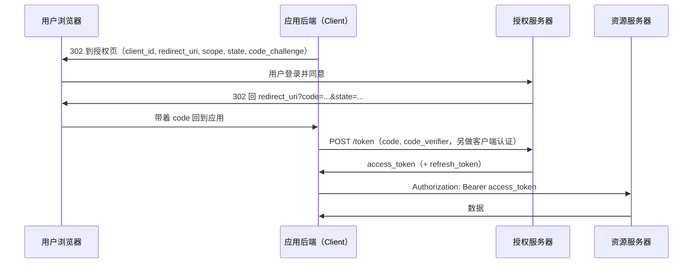
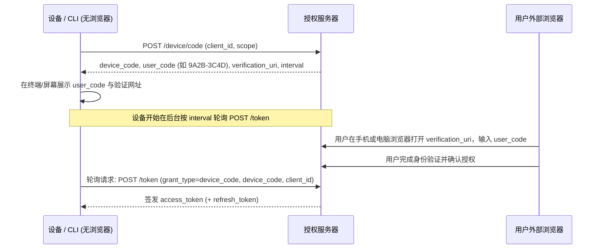
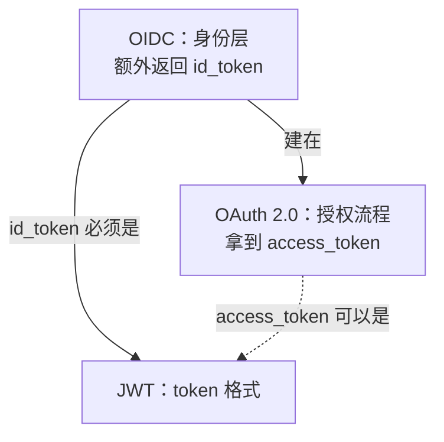

# OAuth

## 摘要

OAuth 2.0（RFC 6749）是一套**授权协议**：客户端获得限定访问范围的 access_token 后访问资源。授权可由资源所有者参与，也可采用客户端凭证等不需要用户交互的方式。

它规定"怎么拿到 token"，不规定"token 长什么样"。token 可以是随机字符串，也可以是 [[wiki/topics/architecture/jwt|JWT]]。OAuth 本身也不负责"用户是谁"，这部分由建在它之上的 OpenID Connect（OIDC）补上。

## 四个角色

| 角色 | 是谁 |
| --- | --- |
| Resource Owner | 用户，数据的所有者 |
| Client | 第三方应用，想代表用户访问数据。事先在授权服务器注册，拿到 `client_id`（机密客户端还需配置客户端认证方式，不一定使用共享 secret） |
| Authorization Server | 负责让用户登录、确认授权、发 token |
| Resource Server | 存放数据的 API，收到请求时校验 access_token |

## 授权方式

| 方式 | 适用场景 | 现状 |
| --- | --- | --- |
| 授权码（Authorization Code）+ PKCE | 有用户参与的 Web、App、SPA | 推荐的默认方式 |
| 客户端凭证（Client Credentials） | 服务对服务，没有用户 | 常用 |
| 设备码（Device Authorization，RFC 8628） | 电视、CLI 等不方便输入或接收回调的设备 | 常用 |
| 刷新（Refresh Token） | 换取新的 access_token | 取决于授权方式与服务器策略；客户端凭证流程通常不签发 refresh_token（RFC 6749 §4.4.3） |
| 隐式（Implicit） | 早期浏览器应用 | RFC 9700 建议不再使用 |
| 密码（Resource Owner Password） | 应用直接收用户密码 | RFC 9700 规定不得使用 |

### 授权码流程



要点：

- `code` 很短（分钟级），只能用一次。
- 图中是有后端的机密客户端：兑换时同时提交 PKCE 的 `code_verifier` 并完成客户端认证，二者不互相替代。公开客户端也可直接兑换，但不应依赖保存在浏览器或 App 中的共享 secret。
- `state` 用来确认回调是自己发起的，防止伪造的回调（CSRF）。
- PKCE（RFC 7636）：客户端先生成随机的 `code_verifier`，授权请求里带它的哈希 `code_challenge`，换 token 时带原值。即使 `code` 被截获，没有 `code_verifier` 也换不到 token。原本为没有 secret 的公开客户端（App、SPA）设计。RFC 9700 规定公开客户端必须用，机密客户端推荐用。

### 为什么必须使用授权码（code）换取令牌？

如果不通过中间的短期授权码，而是在用户同意后直接把长效 `access_token` 放在重定向 URL 中返回（即早期 OAuth 2.0 的隐式模式 Implicit Flow）：

1. **前端传输暴露面过大**：重定向 URL 中的长效令牌会完整暴露在浏览器地址栏、写入系统浏览历史，并可能随外链跳转通过 HTTP `Referer` 头或前端第三方脚本泄露给不受信方；
2. **缺乏客户端身份核验**：直接在前端发 token 无法验证接收方的真实身份。通过授权码流程，真正的令牌仅在应用后端与授权服务器之间的安全信道（Server-to-Server）中兑换，结合机密客户端的 `client_secret` 或公开客户端的 PKCE（`code_verifier`），能够有效防御令牌被仿冒客户端窃取。

RFC 9700（OAuth 2.0 安全最佳实践）已明确弃用隐式模式，推荐所有场景统一采用授权码流程。

### 设备码流程（RFC 8628）

用于无法直接运行浏览器或接收本地 HTTP 回调的客户端（如智能电视、机房 SSH 终端、路由器等）：



要点：
- 轮询请求必须携带 `client_id`（公开客户端）或完成客户端认证（机密客户端），授权服务器据此校验 `device_code` 是否归属于发起申请的同一应用，防止其他非法应用冒领令牌（RFC 8628 §3.4）；
- 设备在后台以 `interval`（通常为 5 秒）轮询，未确认前服务器返回 `authorization_pending` 错误码；
- 轮询过快返回 `slow_down`，设备必须增加等待间隔；
- `user_code` 采用适合人类短时记忆和输入的字符集（通常 8 位，去除了容易混淆的 `0/O`、`1/I` 等字符）。

### 命令行（CLI）与无头环境的授权演进

历史早期工具（如旧版 `git`、旧版 `docker login`）曾在终端中直接要求输入用户名与主账号密码，但该做法在现代安全工程中已被彻底弃用：一方面主密码容易残留在终端历史（`~/.bash_history`）、控制台输出或进程环境中，扩大了泄露面；另一方面现代企业普遍接入了 SSO、企业微信/飞书扫码与多因素认证（2FA/MFA），纯黑框终端无法交互式处理复杂的现代认证流程。

现代命令行工具收敛为两种无密授权架构：

- **桌面环境（本地回环 Web Flow）**：如 GitHub CLI（`gh auth login`）在具备图形界面的开发机上运行时，先在本地监听临时回环端口（如 `http://127.0.0.1:<port>/callback`），调起系统默认浏览器打开授权页；用户点击授权后，浏览器直接重定向至本地回环端口自动完成 code 交接与令牌兑换，全程无需用户手动输入代码；
- **无头/远程环境（设备码 Device Flow）**：在通过 SSH 远程连接的服务器、Docker 容器或无界面设备中，因无法接收本地浏览器重定向，程序自动退回设备码流程（RFC 8628），在终端打印短码并引导用户在外部浏览器中完成带外确认。

#### 公开客户端的“无 Secret 困境”与防御模型

终端 CLI 与原生 App 属于公开客户端（Public Client），其二进制分发给所有终端用户，任何硬编码的 `client_secret` 均可被逆向工具轻易提取，因此规范严格禁止公开客户端依赖保密密钥。设备码流程通过两道防线替代 secret 的安全防护：

1. **高熵长随机码内存流转**：展示在屏幕上的仅为 8 位适合输入的 `user_code`，而设备在后台轮询使用的 `device_code` 为长达数十字节的高熵随机字符串，仅保存在终端进程内存与轮询请求中，不显示于终端屏幕，也不通过浏览器传递，外部截获难度极高；
2. **官方 Web 域的带外显式背书（Out-of-band Consent）**：即使外部仿冒者截获了 `client_id`，也必须等待真正的账号主人在登录后的授权服务器官方安全页面中输入对应验证码并点击批准，服务端才会在后台将该用户的授权与该 `device_code` 关联绑定。

#### 为什么第一方官方 CLI 依然走标准 OAuth 授权？

GitHub CLI（`gh`）、AWS CLI、Vercel CLI 等官方第一方工具访问自研服务器时，依然表现得像“第三方应用”一样弹窗走标准 OAuth，而非内置特权私有接口。这一设计体现了**第一方与第三方平权（First-party & Third-party Parity）**的架构哲学：

1. **消除特权后门**：避免在公开 OAuth 之外再维护一套私有特权通道，从源头消灭特权接口被逆向挖掘沦为安全黑洞的风险；
2. **权限透明与最小权限裁剪（Scopes Control）**：官方 CLI 依然需要按需声明申请的权限范围（如 `repo`, `read:org`），用户在网页授权时保留完整的知情权与权限审计能力；
3. **支持控制台一键独立吊销（Revocation Kill-Switch）**：所有已授权的 CLI 终端均列在用户的应用管理列表中。一旦某台开发机丢失或失控，用户可在网页端单独吊销该终端的访问令牌，无需重置人类主账号密码；
4. **跨私有化实例通用适配**：标准 OAuth 抽象使得同一套 CLI 二进制能够无缝连接公有云服务与企业私有化部署实例（如 GitHub Enterprise Server），底层认证协议完全统一。

#### 企业级 CLI 的双身份模型：以飞书 lark-cli 为例

在现代企业协作生态中，官方工具（如 `lark-cli`）进一步演进出 **Bot 身份（机器凭证）与 User 身份（人类凭证）并存的双身份架构**：

- **Bot 身份（自动化底座）**：通过在本地初始化配置企业自建应用的 `appId`（即 `client_id`）与 `appSecret`，CLI 可直接向开放平台申请 `tenant_access_token`，代表机器人身份执行通用业务调用（如发送群卡片、监听 Webhook、执行自动化构建）；
- **User 身份（敏感个人资产操作）**：当 CLI 需要代用户读写私人日程、个人云文档或待办清单时，企业风控机制严格禁止机器人在无人类确认的情况下越权探测。CLI 随即触发 `lark-cli auth login` 唤起 RFC 8628 设备码流程，由员工在手机飞书上扫码完成带外显式授权，获取 `user_access_token` 并加密持久化至本地安全钥匙串（macOS Keychain），实现人机权能的精准隔离。

#### Web 登录态收敛（Cookie/Session）vs CLI 直接持有 Token

这一差异解释了为什么 Web 应用与命令行工具在 OAuth 落地形态上截然不同：

- **第一方 Web 场景（SSO 登录态收敛）**：在拥有业务后端的典型 Web 应用中，浏览器天然具备受保护的 Cookie 容器。用户在统一认证中心（如飞书、Okta）完成授权后，重定向回调直接抵达业务后端；后端使用 `code` 向认证中心换取 Access Token 并提取用户信息后，**随即收敛为业务系统自身的原生登录态（向浏览器植入自有的 Session ID Cookie）**。前端浏览器与业务后端始终基于第一方 Session 通信，OAuth 仅作为外部身份提供商（IdP），浏览器本身无感知且无需存储外部 Access Token；
- **终端 CLI / 桌面工具场景**：CLI 缺乏业务后端代持凭据，亦无浏览器的自动 Cookie 管理容器。CLI 程序身兼调用方与执行宿主，因此必须通过设备码（Device Flow）将 Access Token 领回本地，并依赖系统级安全存储（钥匙串或受限文件）自行管理令牌的持久化与刷新。

针对非个人交互型客户端、需要在后台无人类干预常驻运行的计算节点（如 Agent、CI Runner、Kubernetes 节点），则进一步演进为独立的机器资产开户自举范式，详见 [[wiki/syntheses/architecture/machine-identity-and-agent-provisioning|机器身份与 Agent 节点自举授权范式]]。

## access_token 的三种实现

| 实现 | 资源服务器怎么校验 | 能立刻作废 | 代价 |
| --- | --- | --- | --- |
| 随机字符串（引用型 / opaque） | 查询共享记录或调用内省接口 | 取决于记录更新和缓存传播 | 需要查询或缓存状态 |
| 签名 JWT（RFC 9068 定义了 access_token 的 JWT 格式） | 验签并校验 claims | 仅本地验证不能及时获知撤销；可增加状态检查 | 撤销及时性与查询成本需要取舍 |
| 加密 JWT（JWE） | 解密并验证完整性与 claims；若内层还有 JWS，再验签 | 仍取决于撤销状态检查 | 增加密钥管理与加密处理 |

### 内省接口（RFC 7662）

内省接口可返回 token 的 `active` 状态及适用的 claims。它既可用于 opaque token，也可用于 JWT；不是随机字符串的唯一校验方式。端点 URL 由部署配置，不必叫 `/introspect`。缓存内省结果会影响撤销生效时间（RFC 7662 §2）。

### 撤销接口（RFC 7009）

RFC 7009 要求撤销端点支持 refresh_token，并建议支持 access_token；端点 URL 不必叫 `/revoke`。JWT access_token 的撤销也能生效，但资源服务器需要通过状态查询、通知等方式得知撤销；只做本地验证的服务器可能继续接受它直到过期。撤销 refresh_token 是否连带撤销 access_token，还取决于服务器的支持和策略。

## 使用 access_token

RFC 6750 规定的标准方式是请求头：

```http
Authorization: Bearer <access_token>
```

不要放在 URL 查询参数里，容易进日志和浏览器历史。

## OAuth、OIDC、JWT 的关系



- OAuth 管授权：第三方应用能访问什么。
- OIDC 在授权码流程上加了 `openid` scope 和 `id_token`，回答"用户是谁"，常用于 [[sso]] 和"用 XX 账号登录"。
- JWT 只是格式。只做自己系统的前后端登录，不需要 OAuth，用 Session 或 JWT + refresh_token 即可，见 [[wiki/comparisons/architecture/session-vs-jwt-vs-dual-token|Session vs JWT vs 双 Token]]。

## refresh_token 的安全要求（RFC 9700 §4.14）

对公开客户端，授权服务器必须（MUST）用下面至少一种方式发现 refresh_token 被重放：

- **轮换**：每次刷新发新的 refresh_token，旧的作废；检测到旧的被再次使用时，撤销该轮换关系中当前有效的 refresh_token，要求重新授权。
- **绑定发送方**：把 refresh_token 和客户端持有的密钥绑定（如 DPoP，RFC 9449），仅取得 token 而没有对应密钥，无法通过发送方证明；密钥也泄露时仍有风险。

## 原始笔记

- https://www.ruanyifeng.com/blog/2019/04/oauth_design.html
- OAuth 就是一种授权机制。数据的所有者告诉系统，同意授权第三方应用进入系统，获取这些数据。系统从而产生一个短期的进入令牌（token），用来代替密码，供第三方应用使用
- 一般第三方应用要先去系统注册获取 client id 和 secret
- 第三方应用会向系统携带 client id，告诉系统是谁在请求，用户授权以后会 redirect 到第三方应用的网址，携带授权码，然后请求业务后端，业务后端用 client id 和 secret 加授权码去请求系统的令牌，再跳回到前端（可以是裸的令牌，可以是和业务绑定后的 token），然后前端就可以用这个令牌（以用户的身份）去请求用户在系统的信息了
- 看着向 Github 注册的 **Homepage URL** 和 **Authorization callback URL** 不会校验端口，只会校验域名和 callback 的 path
- ~~TODO 如何结合这个进一步设计登录态？~~ 见 [[wiki/comparisons/architecture/session-vs-jwt-vs-dual-token|Session vs JWT vs 双 Token]]

## 相关页面

- [[wiki/topics/architecture/jwt|JWT]]
- [[wiki/comparisons/architecture/session-vs-jwt-vs-dual-token|Session vs JWT vs 双 Token]]
- [[sso]]

## 来源指针

- `raw/sources/oauth.md`
- 阮一峰《OAuth 2.0 的一个简单解释》：https://www.ruanyifeng.com/blog/2019/04/oauth_design.html
- RFC 6749 OAuth 2.0：https://www.rfc-editor.org/rfc/rfc6749
- RFC 6750 Bearer Token Usage：https://www.rfc-editor.org/rfc/rfc6750
- RFC 7636 PKCE：https://www.rfc-editor.org/rfc/rfc7636
- RFC 8628 Device Authorization Grant：https://www.rfc-editor.org/rfc/rfc8628
- RFC 7662 Token Introspection：https://www.rfc-editor.org/rfc/rfc7662
- RFC 7009 Token Revocation：https://www.rfc-editor.org/rfc/rfc7009
- RFC 9068 JWT Profile for Access Tokens：https://www.rfc-editor.org/rfc/rfc9068
- RFC 9700 OAuth 2.0 Security Best Current Practice：https://www.rfc-editor.org/rfc/rfc9700
- OpenID Connect Core 1.0：https://openid.net/specs/openid-connect-core-1_0.html
