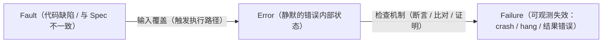

# 软件工程

软件工程的核心问题是解决 **`Intent`（人类意图）→ `Spec`（需求规约）→ `Implementation`（代码实现）** 之间的落差。

软件系统通常从极简原型（独木舟）通过大量小步提交演化成复杂系统（航母）。当 AI Agent 参与开发、一次任务就能生成数百个 commit 与上万行代码时，人类不再读懂每一行实现；同时模型往往倾向于跳过单元测试、只做一次端到端运行交差。代码生产变快之后，**把“什么叫对”定义清楚，并建立能自动暴露错误的架构与验证闭环**，比手写代码本身更重要。

## 调试理论：`Fault → Error → Failure`

理解软件测试与调试，可以从错误传播的三段链条入手：

- **Fault（缺陷 / Bug）**：静态存在于代码中的错误，例如把内层循环 `j++` 写错成 `i++`，或漏掉边界条件。
- **Error（错误状态）**：程序执行后内部状态已经违反规约，但 CPU 不会主动报错，多数 Error 是静默（silent）的。例如覆盖了一块后续未用到的栈内存，当次运行结果可能看似正常。
- **Failure（失效）**：Error 最终传播到外部可观测层面，表现为崩溃、死循环超时或输出错误（例如 Ariane 5 火箭因浮点数转 16 位整数溢出触发异常导致坠毁）。

两条基本结论：
1. **有 Fault 不一定触发 Error**：需要足够完备的输入去覆盖对应路径和运行环境（跨平台大小端、依赖库版本、并发调度时序）。
2. **触发 Error 不一定看到 Failure**：需要有效的检查（断言、参考实现比对）；一旦抓到 Failure，就可以用二分法顺着执行轨迹定位状态从正确变错的第一条语句。

## 架构决定可测性

在谈具体测试技术之前，决定软件质量上限的第一因素是**语言选择与架构设计**：

- **用语言消除整类未定义行为**：Java 通过托管运行时消除了 C/C++ 的 `use-after-free` 等指针未定义行为；Safe Rust 通过编译期借用检查进一步消灭内存安全问题。
- **逻辑引擎与渲染 / 外部 I/O 分离**：如果把状态计算和 3D 渲染、硬编码物理混在一起（例如让 AI 一句话写 CS:GO），后期只能陷入“改代码 → 截图 → 肉眼看图 → 小修”的循环。先做无图形的确定性状态引擎（deterministic state transition，可直接单测和 replay），再做渲染投影层，就能用代码低成本完成绝大部分验证。
- **优先使用纯函数（Functional Design）**：减少对全局可变状态的隐式依赖，让函数行为只由输入决定，避免每次测试都构造复杂的全局状态。
- **为差分比对预留接口边界**：例如模拟器实验 NEMU 将 CPU 核与内存、外设按总线解耦后，即可与参考实现 QEMU 并行挂载，每执行一条指令就比对寄存器与 `EFLAGS`，让静默 Error 当场变成显式 Failure。
- **测试策略单一事实来源**：当项目规模变大时，测试脚本、`Justfile` 与 CI 配置容易互相漂移。可以把测试范围、层级、命令与触发阶段集中写在一张文档表（如 `docs/testing.md`）中，再由脚本编译生成 pre-commit 与 CI 检查流程。

## 软件测试

测试的目标是用有限的成本，尽可能暴露 `Fault → Error → Failure` 链条上的问题。按惯例（如 Dijkstra 所言），**测试只能证明 Bug 存在，不能证明没有 Bug**，但因为正常代码具有泛化性，系统化的测试能持续建立对软件的信心。

### 常见测试分层与工程手段

- **分层金字塔（Unit / Integration / System Test）**：单元测试成本最低，应承担绝大部分逻辑验证；集成测试验证模块接口协作；系统测试（端到端）成本最高，用来确认整体链路可用，避免用昂贵的系统测试去抓单元测试就能发现的低级错误。
- **黑盒与白盒、覆盖率**：黑盒测试关注边界值（0、1、最大值、负数、空值）与等价类；白盒测试结合语句、分支、路径覆盖率找出从未执行过的死角（“未测代码永远是错的”）。
- **Mock / Stub**：用可控的假实现替代昂贵或不可控的外部依赖（如摄像头硬件、网络、系统时间），例如 Android 早期模拟器用 AVD 虚拟摄像头跑通拍照权限流程。
- **回归测试（Regression Test）**：代码修改后重跑相关历史用例，确保修一个问题时不破坏已有功能。

### 自动化增强手段

- **Differential Testing（差分测试）**：把同一份输入或状态同时送入被测程序和参考实现（Golden Version，如自研 CPU 对比 QEMU），直接比对内部状态或输出差异，专门抓那些不会 crash 的静默错误。
- **Fuzzing（模糊测试）**：把命令行参数、文件或网络包编码成字节流，以代码覆盖率为反馈不断做变异与交叉（如 Linux 内核的 Syzkaller、开源项目常用的 OSS-Fuzz），自动搜出人工想不到的异常输入。

## 形式化验证与 AI 时代的拐点

当测试无法穷举所有路径时，形式化方法试图在数学意义上证明程序满足规约：

| 路线 | 代表工具 / 案例 | 核心做法 | 代价与限制 |
| --- | --- | --- | --- |
| **定理证明（Hoare 逻辑）** | `{P} C {Q}`、循环不变式 | 从前置条件出发，用公理规则推导程序终止后必满足后置条件 | 人工构造复杂数据结构/算法的不变式难度极高 |
| **Model-Based** | TLA+（如 2PC 共识建模） | 抽取出几十到数百状态的简化状态机模型，穷举所有路径验证无死锁/不变量成立 | 模型正确不代表代码正确，需通过 **Refinement Mapping**（运行日志对齐模型，或从模型采样生成用例）衔接真实代码 |
| **Path-Based** | KLEE（符号执行） | 把程序指令与分支条件列成数学方程，交给 SMT 求解器解出能触发 `assert` 失败的输入 | 依赖中间表示建模，容易遭遇路径爆炸 |
| **Proof-Based** | CompCert、seL4、Lean / Coq | 直接对真实代码或编译器写出机器可检验的数学证明 | 传统模式成本极高（seL4 耗费 25 人年、20 万行证明脚本） |

### AI 改变了什么，没改变什么

1. **`Impl ↔ Spec` 正在变便宜**：Proof Assistant（如 Lean、Coq）是一个没有容错的确定性裁判——每一步推导只认公理，逐字核对，适合作为强化学习反馈。在 Lean 4 中，基于 Curry-Howard 同构（命题即类型，证明即程序），开发者可以同时写可执行函数（`def`）和性质证明（`theorem`）；编译成 C 代码时，证明项会被擦除（Proof Erasure），只留下经过校验的计算逻辑。大模型大幅压低了编写数万行证明脚本的人力成本，也让类似 Proof-Carrying Code（代码自带编译期可校验的证明）的思路重新具备工程可行性。
2. **`Intent ↔ Spec` 依然没有银弹**：AI 能帮人把给定规约证死，但把模糊人类意图翻译成精确规约（Autoformalization）仍然是瓶颈。依赖主观感受的需求（如动效是否自然、系统是否好用）极难形式化；而且模型在翻译目标时可能偷偷弱化条件再把弱化版证出来，因此**仍需保留可执行的测试来反向校验形式化定义是否偏离原意**。

## 相关页面与来源

- [[wiki/topics/architecture/software-design|Software Design]]
- [nju-se-software-quality-1.md](raw/sources/nju-se-software-quality-1.md)
- [nju-se-software-quality-2.md](raw/sources/nju-se-software-quality-2.md)
