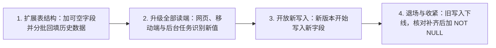

# 软件发布与运维

## 摘要

软件发布负责把本地通过测试的程序交付到他人的运行环境中执行；软件运维负责在系统持续对外提供服务、甚至多个版本同时在线的状态下，安全地完成变更、性能调优与故障恢复。在 AI 编程工具大幅降低代码编写成本之后，从“本地能跑”走向“他人可用且可长期演进”，瓶颈更多落在发布形态决策、真实环境验收与运行期可靠性保障上。

## 验收边界：谁判断 AI 做成了

借助 AI 工具生成代码、配置或数学证明时，机器验证与人类验收承担不同职责：

- **机器验证推理与实现**：测试套件与形式化检查器（如 Lean 及其独立检查器）可以核对实现是否满足已写下的规约，或证明步骤是否严格推出形式化命题。
- **人类核对题意与意图**：形式化命题本身是否等价于原始问题、软件规约是否符合真实业务意图，仍需熟悉领域的人判断。
- **把意图收紧为真实环境验收规格**：当开发者需要借助 AI 使用自己并不完全熟悉的基础设施（如动态链接、Nginx、HTTPS 证书链）时，应先明确可检查的验收条件（例如在未装开发工具的干净机器上下载安装、切到移动网络完成联机、在旧客户端验证证书链），再由 AI 调研方案并按真实路径验收。对于视觉类任务，也可指定真实参考图片作为对比基准，利用多模态模型的判别能力驱动迭代修正。

## 软件发布：从本地构建到跨环境分发

把开发环境编译出的可执行文件直接发给用户，往往在加载阶段就会失败（例如目标机器缺少动态库 `libSDL2-2.0.so.0`）。发布需要解决环境差异、构建自动化与架构扩展三个问题：

- **源码与发布产物分离**：Git 仓库只托管人或 AI 编写的源代码；由工具链生成的二进制包、压缩包、校验和（如 SHA 摘要）和签名文件通过 CI/CD（Continuous Integration / Continuous Delivery，持续集成与持续交付）按 Git tag 自动构建并放进 Release。例如 OpenAI Codex 的一次预发布（`rust-v0.173.0-alpha.4`）由 GitHub Actions 触发，覆盖 Linux、macOS、Windows 多架构构建与签名，单次产出 196 个发布文件。
- **目标环境组合与模型的默认倾向**：原生分发需要面对不同操作系统、CPU 架构（x86-64、ARM64、龙芯等）、系统动态库版本与老旧显卡驱动。当用户没有明确指定发布形态时，AI 模型通常会优先生成单文件网页以减少环境依赖与排错成本；需要跨平台原生分发时，必须在初始需求中明确目标平台与最低硬件要求。
- **架构决定新增平台的代价**：打包与签名可以交给流水线，但如果一开始把键盘输入事件与命中判定、计分、存档耦合在一起，后期新增移动端触屏或分区发行（如 iOS 国区与美区）时仍需返工拆分核心逻辑。

## 在线服务部署与托管边界

当软件需要多人共享状态（如排行榜或联机对战）时，不能再把 `localhost` 链接发给他人，必须部署为在线服务，明确数据存储位置、写入权限边界以及开发者本机离线后的可用性。

- **服务公开即开始担责**：无论采用传统 LAMP（Linux、Apache、MySQL、PHP）、容器部署还是云主机托管，服务暴露到网络的那一刻就需要面对端口扫描、远程代码执行漏洞、拒绝服务攻击与 HTTPS 证书维护。
- **证书信任链的隐蔽故障**：HTTPS 证书在有效期内仍可能被部分客户端拒绝。常见原因是服务器未下发完整的中间证书链；现代浏览器可能因缓存了中间证书而正常打开，但老旧机器或 `wget` 等工具会直接校验失败，必须在多类客户端复核。
- **托管平台的收益与局限**：类似 Serverless 或应用商店托管模式（如 GPT Store 的构想）能接管进程托管、弹性扩容与分发入口，让中长尾开发者聚焦业务逻辑并按用量计费。但从“能回答问题”走到“能执行真实操作（如代为选课）”，瓶颈在于外部系统接口、用户授权与事务回执的集成。

## 零停机变更与多版本并存

即使代码和发布流水线完全正确，业务需求变更仍会带来线上迁移难题（例如教务系统在选课期间不能停机，却需要为新增校区在数据库表中加入“校区”字段）。在无法约定停机维护窗口（如 12306 夜间维护时段）的前提下，上线窗口内会同时存在旧应用、新应用、新旧表结构与新旧数据。测试如果只覆盖“全旧”和“全新”两个端点，会漏掉上线期间真正运行的混合状态。

针对以当前状态为中心的数据库，在线加字段通常采用分步兼容迁移（Expand-Contract）：

1. **先让新旧程序共用数据库**：增加允许为空的字段，保证旧程序照常读写、新程序正确展示空值（不随意猜测默认值），同时后台分批补全历史数据。
2. **先升级所有读端，再开放写端**：确保网页、App、导出任务和后台作业都能正确处理新值后，才开放新数据写入，避免写入端正常而下游消费端展示出错。
3. **旧写入退场后再收紧约束**：只要旧写入入口还在运行，随时可能写入新的空值；必须等旧入口彻底下线、补齐最后一批数据并核对无误后，再添加 `NOT NULL` 约束。执行这一步后，省略该字段的旧程序将无法直接回滚。

另一种架构选择是**事件溯源（Event Sourcing）**：持久化保存操作事件流，当前状态由事件依次重放计算得出。升级时，旧版本继续提供服务，新版本在旁重放同一串事件构建新视图，追平并核对结果一致后再切换流量。其代价是额外的存储与重算开销，且重放历史事件时必须隔离外部副作用（例如避免因重放“地点变更”而向用户重复发送通知）。

## 运行期配置、冷启动与 SRE

源代码只决定服务行为的一部分，运行期配置与上线瞬间的环境差异同样会导致严重故障：

- **配置调优依赖实测瓶颈**：Nginx 混合负载压测表明，当部分工作进程被随机读盘阻塞时，内存缓存中的 4 MB 热门文件平均等待时间可达 7.42 秒；开启 `aio threads` 将阻塞读盘交由线程池处理后，同一热门文件的平均响应时间降至约 226 毫秒。其他配置同样存在权衡：CPU 绑核在混部环境中可能引发饥饿并拉高 P99 延迟；压缩动态 JSON 可节省带宽但消耗服务端 CPU，且会拖慢弱算力客户端；对图片、视频、字体二次压缩则几乎没有收益。AI 生成的默认配置通常能够运行，但不会主动根据线上负载调整参数，需要基于压测证据定向排查。
- **冷启动与超时设置**：Amazon 工程复盘中，一项远程调用将超时设为约 20 毫秒，在复用已有加密连接时足够；但新实例刚接流量时，计时器把首次 TLS 建连也计入超时窗口，导致升级后的首批请求直接失败。常见做法是在进程接收外部流量前预热建连，或区分建连超时与请求超时。
- **SRE（Site Reliability Engineering，站点可靠性工程）**：核心是用工程化工具和流程维持真实站点持续可用。可靠性必须从用户视角度量（例如提交选课请求后在约定时间内返回成功，且刷新课表能看到已选课程），而不仅是检查服务器进程是否存活。针对测试环境难以复现的线上缺陷，通常通过灰度发布（如 1% → 5% → 10% → 50% → 100%）控制影响范围，配合具统计显著性的业务指标（如用户后续反馈情绪、语音输入后紧接着手动打字更正的比例）决定放量或回滚，并确保值班（on-call）告警能直接定位异常版本且回滚流程经过演练。

## 工程限制与早期边界

完备的发布流水线、零停机迁移与专职 SRE 需要显著的研发与运维投入，并非所有阶段都应一步到位：

- **早期产品不宜过早引入重型 SRE**：用户规模在数百至上万阶段，留存用户通常是认可核心功能价值的早期支持者，对偶发故障有一定容忍度。此时优先保证核心价值不退化，并依靠快速反馈与高频迭代修复问题；待用户规模与业务体量增长到故障代价高于运维成本时，再投入专职可靠性工程。
- **单次发布复杂度随目标环境呈乘法增长**：平台、架构、打包格式与发行区域每多一个维度，需要测试和维护的组合数都会成倍扩大，应结合实际用户分布裁剪支持列表并明确终止支持策略。

## 相关页面

- [[wiki/topics/architecture/software-engineering|软件工程]]
- [[wiki/topics/languages/formal-verification|形式化验证]]
- [[wiki/syntheses/systems/serverless-app-layering-isolation|Serverless 应用分层与隔离]]
- [[wiki/syntheses/tooling/npm-package-publishing-practices|npm 包发布与发布链路实践]]
