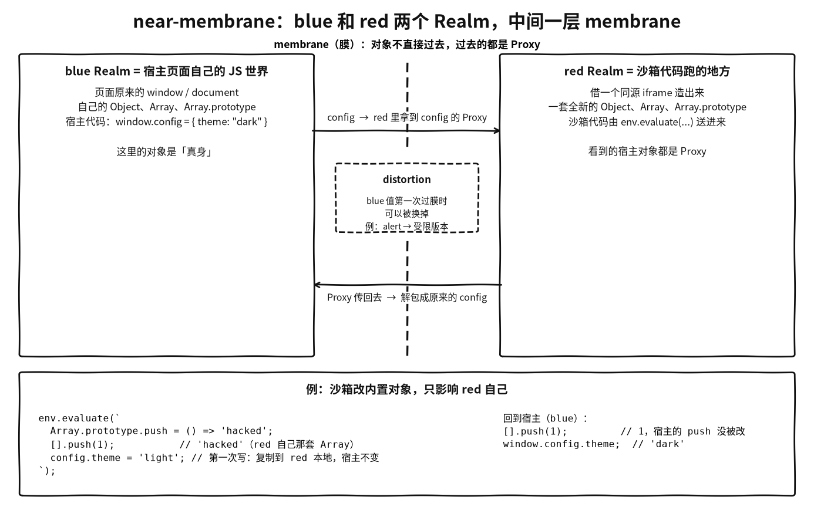

# near-membrane

## 摘要

[salesforce/near-membrane](https://github.com/salesforce/near-membrane)（MIT，npm 作用域 `@locker/`）是一个同步的 JavaScript 沙箱库。它在同一个线程里再造一个 JS Realm（一套独立的全局对象和内置对象：浏览器里借一个同源 iframe，Node 里用 `vm.runInNewContext`），把宿主的全局对象用 Proxy 懒投影进这个新 Realm，让沙箱代码以为自己跑在顶层，同时把它对宿主对象的修改限制在沙箱里，并允许宿主通过 `distortionCallback` 替换任何跨界的值。

仓库描述是「JavaScript Near Membrane Library that powers Lightning Locker Service」，2026 年的安全修复都带 `[LWS]` 标签，所以可以推断它是 Salesforce Lightning Web Security（LWS）沙箱的底层实现；LWS 官方文档本身没有点名 near-membrane。

库本身声明「提供完整性，不提供安全保证」，安全策略要在上层用 distortion 实现。仓库在 2026-09-18 17:59（北京时间）归档，最后的 npm 版本是 0.19.1。

术语：宿主一侧叫 **blue**，沙箱一侧叫 **red**。Blue Proxy 是在 blue 里创建、包着 red 值的 Proxy；Red Proxy 是在 red 里创建、包着 blue 值的 Proxy。代码里 red 一侧被称为 shadow realm（变量 `IS_IN_SHADOW_REALM`），与 TC39 的 ShadowRealm 提案不是一回事。第一次接触的话，先看下一节「先看懂 blue 和 red」里的比方和例子。

本页依据 `main` 分支最后的提交 `19685c3`。源码与 README、`DESIGN_DOCUMENT.md` 不一致的地方以源码为准，并单独指出。

## 先看懂 blue 和 red

**打个比方**：blue 是你自己的家（宿主页面），red 是给客人新装修的一间客房，里面的家具（`Object`、`Array`、`Array.prototype` 这些内置对象）全是新买的一套。客人在客房里随便改家具，不会改到你家的。客人要用你家的东西（比如 `document`、`fetch`、你挂在 `window` 上的配置），不能直接把真东西搬过去，只能隔着一道玻璃窗递过去一个「遥控器」（Proxy）：客人按遥控器，动作才传到真东西上。这道玻璃窗就是 membrane。递东西时你还可以偷偷换掉（distortion），比如把 `alert` 换成一个只打日志的版本。

对应到代码：

- **blue Realm**：宿主页面自己的 JS 世界，就是页面原来的 `window`、`document`，和它自己那套 `Object`、`Array`。调用 `createVirtualEnvironment` 的代码跑在这里。
- **red Realm**：一套全新的内置对象，沙箱代码在这里跑。浏览器版借一个同源 iframe 造出来，Node 版用 `vm`。
- **membrane**：两边之间的 Proxy 层。blue 的对象进入 red 时，red 拿到的是包着它的 Proxy；Proxy 传回 blue 时会解包回原来的对象，所以同一个对象来回传，`===` 始终成立。



一个具体例子（`examples/` 里的示例都是这种写法）：

```js
import createVirtualEnvironment from '@locker/near-membrane-dom';

// blue：宿主页面自己的代码
window.config = { theme: 'dark' };

const env = createVirtualEnvironment(window, {
    distortionCallback(v) {
        // blue 值第一次进入 red 时经过这里，可以换成别的值
        return v === alert ? () => console.warn('沙箱里不能 alert') : v;
    },
});

// red：下面这段字符串在 red Realm 里求值
env.evaluate(`
    Array.prototype.push = () => 'hacked';  // 改的是 red 自己那套 Array.prototype
    [].push(1);                             // 'hacked'
    config.theme;                           // 'dark'：读操作经 Proxy 问 blue
    config.theme = 'light';                 // 第一次写：把属性复制到 red 本地（static），宿主对象不变
    alert('hi');                            // 实际调用的是 distortion 换上去的函数
`);

// 回到 blue
[].push(1);            // 1：宿主的 Array.prototype.push 没被改
window.config.theme;   // 'dark'
```

这个例子对应下文的几处机制：

- `Array` 属于 `getESGlobalKeys` 列出的名字，red 用自己的，不从 blue 投影；`linkIntrinsics` 把两边的 `Array.prototype` 配成一对，所以 blue 的数组进入 red 后原型链对得上，但 red 改的始终是自己那一份（见「`link`：内置对象直接互换」）。
- `config` 是 blue 的普通对象，进入 red 时变成 red proxy，第一次写触发 pending → static，修改只落在 red 本地的 shadow target 上（见「red 侧状态机」）。数组和带 live 标记的对象不一样，写操作会透传到宿主。
- `alert` 被换掉发生在 blue 侧的 `getTransferablePointer`，沙箱拿不到原函数（见「Distortion」）。

和后面几节的关系：「指针协议」讲 Proxy 和原对象之间怎么对上号，「red 侧状态机」讲写操作什么时候复制、什么时候透传，「Distortion」讲换值的时机和局限。

## 目标与非目标

README 的两条目标：

- 沙箱里执行的代码察觉不到沙箱的存在。
- 对对象图的修改只影响沙箱自己。

`DESIGN_DOCUMENT.md`（2026-02 由 #481 加入）把目标细化为四条：透明（沙箱里 `window === globalThis === self`、`window === window.top` 都应成立）、完整性保持、身份连续（同一个对象跨界后 `===` 仍成立）、可控的能力访问（distortion）。非目标有三条：安全保证（「The membrane provides integrity, not security」）、性能对等（允许 `trackAsFastTarget`、`maxPerfMode` 这类用隔离换性能的开关）、完整的 DOM 虚拟化。

## 包结构

| 包 | 作用 |
| --- | --- |
| `@locker/near-membrane-shared` | 缓存原生内置方法（`ReflectApply`、`ArrayProtoPush` 等）、加固过的 WeakMap / WeakSet、常量、序列化、`isNearMembraneProxy` |
| `@locker/near-membrane-shared-dom` | DOM 原生方法缓存、浏览器识别 |
| `@locker/near-membrane-base` | 核心：`membrane.ts`（4711 行）、`connector.ts`、`environment.ts`（`VirtualEnvironment`）、`intrinsics.ts` |
| `@locker/near-membrane-dom` | 浏览器适配：`browser-realm.ts`（用 iframe 建 Realm）、`window.ts` |
| `@locker/near-membrane-node` | Node 适配：`node-realm.ts` |

全库先把要用的内置方法缓存成局部常量。例如 `toSafeWeakMap` 把 `get`、`set` 等方法拷成对象自己的属性，之后即使有人改了 `WeakMap.prototype.get`，membrane 内部的调用也不受影响。

## 核心机制

### 一个函数，在两个 Realm 各求值一次

核心是 `membrane.ts` 里的 `createMembraneMarshall`。`connector.ts` 决定它在哪边运行：

```ts
export function createBlueConnector(globalObject: typeof globalThis): Connector {
    return createMembraneMarshall(globalObject);          // blue：直接调用
}
export function createRedConnector(evaluator: typeof eval): Connector {
    return evaluator(createMembraneMarshallSourceInStrictMode)() as Connector; // red：把函数源码交给 red 的 eval 重新编译
}
```

red 侧拿到的是**函数源码字符串**，用 red 自己的 `eval` 重新编译，所以 red 侧闭包里的 `Proxy`、`Reflect`、`WeakMap` 都是 red 自己的内置对象。red 调用时不传 `globalObject`，于是 `IS_IN_SHADOW_REALM` 为真。同一份源码靠大量 `X = IS_IN_SHADOW_REALM ? 实现 A : noop` 在两侧编译出两套行为，这也要求整个函数自包含，不能引用模块级变量。

两侧握手时互相交换 37 个 callable（`types.ts` 的 `HooksCallback`：`callableApply`、`callableConstruct`、`callableDefineProperty`、`callablePushTarget`……），只能连接一次。`VirtualEnvironment` 负责对接两边。`distortionCallback`、`liveTargetCallback`、`protectDistortions`、`revokedProxyCallback` 这些选项**只交给 blue**，red 侧代码里直接 `options = undefined`，沙箱拿不到这些回调。

### 指针协议：对象从不直接跨界

`types.ts` 里 `export type Pointer = CallableFunction`。指针是一个函数，调用它不返回对象，而是把对象写进**创建这个指针的那一侧**的闭包变量 `selectedTarget`：

```ts
function createPointer(originalTarget) {
    const pointer = () => { selectedTarget = originalTarget; };
    return pointer;
}
// 接收方的标准写法
targetPointer();
const target = selectedTarget!;
selectedTarget = undefined;
```

以 blue 对象 `B` 第一次进入 red 为例：

1. blue 的 `getTransferablePointer(B)`：先过 `distortionCallback` 得到 `B'`，创建 `pB = createPointer(B')`，调用 red 的 `pushTarget(pB, 类型标志, 函数参数个数, 函数名, TypedArray 长度)`。
2. red 新建一个 `BoundaryProxyHandler`，得到 `redProxy`，记下 `redProxy → pB`，返回 `pR = createPointer(redProxy)`。
3. blue 记下 `B → pR`。之后 blue 每次把 `B` 传给 red 都直接发 `pR`，red 调 `pR()` 拿到同一个 `redProxy`，所以 red 侧 `===` 恒成立。
4. red 把 `redProxy` 传回 blue 时，red 的 `proxyPointerCache` 命中 `pB`，blue 调 `pB()` 拿到原来的 `B'`，而不是「blue proxy 包着 red proxy」。

每一侧的 `proxyPointerCache` 同时存「我的原始对象 → 对方的指针」和「我的 proxy → 对方原始对象的指针」，回程总是解包回原值，所以不会出现 proxy 套 proxy。

为什么要用「函数 + 旁路变量」：对方拿到的只是一个闭包，调用它只会写创建方 Realm 的变量，只有创建方的 marshall 代码读得到；只让函数跨界，也正好符合 ShadowRealm 的 callable boundary（只有原始值和函数能跨界）。`DESIGN_DOCUMENT.md` §9.2.2 提到了这一点，但代码里没有真正调用 `new ShadowRealm()` 的适配器。

其他细节：

- `undefined` 和「没有这个字段」要区分，用 `Symbol.for('@@lockerNearMembraneUndefinedValue')` 表示缺失。
- 属性描述符跨界时拍平成 7 个参数 `(key, configurable, enumerable, writable, valuePointer, getterPointer, setterPointer)`，接收侧重建成 `__proto__: null` 的对象。
- 错误也走指针：被调用侧 `throw pushErrorAcrossBoundary(error)`，调用侧 `throw selectedTarget ?? error`。沙箱 `catch` 到的是宿主错误对象的 red proxy，身份保持。

### `link`：内置对象直接互换

`VirtualEnvironment.link(...keys)` 沿同一属性路径在两侧各取一个指针，双向写进对方的 `proxyPointerCache`，之后两侧的这对对象跨界时直接互换，不建 proxy。`linkIntrinsics` 对 `AggregateError`、`Array`、`Error`、`Function`、`Object`、`Proxy` 等反射型内置对象 link 它们的 `prototype`，所以 blue 的 `Object.prototype` 进入 red 就变成 red 自己的 `Object.prototype`，`instanceof Array` 和对象字面量的原型链都能对上。浏览器版还 link 了 `document` 和 `window` 原型链的三层。

`getESGlobalKeys` 里列出的名字（`Map`、`Set`、`WeakMap`、`Symbol`、`JSON`、`Math`、`Reflect`、`RegExp`、`eval` 等）red 用自己的，不从 blue 投影；没列出的（如 `Date`、`Promise`、`Intl`）默认投影成 blue 的 proxy，注释说这样更安全。`Promise` 特意投影，是为了让 `fetch` 返回的 promise 能正常用。#483（2026-04-09）把 `eval` 从 link 列表移到 red 自用列表。

### BoundaryProxyHandler 与 shadow target

真对象在另一个 Realm，本地只有指针，所以 Proxy 的 target 是本地新建的 **shadow target**：函数用 `function () {}`，箭头函数用 `() => {}`（没有 `[[Construct]]`），数组用 `[]`，其他用 `{}`。类型必须匹配，否则 `typeof`、`Array.isArray`、`new` 和 Proxy 不变式都会出错。不可配置属性和不可扩展状态也必须同步到 shadow target 上，否则违反 Proxy invariant。

handler 的 trap 是实例字段而不是原型方法，运行时可以整组替换，状态机就靠这一点实现。

- **blue 侧**（包 red 对象）：所有 trap 直接调用 red 的 callable。识别 near-membrane proxy 的握手要求「上一次 trap 恰好是 has、而且属性确实不存在」时 get 才返回真，真对象上存在这些 symbol 键就抛 `Illegal property access.`，防止沙箱伪造。
- **red 侧**（包 blue 对象）：下面的状态机。

### red 侧状态机：pending → static 或 live

| 操作 | red 侧默认 trap |
| --- | --- |
| get / has | `hybridGetTrap` / `hybridHasTrap`，只读，不改状态 |
| getOwnPropertyDescriptor / getPrototypeOf / ownKeys / isExtensible | 直接问 blue |
| set / defineProperty / deleteProperty / preventExtensions / setPrototypeOf | **pending** |

第一次写操作时，pending trap 问 blue 这个目标是不是 live：

- **static**（默认）：`makeProxyStatic` 一次性把对方所有自有属性描述符和原型复制到 shadow target 上，按完整性状态冻结或密封，然后把所有 trap 换成直接操作 shadow target 的 `Reflect.*`。从此沙箱的修改只落在自己的副本上，宿主对象不变。这就是「修改只影响沙箱」的实现方式：首次写入时复制。
- **live**：`makeProxyLive` 让写操作透传到宿主真对象。数组和 ArrayBufferView 一创建就是 live；其他对象由 blue 侧的 `liveTargetCallback` 决定，例如带 `Symbol.for('@@lockerLiveValue')` 标记的对象。这样沙箱里 `div.style.color = 'red'` 才能真改到宿主 DOM。`Object.prototype` 和 `RegExp.prototype` 永远不是 live。
- **live 的例外**：setPrototypeOf 不透传（#487），`x.__proto__ = v` 也被拦下，只作用于 shadow target。
- **revoked**：目标被 `revokedProxyCallback` 判为已撤销（浏览器里是 red 自己的 `document`、`window`），或者对方本身是已撤销的 proxy，直接 `revoke()`。

`DESIGN_DOCUMENT.md` §5.3 说 static 发生在「对方对象完整性变化时」，和代码不一致：代码里任何第一次写操作都会触发 pending → static / live，完整性变化只触发描述符同步。

### 读路径

red 侧读属性不建快照：

1. 目标在 fast 集合里（见下文性能），直接 `foreignCallableGetPropertyValue(ptr, key)` 一次往返拿值。
2. 否则 `lookupForeignDescriptor` 用一次往返（`foreignCallableBatchGetPrototypeOfWhenHasNoOwnPropertyDescriptor`）拿到对方的自有描述符，没有就拿原型的指针，然后在 red 本地沿原型链继续找，不再触发 has trap。
3. 找到 accessor 时，getter 来自对方就用 `foreignCallableApply` 在对方 Realm 调用；getter 是本地的（例如已被 distortion 换成 red 侧函数）就本地调用。注释写明不用 `ReflectGet` 正是因为 getter 可能被 distortion 替换。

### 全局对象的懒投影

沙箱启动时不会给几百个全局属性都建 proxy。`lazyRemapProperties` 在 red 的全局对象上为每个键装一个占位 accessor，第一次读或写时才去 blue 取真实描述符替换它。占位 accessor 能被 `Object.getOwnPropertyDescriptor(window, 'fetch')` 看到，会暴露沙箱，所以 `installPropertyDescriptorMethodWrappers` 把 `Object.getOwnPropertyDescriptor(s)`、`Reflect.getOwnPropertyDescriptor`、`Reflect.defineProperty`、`__lookupGetter__` 等包一层：发现目标属性还没激活就先激活，再调原函数。

endowments（宿主主动交给沙箱的属性）走立即版本 `remapProperties`，把描述符拍平成一个参数数组一次传过去。

### Distortion

`distortionCallback(target) => target'` 只在 blue 侧的 `getTransferablePointer` 里调用，也就是 blue 值**第一次**跨界时。缓存键是原值，所以之后每次传同一个原值，red 看到的都是同一个替换后的 proxy。替换的粒度是值：替换一个 getter 函数就能改写属性读取，例如把 `ShadowRoot.prototype.host` 的 getter 换成返回 `null` 的函数（`examples/getter-distortion/`）。

- `protectDistortions`（#485，2026-04-27）：沙箱删除被替换过的属性时抛 `Cannot delete property with a distortion.`，防止删掉替换后从原型链上露出原始实现。
- 局限（`DESIGN_DOCUMENT.md` §8.1–8.2）：blue 函数内部调用的 `fetch`、`eval`、`setTimeout` 都是 blue 自己的，不受 distortion 影响。把一个 blue 函数交给 red，等于把这个函数能做的事都交了出去。

## 从创建到执行

浏览器版 `browser-realm.ts`：

1. 创建一个 `display: none`、`sandbox="allow-same-origin allow-scripts"` 的 iframe，拿到 red 的 `window` 和间接 `eval`。
2. 新建 `VirtualEnvironment`，`linkIntrinsics`，link `document` 和 `window` 原型链，`remapProto(document, DocumentProto)`。
3. 对 blue `window` 的键做懒投影，再处理 endowments（去掉 `document`、`location`、`top`、`window` 这些不可替换的属性）。
4. `env.evaluate(sourceText)` 用 red 的间接 eval 在全局作用域执行，结果经指针回到 blue。

README 花了很多篇幅讲「detached iframe」，但代码里 `keepAlive` **默认是 `true`**：iframe 隐藏但仍挂在 DOM 上，red 自己的 `document`、`window` 被放进 `revoked` 集合，proxy 一创建就被撤销；只有 `keepAlive: false` 才真正移除 iframe（移除后 Realm 没有 origin，DOM API 和 `import()` 都不能用）。

同一页面的多个沙箱复用同一个 blue marshall，但每个 `VirtualEnvironment` 都重新连接一次，各有独立的 `proxyPointerCache`。所以兄弟沙箱之间传值时形态是 `redB(blue(redA_obj))`，要穿两层 membrane，这和下文的 #493 直接相关。

运行要求：CSP 必须允许 `'unsafe-eval'`，因为 red 侧注入 marshall 和 `evaluate` 都依赖 `eval`。Node 版 `node-realm.ts` 结构相同，用 `runInNewContext('globalThis')` 拿到 red 全局，没有不可替换属性和撤销那一套。

## 性能手段

README：「The main feature of this library is the laziness aspect of the Red Proxies」，沙箱只激活代码实际碰到的那部分对象图。Blue Proxy 不是懒的。

1. **懒全局**：占位 accessor，见上文。
2. **读不复制**：读在对方查描述符、在本地走原型链，只有第一次写才复制。
3. **合并跨界调用**：`BatchGetPrototypeOfAndGetOwnPropertyDescriptors` 等把「查自有属性 + 取原型」合成一次调用，描述符用 7 个参数传，不分配对象。
4. **按参数个数专门生成 apply / construct trap**：0 到 5 个参数的路径把参数直接摊开传，不分配数组；6 个及以上走 `createApplyOrConstructTrapForAnyNumberOfArgs`，组装参数数组。#489 的漏洞正好在这条路径上。`DESIGN_DOCUMENT.md` §14.2 写的 trap 名和代码不一致。
5. **fast target**：`env.trackAsFastTarget(obj)` 后读属性直接在 blue 执行 `target[key]`。一旦有人改写 `Object.prototype` 或 TypedArray 原型，fast 路径全局关闭。
6. **TypedArray 下标快路径**、热路径上手工内联的 `getTransferableValue`、用位标志记录上一次 trap、各种 WeakMap 缓存。

## 2026 年的修复与事故

时间均为北京时间。

| 时间 | 变更 | 内容 |
| --- | --- | --- |
| 02-25 | #481 | 加入 `DESIGN_DOCUMENT.md` |
| 04-09 | #483 | 不再 link `eval` |
| 04-27 | #485 | `protectDistortions` |
| 07-31 | #487（W-23623814） | live 目标的 setPrototypeOf 和 `__proto__` 只作用于 shadow target。攻击方式是把宿主的原型（例如宿主全局对象）拼到 live 目标上，再通过继承读到宿主全局；随后发布 v0.17.0 / v0.18.0 |
| 08-07 | #488（W-23552746） | live 目标上的 accessor defineProperty 只写到 shadow target |
| 08-14 23:00 | #489（W-23789302） | 修复变参 trap 的沙箱逃逸，23:09 发布 v0.19.0 |
| 09-09 | #491（W-24091454） | 回滚 #488 |
| 09-10 03:44 | #492 | v0.19.1（npm 发布 09-15 22:22） |
| 09-18 00:07 | #493（W-24137734） | 补上兄弟沙箱之间两次穿越的测试 |
| 09-18 17:59 | `19685c3` | 归档 |

- **#489 的逃逸**：6 个及以上参数的跨界调用，用 `arr[i] = x`（`[[Set]]`）把「对方目标指针 + 参数」填进一个继承 `Array.prototype` 的普通数组。沙箱先在 `Array.prototype` 上装一个数字下标的 setter，填参数时就会触发，借机改掉下标 0 的目标指针，把这次调用重定向到另一个宿主函数。commit 原文称之为「a confirmed sandbox escape」。修复是发送端和接收端都改用 `ReflectDefineProperty`，它不查原型链。
- **#488 → #491**：#488 想阻止沙箱把自己写的 getter 种到宿主共享的 live 对象上（宿主之后以原对象为 receiver 读这个属性时会执行沙箱代码）。#491 回滚的理由有两条：它没修到原工单（那是经 `ImageData.data` 的 setPrototypeOf 逃逸，已由 #487 修好）；live 读取解析的是原对象，accessor 只写在 shadow 上会读回 `undefined`，弄坏了 ISV 组件和客户组件之间合法的 getter 共享。回滚后，#488 描述的那种形态在最终版本里仍然存在。
- **#493 与 P1 事故**：PRB-0031933（P1）记录 0.19.0 打进 Locker 0.29.9 后弄坏了 Omniscripts 和 FlexCards，CRST、自动化和手工测试都没发现。原因是整个 karma 测试只覆盖一次 blue↔red 穿越，而 #488 弄坏的是兄弟沙箱之间的第二跳。#493 新增 `test/cross-sandbox/`，34 个 spec。npm 上公开的 `@locker/sandbox` 最高只到 0.29.3，所以 0.29.9 应是内部版本。

最终代码 = v0.19.1 + #493 的测试：包含 #487、#489 的修复，不包含 #488。不要使用 0.19.0。

**读代码时注意到、没有验证影响的两处**（只描述代码字面）：

1. `callableConstruct` 的接收侧仍用 `args[i] = selectedTarget`（`[[Set]]`）回填参数（`membrane.ts` 约第 3742 行），而 `callableApply` 的接收侧已在 #489 改成 `ReflectDefineProperty`。#489 的说明只提到 apply 的接收侧。construct 是否有同类风险，需要实际测试。
2. `callableGetTargetIntegrityTraits` 对冻结对象返回 `IsFrozen & IsSealed & IsNotExtensible`（约第 4199–4201 行），三个不同的位做按位与，字面结果是 0；`makeProxyStatic` 靠这个值决定是否冻结 shadow target。有没有别的路径兜底，没有跑测试确认。

## 为什么归档

**已确认的事实**（北京时间）：

- 2026-09-18 17:59:43，Salesforce 开源办公室（OSPO）负责人 Jim Jagielski 直接推送 commit `19685c3`「This repo is ARCHIVED」，只新增模板文件 `CONTRIBUTING-ARCHIVED.md`（「no longer actively maintained; We are not accepting contributions or Pull Requests.」），没有关联 PR，不动代码。
- 3 秒前，同一个人用同样的标题和文件归档了毫不相关的 AI 研究库 [salesforce/LAVIS](https://github.com/salesforce/LAVIS)。2026 年用这套模板归档的 salesforce 仓库有 30 多个，例如 06-26 一次由 OSPO 机器人归档了约 27 个。
- 没有任何官方说明：仓库、issue、博客里都没写原因，也没有指向替代项目；维护者 @jimjag、@rwaldron、@caridy 在 X 上没有提及；npm 上的 near-membrane 包都没有标记 deprecated。
- Salesforce 仍在使用这份代码：2026-10-15 发布的 `@locker/sandbox` 0.29.3 依赖 `@locker/near-membrane-dom` 0.19.1，包内代码有 #487、#489 的修复，没有被回滚的 #488，与公开的 0.19.1 一致。
- 第三方安全公司 Aikido 发布了 [AIKIDO-2026-167438](https://intel.aikido.dev/cve/AIKIDO-2026-167438)（X 播报 09-01 05:09）：`@locker/near-membrane-base` 0.7.0–0.18.0 存在高危沙箱逃逸，0.19.0 修复。
- 归档时仍开着的 #476 附有一个内部工单链接，标题是「Vulnerability in public near-membrane Salesforce github repo」。
- 归档时有 7 个 issue 和 PR 没有处理，直接冻结。

**推断**（没有直接证据）：这更像 OSPO 对公开仓库的例行批量清理，而不是项目本身被废弃；公开仓库不再维护，后续开发可能转到内部私有仓库。一个可能的动机是不想再公开披露沙箱逃逸修复的细节：7 到 9 月几次修复的说明写得很细，第三方据此在 CVE 之前发了通告，#476 也指向一个针对公开仓库的漏洞工单。但这些只是时间上接近，没有找到因果关系的证据。

还不清楚：归档是 OSPO 定期清理还是 LWS 团队主动申请的，0.19.1 是否就是最后一个公开版本，为什么和 LAVIS 放在同一批。

## 使用限制

- **不是安全边界**：库自己声明只保证完整性，安全依赖上层 distortion。同堆、同线程的 Proxy membrane 一旦漏拦，沙箱就直接摸到宿主对象。
- **CSP 要允许 `'unsafe-eval'`**。
- **不可替换的属性**（`window`、`location`、`top`、Window 原型链）只能保留身份、改装描述符；不支持在沙箱里访问其他同源 iframe 的 Realm；宿主里已经被改过的 DOM API 会原样投影进去。
- **live 目标上的 accessor defineProperty 仍然透传**到宿主对象。
- **已归档**：不会再有公开修复。继续直接依赖时钉在 0.19.1，后续安全问题要自己 fork 维护。

## 相关页面

- [[wiki/comparisons/frontend/javascript-sandbox-approaches|JavaScript 沙箱方案对比]]
- [[wiki/syntheses/frontend/same-origin-iframe-sandbox-design|同源 iframe 沙箱设计]]
- [[wiki/topics/systems/sandbox|Sandbox]]
- [[wiki/syntheses/systems/electron-extension-isolation-boundaries|Electron 扩展隔离边界]]

## 来源指针

- `raw/assets/near-membrane-blue-red-realms.png`：脚本（matplotlib）按本页「先看懂 blue 和 red」一节画的米色底手绘风格示意，不是项目官方素材；图中代码与该节示例一致
- [salesforce/near-membrane](https://github.com/salesforce/near-membrane)：README、`DESIGN_DOCUMENT.md`；源码 `packages/near-membrane-base/src/membrane.ts`、`connector.ts`、`environment.ts`、`intrinsics.ts`、`types.ts`，`packages/near-membrane-dom/src/browser-realm.ts`，`packages/near-membrane-node/src/node-realm.ts`，`packages/near-membrane-shared/src/WeakMap.ts`、`NearMembrane.ts`
- 关键提交：#481、#483、#485、#487、#488、#489、#491、#492、#493，[归档提交 `19685c3`](https://github.com/salesforce/near-membrane/commit/19685c36d267071cc70c2876925f8a020361fe3d)
- [salesforce/LAVIS](https://github.com/salesforce/LAVIS)（同批归档）
- [Aikido 通告 AIKIDO-2026-167438](https://intel.aikido.dev/cve/AIKIDO-2026-167438)
- [LWS 架构](https://developer.salesforce.com/docs/platform/lightning-components-security/guide/lws-architecture.html)
- `raw/sources/near-membrane.md`：阅读范围、核查位置、归档调查记录
