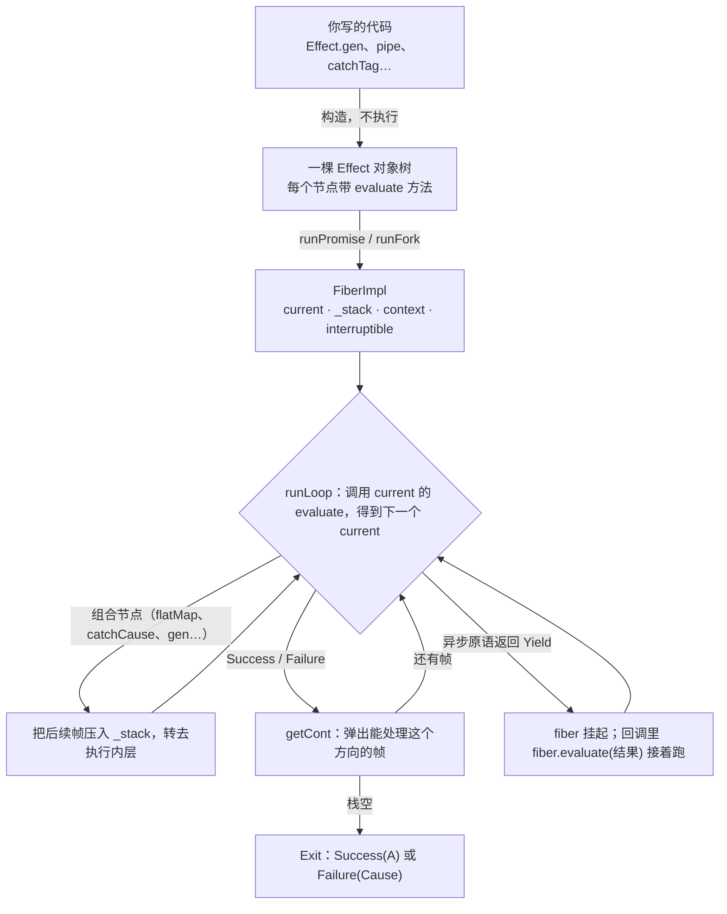

# Effect（Effect-TS）

## 摘要

Effect 是一个 TypeScript 库（npm 包 `effect`，本页按 4.0.5 的源码核对）。它的核心类型 `Effect<A, E, R>` 是一段**还没运行的程序的描述**：成功时得到 A，可能以 E 失败，运行前必须提供 R 里列出的服务。创建 Effect 只是在拼一棵普通 JS 对象树；运行时，fiber 用一个 `while` 循环加一个栈逐个执行这些对象。

从 [[wiki/topics/languages/javascript-generators|生成器]] 的角度看：async/await 是驱动者固定为 Promise 的生成器，Effect 是驱动者换成 fiber 的生成器。`yield*` 和 `await` 写起来差不多，多出来的能力（失败类型、依赖、取消、资源释放、并发子任务、可替换的时钟）都在 fiber 上。

## 类型：Effect<A, E, R>

| 参数 | 含义 | 运行时对应什么 |
| --- | --- | --- |
| A | 成功值 | fiber 最后交回的值 |
| E | 预期内的失败，通常是带 `_tag` 的对象 | 只在类型里存在；运行时失败统一是 `Cause`（`Fail` / `Die` / `Interrupt`） |
| R | 运行前要提供的服务 | fiber 上的一张 context 表（key → 实现） |

A、E、R 在运行时只是三个恒等函数（`dist/internal/core.js:14` 的 `effectVariance`）。带默认值的类型参数只能放在最后，所以顺序是 `Effect<A, E = never, R = never>`，可以直接写 `Effect<number>`；Effect 早期沿用 ZIO 的 `ZIO[R, E, A]` 顺序：`@effect/io` 和 `effect` 2.2.5 都是 `Effect<R, E, A>`，`effect` 2.3.0 改成了 `Effect<A, E = never, R = never>`。

## 运行时：fiber 怎么执行

核心实现在 `dist/internal/effect.js` 的 `FiberImpl.runLoop`（第 430 行）：每一步调用当前对象的 `[evaluate]`，组合节点把后续帧压栈，结果节点用 `getCont` 弹栈。后续帧存在 `_stack` 这个数组里，不在 JS 调用栈上，所以嵌套很深也不会栈溢出。每连续执行 2048 步（`Scheduler.MaxOpsBeforeYield`），fiber 会主动让出线程。

各项能力都是这个循环里多几种对象、栈上多几种帧：

- **失败**：`Failure` 往上弹栈时，只停在带失败处理（`contE`）的帧上，沿途只处理成功的帧全部跳过，所以"失败后面的代码不执行"。`catchTag` 只是 `catchCause` 加一个 `_tag` 判断，处理掉的那个 tag 会从类型的 E 里去掉。普通函数返回的 `{ ok: false }` 是成功值，碰不到失败处理帧，要先转成 `Effect.fail`。
- **服务**：`Context.Service` 创建的类本身就是一个 Effect（`dist/Context.js:68` 把 `KeyClass` 的原型设成 `ServiceProto`）。`yield* Users` 时，fiber 执行它的 `evaluate`，用 key 去 `fiber.context` 里查实现并送回。类型上 `Key<Identifier, Shape> extends Effect<Shape, never, Identifier>`，所以 `yield* Users` 得到实现类型，R 里多一项 `Users`。没提供时，运行时报 `Service not found`，但类型检查会先拦下。
- **Effect.gen**：生成器被包成一个帧。每次 `yield*` 交出一个 Effect，帧把自己压回栈上；Effect 执行完，帧调用 `iterator.next(结果)` 把结果送回生成器。失败时生成器帧被跳过，生成器不会再被调用，所以 gen 里的 `try/catch` 抓不到 `yield*` 出来的 Effect 失败。
- **异步**：异步原语注册回调后返回 `Yield`，`runLoop` 退出，fiber 挂起，栈和 context 原样留在 fiber 对象上；回调触发时调用 `fiber.evaluate(结果)` 接着跑。fiber 不是线程，只是一个能从停下处继续执行的对象。
- **中断**：`interruptUnsafe` 记下中断原因。fiber 挂起且可中断时立刻从 `Failure(Interrupt)` 接着跑；正在运行时，等到循环下一步开头再处理。`uninterruptible` 把 `interruptible` 设为 false，再压一个"恢复可中断"的帧，退出这个区域时积压的中断才生效。中断沿失败方向弹栈时跳过所有失败处理帧，只执行"总会执行"的帧。`tryPromise` 只有在 `try` 函数声明了 `signal` 参数时才创建 `AbortController`，中断时 abort 它；没有用上 signal 的 Promise 会继续跑完，只是结果被丢弃。
- **Scope**：context 里的一张 finalizer 列表。`acquireRelease` 在不可中断区域里拿到资源，同时把释放登记进当前 Scope，所以它的类型带 `Scope` 这个 R；`Effect.scoped` 提供一个新 Scope，结束时按登记的倒序执行释放，并把 `Scope` 从 R 里去掉。成功、失败、被中断三种结束方式都会执行释放。`forkScoped` 把"中断子 fiber"也登记成 finalizer。
- **Layer**：一个带 `build(memoMap, scope)` 方法的对象，build 的结果是一张 context 表。`Layer.provide(that)` 先 build `that`，再用它去 build 自身，只输出自身的服务；`Layer.provideMerge(that)` 把两边的服务都输出。`Effect.provide(layer)` 在一个 Scope 里 build Layer，再把得到的表合并进 `fiber.context`，Layer 里拿到的资源在程序结束时释放。`Layer.sync`、`Layer.effect` 按对象记入 MemoMap，同一个 Layer 在一次构建中只建一次。

## 相比 async/await 多了什么

下表每一行的两种写法都在 Node.js 24 上实际运行过（记录见 `raw/sources/effect-ts.md`）：

| 需求 | async/await 的结果 | Effect 的结果 | fiber 多做了什么 |
| --- | --- | --- | --- |
| 重跑、重试 | Promise 创建时请求已发出；重试只能传工厂函数 | 创建时请求 0 次；同一个值交给 `Effect.retry` 重跑 | Effect 是描述，可以运行多次 |
| 失败的类型 | `catch (e)` 中 `e` 为 `unknown` | `catchTag("NotFound")` 后 E 从 `NotFound \| NetworkError` 变为 `NetworkError` | 失败走单独通道，E 记在类型里 |
| 依赖 | 传参或全局 import，漏了运行时才发现 | 漏提供 Logger：编译报错 `Type 'Logger' is not assignable to type 'never'` | 服务记在 R 里，R 不为 `never` 不允许运行 |
| 取消 | 中间层漏传 `signal`，取消后请求照样完成 | 中间层不用传参，取消后 1ms 内底层请求被 abort | 中断沿 fiber 自动传到底层 |
| 锁 + 超时 | `Promise.race` 超时后先释放锁，写入后来才落盘 | 写入落盘后才释放锁，再报 `TimeoutError` | 不可中断区域 + Scope |
| 并发 | `Promise.all` 中一个失败，其余继续跑完 | `Effect.all` 中一个失败，其余被中断 | 子 fiber 的寿命归父 fiber 管 |

## 使用限制

- **包体**：esbuild 打包压缩后，只调用 `Effect.runPromise(Effect.succeed(1))` 的入口约 8.7 KB gzip；一个带超时、重试和 Http 服务的请求函数约 16.0 KB gzip，同功能的普通写法 472 B。
- **运行开销**：每一步约 30–60 ns，和 async/await 每次 await 的开销同一量级（实测 27.5 ns）。网络请求是毫秒级，这点开销可以忽略；热路径上的纯计算不要包进 Effect。
- **传染**：调用链上每一层都要写 `Effect.gen` / `yield*`；和普通 Promise 代码交界处要用 `runPromise`、`tryPromise` 转换。
- **调试**：原生调用栈里是 fiber 循环，需要靠 Effect 的 span 和 `Cause.pretty` 定位。
- **类型错误发现得晚**：在 `Effect.gen` 里少写 `*` 时 tsc 不报错，只有 Effect 的 language service 规则能发现；详见 [[wiki/syntheses/languages/effect-gen-type-inference|Effect.gen 的类型推导]]。
- **版本差异**：v3 到 v4 改了不少名字，例如 `Context.Tag` → `Context.Service`、`Effect.catchAll` → `Effect.catch`、`Effect.catchAllCause` → `Effect.catchCause`。2026-10 时官网 v4 文档只覆盖入门，Service、Layer、Scope 仍要看 v3 文档对照着读。
- **unstable 模块**：React 绑定依赖的 `effect/reactivity`（Atom）在 4.0 标为 `@stability unstable`，`@effect/atom-react` 4.0.5 要求 React 19 和 effect ≥ 4.0.5。
- **`runPromise` 的失败**：reject 的是 E 对象本身（`causeSquash`），需要保留完整 Cause 时用 `runPromiseExit`。

## 什么时候用

适合用 Effect 的信号：失败要分类处理、依赖要在测试中替换、取消/超时/重试要组合、有锁或连接这类必须释放的资源、有并发子任务或心跳。只命中其中零到一条（纯计算、简单增删改查、一次性脚本、对包体敏感的轻量页面）时，async/await 就够了。这是经验判断。

一个具体的划分规则：agent-kit 只有在出现实时跟随、文件监听、后台刷新索引、带背压的并发扫描这类需求时，才把模块迁到 Effect（[`authoring.md#L200`](https://github.com/PerfectPan/agent-kit/blob/e7396c50a7cb50cd8011651d8886b2fe440e8f1c/docs/architecture/authoring.md#L200)）。因此它的 harness 执行、ACP 连接、lease 用 Effect，catalog、sessions、cost 用普通 TS。

## 和 DDD 的配合

两者解决的问题不同：DDD 管领域怎么建模、边界怎么划，Effect 管副作用怎么表达，可以一起用。agent-kit 的做法：

- 领域层（值对象、聚合、领域规则）保持纯 TS，不 import `effect`，失败用 `Result` 返回；
- 端口写成类形式的 `Context.Service`，实现写成 infra 里的 Layer，同一端口的多个实现跑同一套测试；
- 用例写成 `Effect.gen`，R 只列出它用到的端口，领域的 `Result` 先转成 `Effect.fail` 再进入 E；
- 锁、持久化等一致性要求用 `acquireRelease`、`Effect.uninterruptible` 表达（例如 [`saveLedger`](https://github.com/PerfectPan/agent-kit/blob/e7396c50a7cb50cd8011651d8886b2fe440e8f1c/packages/harness/src/application/services/ledger-session.ts#L82)）。

类写法的端口在类型上互不相同：用函数写法 `Context.Service<Counter>("A")` 时，两个实现类型相同的服务在 R 里都是 `Counter`，提供错了编译器也不报错，所以 agent-kit 要求端口一律用类写法（[`authoring.md#L214`](https://github.com/PerfectPan/agent-kit/blob/e7396c50a7cb50cd8011651d8886b2fe440e8f1c/docs/architecture/authoring.md#L214)）。

## 来历与命名

Effect-TS 由 Michael Arnaldi 于 2020 年前后开始写，早期仓库自称 "functional effect system for TypeScript"，以 Scala 的 ZIO 和 ZIO-Prelude 为主要灵感和移植参照；2023 年 fp-ts 并入 Effect；npm 上 3.0.0 发布于 2024-04-16，4.0.0 发布于 2026-10-01。

编程语言研究里，函数除了根据输入算出返回值以外做的事（请求、读写文件、抛错、读时间）都叫 effect。把 effect 描述成一个值、交给运行时执行，叫 functional effect，核心类型和库都因此叫 Effect。它和 [[wiki/topics/languages/algebraic-effects|代数效应]]、效应系统的关系见那一页。

## 相关页面

- [[wiki/syntheses/languages/effect-gen-type-inference|Effect.gen 的类型推导]]
- [[wiki/topics/languages/javascript-generators|JavaScript 生成器与 yield 的类型]]
- [[wiki/topics/languages/algebraic-effects|Algebraic Effects]]
- [[wiki/topics/architecture/dependency-injection|Dependency Injection]]
- [[wiki/topics/architecture/ddd|DDD]]

## 来源指针

- `raw/sources/effect-ts.md`：源码位置（effect 4.0.5 `dist/`）、类型定义、agent-kit 链接，以及对比实验、包体与开销的测量记录
- [Effect 官网 · The Effect Type](https://effect.website/docs/v4/getting-started/the-effect-type)
- [Effect 官网 · Managing Services（v3）](https://effect.website/docs/v3/requirements-management/services/)
- [mikearnaldi/effect-ts](https://github.com/mikearnaldi/effect-ts)
- [agent-kit · docs/architecture/authoring.md](https://github.com/PerfectPan/agent-kit/blob/e7396c50a7cb50cd8011651d8886b2fe440e8f1c/docs/architecture/authoring.md)
