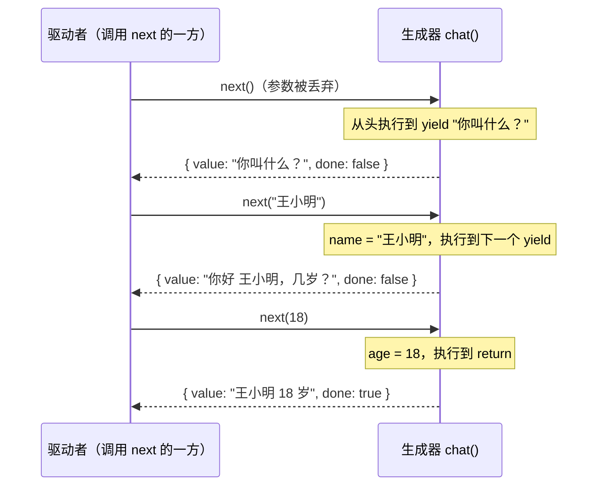

# JavaScript 生成器与 yield 的类型

## 摘要

调用生成器函数（`function*`）时，函数体一行都不执行，只返回一个生成器对象。之后每调用一次 `next(v)`，函数体就运行到下一个 `yield` 暂停，把 `yield` 后面的值交出去；`v` 则成为上一个 `yield` 表达式的值。函数执行到 `return` 时，`next` 返回 `{ done: true, value: 返回值 }`。

暂停之后怎么恢复，由调用 `next` 的那一方（下文称"驱动者"）决定。async/await 可以看成驱动者固定为 Promise 的生成器；生成器则让你自己写驱动者。Effect、redux-saga 都是在这一点上做文章。

## 三个概念

| 名字 | 判断方法 | 例子 |
| --- | --- | --- |
| 迭代器（iterator） | 有 `next()`，返回 `{ value, done }` | 生成器对象；Effect 的 `SingleShotGen` |
| 可迭代对象（iterable） | 有 `[Symbol.iterator]()`，调用后返回一个迭代器 | 数组、Map、字符串、自定义了 `[Symbol.iterator]` 的对象或类 |
| 生成器对象 | `function*` 调用的结果；有 `next`、`return`、`throw`，且 `[Symbol.iterator]()` 返回它自己 | `chat()` 的返回值 |

生成器是一种迭代器，区别只是不用手写 `next()`。MDN 的 Iterators and generators 指南先手写一个迭代器，再用生成器重写，并说明两者行为相同、生成器版更容易写和读。反过来，迭代器不一定是生成器，比如 Effect 的 `SingleShotGen` 就是手写 `next()` 的类。

`for…of`、`[...x]`、`yield* x` 都只要求 x 是可迭代对象：先调用 `x[Symbol.iterator]()` 拿到迭代器，再反复调用它的 `next()`。

## 值怎么进出



- 第一次 `next` 的参数没有 `yield` 在等，会被丢弃。
- 函数结束后再调用 `next()`，得到 `{ value: undefined, done: true }`。

## yield*：委托给另一个迭代器

`const x = yield* inner` 在当前位置把 `inner` 的迭代器跑完：

1. 先调用 `inner[Symbol.iterator]()` 拿到迭代器；不可迭代时抛 `TypeError`（例如 `yield* 42`）。
2. 内层每交出一个值，外层就跟着暂停，把这个值原样交给驱动者。驱动者再调用一次外层的 `next(v)`，`yield*` 才调用一次内层的 `next(v)`。
3. 内层返回 `{ done: true, value }` 时，这个 `value` 就是 `yield*` 表达式的值（MDN：*"If the iterator result has `done: true`, then the `yield*` expression stops executing and returns the `value` of that result."*）。
4. 驱动者中途调用外层的 `return()` 或 `throw()`，会转给内层迭代器，内层可能提前结束。

展开后大致等于：

```js
const it = inner[Symbol.iterator]();
let r = it.next();
while (!r.done) {
  const v = yield r.value; // 把内层交出的值转交给驱动者，拿回驱动者送进来的值
  r = it.next(v);          // 再转交给内层
}
const x = r.value;         // done: true 时的 value
```

`yield*` 层层嵌套时，结构和函数调用一样：任一时刻只有一条从最外层到当前暂停处的路径是活的，形状同调用栈。

## TypeScript 类型：Generator<Y, R, N>

| 参数 | 含义 | 在代码中的位置 |
| --- | --- | --- |
| Y | 交出去的值 | `yield 这里`；`next()` 返回的 `{ done: false, value }` |
| R | 返回值 | `return 这里`；`next()` 返回的 `{ done: true, value }` |
| N | 送进来的值，即 `yield` 表达式的值 | `it.next(这里)`；`const x = yield …` 中 x 的类型 |

`next()` 的返回类型是 `IteratorResult<Y, R>`，即 `{ done?: false; value: Y } | { done: true; value: R }`。

编译器的推导规则（TypeScript 5.9 实测）：

- 不写注解、不使用 `yield` 的结果：`function* count() { yield 1; yield 2; return "完" }` 推导为 `Generator<1 | 2, string, unknown>`。
- 不写注解、使用了 `yield` 的结果：报 TS7057（`'yield' expression implicitly results in an 'any' type…`），因为送进来的值由驱动者决定，函数体里看不出来。
- 写注解：N 由注解给出。
- 从上下文推导：把生成器函数传给参数类型已经写好的函数，N 取自那个参数类型。`Effect.gen` 就是这样，它的参数类型是 `() => Generator<Eff, AEff, never>`。

### 一个生成器只有一个 N

`next` 只有一个签名，所以函数里所有 `yield` 表达式共用同一个 N。注解为 `Generator<string, string, string | number>` 时，`const name = yield "你叫什么？"` 和 `const age = yield "几岁？"` 都是 `string | number`，编译器无法知道第几个 `yield` 会收到什么。

`yield*` 解决了这个问题：`yield* x` 的类型取 x 迭代器的 R，每一处可以不同。`askName: () => Generator<string, string, string>` 和 `askAge: () => Generator<string, number, string>` 分别让 `yield* askName()` 得到 `string`、`yield* askAge()` 得到 `number`。

### 交出自己、返回答案

给一个"请求"对象写 `[Symbol.iterator]`，只做两件事：交出自己，再把驱动者送回的答案原样返回。

```ts
class Ask<A> {
  readonly question: string;
  constructor(question: string) { this.question = question; }
  *[Symbol.iterator](): Generator<Ask<A>, A, any> {
    return yield this; // 等于 const answer = yield this; return answer;
  }
}

function* chat() {
  const name = yield* new Ask<string>("你叫什么？"); // name: string
  const age = yield* new Ask<number>("几岁？");     // age: number
  return `${name} ${age + 1} 岁`;
}
// chat: () => Generator<Ask<string> | Ask<number>, string, any>
```

- `*[Symbol.iterator]() {}` 是"方法简写 + 生成器方法 + 计算属性名"的组合，MDN Method definitions 的语法块列出了 `*[expression](parameters) {}`，Symbol.iterator 页的 "User-defined iterables" 有 `class Foo { *[Symbol.iterator]() { … } }` 的示例。效果等于 `[Symbol.iterator]: function* () {}`（除 `super` 等细节）。
- 运行时：第 1 次 `next()` 停在 `yield this`，交出 Ask；第 2 次 `next("王小明")` 恢复，`yield this` 的值为 `"王小明"`，接着执行 `return`，得到 `{ done: true, value: "王小明" }`。
- 类型上的 A 来自注解 `Generator<Ask<A>, A, any>` 的第二个参数，不是编译器从运行时推出来的。删掉注解，`name` 变成 `any` 并报 TS7057；第三个参数改成 `unknown`，编译器报 `Type 'unknown' is not assignable to type 'A'`。
- 外层生成器的 Y 是 `Ask<string> | Ask<number>`，从类型就能读出这段程序会提出哪些请求。

把 `Ask<A>` 换成 `Effect<A, E, R>`、把驱动者换成 fiber，就是 [[wiki/topics/languages/effect-ts|Effect]] 的 `Effect.gen`，类型推导见 [[wiki/syntheses/languages/effect-gen-type-inference|Effect.gen 的类型推导]]。

## 和 async/await 的关系

`tsc --target ES2015` 会把 async 函数编译成生成器加一个驱动函数 `__awaiter`：`await get()` 变成 `yield get()`；`__awaiter` 在 `done` 时 resolve，否则对交出的值调用 `.then`，成功时 `generator.next(value)`，失败时 `generator.throw(value)`。

| | async/await | 生成器 |
| --- | --- | --- |
| 暂停时交出 | Promise（或普通值） | 任意值 |
| 谁决定怎么恢复 | 固定：Promise 完成后恢复 | 自己写的驱动者 |
| 恢复时送回 | Promise 的结果，或抛错 | 驱动者决定：`next(v)`、`throw(e)`、`return()` |
| 每一行的类型 | `await p` 的类型就是 p 的结果类型 | 需要用 `yield*` 的写法；`next` 本身不做类型检查 |

## 使用限制

- **`next` 不做类型检查。** N 只有一个，常被放宽成 `any`。手动调用 `g.next(123)` 送错类型，编译器不报错，运行时才出错。类型能对上，要靠驱动者送回正确的值；业务代码不要自己驱动别人的生成器。
- **只能恢复一次。** 生成器只能往前走，不能复制一份从同一个暂停点再跑，所以写不了"对同一个请求给出多个答案"这类逻辑。
- **会传染。** 调用链上每一层都要写成 `function*` 并用 `yield*` 调用下一层，和 async 的传染是同一个问题。

## 相关页面

- [[wiki/topics/languages/effect-ts|Effect]]
- [[wiki/syntheses/languages/effect-gen-type-inference|Effect.gen 的类型推导]]
- [[wiki/topics/languages/algebraic-effects|Algebraic Effects]]
- [[wiki/topics/languages/javascript|JavaScript]]
- [[wiki/topics/languages/typescript|TypeScript]]

## 来源指针

- `raw/sources/javascript-generators.md`：MDN 原文摘录、TypeScript 推导结果与 Node.js 运行记录
- [MDN · Iterators and generators](https://developer.mozilla.org/en-US/docs/Web/JavaScript/Guide/Iterators_and_generators)
- [MDN · Iteration protocols](https://developer.mozilla.org/en-US/docs/Web/JavaScript/Reference/Iteration_protocols)
- [MDN · yield*](https://developer.mozilla.org/en-US/docs/Web/JavaScript/Reference/Operators/yield*)
- [MDN · Symbol.iterator](https://developer.mozilla.org/en-US/docs/Web/JavaScript/Reference/Global_Objects/Symbol/iterator)
- [MDN · Method definitions](https://developer.mozilla.org/en-US/docs/Web/JavaScript/Reference/Functions/Method_definitions)
