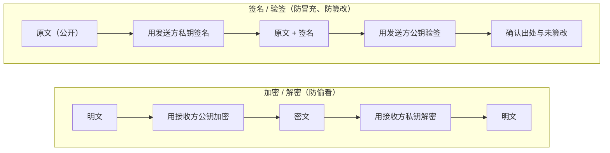

# 非对称加密与数字签名

## 摘要

非对称密码体制（Asymmetric Cryptography，也称公钥密码体制）为每个主体生成数学上配对的两把钥匙：**私钥（Private Key）**只由本人秘密保存，**公钥（Public Key）**可以公开分发，且无法从公钥反推出私钥。同一对钥匙有两种方向完全相反的用途：**加密/解密**用来保密，**签名/验签**用来防伪和防篡改。

## 为什么加密和签名的方向刚好相反

判断该用哪把钥匙，只需看权限需求：**只能由持有者本人执行的操作用私钥，任何人都能执行的操作用公钥**。

| 用途 | 操作方向 | 为什么是这个方向 | 解决什么问题 |
| --- | --- | --- | --- |
| **加密 / 解密** | 公钥加密 → 私钥解密 | 任何人都能加密给你发消息（公钥），但只能由你本人解开看（私钥）。如果反过来用私钥加密、公钥解密，人人都能解开，失去保密性 | **防偷看（机密性）** |
| **签名 / 验签** | 私钥签名 → 公钥验签 | 只能由你本人生成有效签名（私钥），但任何人都能验证真伪（公钥）。如果反过来用公钥签名、私钥验签，人人都能冒充你签名，失去防伪性 | **防冒充、防篡改（完整性与认证）** |

## 「私钥签名 → 公钥验签」的常见实例

数字签名不隐藏内容，而是证明「内容确实由私钥持有人签发，且签发后未被修改」：

- **HTTPS 网站证书（CA 签发）**：CA（Certificate Authority，证书颁发机构）用自己的私钥给网站证书签名；浏览器与操作系统出厂内置受信任 CA 的公钥，访问网站时用 CA 公钥验签，确认目标网站不是假冒站点（见 [[wiki/topics/systems/SSL 与 TLS 握手|SSL 与 TLS 握手]]）。
- **JWT 与 DPoP**：授权服务器用服务端私钥签发 [[wiki/topics/architecture/jwt|JWT]] `access_token`，多个业务网关用服务端公钥各自验签，避免把签发权限暴露给每个业务服务；[[wiki/topics/architecture/dpop|DPoP]] 则反过来由客户端用本地私钥对单次请求签名，服务端用客户端公钥验签，防止 token 被复制后异地盗用。
- **Git Commit 签名（GitHub `Verified` 标识）**：开发者用本地 GPG 或 SSH 私钥给每次提交签名；代码托管平台用开发者上传的公钥验签，确认提交确实来自本人。
- **软件安装包代码签名（macOS / iOS / Windows）**：开发者或应用商店用私钥对安装包签名；操作系统在安装或运行前用对应公钥验签，防止软件包在分发过程中被植入恶意代码。
- **区块链转账交易**：用户用钱包私钥对转账交易签名并广播；全网节点用对应的公钥（或由公钥派生的地址）验签，确认资金转移确实经过账户持有人授权。

## 「公钥加密 → 私钥解密」的常见实例

- **TLS / HTTPS 密钥协商与混合加密**：非对称运算比对称加密（如 AES-GCM）慢得多，工程上很少直接用非对称公钥去加密大段业务数据，而是用非对称密钥交换（如 ECDHE）或公钥加密协商出一把临时的对称会话密钥，后续数据全部用对称密钥高速加解密（RFC 8446）。
- **端到端加密消息与文件加密（如 PGP / age）**：发送方用接收方的公钥加密内容密钥（或短消息），确保中间服务器无法读取原文，只有持有私钥的接收方能够解密。

## 常见算法族

| 算法族 | 典型签名算法 | 特点 |
| --- | --- | --- |
| **RSA**（RFC 8017） | `RS256`、`PS256` | 生态最古老、兼容性广；同等安全强度下密钥较长（常见 2048/3072 bit），签名体积较大 |
| **ECDSA**（FIPS 186-5） | `ES256`（P-256）、`ES384` | 同等安全强度下密钥与签名远短于 RSA，浏览器 Web Crypto API 与移动端安全芯片原生支持好 |
| **EdDSA**（RFC 8032） | `EdDSA`（Ed25519） | 签名与验签速度快、实现不易踩随机数生成坑，常用于 SSH、现代 API 签名与区块链 |

## 工程限制

1. **公钥本身不自带身份证明**：任何人都可以自行生成一对公钥和私钥。如果校验方盲信对方随请求附带的公钥而不核对其来源，攻击者就能用自己的假钥匙自签自验。工程上必须通过第三方信任锚绑定公钥与身份，例如 CA 证书链、可信的 `jwks_uri`、或者像 DPoP 那样由服务端签名的 `access_token` 中的 `cnf.jkt` 指纹背书。
2. **私钥泄露即身份沦陷**：私钥一旦被导出，攻击者即可伪造合法签名或解密历史密文（若未启用前向保密）。浏览器端可通过 Web Crypto API 的 `extractable: false` 降低明文导出风险，原生客户端可借助 Keychain、Keystore 或硬件安全区（TEE / Secure Enclave）保管私钥。
3. **计算开销高于对称算法**：每次非对称签名或验签的 CPU 成本明显高于 HMAC/AES，高频链路需要评估网关验签开销与请求头体积。

## 来源与相关页面

- RFC 8017（PKCS #1: RSA Cryptography Specifications Version 2.2）：https://www.rfc-editor.org/rfc/rfc8017
- RFC 8446（The Transport Layer Security (TLS) Protocol Version 1.3）：https://www.rfc-editor.org/rfc/rfc8446
- RFC 7515（JSON Web Signature (JWS)）：https://www.rfc-editor.org/rfc/rfc7515
- NIST FIPS 186-5（Digital Signature Standard）：https://csrc.nist.gov/pubs/fips/186-5/final
- [[wiki/topics/systems/SSL 与 TLS 握手|SSL 与 TLS 握手]]
- [[wiki/topics/architecture/jwt|JWT]]
- [[wiki/topics/architecture/dpop|DPoP]]
