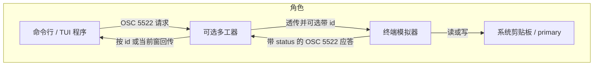
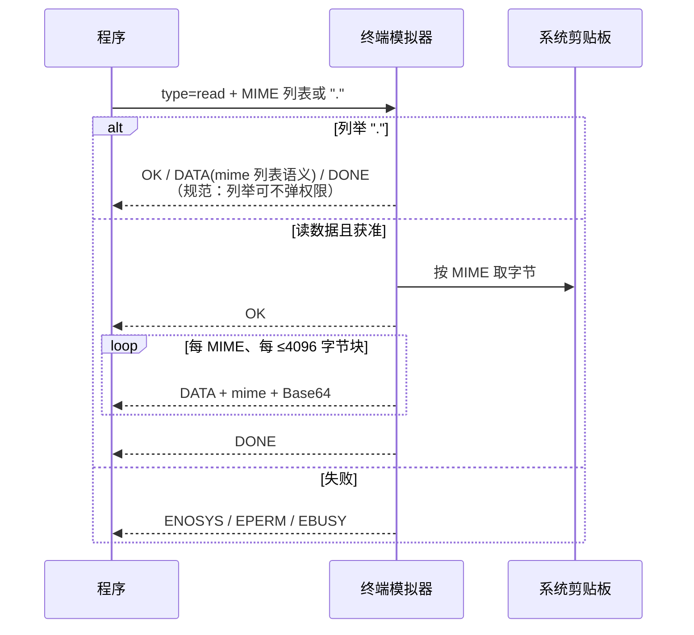
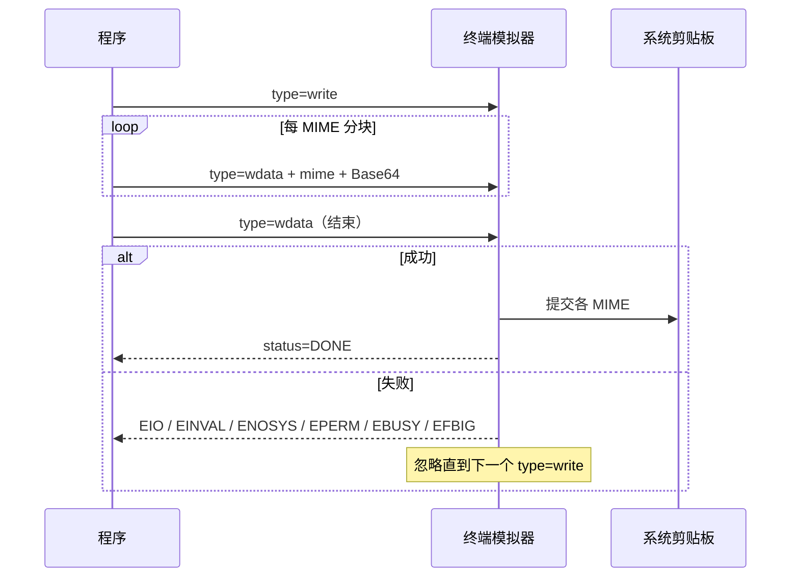
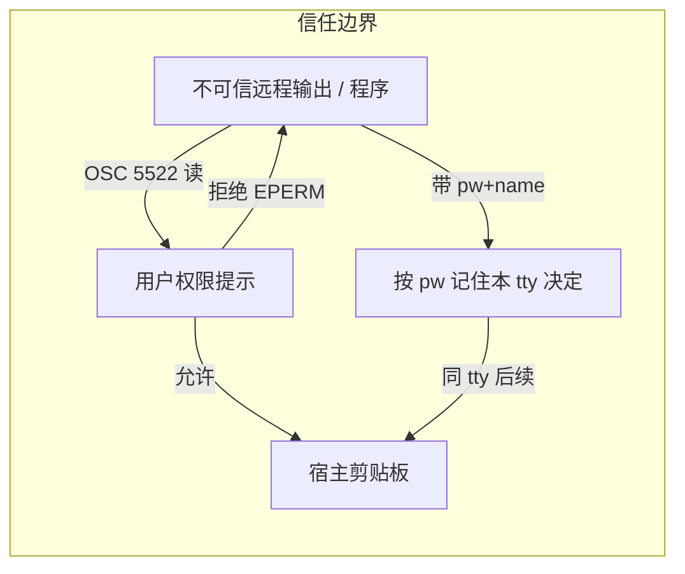

# Kitty OSC 5522：按 MIME 的终端剪贴板协议

OSC 5522 是 **Kitty** 终端定义的剪贴板扩展：在 PTY 字节流上按 MIME 类型读写系统剪贴板（含图片、HTML 等），并要求终端用显式状态码回答成功或拒绝。它扩展的是仅面向纯文本的 OSC 52，规范正文以 [Kitty 文档 *Copying all data types to the clipboard*](https://sw.kovidgoyal.net/kitty/clipboard/) 为准。Ghostty 1.4 是已知的采用方之一，不是规范所有者。[Ghostty 1.4.0](https://ghostty.org/docs/install/release-notes/1-4-0)

本页承接 [[wiki/topics/systems/terminal|Terminal：终端、TTY 与 Shell]] 中「程序经字节流驱动模拟器宿主能力」的视角，只展开剪贴板这一条控制面。

## 相对 OSC 52 的位置

| 维度 | OSC 52 | OSC 5522 |
| --- | --- | --- |
| 数据种类 | 基本是 Base64 纯文本 | 任意 MIME（`text/plain`、`image/png`、`text/html` 等） |
| 应答 | 写常无明确 ACK；读回复同形 OSC 或沉默 | 读/写都有 `status=` 包（`OK` / `DONE` / `EPERM` 等） |
| 列举格式 | 无标准列举 | 读载荷为 `.` 时可只要 MIME 列表 |
| 权限 | 多数模拟器默认禁读或需配置 | 规范要求读前询问用户；可用 `pw`+`name` 减少重复提示 |
| 探测 | 依赖试探或 terminfo 约定 | `DECRQM` 查询模式 `5522` |

OSC 52 仍是跨 SSH 写纯文本剪贴板的常见路径；需要图片/富文本、可观测失败原因或粘贴事件时，才落到 5522。[TDN Clipboard](https://toppk.github.io/revenant/tdn/osc/clipboard/)、[Kitty clipboard](https://sw.kovidgoyal.net/kitty/clipboard/)

## 帧与编码

基本形状：

```text
OSC 5522 ; metadata ; payload ST
```

- `OSC` 为 `ESC ]`（`]`）。
- `metadata` 是冒号分隔的 `key=value` 列表（如 `type=read`、`status=DATA`、`mime=...`、`loc=primary`、`id=...`、`pw=...`、`name=...`）。
- `payload` 为 Base64；`mime` / `name` / `pw` 的值同样按文档要求 Base64。
- `ST` 为字符串终结符（文档示例为 `ESC \`）。

编码规则（摘要）：

1. 使用 RFC 4648 §4 标准字母表，需要 padding，编码后长度须为 4 的倍数。
2. 终端必须拒绝非法 Base64（含空白、错误 padding），**不得**静默丢掉非法字符再当合法数据。
3. 同一 MIME 的多段 `wdata` / `DATA`：先拼接各段 payload，再解码；单包不必各自对齐到 4 字节，整段拼接后必须合法 padding。
4. 写请求因非法 Base64 被拒时，用 `EINVAL` 中止；读请求没有单独错误态时，文档要求直接忽略该次读。

[Kitty clipboard — Encoding of payloads](https://sw.kovidgoyal.net/kitty/clipboard/)



## 读生命周期

请求：

```text
OSC 5522;type=read;<Base64(空格分隔 MIME 列表)> ST
```

- 要读 primary selection：metadata 加 `loc=primary`。
- 只要当前剪贴板上有哪些 MIME：payload 仅为 Base64 编码的 `.`；此类列举**不应**弹权限提示，以免「先列类型再读数据」变成双重确认。

成功时终端依次发送：

1. `type=read:status=OK`
2. 若干 `type=read:status=DATA:mime=<b64>` + Base64 数据块（单 MIME 未编码块 ≤ 4096 字节，同类型块连续）
3. `type=read:status=DONE`

错误时不以 `OK` 开头，而发 `status=ENOSYS`（如无 primary）、`EPERM`（系统或用户拒绝）、`EBUSY`（如多工器并发争用）。[Kitty — Reading](https://sw.kovidgoyal.net/kitty/clipboard/)



## 写生命周期

程序发送：

1. `type=write`（可选 `loc=primary`，以及 `pw` / `name`）
2. 若干 `type=wdata:mime=<b64>;<Base64 块>`（同 MIME 连续，未编码块 ≤ 4096）
3. 无 mime、无数据的 `type=wdata` 表示结束

成功：`type=write:status=DONE`。  
任意时刻可报错：`EIO`、`EINVAL`（含非法 Base64 或缺 MIME；须丢弃本次已收数据）、`ENOSYS`、`EPERM`、`EBUSY`、`EFBIG`（超过终端愿意缓存的上限；**至少接受 64MB**）。出错后忽略后续写相关包，直到新的 `type=write`。

`type=walias` 可在写过程中为已传 MIME 登记别名，避免同一字节重复上传。[Kitty — Writing](https://sw.kovidgoyal.net/kitty/clipboard/)



## 权限、密码与粘贴事件

- **读**：规范要求终端在允许读之前询问用户；仅列举 MIME 除外。
- **密码（≥ Kitty 0.42.2）**：`type=read` / `type=write` 可带 Base64 的 `pw` 与人类可读 `name`。用户若同意「记住该密码」，同一 tty 上后续请求可免提示。无 `name` 的 `pw` 等价于未提供密码。程序宜在启动时随机生成密码（如 UUID4）；终端也可支持用户配置的长期密码。
- **粘贴事件（≥ 0.44.1）**：`CSI ? 5522 h` 开启、`CSI ? 5522 l` 关闭。开启后，用户触发粘贴时终端发送剪贴板上的 MIME 列表，并附一次性 `pw`；程序用该密码读数据时，人类名应为 `Paste event`（Base64）。这样 TUI 可先看有无 `image/png` 再决定读取。

[Kitty — passwords / paste events](https://sw.kovidgoyal.net/kitty/clipboard/)



工程含义：任何能往终端写字节的远端会话，理论上都能发起读请求；安全依赖模拟器默认拒绝或提示，而不是「程序自己保证不读」。密码机制减轻疲劳，也会扩大「一次同意、会话内持续可读」的窗口，配置长期密码时更需限定受信程序。

## 能力探测与多工器

探测：

```text
CSI ? 5522 $ p
```

终端以 `CSI ? 5522 ; Ps $ y` 回答；`Ps` 为 `0` 或 `4` 表示不支持该模式。

多工器：metadata 可选 `id`（字符集 `[a-zA-Z0-9-_+.]`，其余由终端剥离）。终端须在**每条**应答中原样带回 `id`，以便多工器把回复路由到正确窗格。系统剪贴板仍是全局资源，并发请求可能互相覆盖；良好的多工器应串行化飞行中的请求，并用 `EBUSY` 中止冲突方。用户粘贴触发的无 `id` 事件应转给当前活动窗。[Kitty — Detecting / multiplexers](https://sw.kovidgoyal.net/kitty/clipboard/)

## 采用示例：Ghostty 1.4

[Ghostty 1.4.0](https://ghostty.org/docs/install/release-notes/1-4-0)（2026-10-27）在 macOS 与 GTK 上**实现** Kitty clipboard protocol（OSC 5522），含 paste events（mode 5522）。发布说明写明：OSC 52 只能读写纯文本；5522 可读写图片、HTML 等并选择格式。读/写遵循已有 `clipboard-read` / `clipboard-write`（默认读提示、写允许）；新增 `clipboard-write-limit-bytes`（默认 64 MiB），超限失败且不改剪贴板。这是采用与产品默认策略，细节以 Ghostty 配置为准，不改 Kitty 文档中的协议形状。

## 证据对照表

| 结论 | 证据来源 | 证据位置 | 置信度或限制 |
| --- | --- | --- | --- |
| OSC 5522 由 Kitty 定义为 OSC 52 的 MIME/权限扩展 | Kitty 文档 | 文首与帧格式段 | 高；以该页为规范正文 |
| 读/写分块、Base64 规则与状态码集合 | Kitty 文档 | Reading / Writing / Encoding | 高；未做本地抓包复现 |
| DECRQM 5522：`Ps` 0 或 4 表示不支持 | Kitty 文档 | Detecting support | 高 |
| 列举 MIME 的读不应弹权限；数据读应询问 | Kitty 文档 | Reading 段 | 高；具体 UI 因实现而异 |
| 写至少接受 64MB，超限 `EFBIG` | Kitty 文档 | Writing 错误码 | 高；实现可设更高上限 |
| OSC 52 主攻纯文本且读风险大 | TDN Clipboard | OSC 52 语法与 Reads | 高；作对比背景 |
| Ghostty 1.4 实现 OSC 5522（含 paste） | Ghostty 1.4.0 notes | Kitty Clipboard Protocol | 高；版本绑定 1.4.0，非全生态普查 |
| 第三方支持表可能滞后 | control-codes.page | Support 表 | 中；交叉参考，冲突时听官方文档/发布说明 |

## 使用限制

- 仅当外层终端（及路径上的多工器）实现 5522 时可用；否则应回退 OSC 52 纯文本或宿主侧 API。
- 未在本页断言 tmux/zellij 的转发完备性；依赖 `id` 与 `EBUSY` 的行为以实现为准。
- 不覆盖 Windows 控制台 / ConPTY 专有剪贴板路径。

## 相关页面

- [[wiki/topics/systems/terminal|Terminal：终端、TTY 与 Shell]]
- [[wiki/topics/systems/shell|Shell]]
- [[wiki/topics/systems/base64|Base64]]

## 来源指针

- [[raw/sources/kitty-osc-5522-clipboard|来源笔记与验证记录]]
- [Kitty: Copying all data types to the clipboard](https://sw.kovidgoyal.net/kitty/clipboard/)
- [Ghostty 1.4.0 — Kitty Clipboard Protocol](https://ghostty.org/docs/install/release-notes/1-4-0)
- [TDN: Clipboard (OSC 52)](https://toppk.github.io/revenant/tdn/osc/clipboard/)
- [control-codes: OSC 5522](https://control-codes.page/osc/kitty-clipboard/)
