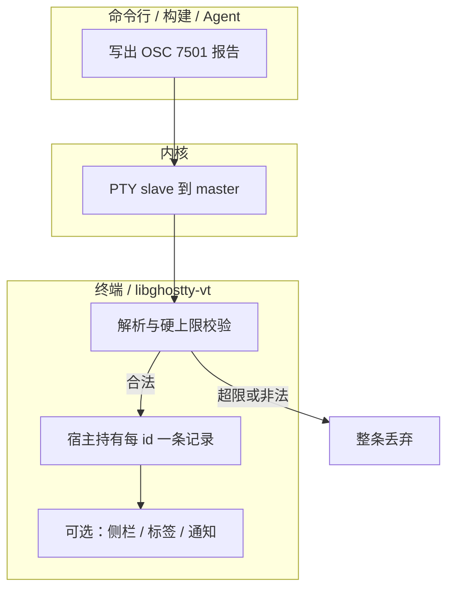
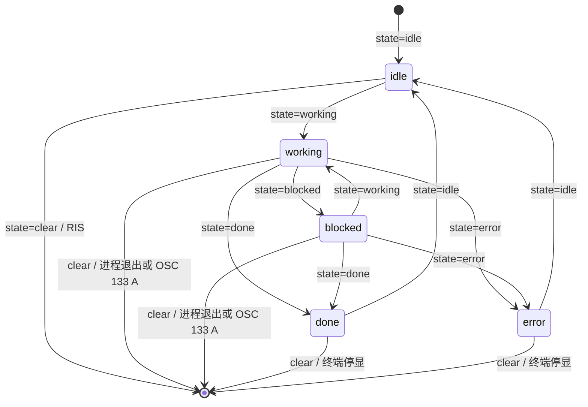
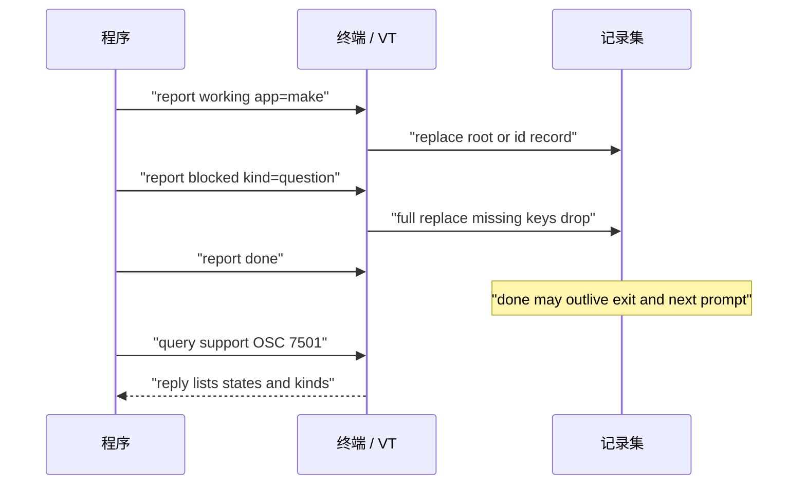

# OSC 7501：Program Status Protocol

OSC 7501（Program Status Protocol，程序状态协议）让**跑在终端里的程序**用一条 OSC 报告自己在做什么：空闲、执行中、卡在等人、已完成或失败，并可附上一行说明。终端据此维护按 `id` 区分的当前记录；**如何展示**（侧栏、标签指示、是否通知）完全留给终端实现，提案刻意不绑定「通知」「打断」等产品词。[control-codes：OSC 7501](https://control-codes.page/proposals/osc-7501/)

这是 Ghostty 项目开创的**第一条净新增终端规范**（Mitchell Hashimoto）。`libghostty-vt` 按规范校验并交给宿主；Ghostty 应用侧在 1.4 仍可解析但不做 UI。Rex、phux 等是实现/采用方。[Ghostty PR #14560](https://github.com/ghostty-org/ghostty/pull/14560)、[Ghostty 1.4.0](https://ghostty.org/docs/install/release-notes/1-4-0)

本页承接 [[wiki/topics/systems/terminal|Terminal：终端模拟器、PTY 与程序]] 中「程序经字节流驱动模拟器宿主能力」的视角。OSC 7501 与标题、OSC 52 等一样，经程序写入 **PTY slave** 的字节流到达模拟器解析器，**并不绕过**伪终端。下文依据提案修订 **0.4** 的公开摘要；不是 Kitty OSC 5522 剪贴板协议。

## 在控制面上的位置

| 机制 | 能说清什么 | 缺口 |
| --- | --- | --- |
| OSC 7501 | 多记录状态 + `kind`/`msg`/`progress`/`app` | 需终端实现；展示形态不统一 |
| OSC 9;4 | 忙 / 百分比 / 错误 | 无身份、无「等人」、与 iTerm2 OSC 9 通知抢号 |
| OSC 133 | shell 提示符与命令边界 | 来自 shell，不知程序内部卡点 |
| OSC 9 / 99 / 777 | 一次性通知 | 不留下「现在仍为真」的记录 |
| 窗口标题 OSC 0/2 | 一个自由字符串 | 常被塞进 spinner，语义模糊 |
| CSI DECRQPSR / DCS DECRSPS | 保存并还原光标、制表等**呈现状态** | 问的是终端状态，不是程序业务状态；见 [[wiki/topics/systems/terminal#控制序列分层：CSI、OSC、DCS（含 DECRQPSR）|terminal 分层节]] |

程序可以同时发 OSC 9;4 与 7501；终端若曾把 9;4 映射到根记录，一旦见过 7501 应停止映射，以免抹掉 `kind`/`msg`，直到下次 RIS。[control-codes](https://control-codes.page/proposals/osc-7501/)



## 帧格式

```text
OSC 7501 ; key=value : key=value … ST     # 报告
OSC 7501 ; ? ST                           # 能力探测（可选）
```

- `key` 为小写字母；`value` 仅允许字母、数字与 `_ . , + / = -`（不含 `:`、`;`），两端空白去掉。
- 畸形键值对跳过，其余仍生效；未知键忽略（扩展点）；同键重复时**后者覆盖**。
- `msg` / `title`：UTF-8 的 Base64（padding 可选）；解码后**不得**含控制字符（含换行、制表）。
- 任一对导致超限、Base64 失败或解码出控制字符 → **整条报告丢弃**，不部分写入。

[control-codes — The sequence](https://control-codes.page/proposals/osc-7501/)

## 记录与生命周期

一个终端单元（窗 / 标签 / 窗格，对应一条 PTY）维护一组记录，按 `id` 索引。省略 `id` 即根记录——只报告自身状态的程序够用。每条报告**整表替换**该记录：未写出的键从记录中消失，故需保留的 `app`/`title` 要每次重发。

`id` 是 `/` 分段路径（如 `build/test`），最多 8 段、每段 ≤32 字符；用于清子树与 `app` 继承，父节点不必事先存在。根与子记录可并存（例如 shell 根为 `idle`，工人为 `blocked`）。记录属于终端单元而非屏幕缓冲：切备用屏幕不动；**RIS** 清空全部，**DECSTR** 不动。[control-codes — Records](https://control-codes.page/proposals/osc-7501/)



说明：`working`/`blocked` 在进程退出或新 shell 提示（OSC 133 `A`）时必须丢掉；`done`/`error` 应保留到用户看见或终端策略停显；`idle` 可否跨提示符由实现决定（提案允许丢，phux 选择保留）。无心跳：过期不靠计时器。

## 状态与键

| `state` | 含义 | 保留到 |
| --- | --- | --- |
| `idle` | 待命，等下一条指令 | 被替换或清除 |
| `working` | 在跑；可带 `progress` | 替换/清除、进程退出、下一提示符 |
| `blocked` | 等人；`kind` 说类型，`msg` 说原因 | 同 `working` |
| `done` | 完成且结果用户可能还没看到 | 替换/清除；跨退出与提示符 |
| `error` | 失败停住 | 同 `done` |
| `clear` | 非状态：删该记录及子树；无 `id` 则全删 | — |

| Key | 值 | 要点 |
| --- | --- | --- |
| `state` | 上表 | **必填**；未知 state → 整条忽略 |
| `id` | 路径 | 省略=根；非法 id 通常使整条丢弃（避免误清根） |
| `kind` | `permission` / `question` / `auth` | 仅 `blocked`；其他值视作无 |
| `progress` | `0`–`100` | 仅 `working`/`blocked`；省略=不定进度 |
| `app` | ≤32 稳定名 | 如 `cargo`；无则向祖先继承 |
| `title` / `msg` | Base64 | 短标签 / 一行说明；勿当标记语言 |

用户打断应报 `idle`；马上退出的程序应先报 `done`/`error`，否则用户回来时可能已无记录。[control-codes — States / Keys](https://control-codes.page/proposals/osc-7501/)



## 能力探测

探测可选。规范终端会忽略未知 OSC，故可直接发报告。需要确认时发 `OSC 7501 ; ? ST`；实现方必须以 `?` 开头应答，并可列出 `states=`（不含 `clear`）与 `kinds=`。省略列表分别表示固定的五态与三种 `kind`——这是日后扩展的约定通道。无应答（在程序自选超时内）视为不支持；也可紧跟 `CSI c`（DA1），若 DA 先到则判不支持。[control-codes — Asking](https://control-codes.page/proposals/osc-7501/)

libghostty-vt：**仅当宿主设置了 program-status 回调**才回答 `?`，避免程序向「无人消费」的终端狂发报告；完整 RIS 时向宿主交一条无 id 的 `clear`。[PR #14560](https://github.com/ghostty-org/ghostty/pull/14560)

## 信任边界与硬上限

报告内容一律不可信：能写 PTY 的进程都能发。终端必须拒绝含控制字符的 `msg`/`title`，不得当标记语言解析，展示时应中和双向文本覆盖等不可见格式。**唯一回写**是对 `?` 的应答，且不含任何报告字段——记录不可被远程读回。对外副作用（桌面通知、声音）应限流。任一项超限则整条丢弃：

| 项 | 上限 |
| --- | --- |
| 整段序列 | 4096 字节 |
| 单键 | 16 字节 |
| `msg` | 编码 2732 / 解码 2048 |
| `title` | 编码 256 / 解码 192 |
| `app` / `id` | 32 / 128（段规则见上） |
| 每终端记录数 | 256（至少支持 64）；超则挤掉最久未更新 |

不要把密钥写进 `msg`/`title`。[control-codes — Security](https://control-codes.page/proposals/osc-7501/)

## 实现快照

| 组件 | 角色 | 置信说明 |
| --- | --- | --- |
| 提案 rev 0.4 | 规范正文（摘要） | 以 control-codes 为准 |
| libghostty-vt | 解析、校验、回调宿主 | PR #14560；GUI 可忽略 |
| Ghostty 1.4 应用 | 解析但不展示 | 发布说明 |
| Rex / phux | 产品级展示与优先级 | phux 文档；非规范强制 |

## 证据对照表

| 结论 | 证据来源 | 证据位置 | 置信度或限制 |
| --- | --- | --- | --- |
| OSC 7501 由 Ghostty 开创，程序报告 idle/working/blocked/done/error | PR #14560、control-codes | PR 正文；提案摘要 | 高 |
| 帧为 `key=value` 冒号列表；`?` 探测 | control-codes、phux | Syntax | 高 |
| 记录按 id，整表替换；RIS 清、DECSTR 不动 | control-codes | Records | 高 |
| libghostty 不自存记录，交宿主；GUI 可忽略 | PR #14560、1.4 notes | PR / Terminal Capabilities | 高；未读源码行 |
| 相对 OSC 9;4 / 133 / 通知的边界 | control-codes | Other sequences | 高 |
| phux 的侧栏排名与 agent 映射 | phux docs | How phux shows… | 中；属一家实现 |

## 使用限制

- 无实现终端时发报告应无害（被忽略），但不要假设有 UI。
- 未验证多工器是否透传或聚合 7501。
- 未把 gist 0.1–0.3 全文纳入核对。

## 相关页面

- [[wiki/topics/systems/terminal|Terminal：终端模拟器、PTY 与程序]]（含 DECRQPSR CSI 例子）
- [[wiki/topics/systems/shell|Shell]]

## 来源指针

- [[raw/sources/osc-7501-program-status|来源笔记与验证记录]]
- [control-codes: Program Status Protocol (OSC 7501)](https://control-codes.page/proposals/osc-7501/)
- [ghostty-org/ghostty#14560](https://github.com/ghostty-org/ghostty/pull/14560)
- [phux: OSC 7501](https://docs.phux.sh/program-protocol)
- [Ghostty 1.4.0 release notes](https://ghostty.org/docs/install/release-notes/1-4-0)
- [DECRQPSR](https://control-codes.page/csi/decrqpsr/)（相关 CSI/DCS 呈现状态查询，对照用）
