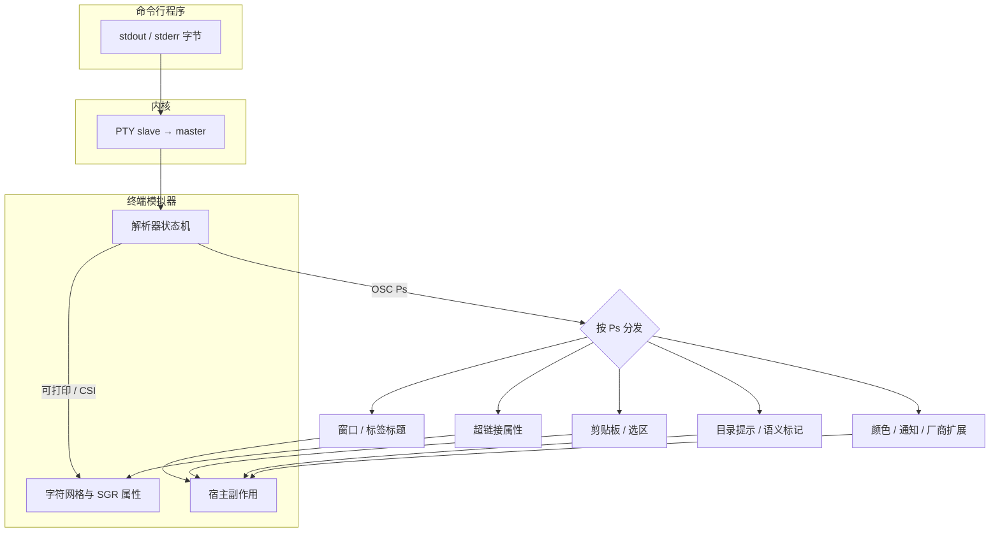
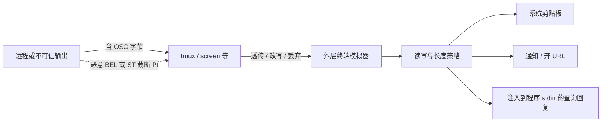

# Terminal OSC：操作系统命令控制串

OSC（Operating System Command，操作系统命令）是终端字节流里一类**带文本载荷**的控制串。程序用它驱动网格之外的能力：窗口标题、调色板、超链接、工作目录提示、剪贴板、语义提示符标记、桌面通知等。ECMA-48 只规定 `OSC … ST` 的帧；各个数字选择器（`Ps`）的含义来自 xterm 及后续模拟器，没有统一注册表。「支持 OSC」必须落到具体 `Ps`，不能当成单一兼容声明。[TDN OSC Overview](https://toppk.github.io/revenant/tdn/osc/)、[xterm Control Sequences](https://invisible-island.net/xterm/ctlseqs/ctlseqs.pdf)

本页承接 [[wiki/topics/systems/terminal|Terminal：终端模拟器、PTY 与程序]] 中的「屏幕由字节流驱动」，专门展开 OSC。不覆盖 Windows 控制台专有路径，也不枚举全部厂商私有码。

## 在控制序列家族中的位置

程序经 PTY 写出的字节，由**终端模拟器用户态解析器**消费。常见几类互不替代：

| 家族 | 典型引入 | 主要作用面 |
| --- | --- | --- |
| 可打印文字 / UTF-8 | 普通字节 | 写入字符网格 |
| CSI（含 SGR） | `ESC [` | 光标、擦除、颜色属性、模式 |
| OSC | `ESC ]` | 网格外的环境：标题、链接、剪贴板、标记等 |
| DCS 等 | `ESC P` 等 | 设备控制串；多工器透传时常包一层 DCS |

CSI/SGR 改的是格子里怎么画；OSC 改的是模拟器与宿主环境怎么协作。颜色既可以走 SGR（格子属性），也可以走 OSC 4 / 10–19（调色板或动态前景背景），二者层级不同。[TDN Overview](https://toppk.github.io/revenant/tdn/osc/)



图示：OSC 与画格路径分流；超链接常作为格子上的附加属性，剪贴板与标题则离开网格进入宿主。[TDN anatomy](https://toppk.github.io/revenant/tdn/osc/anatomy/)

## 帧格式

```text
OSC Ps ; Pt ST
OSC Ps ; Pt BEL
```

- **OSC**：通常是 `ESC ]`（`0x1B 0x5D`）；C1 单字节 `0x9D` 在 UTF-8 会话里不可靠。
- **Ps**：十进制选择器。
- **Pt**：对该选择器私有的文本载荷；可能再含 `;`、`key=value` 或 base64。
- **终结符**：ECMA-48 的 **ST**（`ESC \`），或 xterm 遗留的 **BEL**（`0x07`）。现代模拟器大多两者都收；在 DCS 透传里应发 ST，因为 BEL 不能结束 DCS。[xterm Operating System Commands](https://invisible-island.net/xterm/ctlseqs/ctlseqs.pdf)、[TDN anatomy](https://toppk.github.io/revenant/tdn/osc/anatomy/)

查询类 OSC（例如颜色或 OSC 52 的 `?`）可能让模拟器**往输入流写回复**。回复与按键混在同一条 master→程序的字节流上，应用必须按异步输入解析，并接受对方用 BEL 或 ST 终结。[TDN anatomy · Direction](https://toppk.github.io/revenant/tdn/osc/anatomy/)

## 解析到动作的生命周期

PTY 的一次 `read` 不是消息边界。解析器要在 `osc_string`（或等价）状态里攒字节，直到 ST、BEL，或 CAN/SUB/`ESC` 非法后续等中止条件。不知道的 `Ps` 仍应吞掉整段载荷，不能把 URI 打到屏幕上。[TDN anatomy](https://toppk.github.io/revenant/tdn/osc/anatomy/)、[OSC 8 Backward compatibility](https://gist.github.com/egmontkob/eb114294efbcd5adb1944c9f3cb5feda)

```mermaid
flowchart TD
  Byte[读入下一字节] --> State{解析器状态}
  State -->|普通| Print[写入网格或进 CSI 等]
  State -->|见到 ESC ]| Osc[进入 OSC 收集]
  Osc --> Acc[追加到命令串缓冲]
  Acc --> Term{终结或中止?}
  Term -->|BEL 或 ST| Split[按选择器规则取 Ps 与 Pt]
  Term -->|CAN / SUB / 非法 ESC| Abort[丢弃缓冲]
  Term -->|未结束| Byte
  Split --> Known{识别 Ps?}
  Known -->|否| Ignore[静默丢弃整段]
  Known -->|是| Act[执行动作或排队回复]
  Act --> Side{副作用类型}
  Side --> Local[仅模拟器内状态]
  Side --> HostAct[剪贴板 / 通知 / 开链接等]
  Side --> Reply[经 PTY 写回复给程序]
  HostAct --> Gate{策略门控}
  Gate -->|允许| Do[执行]
  Gate -->|拒绝或需确认| Skip[忽略或提示用户]
```

图示：收集 → 终结 → 分发 →（可选）门控；门控失败时通常静默，应用不能假设一定成功。

## 常见选择器（按工程用途）

| Ps / 形式 | 作用 | 来源侧重 |
| --- | --- | --- |
| `0` / `1` / `2` | 图标名与窗口标题 | xterm（亦见早期 dtterm） |
| `4`，`10`–`19` | 调色板与动态前景/背景等；`Pt` 为 `?` 时可查询 | xterm |
| `52` | 读写选区/剪贴板（`Pc;Pd`，`Pd` 为 base64 或 `?`） | xterm；多模拟器继承 |
| `8` | 超链接：`8 ; params ; URI` 开始，`8 ; ;` 结束 | VTE / iTerm2 社区规范（egmontkob）；**同日 xterm ctlseqs OSC 表未列此项** |
| `7` | 以 `file://host/path` 等形式提示 cwd | 常见于 macOS Terminal / iTerm2 文档；与 OSC 1337 `CurrentDir` 等相关 |
| `9` | 通知等；iTerm2 亦用 `9;4;…` 做进度条 | 厂商扩展，语义不统一 |
| `133` | FinalTerm 语义标记：`A` 提示符前、`B` 命令前、`C` 输出前、`D` 结束（可带退出码） | FinalTerm → iTerm2 等 shell integration |
| `1337` | iTerm2 家族扩展（原与 xterm OSC 50 冲突后改号）：目录、图像、剪贴板变体等 | iTerm2 |

完整数字目录见 [TDN catalog](https://toppk.github.io/revenant/tdn/osc/)；上表只服务「读字节流时该往哪想」。

### 最小例子

```sh
# 窗口标题（ST 终结）
printf '\033]0;project\033\\'

# OSC 8 超链接（需模拟器支持；通常 Ctrl/Cmd+点击打开）
printf '\033]8;;https://example.com\033\\example\033]8;;\033\\\n'

# OSC 52 写入剪贴板（常被默认禁用或需配置；经 SSH 时仍可能到达本地模拟器）
printf '\033]52;c;%s\033\\' "$(printf 'hello' | base64)"
```

[OSC 8 gist](https://gist.github.com/egmontkob/eb114294efbcd5adb1944c9f3cb5feda)、[TDN clipboard](https://toppk.github.io/revenant/tdn/osc/clipboard/)

## 边界、多工器与信任模型

OSC 是程序触及 PTY 以外世界的通道，因此也是注入与误转发的通道。



| 坑 | 机制 | 工程含义 |
| --- | --- | --- |
| 只发 BEL | BEL 不能结束 DCS；包在多工器透传里会坏 | 可移植脚本优先 `ESC \` |
| C1 单字节 ST/OSC | UTF-8 下 `0x9C` 等是续字节 | 只用 7-bit `ESC ]` / `ESC \` |
| 向 `Pt` 拼接未过滤路径/远程文本 | 载荷里的 `BEL` 或 `ESC \` 会提前结束 OSC，后续字节变新输入 | 插值前去掉终结字节 |
| OSC 52 读取 | 回复进入输入流，可读到用户剪贴板 | 多数模拟器默认拒绝读；应用勿当可靠 API |
| OSC 52 写入 | 攻击者可控文本进入系统剪贴板 | 模拟器常默认关或需允许；tmux 有 `set-clipboard` 策略 |
| OSC 8 `file://` | 主机名必须匹配，避免 SSH 远端路径被当成本地文件打开 | 规范要求填 `gethostname()` 并校验 |
| 「未知 OSC 打出乱码」 | 违反「吞掉至终结符」 | 应视为模拟器/多工器缺陷，而不是应用去兼容每一种坏实现 |
| 长度上限 | 帧本身无长度；实现从 KB 到数 MB 不等 | 大 payload（剪贴板、图像）可能被静默截断 |

[TDN anatomy · Security](https://toppk.github.io/revenant/tdn/osc/anatomy/)、[TDN clipboard](https://toppk.github.io/revenant/tdn/osc/clipboard/)、[OSC 8 Security / file://](https://gist.github.com/egmontkob/eb114294efbcd5adb1944c9f3cb5feda)

### 使用条件（读者侧）

- 功能有无，取决于**外层模拟器**、中间多工器是否转发，以及用户配置（尤其 OSC 52）。
- Shell integration（OSC 133 / 1337）依赖壳侧脚本版本与模拟器实现，不能从「开了 iTerm2」推出所有标记都存在。
- 查询回复与用户输入同流：在 raw 模式或自己读 stdin 的 TUI 里要能忽略或解析这些回复。

## 证据对照表

| 结论 | 证据来源 | 证据位置 | 置信度或限制 |
| --- | --- | --- | --- |
| OSC 承载网格外能力；ECMA-48 只定帧不定 Ps | TDN OSC Overview | History and status | 高；ECMA-48 正文经 TDN/ gist 转述 |
| 帧为 `OSC Ps ; Pt` + BEL 或 ST；xterm 两者皆收 | xterm ctlseqs Patch #411（2026-08-23） | Operating System Commands | 高 |
| 未知 Ps 应吞至终结符且不打印 | TDN anatomy；OSC 8 gist | Terminators；Backward compatibility | 高 |
| xterm 文档化 0/1/2、4、10–19、52 等 | 同上 PDF | OSC Ps 列表 | 高；以该版本为界 |
| OSC 8 为 VTE/iTerm2 社区超链接规范，非同日 xterm OSC 表项 | egmontkob gist；PDF 缺省 | gist；OSC 章节 | 高 |
| OSC 52 可写/询剪贴板；读路径危险且常默认关闭 | ctlseqs；TDN clipboard | OSC 52；Reads | 高；默认策略因产品而异 |
| DCS 透传与多工器场景应优先 ST | TDN anatomy | Terminators | 高 |
| `Pt` 注入终结符可截断序列 | TDN anatomy | Security model | 高 |
| OSC 133 A/B/C/D 标记提示符与命令块 | iTerm2 FinalTerm 文档 | FTCS_* | 高；集成脚本有版本差 |

核对过程、未测项与访问日期见 [[raw/sources/terminal-osc|Terminal OSC 核对记录]]。

## 相关页面

- [[wiki/topics/systems/terminal|Terminal：终端模拟器、PTY 与程序]]
- [[wiki/topics/systems/shell|Shell]]
- [[wiki/topics/systems/ssh|SSH]]

## 来源指针

- [[raw/sources/terminal-osc|核对记录]]：来源版本、证据表、本机试打范围。
- [XTerm Control Sequences（PDF）](https://invisible-island.net/xterm/ctlseqs/ctlseqs.pdf)：OSC 帧与 xterm Ps（含 52）。
- [TDN OSC](https://toppk.github.io/revenant/tdn/osc/)、[Anatomy](https://toppk.github.io/revenant/tdn/osc/anatomy/)、[Clipboard](https://toppk.github.io/revenant/tdn/osc/clipboard/)。
- [Hyperlinks in Terminal Emulators](https://gist.github.com/egmontkob/eb114294efbcd5adb1944c9f3cb5feda)：OSC 8。
- [iTerm2 Proprietary Escape Codes](https://iterm2.com/documentation-escape-codes.html)：133 / 1337 / 9 等。
