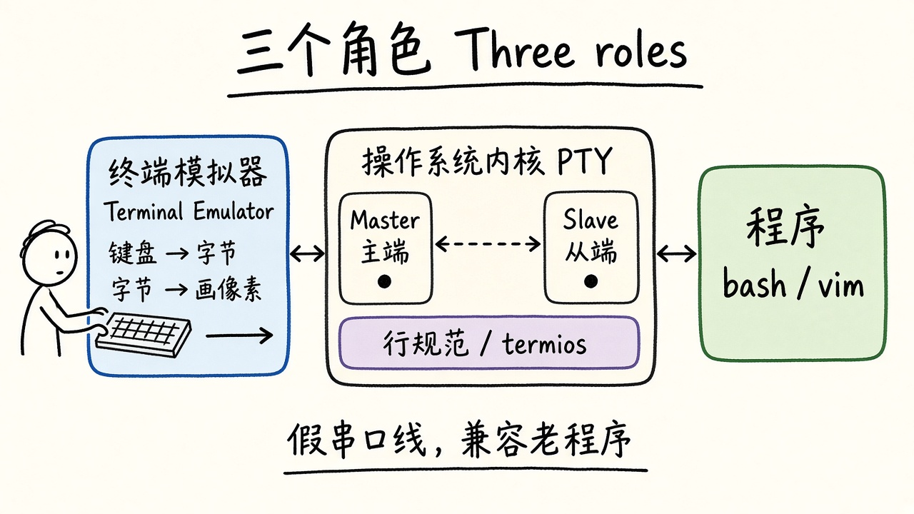
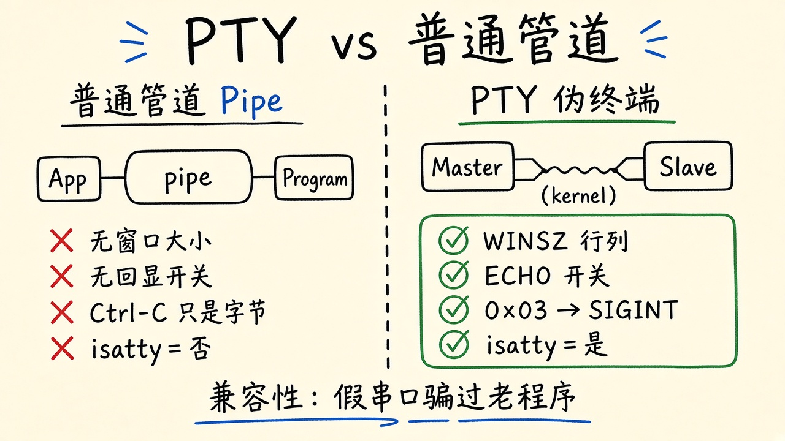
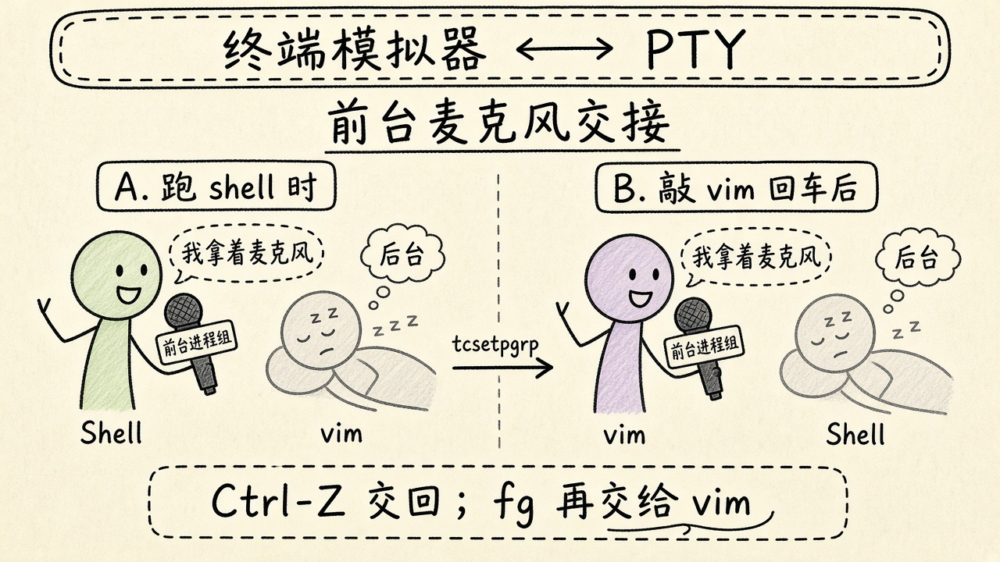

# Terminal：终端模拟器、PTY 与程序

## 摘要

现代命令行界面是为兼容数十年前的终端程序而保留的一套虚拟硬件方案。日常打开的“终端窗口”通常是终端模拟器；它通过操作系统内核里的 PTY（伪终端）与 bash、vim 等独立进程相连。理解这条链路，只需分清三个角色：终端模拟器负责按键与像素，PTY 提供带终端语义的假串口，命令行程序读写从端并决定业务逻辑。本文讨论 Unix 类系统的常见本地终端，不展开 Windows 控制台与 ConPTY。

[How Terminals Work](https://how-terminals-work.vercel.app/) 用可交互演示建立字符网格、控制序列与信号的直观认识；下面用系统文档补足职责划分与条件。[pty(7)](https://man7.org/linux/man-pages/man7/pty.7.html)、[POSIX 终端接口](https://pubs.opengroup.org/onlinepubs/9799919799/basedefs/V1_chap11.html)

## 三个角色：真终端、终端模拟器、PTY

| 名称 | 是什么 | 主要做什么 |
| --- | --- | --- |
| 真终端（physical TTY） | 1970 年代的键盘加屏幕外设，自身几乎没有通用 CPU | 经真实串口线连到主机；日常已绝迹，但接口语义被软件保留 |
| 终端模拟器 | 普通用户态窗口程序（Terminal.app、iTerm2、Windows Terminal、编辑器内嵌终端等），不是内核的一部分 | 把按键编成字节写入 PTY master；读出程序输出的文字与控制序列，再调显卡画出像素 |
| PTY（伪终端） | 内核提供的一对 master / slave 端点 | 在没有物理串口时，让程序仍以为连着终端设备 |
| 命令行程序 | bash、vim、htop 等独立进程 | 读写 PTY slave；解释命令、编辑文件或刷新界面 |

常见误区是把 bash、vim 想成“跑在终端模拟器肚子里”。它们是独立进程：模拟器启动时通常会拉起默认 shell，再用 PTY 连上；若把默认启动命令改成 `/usr/bin/vim` 或 `python3`，打开窗口也可以直接进入这些程序，中间不必经过 shell。[Bash 对 shell 的定义](https://www.gnu.org/software/bash/manual/html_node/What-is-a-shell_003f.html)、[pty(7)](https://man7.org/linux/man-pages/man7/pty.7.html)



图示：人只和模拟器窗口交互；模拟器与程序从不直接共享显卡或字体库，中间隔着内核里的假串口。

TTY 一词来自 teletype。在现代 Unix 语境中，它通常指内核提供的终端设备与接口：输入处理、回显、信号、窗口大小、前台进程组等。PTY 的 slave 端就提供这套语义；“pseudo”表示没有实体硬件，不表示接口是假的。[POSIX 终端接口](https://pubs.opengroup.org/onlinepubs/9799919799/basedefs/V1_chap11.html)

## 为什么需要 PTY（相对普通管道）

管道也能传字节，但交互程序还依赖终端专有能力。图形界面出现前，大量 UNIX 程序已经按 TTY 接口写成；操作系统在内核里实现 PTY，就能让这些程序在现代窗口里继续工作。[pty(7)](https://man7.org/linux/man-pages/man7/pty.7.html)



图示：兼容性动机是用假串口保留旧程序依赖的终端接口，而不是让每个程序重写一套输入输出。

### 行规范能替简单程序做的事

内核终端输入路径上有 line discipline（行规范）。在 canonical（`ICANON`）模式下，内核可以按行缓冲输入、处理擦除，并在开启 `ECHO` 时把字符回显到终端。初学用的 `scanf`、`input()` 不必自己实现退格与回显，就能读到一行干净输入。[termios(3)](https://man7.org/linux/man-pages/man3/termios.3.html)

`Ctrl+C` 在键盘侧常对应字节 `0x03`。当 `ISIG` 开启且该字节匹配 `VINTR` 时，内核向**前台进程组**发送 `SIGINT`，而不是把字节交给卡死、不再读输入的程序。普通管道没有这层转换。收到 `SIGINT` 也不保证进程退出：程序可以捕获或忽略该信号。[POSIX §11.1.9](https://pubs.opengroup.org/onlinepubs/9799919799/basedefs/V1_chap11.html)、[termios(3)](https://man7.org/linux/man-pages/man3/termios.3.html)

不要把“交互式 bash 的行编辑全靠内核”当成现状。现代交互式 Bash 常用 [Readline](https://www.gnu.org/software/bash/manual/html_node/Readline-Interaction.html)（或其他 shell 自带的行编辑器）处理方向键、历史与补全，并把终端调到适合自己的模式。canonical 模式仍帮助许多简单程序；交互式 shell 的编辑体验主要来自用户态行编辑器。

### termios、ioctl 与 isatty

TTY 在内核里还有一组可用 `termios` / `ioctl` 读写的属性。连的不是终端时，相关调用常失败并得到 `ENOTTY`（historically “Not a typewriter”）。

- **关回显**：`sudo`、`ssh` 等在读密码前用 `tcsetattr` 关掉 `ECHO`，读完再打开。
- **窗口大小**：全屏程序用 `TIOCGWINSZ` 查询行列；模拟器在用户拖动窗口时把新尺寸写入 PTY，内核再向相关进程发 `SIGWINCH`。普通管道没有“长宽”。
- **识别终端**：`ls`、`git` 等常调用 `isatty()`。连着 PTY 时更可能启用颜色并按行刷新；连着管道时往往关掉颜色并做块缓冲，因为输出可能被重定向到文件。

[termios(3)](https://man7.org/linux/man-pages/man3/termios.3.html)、[POSIX 终端接口](https://pubs.opengroup.org/onlinepubs/9799919799/basedefs/V1_chap11.html)

一对端点的分工：

- **模拟器使用 master**：写入按键字节，读出程序输出并绘制窗口。
- **程序使用 slave**：像使用终端设备一样读写，并设置输入模式等属性。

PTY 负责带有终端行为的连接；模拟器负责显示；shell 负责解释命令。三者解决的问题不同。[pty(7)](https://man7.org/linux/man-pages/man7/pty.7.html)

## Shell 与前台程序如何交接

刚打开窗口时，常见链路是「终端模拟器 ↔ PTY ↔ shell」。输入 `vim` 并回车后，看起来变成「终端模拟器 ↔ PTY ↔ vim」。中间没有额外转发进程：子进程继承父进程打开的 PTY 从端文件描述符，再靠前台进程组决定键盘与终端信号送给谁。

1. **继承文件描述符**：shell `fork` / `exec` 出 vim 时，子进程继承连着 PTY slave 的标准输入、输出、错误。
2. **交接前台进程组**：同一 PTY 上可以挂着多个相关进程，但同一时刻只有一个前台进程组接收终端输入和由特殊字符产生的信号。shell 通过 `tcsetpgrp` 把前台交给 vim 所在进程组，自己进入等待；vim 退出后，shell 再拿回前台。
3. **作业控制**：在 vim 里按 `Ctrl+Z`，通常使前台作业暂停并把控制交回 shell；再执行 `fg`，shell 把前台重新交给该作业。



图示：“麦克风”比喻前台进程组——同一时间只有一组进程接收该终端的输入与终端信号。[POSIX 终端接口](https://pubs.opengroup.org/onlinepubs/9799919799/basedefs/V1_chap11.html)

shell 也能从脚本文件或管道读取命令，因此运行 shell 不以存在 TTY 为前提；交互式会话只是最常见的一种用法。[Bash](https://www.gnu.org/software/bash/manual/html_node/What-is-a-shell_003f.html)

## 屏幕由字节流与控制序列驱动

vim 等程序不能直接操作显卡或字体库；终端模拟器也不理解“菜单”或“正在编辑的文件”。双方只交换字节：程序计算布局并发出文字与 ANSI / xterm 控制序列，模拟器解析后把字符单元画到窗口。

常见例子：

- 颜色：`ESC[31m` 设红色前景，`ESC[0m` 重置；`ESC` 是字节 `0x1B`，常写作 `\033` 或 `^[`。
- 光标：`ESC[5;10H` 把光标移到第 5 行第 10 列；htop 一类程序靠同类序列原地刷新。
- 按键编码：上箭头在常见模式下编码为 `ESC[A`；具体序列随终端模式变化。鼠标事件通常要由程序开启报告后才发送。

TUI（文本用户界面）更新界面时输出文字和控制序列，不需要终端理解按钮或业务状态。[教程的 Escape Sequences](https://how-terminals-work.vercel.app/#escape)、[xterm 控制序列](https://invisible-island.net/xterm/ctlseqs/ctlseqs.html)

网格只是显示模型，不能推成“一个 Unicode 字符固定占一格”：显示列宽可以是 0、1 或 2，组合字符和 emoji 还会增加难度。[wcwidth(3)](https://man7.org/linux/man-pages/man3/wcwidth.3.html)

### 全屏程序启动时常见的两步

1. **进入更接近 raw 的输入模式**：关掉自动回显、按行缓冲等多项标志（raw 通常不止关闭 `ICANON`），让单键如 `j` 立刻到达程序，且不必在屏幕上打印字母本身。[termios(3)](https://man7.org/linux/man-pages/man3/termios.3.html)
2. **切换备用屏幕**：xterm 兼容终端常用 `ESC[?1049h` 进入 alternate screen buffer（备用屏幕缓冲区）并保存光标；退出时用 `ESC[?1049l` 切回普通屏幕。备用屏幕是模拟器另维护的一份字符网格，不是新开终端进程，也不是视频的下一帧。普通屏幕通常关联滚动历史，因此退出 vim 后还能看到之前的命令输出；xterm 的备用屏幕没有同样的滚动历史，具体模拟器与配置可能不同。[xterm Alternate Screen Buffer](https://invisible-island.net/xterm/ctlseqs/ctlseqs.html#h2-The-Alternate-Screen-Buffer)

| 时刻 | 当前显示 | 另一份内容怎样处理 |
| --- | --- | --- |
| 执行 `vim file.txt` 前 | 普通屏幕上的提示符与命令输出 | 备用屏幕尚未使用 |
| Vim 请求切换后 | 备用屏幕上的文件内容、状态栏与光标 | 普通屏幕保留，全屏重画不混入原来的命令输出 |
| Vim 请求切回后 | 恢复普通屏幕，shell 继续显示提示符 | Vim 的临时全屏界面不再显示 |

两点容易混淆：保存屏幕内容不等于保存正在编辑的文件；终端并非完全没有状态——它维护光标、颜色和屏幕缓冲区，只是不理解应用自己的菜单、编辑缓冲或业务状态。程序退出时需要正确恢复终端模式。[教程的 State Management](https://how-terminals-work.vercel.app/#state)

## 按键什么时候变成命令或信号

- **按行还是按字符交付**：`ICANON` 开启时，内核按行处理输入，并支持擦除等编辑；关闭后，读取由 `VMIN` / `VTIME` 等设置控制。raw mode 通常还会关闭回显、信号字符处理等多项功能，不等于只关闭 `ICANON`。[termios(3)](https://man7.org/linux/man-pages/man3/termios.3.html)
- **输入编辑由谁负责**：现代交互式 shell 常用 Readline 或自己的行编辑器处理方向键、补全和历史。按 Enter 才执行命令，并不代表内核一直替 shell 缓冲整行。[Readline](https://www.gnu.org/software/bash/manual/html_node/Readline-Interaction.html)
- **`Ctrl+C` 为什么能中断程序**：通常会产生字节 `0x03`；当 `ISIG` 开启且它匹配 `VINTR` 时，内核向前台进程组发送 `SIGINT`。关闭该处理时，程序可以收到输入字节；收到 `SIGINT` 也不保证程序一定退出。[POSIX §11.1.9](https://pubs.opengroup.org/onlinepubs/9799919799/basedefs/V1_chap11.html)
- **方向键与鼠标**：常见模式下上箭头为 `ESC[A`；鼠标一般要由程序开启报告后才发送。历史回查与点击后的业务行为由程序决定。[xterm 控制序列](https://invisible-island.net/xterm/ctlseqs/ctlseqs.html)

## 两个小实验

在 Unix 类系统的交互式 shell 中执行：

```sh
tty
printf 'hello\n' | tty
printf '\033[31mred\033[0m\n'
```

第一个 `tty` 打印标准输入连接的终端设备名；第二个的标准输入是管道，所以报告 `not a tty`。最后一个命令在支持相应控制序列的模拟器中显示红字。这个实验区分了“程序在终端窗口内运行”和“程序的标准输入连接着终端”。[tty(1)](https://man7.org/linux/man-pages/man1/tty.1.html)、[xterm](https://invisible-island.net/xterm/ctlseqs/ctlseqs.html)

## 相关页面

- [[wiki/topics/systems/kitty-osc-5522-clipboard|Kitty OSC 5522：按 MIME 的终端剪贴板协议]]
- [[wiki/topics/systems/shell|Shell]]
- [[wiki/topics/systems/syscalls-and-shell|系统调用和 Shell]]
- [[wiki/topics/tooling/cmux|cmux]]

## 来源指针

- [[raw/sources/terminal-emulator-pty-guide|终端模拟器 / PTY 入门讲解核对记录]]：本页重写的阅读范围、保留与改写点、未测试项。
- [How Terminals Work](https://how-terminals-work.vercel.app/)；[[raw/sources/how-terminals-work|阅读与补充核对记录]]。
- [POSIX General Terminal Interface](https://pubs.opengroup.org/onlinepubs/9799919799/basedefs/V1_chap11.html)：进程组、输入处理和特殊字符。
- [pty(7)](https://man7.org/linux/man-pages/man7/pty.7.html)、[termios(3)](https://man7.org/linux/man-pages/man3/termios.3.html)：伪终端与终端模式。
- [xterm 控制序列](https://invisible-island.net/xterm/ctlseqs/ctlseqs.html)：颜色、光标、备用屏幕与输入编码。
- [Bash](https://www.gnu.org/software/bash/manual/html_node/What-is-a-shell_003f.html)、[Readline](https://www.gnu.org/software/bash/manual/html_node/Readline-Interaction.html)：shell 职责与交互式行编辑。
