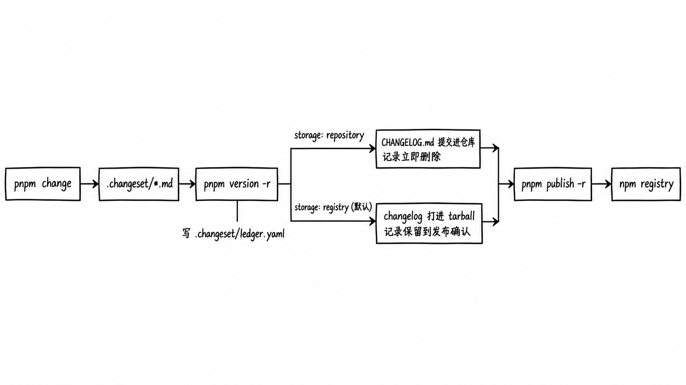

# pnpm 原生发版

## 摘要

pnpm 原生发版是 pnpm 11.13.0（2026-07-13）加入的 workspace 发版功能：不装 changesets，也能完成"记录变更 → 升版本 → 写 changelog → 发布"。变更记录沿用 changesets 的 `.changeset/*.md` 格式，配置写在 `pnpm-workspace.yaml` 的 `versioning` 下。它解决的是 monorepo 里多个包一起升版本、按 `workspace:` 依赖传播升级、写 changelog 这几件事；开版本 PR、打 tag、检查 PR 是否漏写记录不在它的范围内。

## 流程



1. 开发时运行 `pnpm change`，选择受影响的包、升级类型和一句说明，写出 `.changeset/<名字>.md`。格式和 changesets 相同，已有的 `.changeset/` 目录可以直接沿用。
2. `pnpm change status` 显示这些记录会产生的发版计划，例如 `@t/b: 0.19.0 → 0.19.1 (patch, via fixed)`。
3. 发版时运行 `pnpm version -r`：升级记录点名的包，沿 `workspace:` 依赖把升级传给依赖方，处理 fixed 分组，写 changelog，并把消费过的记录写进 `.changeset/ledger.yaml`。
4. `pnpm version -r` 不提交 git、不打 tag，理由是一次可能升好几个不同的版本，没有单一版本可标。提交由使用者自己做，再用 `pnpm publish -r` 发布；`pnpm publish -r` 会跳过 registry 上已有的版本。

## 配置

```yaml
versioning:
  fixed:
    - ['@example/cli', '@example/core']   # 组内包始终同一个版本
  ignore:
    - '@example/internal'                  # 永久不参与发版
  maxBump: minor                           # 一次发版最多升 minor
  changelog:
    storage: repository                    # 见下一节
```

- `fixed`：组内包取当前最高版本，按组内需要的最大升级幅度一起升。对应 Rush 的 lockstep 策略和 changesets 的 `fixed`。
- `maxBump`：在依赖传播和 fixed 分组处理之后的最终发版计划上生效，用来防止维护分支意外发出 minor。
- `lanes`、`epics`：分别用于单个包发预发布版本（`X.Y.Z-<lane>.N`），以及让一组包的大版本号跟随主包。
- 私有包（`"private": true`）从 12.7.0 起也会升版本，changelog 始终写进仓库里的 `CHANGELOG.md`。
- 从没发布过的包，11.16 起首发时直接用 manifest 里写的版本。

## changelog 存放：`versioning.changelog.storage`

| | `registry`（默认） | `repository` |
| --- | --- | --- |
| 仓库里的 `CHANGELOG.md` | 不提交 | 每个包一份，`pnpm version -r` 时把新条目加到开头 |
| changelog 在哪里能看到 | 发布时拼在上一个已发布版本的 changelog 前面，打进 npm tarball | 仓库、版本 PR 的 diff、npm tarball |
| `version -r` 之后的记录文件 | 保留，等 registry 确认已发布后由下一次 `version -r` 清理；另外生成 `.changeset/changelogs/` | 立即删除，只在 `ledger.yaml` 留记录 |

`registry` 模式适合同时维护多条发布分支的项目：没有每次都要改的 `CHANGELOG.md`，cherry-pick 和合回不会在 changelog 上冲突，changelog 只记录真正发布出去的版本。只有一条主分支、需要在版本 PR 里看 changelog 的仓库用 `repository`。

## 和 changesets 的区别

| 方面 | changesets | pnpm 原生发版 |
| --- | --- | --- |
| 变更记录 | `.changeset/*.md` | 同一格式 |
| changelog | 提交 `CHANGELOG.md`，格式可用 `@changesets/changelog-github` 等插件生成 PR 链接 | 默认不提交；只有内置格式，没有 PR 链接和作者 |
| 依赖方的 changelog | 写出升级了哪些依赖 | 实测只有版本标题，没有条目 |
| 检查 PR 是否漏写 | `changeset status --since=main`，缺记录时退出码 1 | 没有；`pnpm change check` 只校验已提交的版本号是否符合 `fixed` 和 `epics` |
| 版本 PR | changesets/action | 没有官方 Action |
| 打 tag | `changeset publish` 打 tag | 不打，要自己加一步 |
| 预发布 | pre 模式、snapshot | lanes；snapshot 还在设计中 |

## 使用限制

- **没有终端时无法用 `pnpm change` 写记录。** 实测 `pnpm --filter <pkg> change --bump patch --summary "..." -y` 报 "IO error: not a terminal"，CI 或 agent 里要直接写 `.changeset/*.md` 文件。
- **和 changesets/action 配合时必须用 `storage: repository`。** changesets/action 以 `.changeset/*.md` 是否存在判断"开版本 PR 还是发布"（`src/readChangesetState.ts`），而 `registry` 模式下记录文件在 `version -r` 后仍保留，action 会一直认为还有待发的版本。`repository` 模式下记录会删除，PR 描述也能从 `CHANGELOG.md` 取到条目；这种组合在 GitHub Actions 上的完整流程尚未验证。
- **CI 拦截漏写记录要另想办法**，例如保留 `@changesets/cli` 只跑 `changeset status --since`，或者自己写检查脚本。
- **功能还在频繁变化。** 发布后 12.4、12.6、12.7 都改过相关行为，pnpm 版本要固定在 11.13 以上的具体版本。

## 后续规划

设计文档 RFC 0006 里还有几项没有实现（2026-10-19）：

- 按 PR 的 diff 找出改动的包、缺记录就失败的 `pnpm change check`，对应 `rush change --verify`。
- `pnpm publish -r --snapshot [tag]` 预览发布。
- RFC 里尚未决定的选择：是否提供官方 Action、`pnpm version -r` 是否自己提交和打 tag、changelog 格式是否可插拔、是否从 conventional commits 生成记录。

## 相关页面

- [[wiki/comparisons/tooling/rush-vs-pnpm-workspace|Rush vs pnpm workspace]]
- [[wiki/topics/tooling/monorepo|Monorepo]]
- [[wiki/topics/tooling/npm-trusted-publishers|npm Trusted Publishers]]

## 来源指针

- [pnpm 文档：Release management](https://pnpm.io/versioning)、[Versioning Settings](https://pnpm.io/settings/versioning)
- [pnpm v11.13.0 release notes](https://github.com/pnpm/pnpm/releases/tag/v11.13.0)，以及 v12.4.0、v12.6.0、v12.7.0 的 release notes
- [pnpm/rfcs `text/0006-monorepo-versioning.md`](https://github.com/pnpm/rfcs/blob/main/text/0006-monorepo-versioning.md)
- changesets/action `src/readChangesetState.ts`、`src/run.ts`
- 实测记录与版本快照：[[raw/sources/rush-vs-pnpm-workspace]]
- 流程图由生图工具绘制，内容依据上述文档与实测记录，不是官方图。
